# ORBIT entity relationship diagrams

A proposed SQL Server design for the covered school workflows, not complete ORBIT database coverage.

**80 distinct tables · 734 columns · 246 ordered foreign-key definitions.** No database or SQL execution occurred.

Every FK appears once in the overall Mermaid source. Domain diagrams include every FK owned by their core tables, including cross-domain references; repeated external entities are context, not new tables. Smaller detail exports supplement the larger domains.

[Schema and full column/key definitions](Schema-Diagram.md). Fenced mermaid erDiagram blocks use standard GitHub-documented syntax. GitHub Preview has not been tested; large diagrams may exceed its renderer limits. Use the linked SVG/PNG fallbacks. Local renderer configuration cannot override GitHub limits.

Crow’s foot = many; circle = optional; bars = one. Solid lines mean the FK columns participate in the child primary key; dotted lines mean a non-identifying relationship. All child minimum cardinalities are zero because FKs do not require child records. A composite FK is **one** relationship, labelled with a short business role, stable ID and composite column count. Exact ordered pairs are listed below.

## ORBIT overall ER diagram — all 80 entities and 246 FK definitions

[Mermaid source](src/er-diagram.mmd) · [SVG fallback](svg/er-diagram.svg) · [PNG fallback](png/er-diagram.png)

Core entities: `AspNetUsers`, `AspNetRoles`, `AspNetUserRoles`, `AspNetUserClaims`, `AspNetRoleClaims`, `AspNetUserLogins`, `AspNetUserTokens`, `UserProfiles`, `Students`, `Teachers`, `SubjectCatalog`, `TeacherSubjects`, `TeacherGradeLevels`, `TeacherFacets`, `Schools`, `SchoolLevels`, `SchoolSubjects`, `SchoolRegistrationReviews`, `SchoolMemberships`, `MembershipPermissions`, `SchoolStudents`, `SchoolTeachers`, `AccountLinkRequests`, `AccountLinkHistory`, `AcademicYears`, `Grades`, `Sections`, `StudentEnrollments`, `EnrollmentPlacements`, `PromotionBatches`, `PromotionItems`, `PromotionItemHistory`, `TeachingAssignments`, `TeachingAssignmentHistory`, `WeeklySubjectRequirements`, `TeacherUnavailableSlots`, `Timetables`, `TimetableRevisions`, `TimetableCells`, `PublishedTimetableOccupancy`, `TimetableChangeRequests`, `Channels`, `ChannelSections`, `ChannelMemberships`, `ChannelInvitations`, `ChannelOwnershipHistory`, `Posts`, `PostSections`, `Files`, `PostAttachments`, `Assignments`, `Submissions`, `SubmissionVersions`, `SubmissionAttachments`, `Evaluations`, `ContentCorrectionRequests`, `CorrectionResponses`, `ModerationReports`, `PostModerationActions`, `Opportunities`, `OpportunityGradeLevels`, `OpportunitySkills`, `OpportunityStatusHistory`, `Applications`, `ApplicationFiles`, `ApplicationStatusHistory`, `Interviews`, `InterviewRescheduleRequests`, `InterviewHistory`, `SchoolEvents`, `SchoolEventSections`, `LearningMeetings`, `MeetingGroups`, `MeetingGroupMembers`, `MeetingRecipients`, `MeetingResources`, `Notifications`, `AuditEvents`, `OperationReceipts`, `OutboxMessages`.

```mermaid
erDiagram
  direction LR
  accTitle: ORBIT overall ER diagram — all 80 entities and 246 FK definitions
  accDescr: White background. External entities are marked external. Business relationship labels and stable FK IDs map to ordered source and referenced columns in the accompanying Markdown.
  AspNetUsers["AspNetUsers"]
  AspNetRoles["AspNetRoles"]
  AspNetUserRoles["AspNetUserRoles"]
  AspNetUserClaims["AspNetUserClaims"]
  AspNetRoleClaims["AspNetRoleClaims"]
  AspNetUserLogins["AspNetUserLogins"]
  AspNetUserTokens["AspNetUserTokens"]
  UserProfiles["UserProfiles"]
  Students["Students"]
  Teachers["Teachers"]
  SubjectCatalog["SubjectCatalog"]
  TeacherSubjects["TeacherSubjects"]
  TeacherGradeLevels["TeacherGradeLevels"]
  TeacherFacets["TeacherFacets"]
  Schools["Schools"]
  SchoolLevels["SchoolLevels"]
  SchoolSubjects["SchoolSubjects"]
  SchoolRegistrationReviews["SchoolRegistrationReviews"]
  SchoolMemberships["SchoolMemberships"]
  MembershipPermissions["MembershipPermissions"]
  SchoolStudents["SchoolStudents"]
  SchoolTeachers["SchoolTeachers"]
  AccountLinkRequests["AccountLinkRequests"]
  AccountLinkHistory["AccountLinkHistory"]
  AcademicYears["AcademicYears"]
  Grades["Grades"]
  Sections["Sections"]
  StudentEnrollments["StudentEnrollments"]
  EnrollmentPlacements["EnrollmentPlacements"]
  PromotionBatches["PromotionBatches"]
  PromotionItems["PromotionItems"]
  PromotionItemHistory["PromotionItemHistory"]
  TeachingAssignments["TeachingAssignments"]
  TeachingAssignmentHistory["TeachingAssignmentHistory"]
  WeeklySubjectRequirements["WeeklySubjectRequirements"]
  TeacherUnavailableSlots["TeacherUnavailableSlots"]
  Timetables["Timetables"]
  TimetableRevisions["TimetableRevisions"]
  TimetableCells["TimetableCells"]
  PublishedTimetableOccupancy["PublishedTimetableOccupancy"]
  TimetableChangeRequests["TimetableChangeRequests"]
  Channels["Channels"]
  ChannelSections["ChannelSections"]
  ChannelMemberships["ChannelMemberships"]
  ChannelInvitations["ChannelInvitations"]
  ChannelOwnershipHistory["ChannelOwnershipHistory"]
  Posts["Posts"]
  PostSections["PostSections"]
  Files["Files"]
  PostAttachments["PostAttachments"]
  Assignments["Assignments"]
  Submissions["Submissions"]
  SubmissionVersions["SubmissionVersions"]
  SubmissionAttachments["SubmissionAttachments"]
  Evaluations["Evaluations"]
  ContentCorrectionRequests["ContentCorrectionRequests"]
  CorrectionResponses["CorrectionResponses"]
  ModerationReports["ModerationReports"]
  PostModerationActions["PostModerationActions"]
  Opportunities["Opportunities"]
  OpportunityGradeLevels["OpportunityGradeLevels"]
  OpportunitySkills["OpportunitySkills"]
  OpportunityStatusHistory["OpportunityStatusHistory"]
  Applications["Applications"]
  ApplicationFiles["ApplicationFiles"]
  ApplicationStatusHistory["ApplicationStatusHistory"]
  Interviews["Interviews"]
  InterviewRescheduleRequests["InterviewRescheduleRequests"]
  InterviewHistory["InterviewHistory"]
  SchoolEvents["SchoolEvents"]
  SchoolEventSections["SchoolEventSections"]
  LearningMeetings["LearningMeetings"]
  MeetingGroups["MeetingGroups"]
  MeetingGroupMembers["MeetingGroupMembers"]
  MeetingRecipients["MeetingRecipients"]
  MeetingResources["MeetingResources"]
  Notifications["Notifications"]
  AuditEvents["AuditEvents"]
  OperationReceipts["OperationReceipts"]
  OutboxMessages["OutboxMessages"]
  AspNetUsers |o..o{ AspNetUsers : "provisions [FK001]"
  Schools |o..o{ AspNetUsers : "provisions account [FK002]"
  AspNetUsers ||--o{ AspNetUserRoles : "identifies [FK003]"
  AspNetRoles ||--o{ AspNetUserRoles : "grants role [FK004]"
  AspNetUsers ||..o{ AspNetUserClaims : "identifies [FK005]"
  AspNetRoles ||..o{ AspNetRoleClaims : "grants role [FK006]"
  AspNetUsers ||..o{ AspNetUserLogins : "identifies [FK007]"
  AspNetUsers ||--o{ AspNetUserTokens : "identifies [FK008]"
  AspNetUsers ||--o| UserProfiles : "identifies [FK009]"
  Files |o..o{ UserProfiles : "attaches file [FK010]"
  AspNetUsers |o..o| Students : "identifies [FK011]"
  AspNetUsers |o..o| Teachers : "identifies [FK012]"
  SubjectCatalog |o..o{ Teachers : "classifies subject [FK013]"
  Files |o..o{ Teachers : "attaches file [FK014]"
  Teachers ||--o{ TeacherSubjects : "describes teacher [FK015]"
  SubjectCatalog ||--o{ TeacherSubjects : "classifies subject [FK016]"
  Teachers ||--o{ TeacherGradeLevels : "describes teacher [FK017]"
  Teachers ||..o{ TeacherFacets : "describes teacher [FK018]"
  Files |o..o{ TeacherFacets : "attaches file [FK019]"
  Files |o..o{ Schools : "attaches file [FK020]"
  Schools ||--o{ SchoolLevels : "owns [FK021]"
  Schools ||..o{ SchoolSubjects : "offers subjects [FK022]"
  SubjectCatalog |o..o{ SchoolSubjects : "classifies subject [FK023]"
  Schools ||..o{ SchoolRegistrationReviews : "owns [FK024]"
  AspNetUsers ||..o{ SchoolRegistrationReviews : "requests [FK025]"
  AspNetUsers |o..o{ SchoolRegistrationReviews : "decides [FK026]"
  Schools ||..o{ SchoolMemberships : "has members [FK027]"
  AspNetUsers ||..o{ SchoolMemberships : "identifies [FK028]"
  Schools ||--o{ MembershipPermissions : "owns [FK029]"
  AspNetUsers ||..o{ MembershipPermissions : "grants [FK030]"
  SchoolMemberships ||--o{ MembershipPermissions : "grants permission [FK031] (2 cols)"
  Schools ||..o{ SchoolStudents : "registers students [FK032]"
  Students ||..o{ SchoolStudents : "identifies student [FK033]"
  Schools ||..o{ SchoolTeachers : "lists teachers [FK034]"
  Teachers ||..o{ SchoolTeachers : "describes teacher [FK035]"
  Schools ||..o{ AccountLinkRequests : "requests linking [FK036]"
  AspNetUsers ||..o{ AccountLinkRequests : "invited account [FK037]"
  AspNetUsers ||..o{ AccountLinkRequests : "requests [FK038]"
  AspNetUsers |o..o{ AccountLinkRequests : "verifies [FK039]"
  AspNetUsers |o..o{ AccountLinkRequests : "approves link [FK040]"
  SchoolStudents |o..o{ AccountLinkRequests : "enrolls student [FK041] (2 cols)"
  SchoolTeachers |o..o{ AccountLinkRequests : "assigns teacher [FK042] (2 cols)"
  Schools ||..o{ AccountLinkHistory : "owns [FK043]"
  AspNetUsers |o..o{ AccountLinkHistory : "previous account [FK044]"
  AspNetUsers ||..o{ AccountLinkHistory : "linked account [FK045]"
  AspNetUsers ||..o{ AccountLinkHistory : "performs [FK046]"
  SchoolStudents |o..o{ AccountLinkHistory : "enrolls student [FK047] (2 cols)"
  SchoolTeachers |o..o{ AccountLinkHistory : "assigns teacher [FK048] (2 cols)"
  AccountLinkRequests |o..o{ AccountLinkHistory : "records link [FK049] (2 cols)"
  Schools ||..o{ AcademicYears : "defines years [FK050]"
  Schools ||..o{ Grades : "offers grades [FK051]"
  Schools ||..o{ Sections : "owns [FK052]"
  AcademicYears ||..o{ Sections : "scopes year [FK053] (2 cols)"
  Grades ||..o{ Sections : "groups grade [FK054] (2 cols)"
  Schools ||..o{ StudentEnrollments : "owns [FK055]"
  AcademicYears ||..o{ StudentEnrollments : "scopes year [FK056] (2 cols)"
  SchoolStudents ||..o{ StudentEnrollments : "enrolls student [FK057] (3 cols)"
  Schools ||..o{ EnrollmentPlacements : "owns [FK058]"
  AcademicYears ||..o{ EnrollmentPlacements : "scopes year [FK059] (2 cols)"
  AspNetUsers ||..o{ EnrollmentPlacements : "performs [FK060]"
  StudentEnrollments ||..o{ EnrollmentPlacements : "has placements [FK061] (3 cols)"
  Sections ||..o{ EnrollmentPlacements : "places students [FK062] (3 cols)"
  EnrollmentPlacements |o..o{ EnrollmentPlacements : "precedes placement [FK063] (4 cols)"
  Schools ||..o{ PromotionBatches : "owns [FK064]"
  AspNetUsers |o..o{ PromotionBatches : "confirms [FK065]"
  AcademicYears ||..o{ PromotionBatches : "source year [FK066] (2 cols)"
  AcademicYears ||..o{ PromotionBatches : "target year [FK067] (2 cols)"
  Schools ||..o{ PromotionItems : "owns [FK068]"
  AspNetUsers |o..o{ PromotionItems : "reviews [FK069]"
  AcademicYears ||..o{ PromotionItems : "source year [FK070] (2 cols)"
  AcademicYears ||..o{ PromotionItems : "target year [FK071] (2 cols)"
  PromotionBatches ||..o{ PromotionItems : "reviews promotion [FK072] (4 cols)"
  StudentEnrollments ||..o{ PromotionItems : "source enrollment [FK073] (4 cols)"
  Sections |o..o{ PromotionItems : "target section [FK074] (3 cols)"
  StudentEnrollments |o..o{ PromotionItems : "result enrollment [FK075] (4 cols)"
  Schools ||..o{ PromotionItemHistory : "owns [FK076]"
  AspNetUsers ||..o{ PromotionItemHistory : "performs [FK077]"
  PromotionItems ||..o{ PromotionItemHistory : "records review [FK078] (3 cols)"
  Sections |o..o{ PromotionItemHistory : "target section [FK079] (3 cols)"
  Schools ||..o{ TeachingAssignments : "owns [FK080]"
  AcademicYears ||..o{ TeachingAssignments : "scopes year [FK081] (2 cols)"
  Sections ||..o{ TeachingAssignments : "groups section [FK082] (3 cols)"
  SchoolSubjects ||..o{ TeachingAssignments : "teaches subject [FK083] (2 cols)"
  SchoolTeachers ||..o{ TeachingAssignments : "assigns teacher [FK084] (2 cols)"
  Schools ||..o{ TeachingAssignmentHistory : "owns [FK085]"
  AcademicYears ||..o{ TeachingAssignmentHistory : "scopes year [FK086] (2 cols)"
  AspNetUsers ||..o{ TeachingAssignmentHistory : "performs [FK087]"
  TeachingAssignments ||..o{ TeachingAssignmentHistory : "records allocation [FK088] (3 cols)"
  TeachingAssignments |o..o{ TeachingAssignmentHistory : "replaces allocation [FK089] (3 cols)"
  Schools ||--o{ WeeklySubjectRequirements : "owns [FK090]"
  AcademicYears ||--o{ WeeklySubjectRequirements : "scopes year [FK091] (2 cols)"
  AspNetUsers ||..o{ WeeklySubjectRequirements : "updates [FK092]"
  Grades ||--o{ WeeklySubjectRequirements : "groups grade [FK093] (2 cols)"
  SchoolSubjects ||--o{ WeeklySubjectRequirements : "teaches subject [FK094] (2 cols)"
  Schools ||--o{ TeacherUnavailableSlots : "owns [FK095]"
  AcademicYears ||--o{ TeacherUnavailableSlots : "scopes year [FK096] (2 cols)"
  AspNetUsers ||..o{ TeacherUnavailableSlots : "updates [FK097]"
  SchoolTeachers ||--o{ TeacherUnavailableSlots : "assigns teacher [FK098] (2 cols)"
  Schools ||..o{ Timetables : "owns [FK099]"
  AcademicYears ||..o{ Timetables : "scopes year [FK100] (2 cols)"
  Sections ||..o| Timetables : "groups section [FK101] (3 cols)"
  TimetableRevisions |o..o| Timetables : "current draft [FK102] (5 cols)"
  TimetableRevisions |o..o| Timetables : "published version [FK103] (5 cols)"
  Schools ||..o{ TimetableRevisions : "owns [FK104]"
  AcademicYears ||..o{ TimetableRevisions : "scopes year [FK105] (2 cols)"
  AspNetUsers ||..o{ TimetableRevisions : "saves revision [FK106]"
  AspNetUsers |o..o{ TimetableRevisions : "publishes [FK107]"
  Timetables ||..o{ TimetableRevisions : "has revisions [FK108] (4 cols)"
  Schools ||..o{ TimetableCells : "owns [FK109]"
  AcademicYears ||..o{ TimetableCells : "scopes year [FK110] (2 cols)"
  TimetableRevisions ||..o{ TimetableCells : "contains cells [FK111] (4 cols)"
  TeachingAssignments ||..o{ TimetableCells : "schedules lesson [FK112] (6 cols)"
  ChannelSections |o..o{ TimetableCells : "targets section [FK113] (5 cols)"
  Schools ||--o{ PublishedTimetableOccupancy : "owns [FK114]"
  AcademicYears ||--o{ PublishedTimetableOccupancy : "scopes year [FK115] (2 cols)"
  Sections ||--o{ PublishedTimetableOccupancy : "groups section [FK116] (3 cols)"
  TimetableCells ||..o| PublishedTimetableOccupancy : "reserves slot [FK117] (7 cols)"
  Schools ||..o{ TimetableChangeRequests : "owns [FK118]"
  AcademicYears ||..o{ TimetableChangeRequests : "scopes year [FK119] (2 cols)"
  AspNetUsers ||..o{ TimetableChangeRequests : "requests [FK120]"
  AspNetUsers |o..o{ TimetableChangeRequests : "decides [FK121]"
  TimetableCells ||..o{ TimetableChangeRequests : "requests move [FK122] (3 cols)"
  TimetableRevisions |o..o{ TimetableChangeRequests : "approved revision [FK123] (3 cols)"
  Schools |o..o{ Channels : "owns [FK124]"
  AcademicYears |o..o{ Channels : "scopes year [FK125] (2 cols)"
  AspNetUsers ||..o{ Channels : "owns [FK126]"
  SchoolSubjects |o..o{ Channels : "teaches subject [FK127] (2 cols)"
  SubjectCatalog |o..o{ Channels : "classifies subject [FK128]"
  Files |o..o{ Channels : "attaches file [FK129]"
  Schools ||--o{ ChannelSections : "owns [FK130]"
  AcademicYears ||--o{ ChannelSections : "scopes year [FK131] (2 cols)"
  Channels ||..o{ ChannelSections : "contains activity [FK132] (4 cols)"
  Sections ||--o{ ChannelSections : "groups section [FK133] (3 cols)"
  AspNetUsers ||--o{ ChannelMemberships : "identifies [FK134]"
  Channels ||--o{ ChannelMemberships : "contains activity [FK135]"
  AspNetUsers ||..o{ ChannelInvitations : "creates [FK136]"
  Channels ||..o{ ChannelInvitations : "contains activity [FK137]"
  AspNetUsers ||..o{ ChannelOwnershipHistory : "previous account [FK138]"
  AspNetUsers ||..o{ ChannelOwnershipHistory : "linked account [FK139]"
  AspNetUsers ||..o{ ChannelOwnershipHistory : "performs [FK140]"
  Channels ||..o{ ChannelOwnershipHistory : "contains activity [FK141]"
  AspNetUsers ||..o{ Posts : "authors [FK142]"
  AspNetUsers |o..o{ Posts : "removes access [FK143]"
  Channels ||..o{ Posts : "contains activity [FK144]"
  Files |o..o{ Posts : "attaches file [FK145]"
  Schools ||..o{ PostSections : "owns [FK146]"
  AcademicYears ||..o{ PostSections : "scopes year [FK147] (2 cols)"
  Posts ||..o{ PostSections : "targets content [FK148] (2 cols)"
  ChannelSections ||..o{ PostSections : "targets section [FK149] (5 cols)"
  AspNetUsers ||..o{ Files : "uploads [FK150]"
  Posts ||--o{ PostAttachments : "targets content [FK151]"
  Files ||--o{ PostAttachments : "attaches file [FK152]"
  Posts ||--o| Assignments : "defines assignment [FK153]"
  Assignments ||..o{ Submissions : "receives submissions [FK154]"
  Students ||..o{ Submissions : "identifies student [FK155]"
  Schools |o..o{ SubmissionVersions : "owns [FK156]"
  AcademicYears |o..o{ SubmissionVersions : "scopes year [FK157] (2 cols)"
  AspNetUsers ||..o{ SubmissionVersions : "submits [FK158]"
  Submissions ||..o{ SubmissionVersions : "has versions [FK159] (2 cols)"
  EnrollmentPlacements |o..o{ SubmissionVersions : "records placement [FK160] (4 cols)"
  EnrollmentPlacements |o..o{ SubmissionVersions : "records placement [FK161] (4 cols)"
  PostSections |o..o{ SubmissionVersions : "targets submission [FK162] (4 cols)"
  SubmissionVersions ||--o{ SubmissionAttachments : "records answer [FK163]"
  Files ||--o{ SubmissionAttachments : "attaches file [FK164]"
  AspNetUsers ||..o{ Evaluations : "evaluates [FK165]"
  SubmissionVersions ||..o{ Evaluations : "records answer [FK166]"
  Schools ||..o{ ContentCorrectionRequests : "owns [FK167]"
  AcademicYears ||..o{ ContentCorrectionRequests : "scopes year [FK168] (2 cols)"
  AspNetUsers ||..o{ ContentCorrectionRequests : "corrects content [FK169]"
  AspNetUsers ||..o{ ContentCorrectionRequests : "requests [FK170]"
  Channels ||..o{ ContentCorrectionRequests : "contains activity [FK171] (3 cols)"
  Posts ||..o{ ContentCorrectionRequests : "targets content [FK172] (2 cols)"
  Schools ||..o{ CorrectionResponses : "owns [FK173]"
  AcademicYears ||..o{ CorrectionResponses : "scopes year [FK174] (2 cols)"
  AspNetUsers ||..o{ CorrectionResponses : "performs [FK175]"
  ContentCorrectionRequests ||..o{ CorrectionResponses : "has responses [FK176] (3 cols)"
  AspNetUsers |o..o{ ModerationReports : "reports [FK177]"
  AspNetUsers |o..o{ ModerationReports : "is reported [FK178]"
  AspNetUsers |o..o{ ModerationReports : "resolves [FK179]"
  Posts |o..o{ ModerationReports : "targets content [FK180]"
  Schools |o..o{ PostModerationActions : "owns [FK181]"
  AcademicYears |o..o{ PostModerationActions : "scopes year [FK182] (2 cols)"
  AspNetUsers ||..o{ PostModerationActions : "performs [FK183]"
  Posts ||..o{ PostModerationActions : "targets content [FK184]"
  ModerationReports |o..o{ PostModerationActions : "records moderation [FK185]"
  Schools ||..o{ Opportunities : "advertises [FK186]"
  AspNetUsers ||..o{ Opportunities : "creates [FK187]"
  SubjectCatalog ||..o{ Opportunities : "classifies subject [FK188]"
  Schools ||--o{ OpportunityGradeLevels : "owns [FK189]"
  Opportunities ||--o{ OpportunityGradeLevels : "receives applications [FK190] (2 cols)"
  Schools ||--o{ OpportunitySkills : "owns [FK191]"
  Opportunities ||--o{ OpportunitySkills : "receives applications [FK192] (2 cols)"
  Schools ||..o{ OpportunityStatusHistory : "owns [FK193]"
  AspNetUsers ||..o{ OpportunityStatusHistory : "performs [FK194]"
  Opportunities ||..o{ OpportunityStatusHistory : "receives applications [FK195] (2 cols)"
  Schools ||..o{ Applications : "owns [FK196]"
  AspNetUsers ||..o{ Applications : "consents [FK197]"
  Opportunities ||..o{ Applications : "receives applications [FK198] (2 cols)"
  Teachers ||..o{ Applications : "applies [FK199]"
  Schools ||--o{ ApplicationFiles : "owns [FK200]"
  Applications ||--o{ ApplicationFiles : "records application [FK201] (2 cols)"
  Files ||--o{ ApplicationFiles : "attaches file [FK202]"
  Schools ||..o{ ApplicationStatusHistory : "owns [FK203]"
  AspNetUsers ||..o{ ApplicationStatusHistory : "performs [FK204]"
  Applications ||..o{ ApplicationStatusHistory : "records application [FK205] (2 cols)"
  Interviews |o..o{ ApplicationStatusHistory : "supports decision [FK206] (3 cols)"
  Schools ||..o{ Interviews : "owns [FK207]"
  AspNetUsers |o..o{ Interviews : "completes [FK208]"
  AspNetUsers |o..o{ Interviews : "cancels [FK209]"
  AspNetUsers ||..o{ Interviews : "creates [FK210]"
  Applications ||..o{ Interviews : "schedules attempts [FK211] (3 cols)"
  Schools ||..o{ InterviewRescheduleRequests : "owns [FK212]"
  AspNetUsers ||..o{ InterviewRescheduleRequests : "requests [FK213]"
  AspNetUsers |o..o{ InterviewRescheduleRequests : "decides [FK214]"
  Interviews ||..o{ InterviewRescheduleRequests : "receives proposals [FK215] (2 cols)"
  Schools ||..o{ InterviewHistory : "owns [FK216]"
  AspNetUsers ||..o{ InterviewHistory : "performs [FK217]"
  Interviews ||..o{ InterviewHistory : "records events [FK218] (2 cols)"
  InterviewRescheduleRequests |o..o{ InterviewHistory : "records proposal [FK219] (3 cols)"
  Schools ||..o{ SchoolEvents : "hosts [FK220]"
  AcademicYears |o..o{ SchoolEvents : "scopes year [FK221] (2 cols)"
  AspNetUsers ||..o{ SchoolEvents : "creates [FK222]"
  Schools ||--o{ SchoolEventSections : "owns [FK223]"
  AcademicYears ||--o{ SchoolEventSections : "scopes year [FK224] (2 cols)"
  SchoolEvents ||--o{ SchoolEventSections : "targets audience [FK225] (3 cols)"
  Sections ||--o{ SchoolEventSections : "groups section [FK226] (3 cols)"
  AspNetUsers ||..o{ LearningMeetings : "organizes [FK227]"
  Channels ||..o{ LearningMeetings : "contains activity [FK228]"
  MeetingGroups |o..o{ LearningMeetings : "selects audience [FK229] (2 cols)"
  AspNetUsers ||..o{ MeetingGroups : "owns [FK230]"
  Channels ||..o{ MeetingGroups : "contains activity [FK231]"
  AspNetUsers ||--o{ MeetingGroupMembers : "identifies [FK232]"
  MeetingGroups ||--o{ MeetingGroupMembers : "selects audience [FK233]"
  AspNetUsers ||--o{ MeetingRecipients : "identifies [FK234]"
  LearningMeetings ||--o{ MeetingRecipients : "invites audience [FK235]"
  LearningMeetings ||--o{ MeetingResources : "invites audience [FK236]"
  Schools |o..o{ Notifications : "owns [FK237]"
  AspNetUsers ||..o{ Notifications : "receives [FK238]"
  Posts |o..o{ Notifications : "targets content [FK239]"
  LearningMeetings |o..o{ Notifications : "invites audience [FK240]"
  Applications |o..o{ Notifications : "records application [FK241] (2 cols)"
  Interviews |o..o{ Notifications : "receives proposals [FK242] (2 cols)"
  SchoolEvents |o..o{ Notifications : "targets audience [FK243] (2 cols)"
  Schools |o..o{ AuditEvents : "owns [FK244]"
  AspNetUsers |o..o{ AuditEvents : "performs [FK245]"
  AspNetUsers ||..o{ OperationReceipts : "performs [FK246]"
```

## ORBIT ER — Identity

[Mermaid source](src/er-identity.mmd) · [SVG fallback](svg/er-identity.svg) · [PNG fallback](png/er-identity.png)

Core entities: `AspNetUsers`, `AspNetRoles`, `AspNetUserRoles`, `AspNetUserClaims`, `AspNetRoleClaims`, `AspNetUserLogins`, `AspNetUserTokens`.

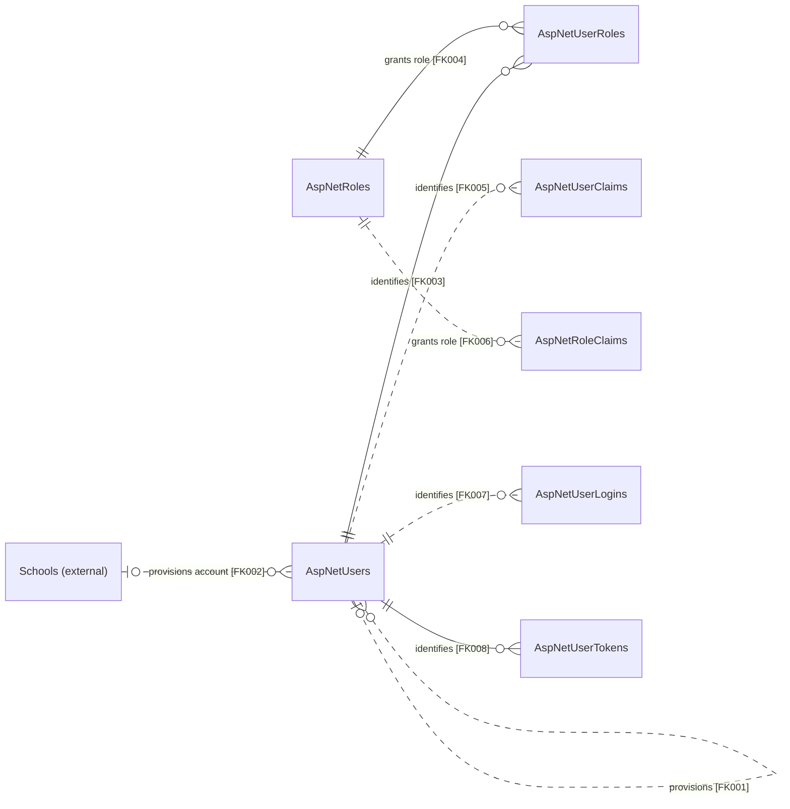

## ORBIT ER — People & schools

[Mermaid source](src/er-people.mmd) · [SVG fallback](svg/er-people.svg) · [PNG fallback](png/er-people.png)

Core entities: `UserProfiles`, `Students`, `Teachers`, `SubjectCatalog`, `TeacherSubjects`, `TeacherGradeLevels`, `TeacherFacets`, `Schools`, `SchoolLevels`, `SchoolSubjects`, `SchoolRegistrationReviews`, `SchoolMemberships`, `MembershipPermissions`, `SchoolStudents`, `SchoolTeachers`, `AccountLinkRequests`, `AccountLinkHistory`.

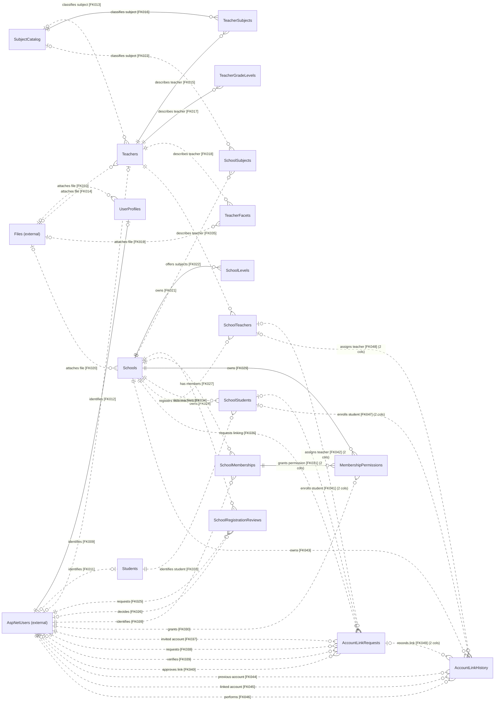

## ORBIT ER — People & schools — detail 1

[Mermaid source](src/er-people-detail-1.mmd) · [SVG fallback](svg/er-people-detail-1.svg) · [PNG fallback](png/er-people-detail-1.png)

Core entities: `UserProfiles`, `Students`, `Teachers`, `SubjectCatalog`.

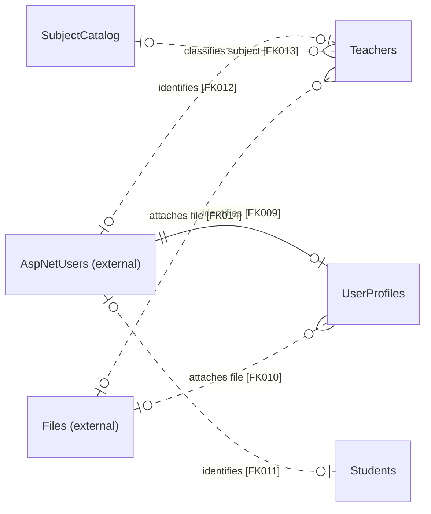

## ORBIT ER — People & schools — detail 2

[Mermaid source](src/er-people-detail-2.mmd) · [SVG fallback](svg/er-people-detail-2.svg) · [PNG fallback](png/er-people-detail-2.png)

Core entities: `TeacherSubjects`, `TeacherGradeLevels`, `TeacherFacets`, `Schools`.

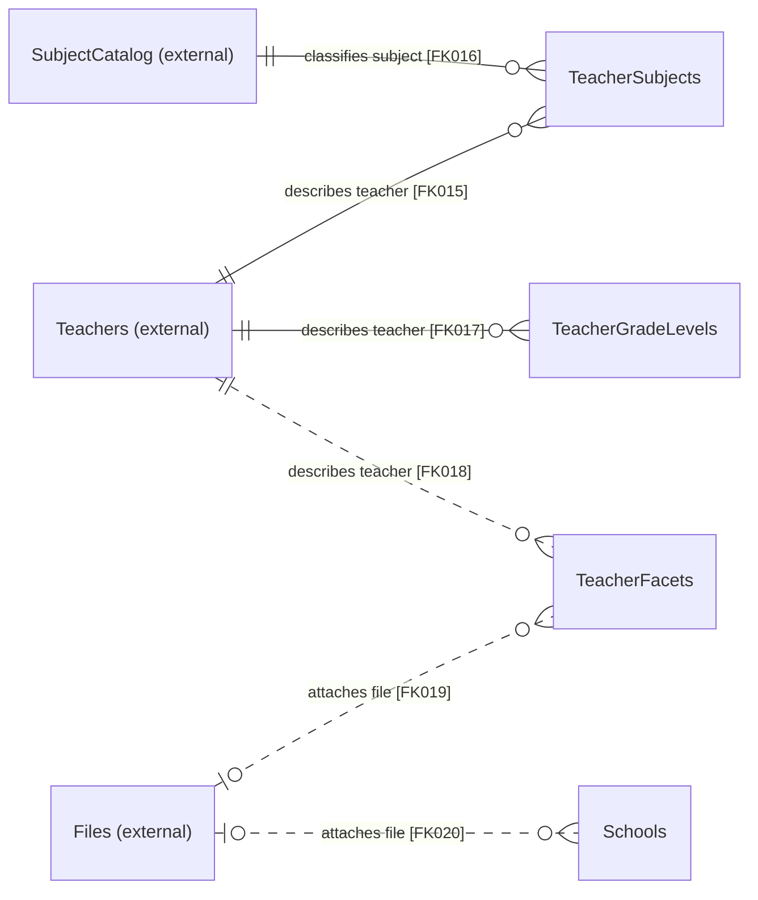

## ORBIT ER — People & schools — detail 3

[Mermaid source](src/er-people-detail-3.mmd) · [SVG fallback](svg/er-people-detail-3.svg) · [PNG fallback](png/er-people-detail-3.png)

Core entities: `SchoolLevels`, `SchoolSubjects`, `SchoolRegistrationReviews`, `SchoolMemberships`.

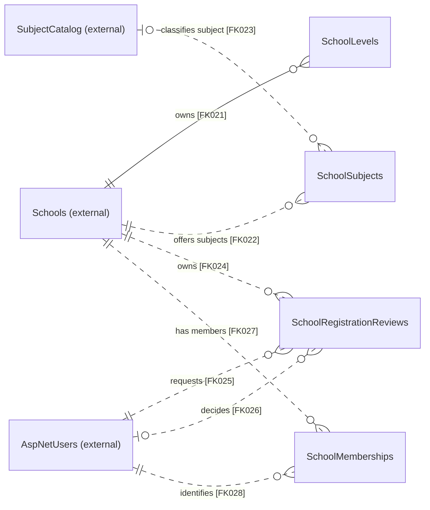

## ORBIT ER — People & schools — detail 4

[Mermaid source](src/er-people-detail-4.mmd) · [SVG fallback](svg/er-people-detail-4.svg) · [PNG fallback](png/er-people-detail-4.png)

Core entities: `MembershipPermissions`, `SchoolStudents`, `SchoolTeachers`, `AccountLinkRequests`.

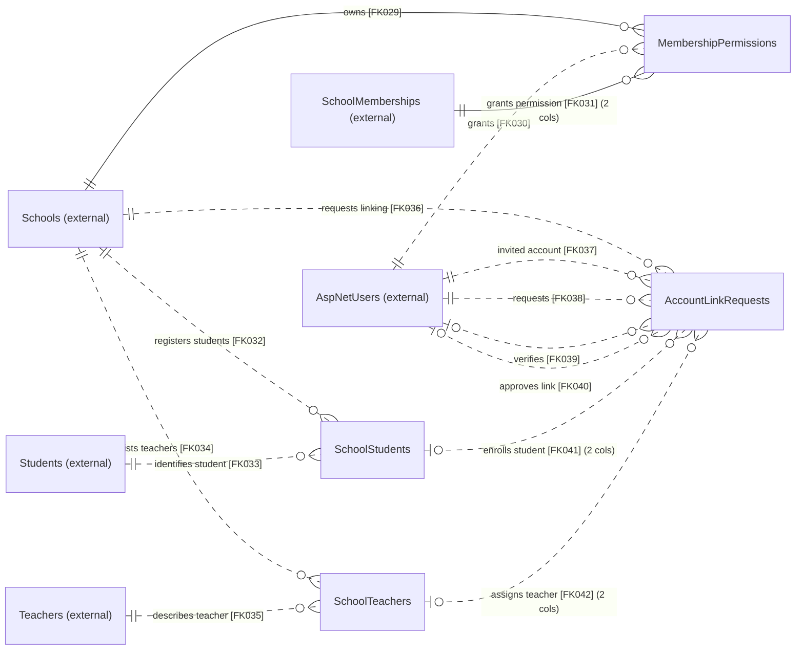

## ORBIT ER — People & schools — detail 5

[Mermaid source](src/er-people-detail-5.mmd) · [SVG fallback](svg/er-people-detail-5.svg) · [PNG fallback](png/er-people-detail-5.png)

Core entities: `AccountLinkHistory`.

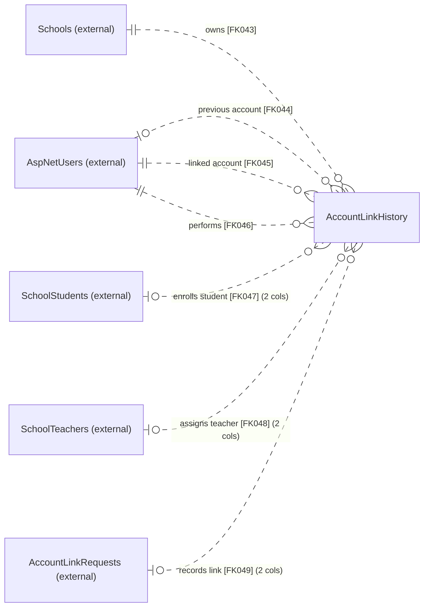

## ORBIT ER — Annual academics

[Mermaid source](src/er-academics.mmd) · [SVG fallback](svg/er-academics.svg) · [PNG fallback](png/er-academics.png)

Core entities: `AcademicYears`, `Grades`, `Sections`, `StudentEnrollments`, `EnrollmentPlacements`, `PromotionBatches`, `PromotionItems`, `PromotionItemHistory`.

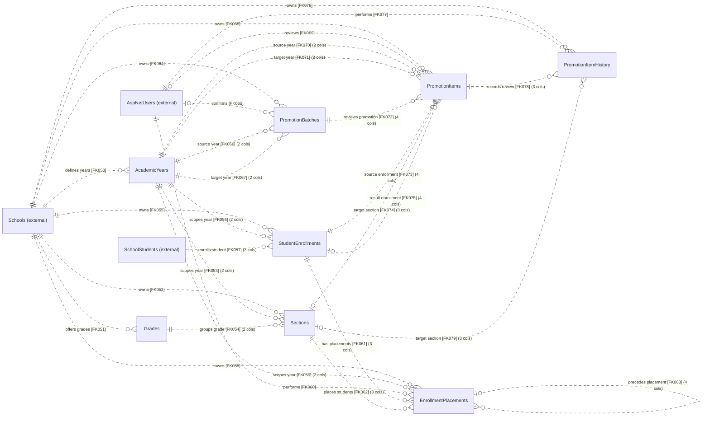

## ORBIT ER — Teaching & timetables

[Mermaid source](src/er-teaching.mmd) · [SVG fallback](svg/er-teaching.svg) · [PNG fallback](png/er-teaching.png)

Core entities: `TeachingAssignments`, `TeachingAssignmentHistory`, `WeeklySubjectRequirements`, `TeacherUnavailableSlots`, `Timetables`, `TimetableRevisions`, `TimetableCells`, `PublishedTimetableOccupancy`, `TimetableChangeRequests`.

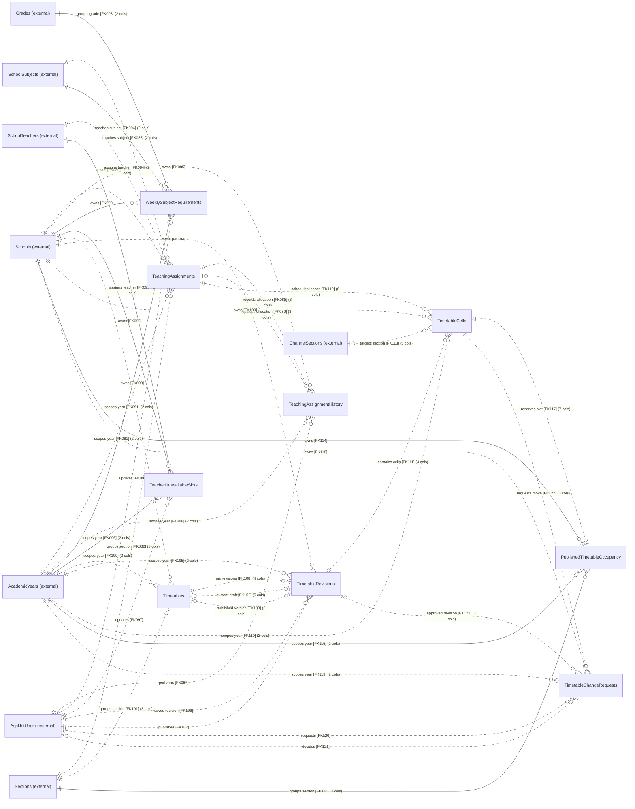

## ORBIT ER — Channels & learning

[Mermaid source](src/er-content.mmd) · [SVG fallback](svg/er-content.svg) · [PNG fallback](png/er-content.png)

Core entities: `Channels`, `ChannelSections`, `ChannelMemberships`, `ChannelInvitations`, `ChannelOwnershipHistory`, `Posts`, `PostSections`, `Files`, `PostAttachments`, `Assignments`, `Submissions`, `SubmissionVersions`, `SubmissionAttachments`, `Evaluations`.

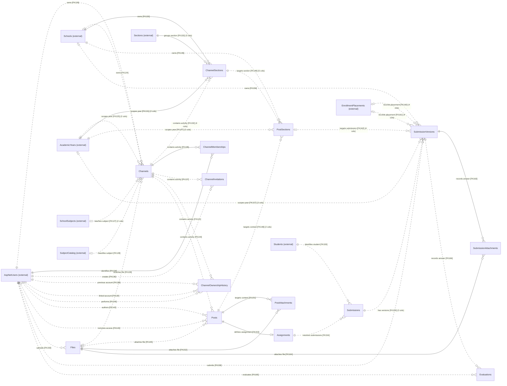

## ORBIT ER — Channels & learning — detail 1

[Mermaid source](src/er-content-detail-1.mmd) · [SVG fallback](svg/er-content-detail-1.svg) · [PNG fallback](png/er-content-detail-1.png)

Core entities: `Channels`, `ChannelSections`, `ChannelMemberships`, `ChannelInvitations`.

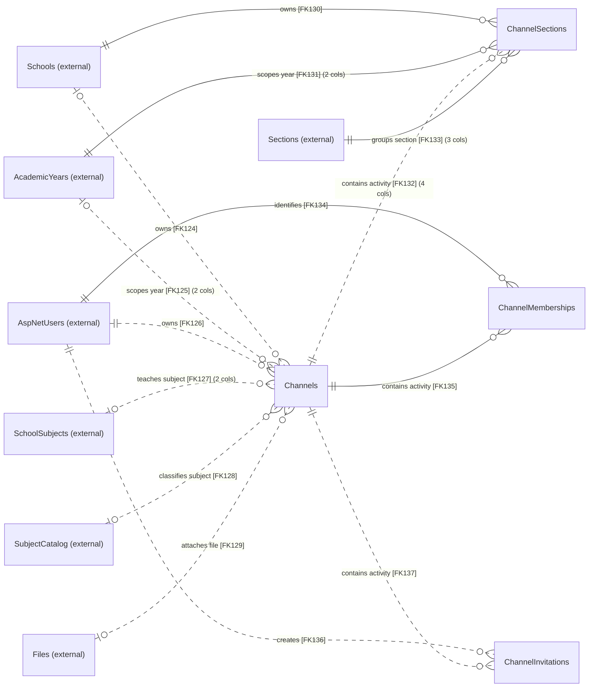

## ORBIT ER — Channels & learning — detail 2

[Mermaid source](src/er-content-detail-2.mmd) · [SVG fallback](svg/er-content-detail-2.svg) · [PNG fallback](png/er-content-detail-2.png)

Core entities: `ChannelOwnershipHistory`, `Posts`, `PostSections`, `Files`.

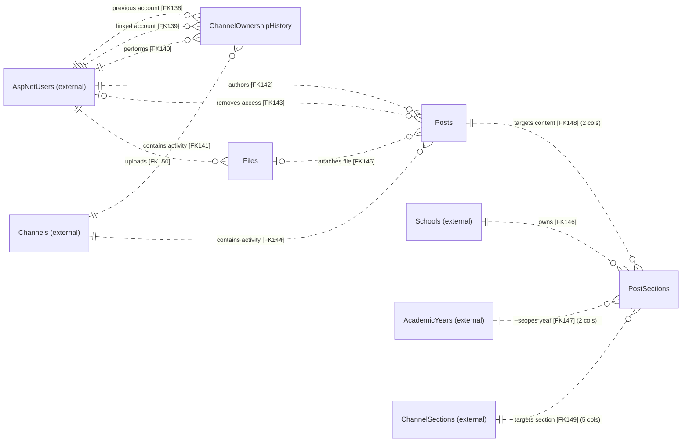

## ORBIT ER — Channels & learning — detail 3

[Mermaid source](src/er-content-detail-3.mmd) · [SVG fallback](svg/er-content-detail-3.svg) · [PNG fallback](png/er-content-detail-3.png)

Core entities: `PostAttachments`, `Assignments`, `Submissions`, `SubmissionVersions`.

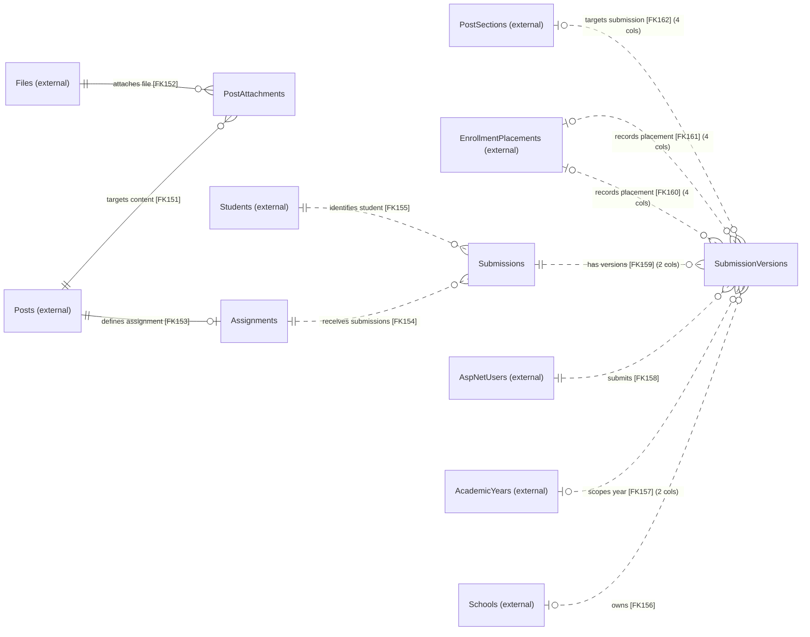

## ORBIT ER — Channels & learning — detail 4

[Mermaid source](src/er-content-detail-4.mmd) · [SVG fallback](svg/er-content-detail-4.svg) · [PNG fallback](png/er-content-detail-4.png)

Core entities: `SubmissionAttachments`, `Evaluations`.

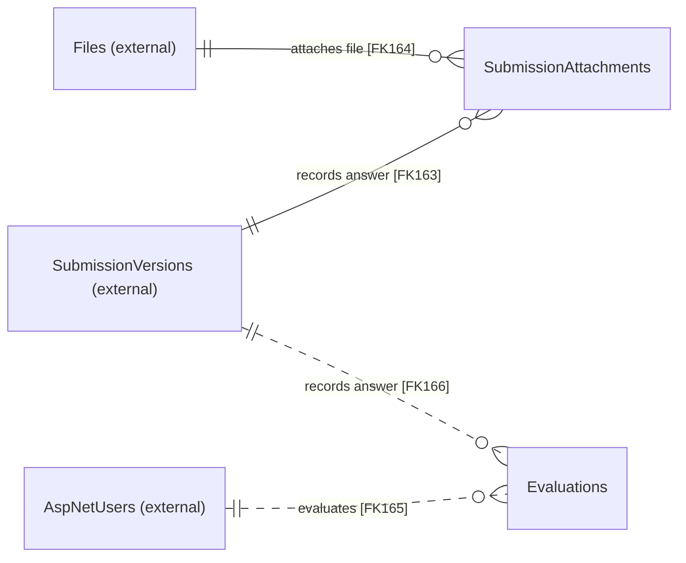

## ORBIT ER — Monitoring & moderation

[Mermaid source](src/er-moderation.mmd) · [SVG fallback](svg/er-moderation.svg) · [PNG fallback](png/er-moderation.png)

Core entities: `ContentCorrectionRequests`, `CorrectionResponses`, `ModerationReports`, `PostModerationActions`.

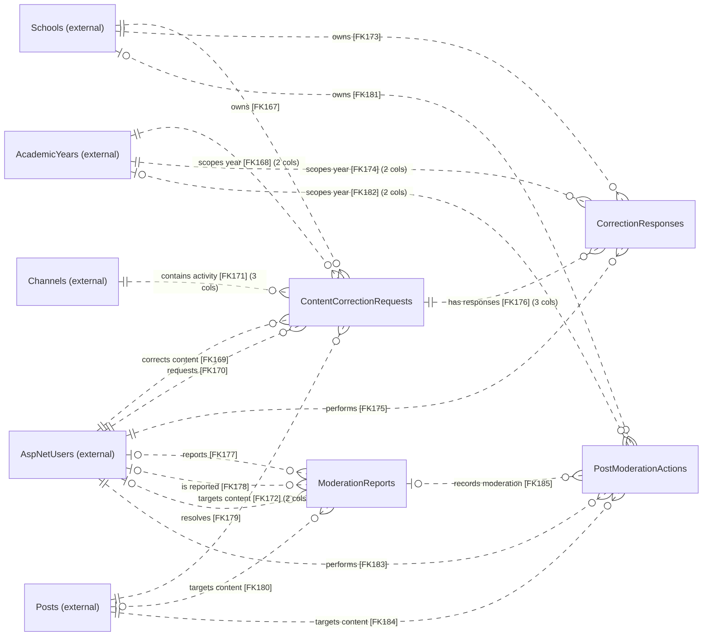

## ORBIT ER — Recruitment

[Mermaid source](src/er-recruitment.mmd) · [SVG fallback](svg/er-recruitment.svg) · [PNG fallback](png/er-recruitment.png)

Core entities: `Opportunities`, `OpportunityGradeLevels`, `OpportunitySkills`, `OpportunityStatusHistory`, `Applications`, `ApplicationFiles`, `ApplicationStatusHistory`, `Interviews`, `InterviewRescheduleRequests`, `InterviewHistory`.

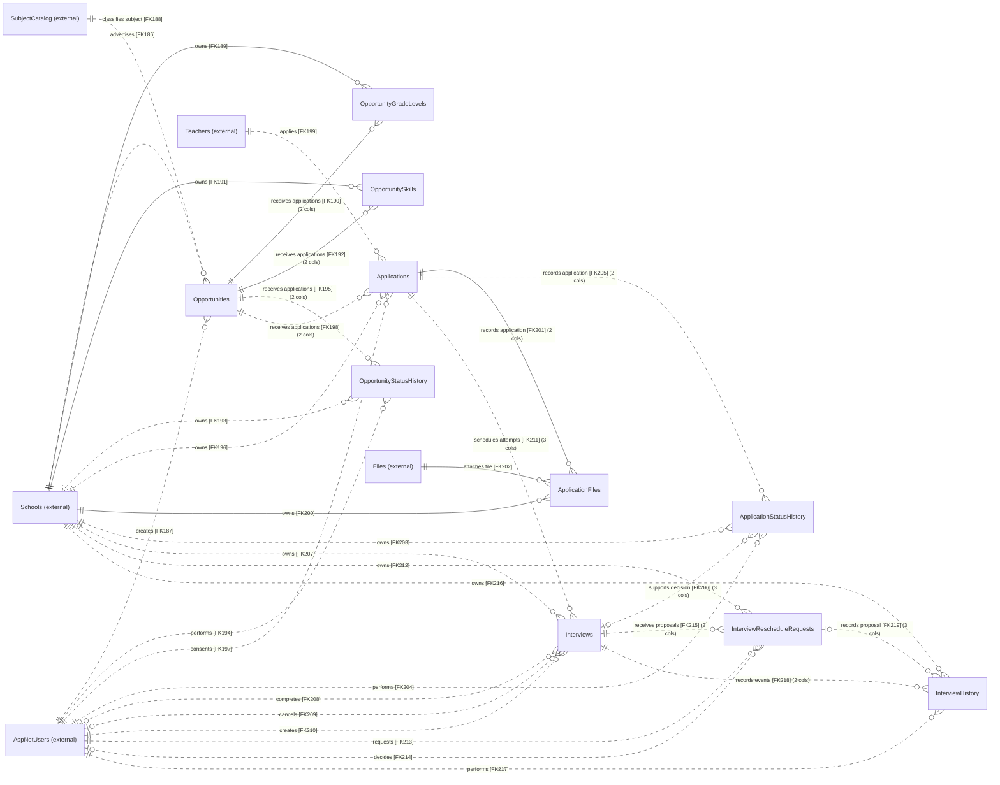

## ORBIT ER — Events & delivery

[Mermaid source](src/er-events.mmd) · [SVG fallback](svg/er-events.svg) · [PNG fallback](png/er-events.png)

Core entities: `SchoolEvents`, `SchoolEventSections`, `LearningMeetings`, `MeetingGroups`, `MeetingGroupMembers`, `MeetingRecipients`, `MeetingResources`, `Notifications`, `AuditEvents`, `OperationReceipts`, `OutboxMessages`.

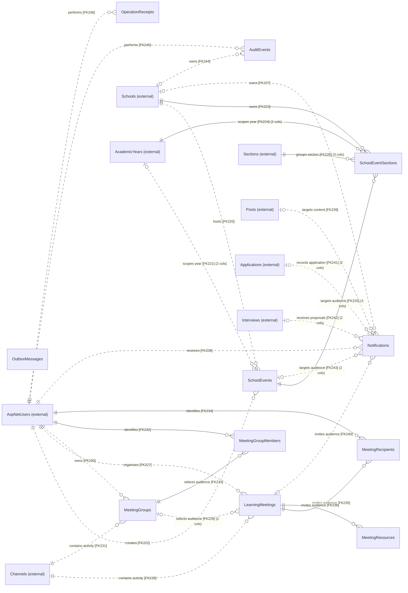

## ORBIT ER — Events & delivery — detail 1

[Mermaid source](src/er-events-detail-1.mmd) · [SVG fallback](svg/er-events-detail-1.svg) · [PNG fallback](png/er-events-detail-1.png)

Core entities: `SchoolEvents`, `SchoolEventSections`, `LearningMeetings`, `MeetingGroups`.

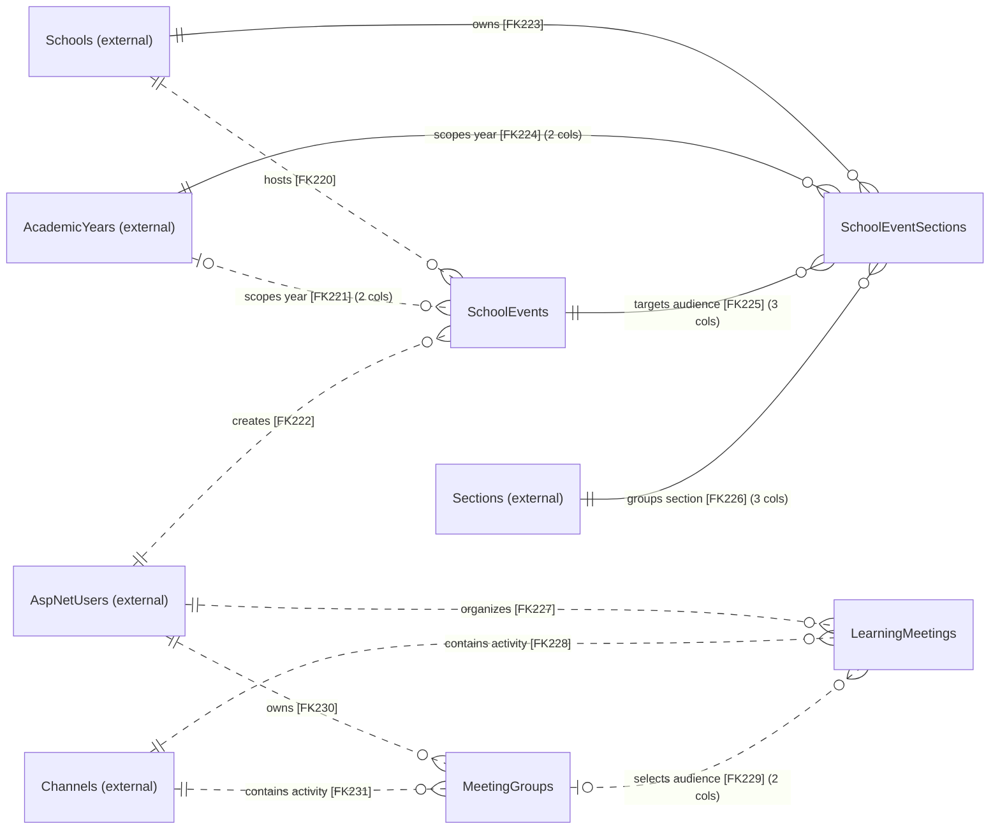

## ORBIT ER — Events & delivery — detail 2

[Mermaid source](src/er-events-detail-2.mmd) · [SVG fallback](svg/er-events-detail-2.svg) · [PNG fallback](png/er-events-detail-2.png)

Core entities: `MeetingGroupMembers`, `MeetingRecipients`, `MeetingResources`, `Notifications`.

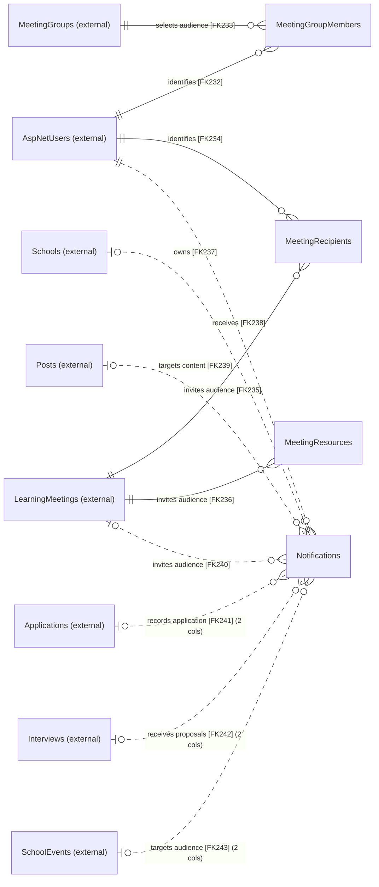

## ORBIT ER — Events & delivery — detail 3

[Mermaid source](src/er-events-detail-3.mmd) · [SVG fallback](svg/er-events-detail-3.svg) · [PNG fallback](png/er-events-detail-3.png)

Core entities: `AuditEvents`, `OperationReceipts`, `OutboxMessages`.

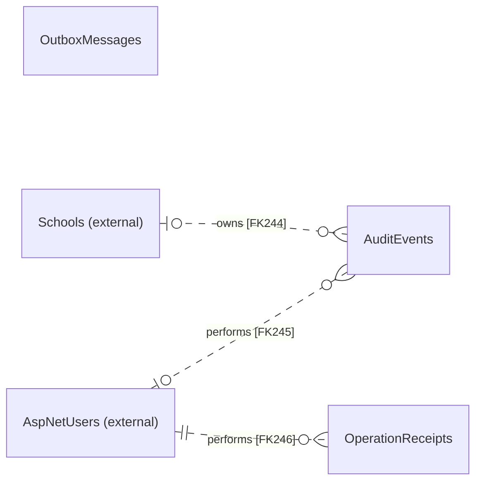

## Complete foreign-key registry

| ID | Constraint | Source columns (ordered) | Referenced columns (ordered) |
|---|---|---|---|
| FK001 | FK_AspNetUsers_AspNetUsers_1 | AspNetUsers (ProvisionedById) | AspNetUsers (Id) |
| FK002 | FK_AspNetUsers_Schools_2 | AspNetUsers (ProvisionedSchoolId) | Schools (Id) |
| FK003 | FK_AspNetUserRoles_AspNetUsers_1 | AspNetUserRoles (UserId) | AspNetUsers (Id) |
| FK004 | FK_AspNetUserRoles_AspNetRoles_2 | AspNetUserRoles (RoleId) | AspNetRoles (Id) |
| FK005 | FK_AspNetUserClaims_AspNetUsers_1 | AspNetUserClaims (UserId) | AspNetUsers (Id) |
| FK006 | FK_AspNetRoleClaims_AspNetRoles_1 | AspNetRoleClaims (RoleId) | AspNetRoles (Id) |
| FK007 | FK_AspNetUserLogins_AspNetUsers_1 | AspNetUserLogins (UserId) | AspNetUsers (Id) |
| FK008 | FK_AspNetUserTokens_AspNetUsers_1 | AspNetUserTokens (UserId) | AspNetUsers (Id) |
| FK009 | FK_UserProfiles_AspNetUsers_1 | UserProfiles (UserId) | AspNetUsers (Id) |
| FK010 | FK_UserProfiles_Files_2 | UserProfiles (PhotoFileId) | Files (Id) |
| FK011 | FK_Students_AspNetUsers_1 | Students (UserId) | AspNetUsers (Id) |
| FK012 | FK_Teachers_AspNetUsers_1 | Teachers (UserId) | AspNetUsers (Id) |
| FK013 | FK_Teachers_SubjectCatalog_2 | Teachers (PrimarySubjectId) | SubjectCatalog (Id) |
| FK014 | FK_Teachers_Files_3 | Teachers (CvFileId) | Files (Id) |
| FK015 | FK_TeacherSubjects_Teachers_1 | TeacherSubjects (TeacherId) | Teachers (Id) |
| FK016 | FK_TeacherSubjects_SubjectCatalog_2 | TeacherSubjects (SubjectCatalogId) | SubjectCatalog (Id) |
| FK017 | FK_TeacherGradeLevels_Teachers_1 | TeacherGradeLevels (TeacherId) | Teachers (Id) |
| FK018 | FK_TeacherFacets_Teachers_1 | TeacherFacets (TeacherId) | Teachers (Id) |
| FK019 | FK_TeacherFacets_Files_2 | TeacherFacets (FileId) | Files (Id) |
| FK020 | FK_Schools_Files_1 | Schools (LogoFileId) | Files (Id) |
| FK021 | FK_SchoolLevels_Schools_1 | SchoolLevels (SchoolId) | Schools (Id) |
| FK022 | FK_SchoolSubjects_Schools_1 | SchoolSubjects (SchoolId) | Schools (Id) |
| FK023 | FK_SchoolSubjects_SubjectCatalog_2 | SchoolSubjects (CatalogSubjectId) | SubjectCatalog (Id) |
| FK024 | FK_SchoolRegistrationReviews_Schools_1 | SchoolRegistrationReviews (SchoolId) | Schools (Id) |
| FK025 | FK_SchoolRegistrationReviews_AspNetUsers_2 | SchoolRegistrationReviews (RequestedById) | AspNetUsers (Id) |
| FK026 | FK_SchoolRegistrationReviews_AspNetUsers_3 | SchoolRegistrationReviews (DecidedById) | AspNetUsers (Id) |
| FK027 | FK_SchoolMemberships_Schools_1 | SchoolMemberships (SchoolId) | Schools (Id) |
| FK028 | FK_SchoolMemberships_AspNetUsers_2 | SchoolMemberships (UserId) | AspNetUsers (Id) |
| FK029 | FK_MembershipPermissions_Schools_1 | MembershipPermissions (SchoolId) | Schools (Id) |
| FK030 | FK_MembershipPermissions_AspNetUsers_2 | MembershipPermissions (GrantedById) | AspNetUsers (Id) |
| FK031 | FK_MembershipPermissions_SchoolMemberships_3 | MembershipPermissions (SchoolId, MembershipId) | SchoolMemberships (SchoolId, Id) |
| FK032 | FK_SchoolStudents_Schools_1 | SchoolStudents (SchoolId) | Schools (Id) |
| FK033 | FK_SchoolStudents_Students_2 | SchoolStudents (StudentId) | Students (Id) |
| FK034 | FK_SchoolTeachers_Schools_1 | SchoolTeachers (SchoolId) | Schools (Id) |
| FK035 | FK_SchoolTeachers_Teachers_2 | SchoolTeachers (TeacherId) | Teachers (Id) |
| FK036 | FK_AccountLinkRequests_Schools_1 | AccountLinkRequests (SchoolId) | Schools (Id) |
| FK037 | FK_AccountLinkRequests_AspNetUsers_2 | AccountLinkRequests (TargetUserId) | AspNetUsers (Id) |
| FK038 | FK_AccountLinkRequests_AspNetUsers_3 | AccountLinkRequests (RequestedById) | AspNetUsers (Id) |
| FK039 | FK_AccountLinkRequests_AspNetUsers_4 | AccountLinkRequests (VerifiedById) | AspNetUsers (Id) |
| FK040 | FK_AccountLinkRequests_AspNetUsers_5 | AccountLinkRequests (SchoolApprovedById) | AspNetUsers (Id) |
| FK041 | FK_AccountLinkRequests_SchoolStudents_6 | AccountLinkRequests (SchoolId, SchoolStudentId) | SchoolStudents (SchoolId, Id) |
| FK042 | FK_AccountLinkRequests_SchoolTeachers_7 | AccountLinkRequests (SchoolId, SchoolTeacherId) | SchoolTeachers (SchoolId, Id) |
| FK043 | FK_AccountLinkHistory_Schools_1 | AccountLinkHistory (SchoolId) | Schools (Id) |
| FK044 | FK_AccountLinkHistory_AspNetUsers_2 | AccountLinkHistory (FromUserId) | AspNetUsers (Id) |
| FK045 | FK_AccountLinkHistory_AspNetUsers_3 | AccountLinkHistory (ToUserId) | AspNetUsers (Id) |
| FK046 | FK_AccountLinkHistory_AspNetUsers_4 | AccountLinkHistory (ActorId) | AspNetUsers (Id) |
| FK047 | FK_AccountLinkHistory_SchoolStudents_5 | AccountLinkHistory (SchoolId, SchoolStudentId) | SchoolStudents (SchoolId, Id) |
| FK048 | FK_AccountLinkHistory_SchoolTeachers_6 | AccountLinkHistory (SchoolId, SchoolTeacherId) | SchoolTeachers (SchoolId, Id) |
| FK049 | FK_AccountLinkHistory_AccountLinkRequests_7 | AccountLinkHistory (SchoolId, RequestId) | AccountLinkRequests (SchoolId, Id) |
| FK050 | FK_AcademicYears_Schools_1 | AcademicYears (SchoolId) | Schools (Id) |
| FK051 | FK_Grades_Schools_1 | Grades (SchoolId) | Schools (Id) |
| FK052 | FK_Sections_Schools_1 | Sections (SchoolId) | Schools (Id) |
| FK053 | FK_Sections_AcademicYears_2 | Sections (SchoolId, AcademicYearId) | AcademicYears (SchoolId, Id) |
| FK054 | FK_Sections_Grades_3 | Sections (SchoolId, GradeId) | Grades (SchoolId, Id) |
| FK055 | FK_StudentEnrollments_Schools_1 | StudentEnrollments (SchoolId) | Schools (Id) |
| FK056 | FK_StudentEnrollments_AcademicYears_2 | StudentEnrollments (SchoolId, AcademicYearId) | AcademicYears (SchoolId, Id) |
| FK057 | FK_StudentEnrollments_SchoolStudents_3 | StudentEnrollments (SchoolId, SchoolStudentId, StudentId) | SchoolStudents (SchoolId, Id, StudentId) |
| FK058 | FK_EnrollmentPlacements_Schools_1 | EnrollmentPlacements (SchoolId) | Schools (Id) |
| FK059 | FK_EnrollmentPlacements_AcademicYears_2 | EnrollmentPlacements (SchoolId, AcademicYearId) | AcademicYears (SchoolId, Id) |
| FK060 | FK_EnrollmentPlacements_AspNetUsers_3 | EnrollmentPlacements (ActorId) | AspNetUsers (Id) |
| FK061 | FK_EnrollmentPlacements_StudentEnrollments_4 | EnrollmentPlacements (SchoolId, AcademicYearId, EnrollmentId) | StudentEnrollments (SchoolId, AcademicYearId, Id) |
| FK062 | FK_EnrollmentPlacements_Sections_5 | EnrollmentPlacements (SchoolId, AcademicYearId, SectionId) | Sections (SchoolId, AcademicYearId, Id) |
| FK063 | FK_EnrollmentPlacements_EnrollmentPlacements_6 | EnrollmentPlacements (SchoolId, AcademicYearId, EnrollmentId, PreviousPlacementId) | EnrollmentPlacements (SchoolId, AcademicYearId, EnrollmentId, Id) |
| FK064 | FK_PromotionBatches_Schools_1 | PromotionBatches (SchoolId) | Schools (Id) |
| FK065 | FK_PromotionBatches_AspNetUsers_2 | PromotionBatches (ConfirmedById) | AspNetUsers (Id) |
| FK066 | FK_PromotionBatches_AcademicYears_3 | PromotionBatches (SchoolId, SourceYearId) | AcademicYears (SchoolId, Id) |
| FK067 | FK_PromotionBatches_AcademicYears_4 | PromotionBatches (SchoolId, TargetYearId) | AcademicYears (SchoolId, Id) |
| FK068 | FK_PromotionItems_Schools_1 | PromotionItems (SchoolId) | Schools (Id) |
| FK069 | FK_PromotionItems_AspNetUsers_2 | PromotionItems (ReviewedById) | AspNetUsers (Id) |
| FK070 | FK_PromotionItems_AcademicYears_3 | PromotionItems (SchoolId, SourceYearId) | AcademicYears (SchoolId, Id) |
| FK071 | FK_PromotionItems_AcademicYears_4 | PromotionItems (SchoolId, TargetYearId) | AcademicYears (SchoolId, Id) |
| FK072 | FK_PromotionItems_PromotionBatches_5 | PromotionItems (SchoolId, BatchId, SourceYearId, TargetYearId) | PromotionBatches (SchoolId, Id, SourceYearId, TargetYearId) |
| FK073 | FK_PromotionItems_StudentEnrollments_6 | PromotionItems (SchoolId, SourceYearId, SourceEnrollmentId, SchoolStudentId) | StudentEnrollments (SchoolId, AcademicYearId, Id, SchoolStudentId) |
| FK074 | FK_PromotionItems_Sections_7 | PromotionItems (SchoolId, TargetYearId, DestinationSectionId) | Sections (SchoolId, AcademicYearId, Id) |
| FK075 | FK_PromotionItems_StudentEnrollments_8 | PromotionItems (SchoolId, TargetYearId, DestinationEnrollmentId, SchoolStudentId) | StudentEnrollments (SchoolId, AcademicYearId, Id, SchoolStudentId) |
| FK076 | FK_PromotionItemHistory_Schools_1 | PromotionItemHistory (SchoolId) | Schools (Id) |
| FK077 | FK_PromotionItemHistory_AspNetUsers_2 | PromotionItemHistory (ActorId) | AspNetUsers (Id) |
| FK078 | FK_PromotionItemHistory_PromotionItems_3 | PromotionItemHistory (SchoolId, PromotionItemId, TargetYearId) | PromotionItems (SchoolId, Id, TargetYearId) |
| FK079 | FK_PromotionItemHistory_Sections_4 | PromotionItemHistory (SchoolId, TargetYearId, DestinationSectionId) | Sections (SchoolId, AcademicYearId, Id) |
| FK080 | FK_TeachingAssignments_Schools_1 | TeachingAssignments (SchoolId) | Schools (Id) |
| FK081 | FK_TeachingAssignments_AcademicYears_2 | TeachingAssignments (SchoolId, AcademicYearId) | AcademicYears (SchoolId, Id) |
| FK082 | FK_TeachingAssignments_Sections_3 | TeachingAssignments (SchoolId, AcademicYearId, SectionId) | Sections (SchoolId, AcademicYearId, Id) |
| FK083 | FK_TeachingAssignments_SchoolSubjects_4 | TeachingAssignments (SchoolId, SubjectId) | SchoolSubjects (SchoolId, Id) |
| FK084 | FK_TeachingAssignments_SchoolTeachers_5 | TeachingAssignments (SchoolId, SchoolTeacherId) | SchoolTeachers (SchoolId, Id) |
| FK085 | FK_TeachingAssignmentHistory_Schools_1 | TeachingAssignmentHistory (SchoolId) | Schools (Id) |
| FK086 | FK_TeachingAssignmentHistory_AcademicYears_2 | TeachingAssignmentHistory (SchoolId, AcademicYearId) | AcademicYears (SchoolId, Id) |
| FK087 | FK_TeachingAssignmentHistory_AspNetUsers_3 | TeachingAssignmentHistory (ActorId) | AspNetUsers (Id) |
| FK088 | FK_TeachingAssignmentHistory_TeachingAssignments_4 | TeachingAssignmentHistory (SchoolId, AcademicYearId, AssignmentId) | TeachingAssignments (SchoolId, AcademicYearId, Id) |
| FK089 | FK_TeachingAssignmentHistory_TeachingAssignments_5 | TeachingAssignmentHistory (SchoolId, AcademicYearId, ReplacesAssignmentId) | TeachingAssignments (SchoolId, AcademicYearId, Id) |
| FK090 | FK_WeeklySubjectRequirements_Schools_1 | WeeklySubjectRequirements (SchoolId) | Schools (Id) |
| FK091 | FK_WeeklySubjectRequirements_AcademicYears_2 | WeeklySubjectRequirements (SchoolId, AcademicYearId) | AcademicYears (SchoolId, Id) |
| FK092 | FK_WeeklySubjectRequirements_AspNetUsers_3 | WeeklySubjectRequirements (UpdatedById) | AspNetUsers (Id) |
| FK093 | FK_WeeklySubjectRequirements_Grades_4 | WeeklySubjectRequirements (SchoolId, GradeId) | Grades (SchoolId, Id) |
| FK094 | FK_WeeklySubjectRequirements_SchoolSubjects_5 | WeeklySubjectRequirements (SchoolId, SubjectId) | SchoolSubjects (SchoolId, Id) |
| FK095 | FK_TeacherUnavailableSlots_Schools_1 | TeacherUnavailableSlots (SchoolId) | Schools (Id) |
| FK096 | FK_TeacherUnavailableSlots_AcademicYears_2 | TeacherUnavailableSlots (SchoolId, AcademicYearId) | AcademicYears (SchoolId, Id) |
| FK097 | FK_TeacherUnavailableSlots_AspNetUsers_3 | TeacherUnavailableSlots (UpdatedById) | AspNetUsers (Id) |
| FK098 | FK_TeacherUnavailableSlots_SchoolTeachers_4 | TeacherUnavailableSlots (SchoolId, SchoolTeacherId) | SchoolTeachers (SchoolId, Id) |
| FK099 | FK_Timetables_Schools_1 | Timetables (SchoolId) | Schools (Id) |
| FK100 | FK_Timetables_AcademicYears_2 | Timetables (SchoolId, AcademicYearId) | AcademicYears (SchoolId, Id) |
| FK101 | FK_Timetables_Sections_3 | Timetables (SchoolId, AcademicYearId, SectionId) | Sections (SchoolId, AcademicYearId, Id) |
| FK102 | FK_Timetables_TimetableRevisions_4 | Timetables (SchoolId, AcademicYearId, Id, SectionId, CurrentDraftRevisionId) | TimetableRevisions (SchoolId, AcademicYearId, TimetableId, SectionId, Id) |
| FK103 | FK_Timetables_TimetableRevisions_5 | Timetables (SchoolId, AcademicYearId, Id, SectionId, PublishedRevisionId) | TimetableRevisions (SchoolId, AcademicYearId, TimetableId, SectionId, Id) |
| FK104 | FK_TimetableRevisions_Schools_1 | TimetableRevisions (SchoolId) | Schools (Id) |
| FK105 | FK_TimetableRevisions_AcademicYears_2 | TimetableRevisions (SchoolId, AcademicYearId) | AcademicYears (SchoolId, Id) |
| FK106 | FK_TimetableRevisions_AspNetUsers_3 | TimetableRevisions (SavedById) | AspNetUsers (Id) |
| FK107 | FK_TimetableRevisions_AspNetUsers_4 | TimetableRevisions (PublishedById) | AspNetUsers (Id) |
| FK108 | FK_TimetableRevisions_Timetables_5 | TimetableRevisions (SchoolId, AcademicYearId, TimetableId, SectionId) | Timetables (SchoolId, AcademicYearId, Id, SectionId) |
| FK109 | FK_TimetableCells_Schools_1 | TimetableCells (SchoolId) | Schools (Id) |
| FK110 | FK_TimetableCells_AcademicYears_2 | TimetableCells (SchoolId, AcademicYearId) | AcademicYears (SchoolId, Id) |
| FK111 | FK_TimetableCells_TimetableRevisions_3 | TimetableCells (SchoolId, AcademicYearId, RevisionId, SectionId) | TimetableRevisions (SchoolId, AcademicYearId, Id, SectionId) |
| FK112 | FK_TimetableCells_TeachingAssignments_4 | TimetableCells (SchoolId, AcademicYearId, AssignmentId, SectionId, SubjectId, SchoolTeacherId) | TeachingAssignments (SchoolId, AcademicYearId, Id, SectionId, SubjectId, SchoolTeacherId) |
| FK113 | FK_TimetableCells_ChannelSections_5 | TimetableCells (SchoolId, AcademicYearId, ChannelId, SectionId, SubjectId) | ChannelSections (SchoolId, AcademicYearId, ChannelId, SectionId, SubjectId) |
| FK114 | FK_PublishedTimetableOccupancy_Schools_1 | PublishedTimetableOccupancy (SchoolId) | Schools (Id) |
| FK115 | FK_PublishedTimetableOccupancy_AcademicYears_2 | PublishedTimetableOccupancy (SchoolId, AcademicYearId) | AcademicYears (SchoolId, Id) |
| FK116 | FK_PublishedTimetableOccupancy_Sections_3 | PublishedTimetableOccupancy (SchoolId, AcademicYearId, SectionId) | Sections (SchoolId, AcademicYearId, Id) |
| FK117 | FK_PublishedTimetableOccupancy_TimetableCells_4 | PublishedTimetableOccupancy (SchoolId, AcademicYearId, CellId, SectionId, SchoolTeacherId, DayNumber, PeriodNumber) | TimetableCells (SchoolId, AcademicYearId, Id, SectionId, SchoolTeacherId, DayNumber, PeriodNumber) |
| FK118 | FK_TimetableChangeRequests_Schools_1 | TimetableChangeRequests (SchoolId) | Schools (Id) |
| FK119 | FK_TimetableChangeRequests_AcademicYears_2 | TimetableChangeRequests (SchoolId, AcademicYearId) | AcademicYears (SchoolId, Id) |
| FK120 | FK_TimetableChangeRequests_AspNetUsers_3 | TimetableChangeRequests (RequestedById) | AspNetUsers (Id) |
| FK121 | FK_TimetableChangeRequests_AspNetUsers_4 | TimetableChangeRequests (DecidedById) | AspNetUsers (Id) |
| FK122 | FK_TimetableChangeRequests_TimetableCells_5 | TimetableChangeRequests (SchoolId, AcademicYearId, BaseCellId) | TimetableCells (SchoolId, AcademicYearId, Id) |
| FK123 | FK_TimetableChangeRequests_TimetableRevisions_6 | TimetableChangeRequests (SchoolId, AcademicYearId, ResultRevisionId) | TimetableRevisions (SchoolId, AcademicYearId, Id) |
| FK124 | FK_Channels_Schools_1 | Channels (SchoolId) | Schools (Id) |
| FK125 | FK_Channels_AcademicYears_2 | Channels (SchoolId, AcademicYearId) | AcademicYears (SchoolId, Id) |
| FK126 | FK_Channels_AspNetUsers_3 | Channels (OwnerUserId) | AspNetUsers (Id) |
| FK127 | FK_Channels_SchoolSubjects_4 | Channels (SchoolId, SubjectId) | SchoolSubjects (SchoolId, Id) |
| FK128 | FK_Channels_SubjectCatalog_5 | Channels (StandaloneSubjectId) | SubjectCatalog (Id) |
| FK129 | FK_Channels_Files_6 | Channels (CoverFileId) | Files (Id) |
| FK130 | FK_ChannelSections_Schools_1 | ChannelSections (SchoolId) | Schools (Id) |
| FK131 | FK_ChannelSections_AcademicYears_2 | ChannelSections (SchoolId, AcademicYearId) | AcademicYears (SchoolId, Id) |
| FK132 | FK_ChannelSections_Channels_3 | ChannelSections (SchoolId, AcademicYearId, ChannelId, SubjectId) | Channels (SchoolId, AcademicYearId, Id, SubjectId) |
| FK133 | FK_ChannelSections_Sections_4 | ChannelSections (SchoolId, AcademicYearId, SectionId) | Sections (SchoolId, AcademicYearId, Id) |
| FK134 | FK_ChannelMemberships_AspNetUsers_1 | ChannelMemberships (UserId) | AspNetUsers (Id) |
| FK135 | FK_ChannelMemberships_Channels_2 | ChannelMemberships (ChannelId) | Channels (Id) |
| FK136 | FK_ChannelInvitations_AspNetUsers_1 | ChannelInvitations (CreatedById) | AspNetUsers (Id) |
| FK137 | FK_ChannelInvitations_Channels_2 | ChannelInvitations (ChannelId) | Channels (Id) |
| FK138 | FK_ChannelOwnershipHistory_AspNetUsers_1 | ChannelOwnershipHistory (FromUserId) | AspNetUsers (Id) |
| FK139 | FK_ChannelOwnershipHistory_AspNetUsers_2 | ChannelOwnershipHistory (ToUserId) | AspNetUsers (Id) |
| FK140 | FK_ChannelOwnershipHistory_AspNetUsers_3 | ChannelOwnershipHistory (ActorId) | AspNetUsers (Id) |
| FK141 | FK_ChannelOwnershipHistory_Channels_4 | ChannelOwnershipHistory (ChannelId) | Channels (Id) |
| FK142 | FK_Posts_AspNetUsers_1 | Posts (AuthorId) | AspNetUsers (Id) |
| FK143 | FK_Posts_AspNetUsers_2 | Posts (DeletedById) | AspNetUsers (Id) |
| FK144 | FK_Posts_Channels_3 | Posts (ChannelId) | Channels (Id) |
| FK145 | FK_Posts_Files_4 | Posts (VideoFileId) | Files (Id) |
| FK146 | FK_PostSections_Schools_1 | PostSections (SchoolId) | Schools (Id) |
| FK147 | FK_PostSections_AcademicYears_2 | PostSections (SchoolId, AcademicYearId) | AcademicYears (SchoolId, Id) |
| FK148 | FK_PostSections_Posts_3 | PostSections (ChannelId, PostId) | Posts (ChannelId, Id) |
| FK149 | FK_PostSections_ChannelSections_4 | PostSections (SchoolId, AcademicYearId, ChannelId, SectionId, SubjectId) | ChannelSections (SchoolId, AcademicYearId, ChannelId, SectionId, SubjectId) |
| FK150 | FK_Files_AspNetUsers_1 | Files (UploadedById) | AspNetUsers (Id) |
| FK151 | FK_PostAttachments_Posts_1 | PostAttachments (PostId) | Posts (Id) |
| FK152 | FK_PostAttachments_Files_2 | PostAttachments (FileId) | Files (Id) |
| FK153 | FK_Assignments_Posts_1 | Assignments (PostId) | Posts (Id) |
| FK154 | FK_Submissions_Assignments_1 | Submissions (AssignmentPostId) | Assignments (PostId) |
| FK155 | FK_Submissions_Students_2 | Submissions (StudentId) | Students (Id) |
| FK156 | FK_SubmissionVersions_Schools_1 | SubmissionVersions (SchoolId) | Schools (Id) |
| FK157 | FK_SubmissionVersions_AcademicYears_2 | SubmissionVersions (SchoolId, AcademicYearId) | AcademicYears (SchoolId, Id) |
| FK158 | FK_SubmissionVersions_AspNetUsers_3 | SubmissionVersions (SubmittedById) | AspNetUsers (Id) |
| FK159 | FK_SubmissionVersions_Submissions_4 | SubmissionVersions (SubmissionId, AssignmentPostId) | Submissions (Id, AssignmentPostId) |
| FK160 | FK_SubmissionVersions_EnrollmentPlacements_5 | SubmissionVersions (SchoolId, AcademicYearId, EnrollmentId, PlacementId) | EnrollmentPlacements (SchoolId, AcademicYearId, EnrollmentId, Id) |
| FK161 | FK_SubmissionVersions_EnrollmentPlacements_6 | SubmissionVersions (SchoolId, AcademicYearId, PlacementId, SectionId) | EnrollmentPlacements (SchoolId, AcademicYearId, Id, SectionId) |
| FK162 | FK_SubmissionVersions_PostSections_7 | SubmissionVersions (SchoolId, AcademicYearId, AssignmentPostId, SectionId) | PostSections (SchoolId, AcademicYearId, PostId, SectionId) |
| FK163 | FK_SubmissionAttachments_SubmissionVersions_1 | SubmissionAttachments (SubmissionVersionId) | SubmissionVersions (Id) |
| FK164 | FK_SubmissionAttachments_Files_2 | SubmissionAttachments (FileId) | Files (Id) |
| FK165 | FK_Evaluations_AspNetUsers_1 | Evaluations (EvaluatorId) | AspNetUsers (Id) |
| FK166 | FK_Evaluations_SubmissionVersions_2 | Evaluations (SubmissionVersionId) | SubmissionVersions (Id) |
| FK167 | FK_ContentCorrectionRequests_Schools_1 | ContentCorrectionRequests (SchoolId) | Schools (Id) |
| FK168 | FK_ContentCorrectionRequests_AcademicYears_2 | ContentCorrectionRequests (SchoolId, AcademicYearId) | AcademicYears (SchoolId, Id) |
| FK169 | FK_ContentCorrectionRequests_AspNetUsers_3 | ContentCorrectionRequests (AssignedTeacherUserId) | AspNetUsers (Id) |
| FK170 | FK_ContentCorrectionRequests_AspNetUsers_4 | ContentCorrectionRequests (RequestedById) | AspNetUsers (Id) |
| FK171 | FK_ContentCorrectionRequests_Channels_5 | ContentCorrectionRequests (SchoolId, AcademicYearId, ChannelId) | Channels (SchoolId, AcademicYearId, Id) |
| FK172 | FK_ContentCorrectionRequests_Posts_6 | ContentCorrectionRequests (ChannelId, PostId) | Posts (ChannelId, Id) |
| FK173 | FK_CorrectionResponses_Schools_1 | CorrectionResponses (SchoolId) | Schools (Id) |
| FK174 | FK_CorrectionResponses_AcademicYears_2 | CorrectionResponses (SchoolId, AcademicYearId) | AcademicYears (SchoolId, Id) |
| FK175 | FK_CorrectionResponses_AspNetUsers_3 | CorrectionResponses (ActorId) | AspNetUsers (Id) |
| FK176 | FK_CorrectionResponses_ContentCorrectionRequests_4 | CorrectionResponses (SchoolId, AcademicYearId, RequestId) | ContentCorrectionRequests (SchoolId, AcademicYearId, Id) |
| FK177 | FK_ModerationReports_AspNetUsers_1 | ModerationReports (ReporterId) | AspNetUsers (Id) |
| FK178 | FK_ModerationReports_AspNetUsers_2 | ModerationReports (ReportedUserId) | AspNetUsers (Id) |
| FK179 | FK_ModerationReports_AspNetUsers_3 | ModerationReports (ResolvedById) | AspNetUsers (Id) |
| FK180 | FK_ModerationReports_Posts_4 | ModerationReports (PostId) | Posts (Id) |
| FK181 | FK_PostModerationActions_Schools_1 | PostModerationActions (SchoolId) | Schools (Id) |
| FK182 | FK_PostModerationActions_AcademicYears_2 | PostModerationActions (SchoolId, AcademicYearId) | AcademicYears (SchoolId, Id) |
| FK183 | FK_PostModerationActions_AspNetUsers_3 | PostModerationActions (ActorId) | AspNetUsers (Id) |
| FK184 | FK_PostModerationActions_Posts_4 | PostModerationActions (PostId) | Posts (Id) |
| FK185 | FK_PostModerationActions_ModerationReports_5 | PostModerationActions (ReportId) | ModerationReports (Id) |
| FK186 | FK_Opportunities_Schools_1 | Opportunities (SchoolId) | Schools (Id) |
| FK187 | FK_Opportunities_AspNetUsers_2 | Opportunities (CreatedById) | AspNetUsers (Id) |
| FK188 | FK_Opportunities_SubjectCatalog_3 | Opportunities (SubjectCatalogId) | SubjectCatalog (Id) |
| FK189 | FK_OpportunityGradeLevels_Schools_1 | OpportunityGradeLevels (SchoolId) | Schools (Id) |
| FK190 | FK_OpportunityGradeLevels_Opportunities_2 | OpportunityGradeLevels (SchoolId, OpportunityId) | Opportunities (SchoolId, Id) |
| FK191 | FK_OpportunitySkills_Schools_1 | OpportunitySkills (SchoolId) | Schools (Id) |
| FK192 | FK_OpportunitySkills_Opportunities_2 | OpportunitySkills (SchoolId, OpportunityId) | Opportunities (SchoolId, Id) |
| FK193 | FK_OpportunityStatusHistory_Schools_1 | OpportunityStatusHistory (SchoolId) | Schools (Id) |
| FK194 | FK_OpportunityStatusHistory_AspNetUsers_2 | OpportunityStatusHistory (ActorId) | AspNetUsers (Id) |
| FK195 | FK_OpportunityStatusHistory_Opportunities_3 | OpportunityStatusHistory (SchoolId, OpportunityId) | Opportunities (SchoolId, Id) |
| FK196 | FK_Applications_Schools_1 | Applications (SchoolId) | Schools (Id) |
| FK197 | FK_Applications_AspNetUsers_2 | Applications (ConsentedById) | AspNetUsers (Id) |
| FK198 | FK_Applications_Opportunities_3 | Applications (SchoolId, OpportunityId) | Opportunities (SchoolId, Id) |
| FK199 | FK_Applications_Teachers_4 | Applications (TeacherId) | Teachers (Id) |
| FK200 | FK_ApplicationFiles_Schools_1 | ApplicationFiles (SchoolId) | Schools (Id) |
| FK201 | FK_ApplicationFiles_Applications_2 | ApplicationFiles (SchoolId, ApplicationId) | Applications (SchoolId, Id) |
| FK202 | FK_ApplicationFiles_Files_3 | ApplicationFiles (FileId) | Files (Id) |
| FK203 | FK_ApplicationStatusHistory_Schools_1 | ApplicationStatusHistory (SchoolId) | Schools (Id) |
| FK204 | FK_ApplicationStatusHistory_AspNetUsers_2 | ApplicationStatusHistory (ActorId) | AspNetUsers (Id) |
| FK205 | FK_ApplicationStatusHistory_Applications_3 | ApplicationStatusHistory (SchoolId, ApplicationId) | Applications (SchoolId, Id) |
| FK206 | FK_ApplicationStatusHistory_Interviews_4 | ApplicationStatusHistory (SchoolId, ApplicationId, InterviewId) | Interviews (SchoolId, ApplicationId, Id) |
| FK207 | FK_Interviews_Schools_1 | Interviews (SchoolId) | Schools (Id) |
| FK208 | FK_Interviews_AspNetUsers_2 | Interviews (CompletedById) | AspNetUsers (Id) |
| FK209 | FK_Interviews_AspNetUsers_3 | Interviews (CancelledById) | AspNetUsers (Id) |
| FK210 | FK_Interviews_AspNetUsers_4 | Interviews (CreatedById) | AspNetUsers (Id) |
| FK211 | FK_Interviews_Applications_5 | Interviews (SchoolId, ApplicationId, TeacherId) | Applications (SchoolId, Id, TeacherId) |
| FK212 | FK_InterviewRescheduleRequests_Schools_1 | InterviewRescheduleRequests (SchoolId) | Schools (Id) |
| FK213 | FK_InterviewRescheduleRequests_AspNetUsers_2 | InterviewRescheduleRequests (RequestedById) | AspNetUsers (Id) |
| FK214 | FK_InterviewRescheduleRequests_AspNetUsers_3 | InterviewRescheduleRequests (DecidedById) | AspNetUsers (Id) |
| FK215 | FK_InterviewRescheduleRequests_Interviews_4 | InterviewRescheduleRequests (SchoolId, InterviewId) | Interviews (SchoolId, Id) |
| FK216 | FK_InterviewHistory_Schools_1 | InterviewHistory (SchoolId) | Schools (Id) |
| FK217 | FK_InterviewHistory_AspNetUsers_2 | InterviewHistory (ActorId) | AspNetUsers (Id) |
| FK218 | FK_InterviewHistory_Interviews_3 | InterviewHistory (SchoolId, InterviewId) | Interviews (SchoolId, Id) |
| FK219 | FK_InterviewHistory_InterviewRescheduleRequests_4 | InterviewHistory (SchoolId, InterviewId, RequestId) | InterviewRescheduleRequests (SchoolId, InterviewId, Id) |
| FK220 | FK_SchoolEvents_Schools_1 | SchoolEvents (SchoolId) | Schools (Id) |
| FK221 | FK_SchoolEvents_AcademicYears_2 | SchoolEvents (SchoolId, AcademicYearId) | AcademicYears (SchoolId, Id) |
| FK222 | FK_SchoolEvents_AspNetUsers_3 | SchoolEvents (CreatedById) | AspNetUsers (Id) |
| FK223 | FK_SchoolEventSections_Schools_1 | SchoolEventSections (SchoolId) | Schools (Id) |
| FK224 | FK_SchoolEventSections_AcademicYears_2 | SchoolEventSections (SchoolId, AcademicYearId) | AcademicYears (SchoolId, Id) |
| FK225 | FK_SchoolEventSections_SchoolEvents_3 | SchoolEventSections (SchoolId, AcademicYearId, EventId) | SchoolEvents (SchoolId, AcademicYearId, Id) |
| FK226 | FK_SchoolEventSections_Sections_4 | SchoolEventSections (SchoolId, AcademicYearId, SectionId) | Sections (SchoolId, AcademicYearId, Id) |
| FK227 | FK_LearningMeetings_AspNetUsers_1 | LearningMeetings (OrganizerId) | AspNetUsers (Id) |
| FK228 | FK_LearningMeetings_Channels_2 | LearningMeetings (ChannelId) | Channels (Id) |
| FK229 | FK_LearningMeetings_MeetingGroups_3 | LearningMeetings (ChannelId, GroupId) | MeetingGroups (ChannelId, Id) |
| FK230 | FK_MeetingGroups_AspNetUsers_1 | MeetingGroups (OwnerUserId) | AspNetUsers (Id) |
| FK231 | FK_MeetingGroups_Channels_2 | MeetingGroups (ChannelId) | Channels (Id) |
| FK232 | FK_MeetingGroupMembers_AspNetUsers_1 | MeetingGroupMembers (UserId) | AspNetUsers (Id) |
| FK233 | FK_MeetingGroupMembers_MeetingGroups_2 | MeetingGroupMembers (GroupId) | MeetingGroups (Id) |
| FK234 | FK_MeetingRecipients_AspNetUsers_1 | MeetingRecipients (UserId) | AspNetUsers (Id) |
| FK235 | FK_MeetingRecipients_LearningMeetings_2 | MeetingRecipients (MeetingId) | LearningMeetings (Id) |
| FK236 | FK_MeetingResources_LearningMeetings_1 | MeetingResources (MeetingId) | LearningMeetings (Id) |
| FK237 | FK_Notifications_Schools_1 | Notifications (SchoolId) | Schools (Id) |
| FK238 | FK_Notifications_AspNetUsers_2 | Notifications (RecipientId) | AspNetUsers (Id) |
| FK239 | FK_Notifications_Posts_3 | Notifications (PostId) | Posts (Id) |
| FK240 | FK_Notifications_LearningMeetings_4 | Notifications (LearningMeetingId) | LearningMeetings (Id) |
| FK241 | FK_Notifications_Applications_5 | Notifications (SchoolId, ApplicationId) | Applications (SchoolId, Id) |
| FK242 | FK_Notifications_Interviews_6 | Notifications (SchoolId, InterviewId) | Interviews (SchoolId, Id) |
| FK243 | FK_Notifications_SchoolEvents_7 | Notifications (SchoolId, SchoolEventId) | SchoolEvents (SchoolId, Id) |
| FK244 | FK_AuditEvents_Schools_1 | AuditEvents (SchoolId) | Schools (Id) |
| FK245 | FK_AuditEvents_AspNetUsers_2 | AuditEvents (ActorId) | AspNetUsers (Id) |
| FK246 | FK_OperationReceipts_AspNetUsers_1 | OperationReceipts (ActorId) | AspNetUsers (Id) |

All foreign keys use `ON DELETE NO ACTION ON UPDATE NO ACTION`. FK existence and row-local constraints do not establish authorization, interval eligibility, manual completion or cross-row transitions.
