# ORBIT schema by domain

A proposed SQL Server design for the covered school workflows, not complete ORBIT database coverage.

All 80 tables and all 734 columns are documented below. SQL types, nullability, generation, PKs, unique constraints, FKs, checks and indexes are expanded from the completed structured model; no model redesign or ID conversion is performed.

[Entity-only ER diagrams and complete relationship registry](ER-Diagram.md). Fenced mermaid erDiagram blocks are provided for GitHub Preview, but GitHub rendering has not been tested. Large diagrams have linked SVG/PNG fallbacks; no Mermaid configuration is assumed to raise GitHub limits.

## Reading the sources and images

Each schema part has at most four core tables. External entities include only the referenced key columns and are explicitly named `(external)`; their complete definition appears in their own domain. Every core table is shown in full. Domain parts collectively include all 246 FKs.

Markdown uses **UQ**; Mermaid requires the equivalent keyword **UK**. A marker on a column means participation in the named key/index, not individual-column uniqueness. Composite definitions are listed explicitly under each table. `decimal(5,2)` is written as type `decimal` with the exact SQL type in the visible comment because Mermaid 11 ER type syntax rejects commas. The SQL and column catalog retain `decimal(5,2)` exactly.

## Identity

### ORBIT schema — Identity — part 1

[Mermaid source](src/schema-identity-1.mmd) · [SVG fallback](svg/schema-identity-1.svg) · [PNG fallback](png/schema-identity-1.png)

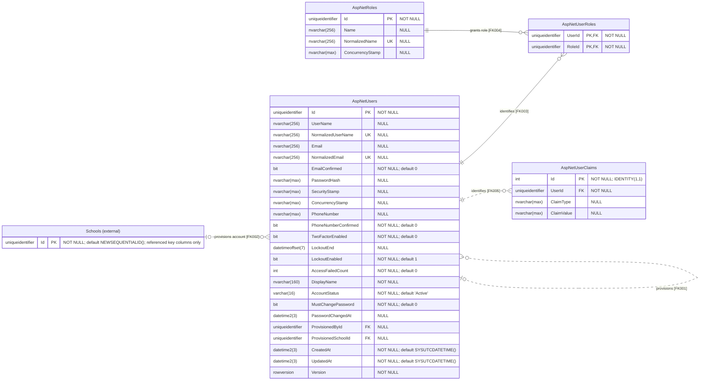

### ORBIT schema — Identity — part 2

[Mermaid source](src/schema-identity-2.mmd) · [SVG fallback](svg/schema-identity-2.svg) · [PNG fallback](png/schema-identity-2.png)

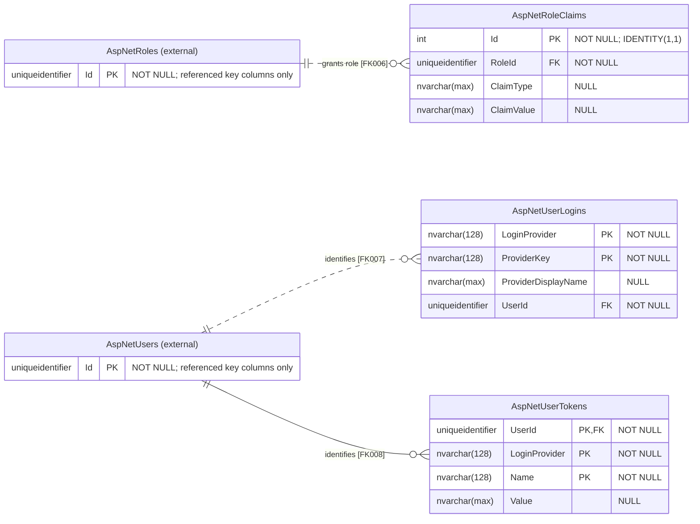

### AspNetUsers

login identity; ApplicationUser extends this table.

Scope: **supporting backend infrastructure**.

| Column | SQL Server type | PK / FK / UQ | Nullable | Default / generation |
|---|---|---|---|---|
| Id | uniqueidentifier | PK | No | — |
| UserName | nvarchar(256) | — | Yes | — |
| NormalizedUserName | nvarchar(256) | UQ | Yes | — |
| Email | nvarchar(256) | — | Yes | — |
| NormalizedEmail | nvarchar(256) | UQ | Yes | — |
| EmailConfirmed | bit | — | No | 0 |
| PasswordHash | nvarchar(max) | — | Yes | — |
| SecurityStamp | nvarchar(max) | — | Yes | — |
| ConcurrencyStamp | nvarchar(max) | — | Yes | — |
| PhoneNumber | nvarchar(max) | — | Yes | — |
| PhoneNumberConfirmed | bit | — | No | 0 |
| TwoFactorEnabled | bit | — | No | 0 |
| LockoutEnd | datetimeoffset(7) | — | Yes | — |
| LockoutEnabled | bit | — | No | 1 |
| AccessFailedCount | int | — | No | 0 |
| DisplayName | nvarchar(160) | — | No | — |
| AccountStatus | varchar(16) COLLATE Latin1_General_100_BIN2 | — | No | 'Active' |
| MustChangePassword | bit | — | No | 0 |
| PasswordChangedAt | datetime2(3) | — | Yes | — |
| ProvisionedById | uniqueidentifier | FK | Yes | — |
| ProvisionedSchoolId | uniqueidentifier | FK | Yes | — |
| CreatedAt | datetime2(3) | — | No | SYSUTCDATETIME() |
| UpdatedAt | datetime2(3) | — | No | SYSUTCDATETIME() |
| Version | rowversion | — | No | — |

**Primary key**

- PK_AspNetUsers: CLUSTERED (Id)

**Unique constraints**

None beyond the primary key.

**Points to — ordered foreign keys**

- FK001 / FK_AspNetUsers_AspNetUsers_1: (ProvisionedById) → AspNetUsers (Id); DELETE NO ACTION, UPDATE NO ACTION.
- FK002 / FK_AspNetUsers_Schools_2: (ProvisionedSchoolId) → Schools (Id); DELETE NO ACTION, UPDATE NO ACTION.

**Referenced by**

- FK001: AspNetUsers (ProvisionedById) → (Id).
- FK003: AspNetUserRoles (UserId) → (Id).
- FK005: AspNetUserClaims (UserId) → (Id).
- FK007: AspNetUserLogins (UserId) → (Id).
- FK008: AspNetUserTokens (UserId) → (Id).
- FK009: UserProfiles (UserId) → (Id).
- FK011: Students (UserId) → (Id).
- FK012: Teachers (UserId) → (Id).
- FK025: SchoolRegistrationReviews (RequestedById) → (Id).
- FK026: SchoolRegistrationReviews (DecidedById) → (Id).
- FK028: SchoolMemberships (UserId) → (Id).
- FK030: MembershipPermissions (GrantedById) → (Id).
- FK037: AccountLinkRequests (TargetUserId) → (Id).
- FK038: AccountLinkRequests (RequestedById) → (Id).
- FK039: AccountLinkRequests (VerifiedById) → (Id).
- FK040: AccountLinkRequests (SchoolApprovedById) → (Id).
- FK044: AccountLinkHistory (FromUserId) → (Id).
- FK045: AccountLinkHistory (ToUserId) → (Id).
- FK046: AccountLinkHistory (ActorId) → (Id).
- FK060: EnrollmentPlacements (ActorId) → (Id).
- FK065: PromotionBatches (ConfirmedById) → (Id).
- FK069: PromotionItems (ReviewedById) → (Id).
- FK077: PromotionItemHistory (ActorId) → (Id).
- FK087: TeachingAssignmentHistory (ActorId) → (Id).
- FK092: WeeklySubjectRequirements (UpdatedById) → (Id).
- FK097: TeacherUnavailableSlots (UpdatedById) → (Id).
- FK106: TimetableRevisions (SavedById) → (Id).
- FK107: TimetableRevisions (PublishedById) → (Id).
- FK120: TimetableChangeRequests (RequestedById) → (Id).
- FK121: TimetableChangeRequests (DecidedById) → (Id).
- FK126: Channels (OwnerUserId) → (Id).
- FK134: ChannelMemberships (UserId) → (Id).
- FK136: ChannelInvitations (CreatedById) → (Id).
- FK138: ChannelOwnershipHistory (FromUserId) → (Id).
- FK139: ChannelOwnershipHistory (ToUserId) → (Id).
- FK140: ChannelOwnershipHistory (ActorId) → (Id).
- FK142: Posts (AuthorId) → (Id).
- FK143: Posts (DeletedById) → (Id).
- FK150: Files (UploadedById) → (Id).
- FK158: SubmissionVersions (SubmittedById) → (Id).
- FK165: Evaluations (EvaluatorId) → (Id).
- FK169: ContentCorrectionRequests (AssignedTeacherUserId) → (Id).
- FK170: ContentCorrectionRequests (RequestedById) → (Id).
- FK175: CorrectionResponses (ActorId) → (Id).
- FK177: ModerationReports (ReporterId) → (Id).
- FK178: ModerationReports (ReportedUserId) → (Id).
- FK179: ModerationReports (ResolvedById) → (Id).
- FK183: PostModerationActions (ActorId) → (Id).
- FK187: Opportunities (CreatedById) → (Id).
- FK194: OpportunityStatusHistory (ActorId) → (Id).
- FK197: Applications (ConsentedById) → (Id).
- FK204: ApplicationStatusHistory (ActorId) → (Id).
- FK208: Interviews (CompletedById) → (Id).
- FK209: Interviews (CancelledById) → (Id).
- FK210: Interviews (CreatedById) → (Id).
- FK213: InterviewRescheduleRequests (RequestedById) → (Id).
- FK214: InterviewRescheduleRequests (DecidedById) → (Id).
- FK217: InterviewHistory (ActorId) → (Id).
- FK222: SchoolEvents (CreatedById) → (Id).
- FK227: LearningMeetings (OrganizerId) → (Id).
- FK230: MeetingGroups (OwnerUserId) → (Id).
- FK232: MeetingGroupMembers (UserId) → (Id).
- FK234: MeetingRecipients (UserId) → (Id).
- FK238: Notifications (RecipientId) → (Id).
- FK245: AuditEvents (ActorId) → (Id).
- FK246: OperationReceipts (ActorId) → (Id).

**CHECK constraints**

- CK_AspNetUsers_AccountStatus_Values: `[AccountStatus] IN ('Active', 'Suspended', 'Deleted')`
- CK_AspNetUsers_DisplayName_Nonblank: `LEN(LTRIM(RTRIM([DisplayName]))) > 0`
- CK_AspNetUsers_AccessFailedCount: `[AccessFailedCount] >= 0`

**Clustering strategy**

`PK_AspNetUsers` (Id): Stable 16-byte Identity key supports point lookups. The store supplies Guids: random-key fragmentation is a measured tuning concern, not an assumed sequential default.

**Indexes**

- IX_AspNetUsers_1: NONCLUSTERED (AccountStatus ASC, CreatedAt ASC).
- UX_AspNetUsers_2: UNIQUE NONCLUSTERED (NormalizedUserName ASC) WHERE [NormalizedUserName] IS NOT NULL.
- UX_AspNetUsers_3: UNIQUE NONCLUSTERED (NormalizedEmail ASC) WHERE [NormalizedEmail] IS NOT NULL.
- IX_AspNetUsers_4: NONCLUSTERED (ProvisionedById ASC).
- IX_AspNetUsers_5: NONCLUSTERED (ProvisionedSchoolId ASC).

### AspNetRoles

global platform roles.

Scope: **supporting backend infrastructure**.

| Column | SQL Server type | PK / FK / UQ | Nullable | Default / generation |
|---|---|---|---|---|
| Id | uniqueidentifier | PK | No | — |
| Name | nvarchar(256) | — | Yes | — |
| NormalizedName | nvarchar(256) | UQ | Yes | — |
| ConcurrencyStamp | nvarchar(max) | — | Yes | — |

**Primary key**

- PK_AspNetRoles: CLUSTERED (Id)

**Unique constraints**

None beyond the primary key.

**Points to — ordered foreign keys**

None.

**Referenced by**

- FK004: AspNetUserRoles (RoleId) → (Id).
- FK006: AspNetRoleClaims (RoleId) → (Id).

**CHECK constraints**

None.

**Clustering strategy**

`PK_AspNetRoles` (Id): Stable 16-byte Identity key supports point lookups. The store supplies Guids: random-key fragmentation is a measured tuning concern, not an assumed sequential default.

**Indexes**

- UX_AspNetRoles_1: UNIQUE NONCLUSTERED (NormalizedName ASC) WHERE [NormalizedName] IS NOT NULL.

### AspNetUserRoles

global role grants.

Scope: **supporting backend infrastructure**.

| Column | SQL Server type | PK / FK / UQ | Nullable | Default / generation |
|---|---|---|---|---|
| UserId | uniqueidentifier | PK FK | No | — |
| RoleId | uniqueidentifier | PK FK | No | — |

**Primary key**

- PK_AspNetUserRoles: CLUSTERED (UserId, RoleId)

**Unique constraints**

None beyond the primary key.

**Points to — ordered foreign keys**

- FK003 / FK_AspNetUserRoles_AspNetUsers_1: (UserId) → AspNetUsers (Id); DELETE NO ACTION, UPDATE NO ACTION.
- FK004 / FK_AspNetUserRoles_AspNetRoles_2: (RoleId) → AspNetRoles (Id); DELETE NO ACTION, UPDATE NO ACTION.

**Referenced by**

None.

**CHECK constraints**

None.

**Clustering strategy**

`PK_AspNetUserRoles` (UserId, RoleId): Parent-first junction key keeps related membership/lookup rows together; the existing composite uniqueness is unchanged.

**Indexes**

- IX_AspNetUserRoles_1: NONCLUSTERED (RoleId ASC, UserId ASC).

### AspNetUserClaims

user claims.

Scope: **supporting backend infrastructure**.

| Column | SQL Server type | PK / FK / UQ | Nullable | Default / generation |
|---|---|---|---|---|
| Id | int | PK | No | IDENTITY(1,1) |
| UserId | uniqueidentifier | FK | No | — |
| ClaimType | nvarchar(max) | — | Yes | — |
| ClaimValue | nvarchar(max) | — | Yes | — |

**Primary key**

- PK_AspNetUserClaims: CLUSTERED (Id)

**Unique constraints**

None beyond the primary key.

**Points to — ordered foreign keys**

- FK005 / FK_AspNetUserClaims_AspNetUsers_1: (UserId) → AspNetUsers (Id); DELETE NO ACTION, UPDATE NO ACTION.

**Referenced by**

None.

**CHECK constraints**

None.

**Clustering strategy**

`PK_AspNetUserClaims` (Id): Narrow increasing int IDENTITY supports append inserts; parent lookups retain their nonclustered indexes.

**Indexes**

- IX_AspNetUserClaims_1: NONCLUSTERED (UserId ASC).

### AspNetRoleClaims

role claims.

Scope: **supporting backend infrastructure**.

| Column | SQL Server type | PK / FK / UQ | Nullable | Default / generation |
|---|---|---|---|---|
| Id | int | PK | No | IDENTITY(1,1) |
| RoleId | uniqueidentifier | FK | No | — |
| ClaimType | nvarchar(max) | — | Yes | — |
| ClaimValue | nvarchar(max) | — | Yes | — |

**Primary key**

- PK_AspNetRoleClaims: CLUSTERED (Id)

**Unique constraints**

None beyond the primary key.

**Points to — ordered foreign keys**

- FK006 / FK_AspNetRoleClaims_AspNetRoles_1: (RoleId) → AspNetRoles (Id); DELETE NO ACTION, UPDATE NO ACTION.

**Referenced by**

None.

**CHECK constraints**

None.

**Clustering strategy**

`PK_AspNetRoleClaims` (Id): Narrow increasing int IDENTITY supports append inserts; parent lookups retain their nonclustered indexes.

**Indexes**

- IX_AspNetRoleClaims_1: NONCLUSTERED (RoleId ASC).

### AspNetUserLogins

external provider identities.

Scope: **supporting backend infrastructure**.

| Column | SQL Server type | PK / FK / UQ | Nullable | Default / generation |
|---|---|---|---|---|
| LoginProvider | nvarchar(128) | PK | No | — |
| ProviderKey | nvarchar(128) | PK | No | — |
| ProviderDisplayName | nvarchar(max) | — | Yes | — |
| UserId | uniqueidentifier | FK | No | — |

**Primary key**

- PK_AspNetUserLogins: NONCLUSTERED (LoginProvider, ProviderKey)

**Unique constraints**

None beyond the primary key.

**Points to — ordered foreign keys**

- FK007 / FK_AspNetUserLogins_AspNetUsers_1: (UserId) → AspNetUsers (Id); DELETE NO ACTION, UPDATE NO ACTION.

**Referenced by**

None.

**CHECK constraints**

None.

**Clustering strategy**

`CX_AspNetUserLogins_Access` (UserId): Group an account’s external logins/tokens on the narrow UserId. Keep the wide provider/name composite PK NONCLUSTERED; a nonunique cluster uses SQL Server’s internal uniquifier without adding a domain column.

**Indexes**

- IX_AspNetUserLogins_1: NONCLUSTERED (UserId ASC).
- CX_AspNetUserLogins_Access: CLUSTERED (UserId ASC).

### AspNetUserTokens

Identity tokens.

Scope: **supporting backend infrastructure**.

| Column | SQL Server type | PK / FK / UQ | Nullable | Default / generation |
|---|---|---|---|---|
| UserId | uniqueidentifier | PK FK | No | — |
| LoginProvider | nvarchar(128) | PK | No | — |
| Name | nvarchar(128) | PK | No | — |
| Value | nvarchar(max) | — | Yes | — |

**Primary key**

- PK_AspNetUserTokens: NONCLUSTERED (UserId, LoginProvider, Name)

**Unique constraints**

None beyond the primary key.

**Points to — ordered foreign keys**

- FK008 / FK_AspNetUserTokens_AspNetUsers_1: (UserId) → AspNetUsers (Id); DELETE NO ACTION, UPDATE NO ACTION.

**Referenced by**

None.

**CHECK constraints**

None.

**Clustering strategy**

`CX_AspNetUserTokens_Access` (UserId): Group an account’s external logins/tokens on the narrow UserId. Keep the wide provider/name composite PK NONCLUSTERED; a nonunique cluster uses SQL Server’s internal uniquifier without adding a domain column.

**Indexes**

- CX_AspNetUserTokens_Access: CLUSTERED (UserId ASC).

## People & schools

### ORBIT schema — People & schools — part 1

[Mermaid source](src/schema-people-1.mmd) · [SVG fallback](svg/schema-people-1.svg) · [PNG fallback](png/schema-people-1.png)

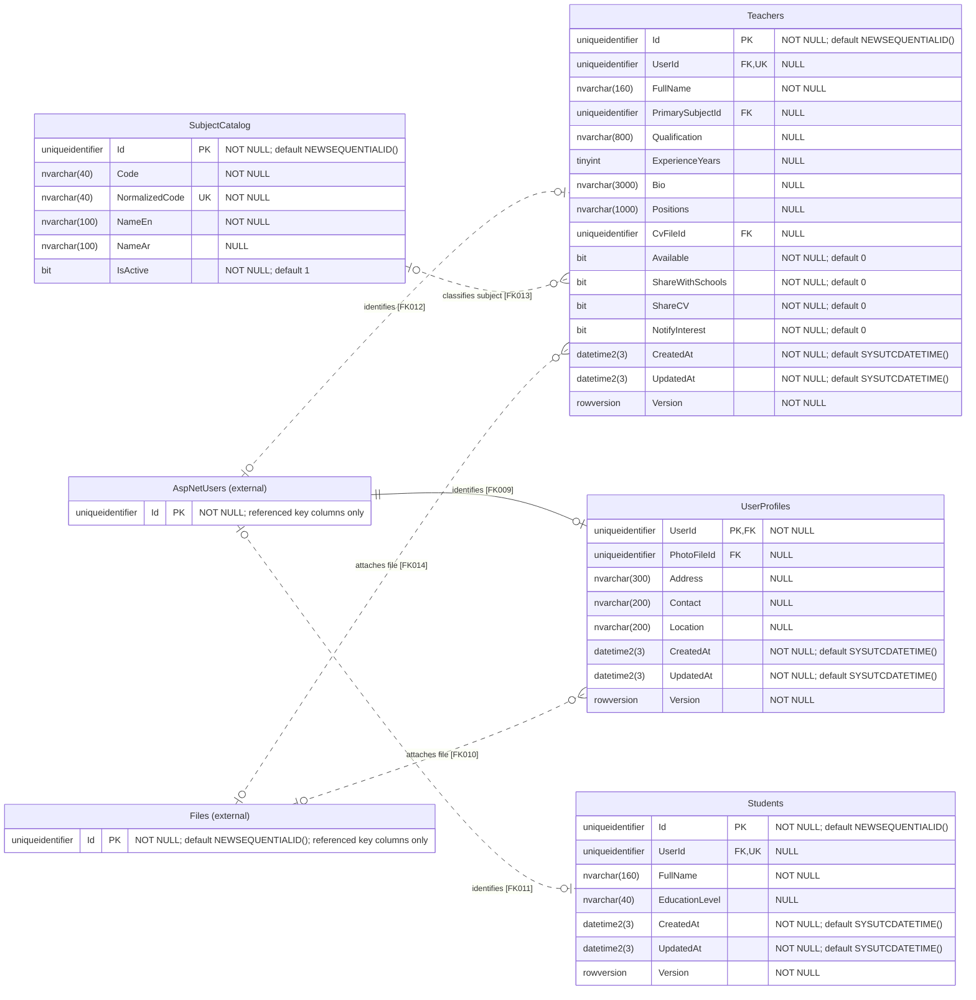

### ORBIT schema — People & schools — part 2

[Mermaid source](src/schema-people-2.mmd) · [SVG fallback](svg/schema-people-2.svg) · [PNG fallback](png/schema-people-2.png)

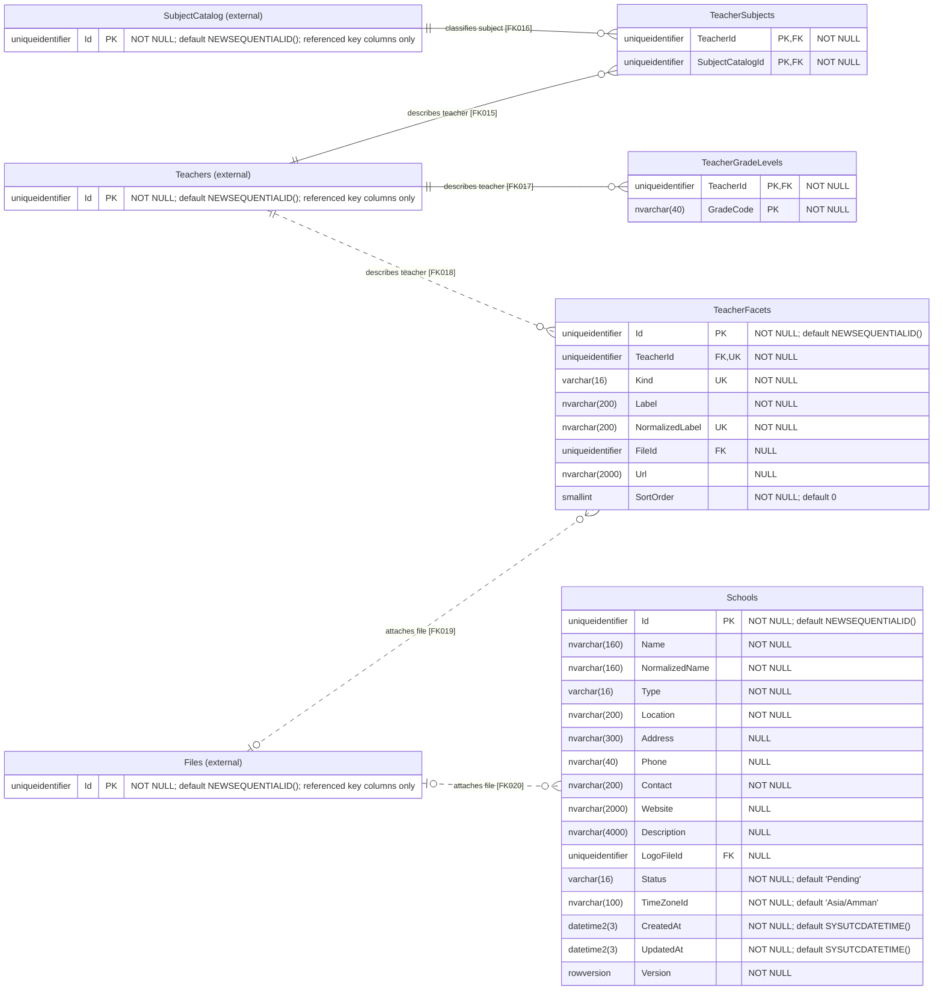

### ORBIT schema — People & schools — part 3

[Mermaid source](src/schema-people-3.mmd) · [SVG fallback](svg/schema-people-3.svg) · [PNG fallback](png/schema-people-3.png)

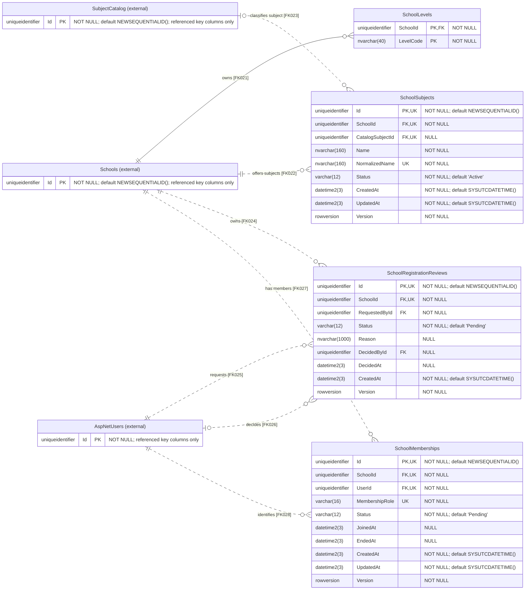

### ORBIT schema — People & schools — part 4

[Mermaid source](src/schema-people-4.mmd) · [SVG fallback](svg/schema-people-4.svg) · [PNG fallback](png/schema-people-4.png)

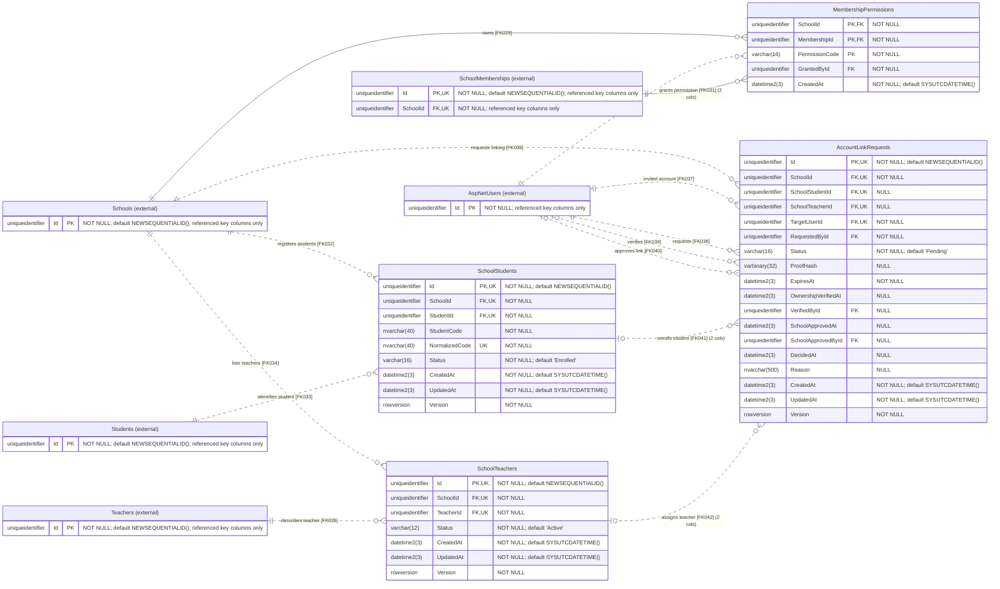

### ORBIT schema — People & schools — part 5

[Mermaid source](src/schema-people-5.mmd) · [SVG fallback](svg/schema-people-5.svg) · [PNG fallback](png/schema-people-5.png)

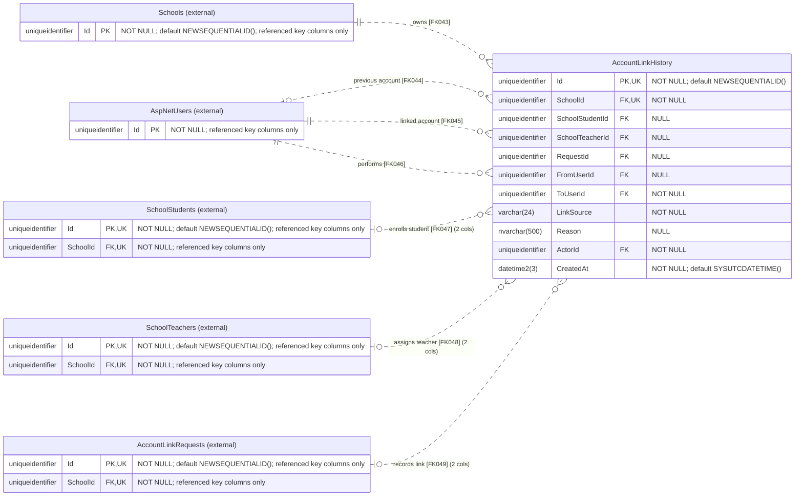

### UserProfiles

common public/contact profile.

Scope: **current required functionality**.

| Column | SQL Server type | PK / FK / UQ | Nullable | Default / generation |
|---|---|---|---|---|
| UserId | uniqueidentifier | PK FK | No | — |
| PhotoFileId | uniqueidentifier | FK | Yes | — |
| Address | nvarchar(300) | — | Yes | — |
| Contact | nvarchar(200) | — | Yes | — |
| Location | nvarchar(200) | — | Yes | — |
| CreatedAt | datetime2(3) | — | No | SYSUTCDATETIME() |
| UpdatedAt | datetime2(3) | — | No | SYSUTCDATETIME() |
| Version | rowversion | — | No | — |

**Primary key**

- PK_UserProfiles: CLUSTERED (UserId)

**Unique constraints**

None beyond the primary key.

**Points to — ordered foreign keys**

- FK009 / FK_UserProfiles_AspNetUsers_1: (UserId) → AspNetUsers (Id); DELETE NO ACTION, UPDATE NO ACTION.
- FK010 / FK_UserProfiles_Files_2: (PhotoFileId) → Files (Id); DELETE NO ACTION, UPDATE NO ACTION.

**Referenced by**

None.

**CHECK constraints**

- CK_UserProfiles_Address_Nonblank: `[Address] IS NULL OR LEN(LTRIM(RTRIM([Address]))) > 0`
- CK_UserProfiles_Contact_Nonblank: `[Contact] IS NULL OR LEN(LTRIM(RTRIM([Contact]))) > 0`
- CK_UserProfiles_Location_Nonblank: `[Location] IS NULL OR LEN(LTRIM(RTRIM([Location]))) > 0`

**Clustering strategy**

`PK_UserProfiles` (UserId): Shared stable Guid key co-locates the subtype lookup path; no extra surrogate column.

**Indexes**

- IX_UserProfiles_1: NONCLUSTERED (PhotoFileId ASC).

### Students

stable student identity independent of year/login.

Scope: **current required functionality**.

| Column | SQL Server type | PK / FK / UQ | Nullable | Default / generation |
|---|---|---|---|---|
| Id | uniqueidentifier | PK | No | NEWSEQUENTIALID() |
| UserId | uniqueidentifier | FK UQ | Yes | — |
| FullName | nvarchar(160) | — | No | — |
| EducationLevel | nvarchar(40) | — | Yes | — |
| CreatedAt | datetime2(3) | — | No | SYSUTCDATETIME() |
| UpdatedAt | datetime2(3) | — | No | SYSUTCDATETIME() |
| Version | rowversion | — | No | — |

**Primary key**

- PK_Students: CLUSTERED (Id)

**Unique constraints**

None beyond the primary key.

**Points to — ordered foreign keys**

- FK011 / FK_Students_AspNetUsers_1: (UserId) → AspNetUsers (Id); DELETE NO ACTION, UPDATE NO ACTION.

**Referenced by**

- FK033: SchoolStudents (StudentId) → (Id).
- FK155: Submissions (StudentId) → (Id).

**CHECK constraints**

- CK_Students_FullName_Nonblank: `LEN(LTRIM(RTRIM([FullName]))) > 0`
- CK_Students_EducationLevel_Nonblank: `[EducationLevel] IS NULL OR LEN(LTRIM(RTRIM([EducationLevel]))) > 0`

**Clustering strategy**

`PK_Students` (Id): Stable, narrow Guid point lookup; NEWSEQUENTIALID supports append-biased inserts. Wider names, mutable status/time fields and existing seek/filter paths stay nonclustered.

**Indexes**

- UX_Students_1: UNIQUE NONCLUSTERED (UserId ASC) WHERE [UserId] IS NOT NULL.
- IX_Students_2: NONCLUSTERED (UserId ASC).

### Teachers

stable teacher identity and professional profile.

Scope: **current required functionality**.

| Column | SQL Server type | PK / FK / UQ | Nullable | Default / generation |
|---|---|---|---|---|
| Id | uniqueidentifier | PK | No | NEWSEQUENTIALID() |
| UserId | uniqueidentifier | FK UQ | Yes | — |
| FullName | nvarchar(160) | — | No | — |
| PrimarySubjectId | uniqueidentifier | FK | Yes | — |
| Qualification | nvarchar(800) | — | Yes | — |
| ExperienceYears | tinyint | — | Yes | — |
| Bio | nvarchar(3000) | — | Yes | — |
| Positions | nvarchar(1000) | — | Yes | — |
| CvFileId | uniqueidentifier | FK | Yes | — |
| Available | bit | — | No | 0 |
| ShareWithSchools | bit | — | No | 0 |
| ShareCV | bit | — | No | 0 |
| NotifyInterest | bit | — | No | 0 |
| CreatedAt | datetime2(3) | — | No | SYSUTCDATETIME() |
| UpdatedAt | datetime2(3) | — | No | SYSUTCDATETIME() |
| Version | rowversion | — | No | — |

**Primary key**

- PK_Teachers: CLUSTERED (Id)

**Unique constraints**

None beyond the primary key.

**Points to — ordered foreign keys**

- FK012 / FK_Teachers_AspNetUsers_1: (UserId) → AspNetUsers (Id); DELETE NO ACTION, UPDATE NO ACTION.
- FK013 / FK_Teachers_SubjectCatalog_2: (PrimarySubjectId) → SubjectCatalog (Id); DELETE NO ACTION, UPDATE NO ACTION.
- FK014 / FK_Teachers_Files_3: (CvFileId) → Files (Id); DELETE NO ACTION, UPDATE NO ACTION.

**Referenced by**

- FK015: TeacherSubjects (TeacherId) → (Id).
- FK017: TeacherGradeLevels (TeacherId) → (Id).
- FK018: TeacherFacets (TeacherId) → (Id).
- FK035: SchoolTeachers (TeacherId) → (Id).
- FK199: Applications (TeacherId) → (Id).

**CHECK constraints**

- CK_Teachers_FullName_Nonblank: `LEN(LTRIM(RTRIM([FullName]))) > 0`
- CK_Teachers_Qualification_Nonblank: `[Qualification] IS NULL OR LEN(LTRIM(RTRIM([Qualification]))) > 0`
- CK_Teachers_Bio_Nonblank: `[Bio] IS NULL OR LEN(LTRIM(RTRIM([Bio]))) > 0`
- CK_Teachers_Positions_Nonblank: `[Positions] IS NULL OR LEN(LTRIM(RTRIM([Positions]))) > 0`
- CK_Teachers_ExperienceYears: `[ExperienceYears] BETWEEN 0 AND 60`

**Clustering strategy**

`PK_Teachers` (Id): Stable, narrow Guid point lookup; NEWSEQUENTIALID supports append-biased inserts. Wider names, mutable status/time fields and existing seek/filter paths stay nonclustered.

**Indexes**

- IX_Teachers_1: NONCLUSTERED (Available ASC, ShareWithSchools ASC, PrimarySubjectId ASC).
- UX_Teachers_2: UNIQUE NONCLUSTERED (UserId ASC) WHERE [UserId] IS NOT NULL.
- IX_Teachers_3: NONCLUSTERED (UserId ASC).
- IX_Teachers_4: NONCLUSTERED (PrimarySubjectId ASC).
- IX_Teachers_5: NONCLUSTERED (CvFileId ASC).

### SubjectCatalog

shared discoverable subject vocabulary.

Scope: **current required functionality**.

| Column | SQL Server type | PK / FK / UQ | Nullable | Default / generation |
|---|---|---|---|---|
| Id | uniqueidentifier | PK | No | NEWSEQUENTIALID() |
| Code | nvarchar(40) | — | No | — |
| NormalizedCode | nvarchar(40) | UQ | No | — |
| NameEn | nvarchar(100) | — | No | — |
| NameAr | nvarchar(100) | — | Yes | — |
| IsActive | bit | — | No | 1 |

**Primary key**

- PK_SubjectCatalog: CLUSTERED (Id)

**Unique constraints**

- UQ_SubjectCatalog_1: NONCLUSTERED (NormalizedCode)

**Points to — ordered foreign keys**

None.

**Referenced by**

- FK013: Teachers (PrimarySubjectId) → (Id).
- FK016: TeacherSubjects (SubjectCatalogId) → (Id).
- FK023: SchoolSubjects (CatalogSubjectId) → (Id).
- FK128: Channels (StandaloneSubjectId) → (Id).
- FK188: Opportunities (SubjectCatalogId) → (Id).

**CHECK constraints**

- CK_SubjectCatalog_Code_Nonblank: `LEN(LTRIM(RTRIM([Code]))) > 0`
- CK_SubjectCatalog_NormalizedCode_Nonblank: `LEN(LTRIM(RTRIM([NormalizedCode]))) > 0`
- CK_SubjectCatalog_NameEn_Nonblank: `LEN(LTRIM(RTRIM([NameEn]))) > 0`
- CK_SubjectCatalog_NameAr_Nonblank: `[NameAr] IS NULL OR LEN(LTRIM(RTRIM([NameAr]))) > 0`

**Clustering strategy**

`PK_SubjectCatalog` (Id): Stable, narrow Guid point lookup; NEWSEQUENTIALID supports append-biased inserts. Wider names, mutable status/time fields and existing seek/filter paths stay nonclustered.

**Indexes**

None beyond indexes backing the declared keys.

### TeacherSubjects

secondary specializations.

Scope: **current required functionality**.

| Column | SQL Server type | PK / FK / UQ | Nullable | Default / generation |
|---|---|---|---|---|
| TeacherId | uniqueidentifier | PK FK | No | — |
| SubjectCatalogId | uniqueidentifier | PK FK | No | — |

**Primary key**

- PK_TeacherSubjects: CLUSTERED (TeacherId, SubjectCatalogId)

**Unique constraints**

None beyond the primary key.

**Points to — ordered foreign keys**

- FK015 / FK_TeacherSubjects_Teachers_1: (TeacherId) → Teachers (Id); DELETE NO ACTION, UPDATE NO ACTION.
- FK016 / FK_TeacherSubjects_SubjectCatalog_2: (SubjectCatalogId) → SubjectCatalog (Id); DELETE NO ACTION, UPDATE NO ACTION.

**Referenced by**

None.

**CHECK constraints**

None.

**Clustering strategy**

`PK_TeacherSubjects` (TeacherId, SubjectCatalogId): Parent-first junction key keeps related membership/lookup rows together; the existing composite uniqueness is unchanged.

**Indexes**

- IX_TeacherSubjects_1: NONCLUSTERED (SubjectCatalogId ASC).

### TeacherGradeLevels

teaching experience/preference, not assignments.

Scope: **current required functionality**.

| Column | SQL Server type | PK / FK / UQ | Nullable | Default / generation |
|---|---|---|---|---|
| TeacherId | uniqueidentifier | PK FK | No | — |
| GradeCode | nvarchar(40) | PK | No | — |

**Primary key**

- PK_TeacherGradeLevels: CLUSTERED (TeacherId, GradeCode)

**Unique constraints**

None beyond the primary key.

**Points to — ordered foreign keys**

- FK017 / FK_TeacherGradeLevels_Teachers_1: (TeacherId) → Teachers (Id); DELETE NO ACTION, UPDATE NO ACTION.

**Referenced by**

None.

**CHECK constraints**

- CK_TeacherGradeLevels_GradeCode_Nonblank: `LEN(LTRIM(RTRIM([GradeCode]))) > 0`

**Clustering strategy**

`PK_TeacherGradeLevels` (TeacherId, GradeCode): Parent-first junction key keeps related membership/lookup rows together; the existing composite uniqueness is unchanged.

**Indexes**

None beyond indexes backing the declared keys.

### TeacherFacets

normalized skills/methods/certificates/work samples.

Scope: **current required functionality**.

| Column | SQL Server type | PK / FK / UQ | Nullable | Default / generation |
|---|---|---|---|---|
| Id | uniqueidentifier | PK | No | NEWSEQUENTIALID() |
| TeacherId | uniqueidentifier | FK UQ | No | — |
| Kind | varchar(16) COLLATE Latin1_General_100_BIN2 | UQ | No | — |
| Label | nvarchar(200) | — | No | — |
| NormalizedLabel | nvarchar(200) | UQ | No | — |
| FileId | uniqueidentifier | FK | Yes | — |
| Url | nvarchar(2000) | — | Yes | — |
| SortOrder | smallint | — | No | 0 |

**Primary key**

- PK_TeacherFacets: CLUSTERED (Id)

**Unique constraints**

- UQ_TeacherFacets_1: NONCLUSTERED (TeacherId, Kind, NormalizedLabel)

**Points to — ordered foreign keys**

- FK018 / FK_TeacherFacets_Teachers_1: (TeacherId) → Teachers (Id); DELETE NO ACTION, UPDATE NO ACTION.
- FK019 / FK_TeacherFacets_Files_2: (FileId) → Files (Id); DELETE NO ACTION, UPDATE NO ACTION.

**Referenced by**

None.

**CHECK constraints**

- CK_TeacherFacets_Kind_Values: `[Kind] IN ('Skill', 'Method', 'Certificate', 'WorkSample')`
- CK_TeacherFacets_Kind_Nonblank: `LEN(LTRIM(RTRIM([Kind]))) > 0`
- CK_TeacherFacets_Label_Nonblank: `LEN(LTRIM(RTRIM([Label]))) > 0`
- CK_TeacherFacets_NormalizedLabel_Nonblank: `LEN(LTRIM(RTRIM([NormalizedLabel]))) > 0`
- CK_TeacherFacets_Url_Nonblank: `[Url] IS NULL OR LEN(LTRIM(RTRIM([Url]))) > 0`
- CK_TeacherFacets_SortOrder: `[SortOrder] >= 0`

**Clustering strategy**

`PK_TeacherFacets` (Id): Stable, narrow Guid point lookup; NEWSEQUENTIALID supports append-biased inserts. Wider names, mutable status/time fields and existing seek/filter paths stay nonclustered.

**Indexes**

- IX_TeacherFacets_1: NONCLUSTERED (FileId ASC).

### Schools

organization, separated from manager accounts.

Scope: **current required functionality**.

| Column | SQL Server type | PK / FK / UQ | Nullable | Default / generation |
|---|---|---|---|---|
| Id | uniqueidentifier | PK | No | NEWSEQUENTIALID() |
| Name | nvarchar(160) | — | No | — |
| NormalizedName | nvarchar(160) | — | No | — |
| Type | varchar(16) COLLATE Latin1_General_100_BIN2 | — | No | — |
| Location | nvarchar(200) | — | No | — |
| Address | nvarchar(300) | — | Yes | — |
| Phone | nvarchar(40) | — | Yes | — |
| Contact | nvarchar(200) | — | No | — |
| Website | nvarchar(2000) | — | Yes | — |
| Description | nvarchar(4000) | — | Yes | — |
| LogoFileId | uniqueidentifier | FK | Yes | — |
| Status | varchar(16) COLLATE Latin1_General_100_BIN2 | — | No | 'Pending' |
| TimeZoneId | nvarchar(100) | — | No | 'Asia/Amman' |
| CreatedAt | datetime2(3) | — | No | SYSUTCDATETIME() |
| UpdatedAt | datetime2(3) | — | No | SYSUTCDATETIME() |
| Version | rowversion | — | No | — |

**Primary key**

- PK_Schools: CLUSTERED (Id)

**Unique constraints**

None beyond the primary key.

**Points to — ordered foreign keys**

- FK020 / FK_Schools_Files_1: (LogoFileId) → Files (Id); DELETE NO ACTION, UPDATE NO ACTION.

**Referenced by**

- FK002: AspNetUsers (ProvisionedSchoolId) → (Id).
- FK021: SchoolLevels (SchoolId) → (Id).
- FK022: SchoolSubjects (SchoolId) → (Id).
- FK024: SchoolRegistrationReviews (SchoolId) → (Id).
- FK027: SchoolMemberships (SchoolId) → (Id).
- FK029: MembershipPermissions (SchoolId) → (Id).
- FK032: SchoolStudents (SchoolId) → (Id).
- FK034: SchoolTeachers (SchoolId) → (Id).
- FK036: AccountLinkRequests (SchoolId) → (Id).
- FK043: AccountLinkHistory (SchoolId) → (Id).
- FK050: AcademicYears (SchoolId) → (Id).
- FK051: Grades (SchoolId) → (Id).
- FK052: Sections (SchoolId) → (Id).
- FK055: StudentEnrollments (SchoolId) → (Id).
- FK058: EnrollmentPlacements (SchoolId) → (Id).
- FK064: PromotionBatches (SchoolId) → (Id).
- FK068: PromotionItems (SchoolId) → (Id).
- FK076: PromotionItemHistory (SchoolId) → (Id).
- FK080: TeachingAssignments (SchoolId) → (Id).
- FK085: TeachingAssignmentHistory (SchoolId) → (Id).
- FK090: WeeklySubjectRequirements (SchoolId) → (Id).
- FK095: TeacherUnavailableSlots (SchoolId) → (Id).
- FK099: Timetables (SchoolId) → (Id).
- FK104: TimetableRevisions (SchoolId) → (Id).
- FK109: TimetableCells (SchoolId) → (Id).
- FK114: PublishedTimetableOccupancy (SchoolId) → (Id).
- FK118: TimetableChangeRequests (SchoolId) → (Id).
- FK124: Channels (SchoolId) → (Id).
- FK130: ChannelSections (SchoolId) → (Id).
- FK146: PostSections (SchoolId) → (Id).
- FK156: SubmissionVersions (SchoolId) → (Id).
- FK167: ContentCorrectionRequests (SchoolId) → (Id).
- FK173: CorrectionResponses (SchoolId) → (Id).
- FK181: PostModerationActions (SchoolId) → (Id).
- FK186: Opportunities (SchoolId) → (Id).
- FK189: OpportunityGradeLevels (SchoolId) → (Id).
- FK191: OpportunitySkills (SchoolId) → (Id).
- FK193: OpportunityStatusHistory (SchoolId) → (Id).
- FK196: Applications (SchoolId) → (Id).
- FK200: ApplicationFiles (SchoolId) → (Id).
- FK203: ApplicationStatusHistory (SchoolId) → (Id).
- FK207: Interviews (SchoolId) → (Id).
- FK212: InterviewRescheduleRequests (SchoolId) → (Id).
- FK216: InterviewHistory (SchoolId) → (Id).
- FK220: SchoolEvents (SchoolId) → (Id).
- FK223: SchoolEventSections (SchoolId) → (Id).
- FK237: Notifications (SchoolId) → (Id).
- FK244: AuditEvents (SchoolId) → (Id).

**CHECK constraints**

- CK_Schools_Type_Values: `[Type] IN ('Private', 'Public', 'International')`
- CK_Schools_Status_Values: `[Status] IN ('Pending', 'Approved', 'Rejected', 'Suspended', 'Archived')`
- CK_Schools_Name_Nonblank: `LEN(LTRIM(RTRIM([Name]))) > 0`
- CK_Schools_NormalizedName_Nonblank: `LEN(LTRIM(RTRIM([NormalizedName]))) > 0`
- CK_Schools_Type_Nonblank: `LEN(LTRIM(RTRIM([Type]))) > 0`
- CK_Schools_Location_Nonblank: `LEN(LTRIM(RTRIM([Location]))) > 0`
- CK_Schools_Address_Nonblank: `[Address] IS NULL OR LEN(LTRIM(RTRIM([Address]))) > 0`
- CK_Schools_Phone_Nonblank: `[Phone] IS NULL OR LEN(LTRIM(RTRIM([Phone]))) > 0`
- CK_Schools_Contact_Nonblank: `LEN(LTRIM(RTRIM([Contact]))) > 0`
- CK_Schools_Website_Nonblank: `[Website] IS NULL OR LEN(LTRIM(RTRIM([Website]))) > 0`
- CK_Schools_Description_Nonblank: `[Description] IS NULL OR LEN(LTRIM(RTRIM([Description]))) > 0`
- CK_Schools_Status_Nonblank: `LEN(LTRIM(RTRIM([Status]))) > 0`
- CK_Schools_TimeZoneId_Nonblank: `LEN(LTRIM(RTRIM([TimeZoneId]))) > 0`

**Clustering strategy**

`PK_Schools` (Id): Stable, narrow Guid point lookup; NEWSEQUENTIALID supports append-biased inserts. Wider names, mutable status/time fields and existing seek/filter paths stay nonclustered.

**Indexes**

- IX_Schools_1: NONCLUSTERED (NormalizedName ASC).
- IX_Schools_2: NONCLUSTERED (LogoFileId ASC).

### SchoolLevels

offered educational levels.

Scope: **current required functionality**.

| Column | SQL Server type | PK / FK / UQ | Nullable | Default / generation |
|---|---|---|---|---|
| SchoolId | uniqueidentifier | PK FK | No | — |
| LevelCode | nvarchar(40) | PK | No | — |

**Primary key**

- PK_SchoolLevels: CLUSTERED (SchoolId, LevelCode)

**Unique constraints**

None beyond the primary key.

**Points to — ordered foreign keys**

- FK021 / FK_SchoolLevels_Schools_1: (SchoolId) → Schools (Id); DELETE NO ACTION, UPDATE NO ACTION.

**Referenced by**

None.

**CHECK constraints**

- CK_SchoolLevels_LevelCode_Nonblank: `LEN(LTRIM(RTRIM([LevelCode]))) > 0`

**Clustering strategy**

`PK_SchoolLevels` (SchoolId, LevelCode): Parent-first junction key keeps related membership/lookup rows together; the existing composite uniqueness is unchanged.

**Indexes**

None beyond indexes backing the declared keys.

### SchoolSubjects

school's adopted subject records.

Scope: **current required functionality**.

| Column | SQL Server type | PK / FK / UQ | Nullable | Default / generation |
|---|---|---|---|---|
| Id | uniqueidentifier | PK UQ | No | NEWSEQUENTIALID() |
| SchoolId | uniqueidentifier | FK UQ | No | — |
| CatalogSubjectId | uniqueidentifier | FK UQ | Yes | — |
| Name | nvarchar(160) | — | No | — |
| NormalizedName | nvarchar(160) | UQ | No | — |
| Status | varchar(12) COLLATE Latin1_General_100_BIN2 | — | No | 'Active' |
| CreatedAt | datetime2(3) | — | No | SYSUTCDATETIME() |
| UpdatedAt | datetime2(3) | — | No | SYSUTCDATETIME() |
| Version | rowversion | — | No | — |

**Primary key**

- PK_SchoolSubjects: NONCLUSTERED (Id)

**Unique constraints**

- UQ_SchoolSubjects_1: NONCLUSTERED (SchoolId, NormalizedName)
- UQ_SchoolSubjects_2: CLUSTERED (SchoolId, Id)

**Points to — ordered foreign keys**

- FK022 / FK_SchoolSubjects_Schools_1: (SchoolId) → Schools (Id); DELETE NO ACTION, UPDATE NO ACTION.
- FK023 / FK_SchoolSubjects_SubjectCatalog_2: (CatalogSubjectId) → SubjectCatalog (Id); DELETE NO ACTION, UPDATE NO ACTION.

**Referenced by**

- FK083: TeachingAssignments (SchoolId, SubjectId) → (SchoolId, Id).
- FK094: WeeklySubjectRequirements (SchoolId, SubjectId) → (SchoolId, Id).
- FK127: Channels (SchoolId, SubjectId) → (SchoolId, Id).

**CHECK constraints**

- CK_SchoolSubjects_Status_Values: `[Status] IN ('Active', 'Archived')`
- CK_SchoolSubjects_Name_Nonblank: `LEN(LTRIM(RTRIM([Name]))) > 0`
- CK_SchoolSubjects_NormalizedName_Nonblank: `LEN(LTRIM(RTRIM([NormalizedName]))) > 0`
- CK_SchoolSubjects_Status_Nonblank: `LEN(LTRIM(RTRIM([Status]))) > 0`

**Clustering strategy**

`UQ_SchoolSubjects_2` (SchoolId, Id): Tenant-first stable roster/catalog range; the school plus sequential domain ID bounds width to 32 bytes. Global ID PK and other business uniqueness remain NONCLUSTERED.

**Indexes**

- UX_SchoolSubjects_1: UNIQUE NONCLUSTERED (SchoolId ASC, CatalogSubjectId ASC) WHERE [CatalogSubjectId] IS NOT NULL.
- IX_SchoolSubjects_2: NONCLUSTERED (CatalogSubjectId ASC).

### SchoolRegistrationReviews

registration/review history.

Scope: **current required functionality**.

| Column | SQL Server type | PK / FK / UQ | Nullable | Default / generation |
|---|---|---|---|---|
| Id | uniqueidentifier | PK UQ | No | NEWSEQUENTIALID() |
| SchoolId | uniqueidentifier | FK UQ | No | — |
| RequestedById | uniqueidentifier | FK | No | — |
| Status | varchar(12) COLLATE Latin1_General_100_BIN2 | — | No | 'Pending' |
| Reason | nvarchar(1000) | — | Yes | — |
| DecidedById | uniqueidentifier | FK | Yes | — |
| DecidedAt | datetime2(3) | — | Yes | — |
| CreatedAt | datetime2(3) | — | No | SYSUTCDATETIME() |
| Version | rowversion | — | No | — |

**Primary key**

- PK_SchoolRegistrationReviews: CLUSTERED (Id)

**Unique constraints**

- UQ_SchoolRegistrationReviews_1: NONCLUSTERED (SchoolId, Id)

**Points to — ordered foreign keys**

- FK024 / FK_SchoolRegistrationReviews_Schools_1: (SchoolId) → Schools (Id); DELETE NO ACTION, UPDATE NO ACTION.
- FK025 / FK_SchoolRegistrationReviews_AspNetUsers_2: (RequestedById) → AspNetUsers (Id); DELETE NO ACTION, UPDATE NO ACTION.
- FK026 / FK_SchoolRegistrationReviews_AspNetUsers_3: (DecidedById) → AspNetUsers (Id); DELETE NO ACTION, UPDATE NO ACTION.

**Referenced by**

None.

**CHECK constraints**

- CK_SchoolRegistrationReviews_Status_Values: `[Status] IN ('Pending', 'Approved', 'Rejected')`
- CK_SchoolRegistrationReviews_Status_Nonblank: `LEN(LTRIM(RTRIM([Status]))) > 0`
- CK_SchoolRegistrationReviews_Reason_Nonblank: `[Reason] IS NULL OR LEN(LTRIM(RTRIM([Reason]))) > 0`
- CK_SchoolRegistrationReviews_DecisionMetadata: `([Status] IN ('Pending') AND [DecidedById] IS NULL AND [DecidedAt] IS NULL) OR ([Status] NOT IN ('Pending') AND [DecidedById] IS NOT NULL AND [DecidedAt] IS NOT NULL)`

**Clustering strategy**

`PK_SchoolRegistrationReviews` (Id): Stable, narrow Guid point lookup; NEWSEQUENTIALID supports append-biased inserts. Wider names, mutable status/time fields and existing seek/filter paths stay nonclustered.

**Indexes**

- IX_SchoolRegistrationReviews_1: NONCLUSTERED (Status ASC, CreatedAt ASC).
- UX_SchoolRegistrationReviews_2: UNIQUE NONCLUSTERED (SchoolId ASC) WHERE [Status] = 'Pending'.
- IX_SchoolRegistrationReviews_3: NONCLUSTERED (RequestedById ASC).
- IX_SchoolRegistrationReviews_4: NONCLUSTERED (DecidedById ASC).

### SchoolMemberships

account affiliation, not annual academic placement.

Scope: **current required functionality**.

| Column | SQL Server type | PK / FK / UQ | Nullable | Default / generation |
|---|---|---|---|---|
| Id | uniqueidentifier | PK UQ | No | NEWSEQUENTIALID() |
| SchoolId | uniqueidentifier | FK UQ | No | — |
| UserId | uniqueidentifier | FK UQ | No | — |
| MembershipRole | varchar(16) COLLATE Latin1_General_100_BIN2 | UQ | No | — |
| Status | varchar(12) COLLATE Latin1_General_100_BIN2 | — | No | 'Pending' |
| JoinedAt | datetime2(3) | — | Yes | — |
| EndedAt | datetime2(3) | — | Yes | — |
| CreatedAt | datetime2(3) | — | No | SYSUTCDATETIME() |
| UpdatedAt | datetime2(3) | — | No | SYSUTCDATETIME() |
| Version | rowversion | — | No | — |

**Primary key**

- PK_SchoolMemberships: NONCLUSTERED (Id)

**Unique constraints**

- UQ_SchoolMemberships_1: NONCLUSTERED (SchoolId, UserId, MembershipRole)
- UQ_SchoolMemberships_2: NONCLUSTERED (SchoolId, Id, UserId)
- UQ_SchoolMemberships_3: CLUSTERED (SchoolId, Id)

**Points to — ordered foreign keys**

- FK027 / FK_SchoolMemberships_Schools_1: (SchoolId) → Schools (Id); DELETE NO ACTION, UPDATE NO ACTION.
- FK028 / FK_SchoolMemberships_AspNetUsers_2: (UserId) → AspNetUsers (Id); DELETE NO ACTION, UPDATE NO ACTION.

**Referenced by**

- FK031: MembershipPermissions (SchoolId, MembershipId) → (SchoolId, Id).

**CHECK constraints**

- CK_SchoolMemberships_MembershipRole_Values: `[MembershipRole] IN ('Manager', 'Teacher', 'Student')`
- CK_SchoolMemberships_Status_Values: `[Status] IN ('Pending', 'Active', 'Removed')`
- CK_SchoolMemberships_MembershipRole_Nonblank: `LEN(LTRIM(RTRIM([MembershipRole]))) > 0`
- CK_SchoolMemberships_Status_Nonblank: `LEN(LTRIM(RTRIM([Status]))) > 0`
- CK_SchoolMemberships_EndedAt: `[EndedAt] IS NULL OR ([JoinedAt] IS NOT NULL AND [EndedAt] >= [JoinedAt])`

**Clustering strategy**

`UQ_SchoolMemberships_3` (SchoolId, Id): Tenant-first stable roster/catalog range; the school plus sequential domain ID bounds width to 32 bytes. Global ID PK and other business uniqueness remain NONCLUSTERED.

**Indexes**

- IX_SchoolMemberships_1: NONCLUSTERED (UserId ASC, Status ASC, SchoolId ASC).
- UX_SchoolMemberships_2: UNIQUE NONCLUSTERED (UserId ASC) WHERE [MembershipRole] = 'Teacher' AND [Status] = 'Active' — **PROVISIONAL recommendation; not approved policy**.

### MembershipPermissions

school grants from existing permission list.

Scope: **current required functionality**.

| Column | SQL Server type | PK / FK / UQ | Nullable | Default / generation |
|---|---|---|---|---|
| SchoolId | uniqueidentifier | PK FK | No | — |
| MembershipId | uniqueidentifier | PK FK | No | — |
| PermissionCode | varchar(16) COLLATE Latin1_General_100_BIN2 | PK | No | — |
| GrantedById | uniqueidentifier | FK | No | — |
| CreatedAt | datetime2(3) | — | No | SYSUTCDATETIME() |

**Primary key**

- PK_MembershipPermissions: CLUSTERED (SchoolId, MembershipId, PermissionCode)

**Unique constraints**

None beyond the primary key.

**Points to — ordered foreign keys**

- FK029 / FK_MembershipPermissions_Schools_1: (SchoolId) → Schools (Id); DELETE NO ACTION, UPDATE NO ACTION.
- FK030 / FK_MembershipPermissions_AspNetUsers_2: (GrantedById) → AspNetUsers (Id); DELETE NO ACTION, UPDATE NO ACTION.
- FK031 / FK_MembershipPermissions_SchoolMemberships_3: (SchoolId, MembershipId) → SchoolMemberships (SchoolId, Id); DELETE NO ACTION, UPDATE NO ACTION.

**Referenced by**

None.

**CHECK constraints**

- CK_MembershipPermissions_PermissionCode_Values: `[PermissionCode] IN ('Publish', 'Classes', 'Labs', 'Reports', 'Planning')`
- CK_MembershipPermissions_PermissionCode_Nonblank: `LEN(LTRIM(RTRIM([PermissionCode]))) > 0`

**Clustering strategy**

`PK_MembershipPermissions` (SchoolId, MembershipId, PermissionCode): Parent-first junction key keeps related membership/lookup rows together; the existing composite uniqueness is unchanged.

**Indexes**

- IX_MembershipPermissions_1: NONCLUSTERED (GrantedById ASC).

### SchoolStudents

stable school roster/student code.

Scope: **current required functionality**.

| Column | SQL Server type | PK / FK / UQ | Nullable | Default / generation |
|---|---|---|---|---|
| Id | uniqueidentifier | PK UQ | No | NEWSEQUENTIALID() |
| SchoolId | uniqueidentifier | FK UQ | No | — |
| StudentId | uniqueidentifier | FK UQ | No | — |
| StudentCode | nvarchar(40) | — | No | — |
| NormalizedCode | nvarchar(40) | UQ | No | — |
| Status | varchar(16) COLLATE Latin1_General_100_BIN2 | — | No | 'Enrolled' |
| CreatedAt | datetime2(3) | — | No | SYSUTCDATETIME() |
| UpdatedAt | datetime2(3) | — | No | SYSUTCDATETIME() |
| Version | rowversion | — | No | — |

**Primary key**

- PK_SchoolStudents: NONCLUSTERED (Id)

**Unique constraints**

- UQ_SchoolStudents_1: NONCLUSTERED (SchoolId, StudentId)
- UQ_SchoolStudents_2: NONCLUSTERED (SchoolId, NormalizedCode)
- UQ_SchoolStudents_3: NONCLUSTERED (SchoolId, Id, StudentId)
- UQ_SchoolStudents_4: CLUSTERED (SchoolId, Id)

**Points to — ordered foreign keys**

- FK032 / FK_SchoolStudents_Schools_1: (SchoolId) → Schools (Id); DELETE NO ACTION, UPDATE NO ACTION.
- FK033 / FK_SchoolStudents_Students_2: (StudentId) → Students (Id); DELETE NO ACTION, UPDATE NO ACTION.

**Referenced by**

- FK041: AccountLinkRequests (SchoolId, SchoolStudentId) → (SchoolId, Id).
- FK047: AccountLinkHistory (SchoolId, SchoolStudentId) → (SchoolId, Id).
- FK057: StudentEnrollments (SchoolId, SchoolStudentId, StudentId) → (SchoolId, Id, StudentId).

**CHECK constraints**

- CK_SchoolStudents_Status_Values: `[Status] IN ('Enrolled', 'Inactive', 'TransferredOut')`
- CK_SchoolStudents_StudentCode_Nonblank: `LEN(LTRIM(RTRIM([StudentCode]))) > 0`
- CK_SchoolStudents_NormalizedCode_Nonblank: `LEN(LTRIM(RTRIM([NormalizedCode]))) > 0`
- CK_SchoolStudents_Status_Nonblank: `LEN(LTRIM(RTRIM([Status]))) > 0`

**Clustering strategy**

`UQ_SchoolStudents_4` (SchoolId, Id): Tenant-first stable roster/catalog range; the school plus sequential domain ID bounds width to 32 bytes. Global ID PK and other business uniqueness remain NONCLUSTERED.

**Indexes**

- IX_SchoolStudents_1: NONCLUSTERED (StudentId ASC).

### SchoolTeachers

stable school teacher roster.

Scope: **current required functionality**.

| Column | SQL Server type | PK / FK / UQ | Nullable | Default / generation |
|---|---|---|---|---|
| Id | uniqueidentifier | PK UQ | No | NEWSEQUENTIALID() |
| SchoolId | uniqueidentifier | FK UQ | No | — |
| TeacherId | uniqueidentifier | FK UQ | No | — |
| Status | varchar(12) COLLATE Latin1_General_100_BIN2 | — | No | 'Active' |
| CreatedAt | datetime2(3) | — | No | SYSUTCDATETIME() |
| UpdatedAt | datetime2(3) | — | No | SYSUTCDATETIME() |
| Version | rowversion | — | No | — |

**Primary key**

- PK_SchoolTeachers: NONCLUSTERED (Id)

**Unique constraints**

- UQ_SchoolTeachers_1: NONCLUSTERED (SchoolId, TeacherId)
- UQ_SchoolTeachers_2: NONCLUSTERED (SchoolId, Id, TeacherId)
- UQ_SchoolTeachers_3: CLUSTERED (SchoolId, Id)

**Points to — ordered foreign keys**

- FK034 / FK_SchoolTeachers_Schools_1: (SchoolId) → Schools (Id); DELETE NO ACTION, UPDATE NO ACTION.
- FK035 / FK_SchoolTeachers_Teachers_2: (TeacherId) → Teachers (Id); DELETE NO ACTION, UPDATE NO ACTION.

**Referenced by**

- FK042: AccountLinkRequests (SchoolId, SchoolTeacherId) → (SchoolId, Id).
- FK048: AccountLinkHistory (SchoolId, SchoolTeacherId) → (SchoolId, Id).
- FK084: TeachingAssignments (SchoolId, SchoolTeacherId) → (SchoolId, Id).
- FK098: TeacherUnavailableSlots (SchoolId, SchoolTeacherId) → (SchoolId, Id).

**CHECK constraints**

- CK_SchoolTeachers_Status_Values: `[Status] IN ('Active', 'Inactive')`
- CK_SchoolTeachers_Status_Nonblank: `LEN(LTRIM(RTRIM([Status]))) > 0`

**Clustering strategy**

`UQ_SchoolTeachers_3` (SchoolId, Id): Tenant-first stable roster/catalog range; the school plus sequential domain ID bounds width to 32 bytes. Global ID PK and other business uniqueness remain NONCLUSTERED.

**Indexes**

- IX_SchoolTeachers_1: NONCLUSTERED (TeacherId ASC).

### AccountLinkRequests

new stronger unified consent workflow.

Scope: **current required functionality**.

| Column | SQL Server type | PK / FK / UQ | Nullable | Default / generation |
|---|---|---|---|---|
| Id | uniqueidentifier | PK UQ | No | NEWSEQUENTIALID() |
| SchoolId | uniqueidentifier | FK UQ | No | — |
| SchoolStudentId | uniqueidentifier | FK UQ | Yes | — |
| SchoolTeacherId | uniqueidentifier | FK UQ | Yes | — |
| TargetUserId | uniqueidentifier | FK UQ | No | — |
| RequestedById | uniqueidentifier | FK | No | — |
| Status | varchar(16) COLLATE Latin1_General_100_BIN2 | — | No | 'Pending' |
| ProofHash | varbinary(32) | — | Yes | — |
| ExpiresAt | datetime2(3) | — | No | — |
| OwnershipVerifiedAt | datetime2(3) | — | Yes | — |
| VerifiedById | uniqueidentifier | FK | Yes | — |
| SchoolApprovedAt | datetime2(3) | — | Yes | — |
| SchoolApprovedById | uniqueidentifier | FK | Yes | — |
| DecidedAt | datetime2(3) | — | Yes | — |
| Reason | nvarchar(500) | — | Yes | — |
| CreatedAt | datetime2(3) | — | No | SYSUTCDATETIME() |
| UpdatedAt | datetime2(3) | — | No | SYSUTCDATETIME() |
| Version | rowversion | — | No | — |

**Primary key**

- PK_AccountLinkRequests: CLUSTERED (Id)

**Unique constraints**

- UQ_AccountLinkRequests_1: NONCLUSTERED (SchoolId, Id)

**Points to — ordered foreign keys**

- FK036 / FK_AccountLinkRequests_Schools_1: (SchoolId) → Schools (Id); DELETE NO ACTION, UPDATE NO ACTION.
- FK037 / FK_AccountLinkRequests_AspNetUsers_2: (TargetUserId) → AspNetUsers (Id); DELETE NO ACTION, UPDATE NO ACTION.
- FK038 / FK_AccountLinkRequests_AspNetUsers_3: (RequestedById) → AspNetUsers (Id); DELETE NO ACTION, UPDATE NO ACTION.
- FK039 / FK_AccountLinkRequests_AspNetUsers_4: (VerifiedById) → AspNetUsers (Id); DELETE NO ACTION, UPDATE NO ACTION.
- FK040 / FK_AccountLinkRequests_AspNetUsers_5: (SchoolApprovedById) → AspNetUsers (Id); DELETE NO ACTION, UPDATE NO ACTION.
- FK041 / FK_AccountLinkRequests_SchoolStudents_6: (SchoolId, SchoolStudentId) → SchoolStudents (SchoolId, Id); DELETE NO ACTION, UPDATE NO ACTION.
- FK042 / FK_AccountLinkRequests_SchoolTeachers_7: (SchoolId, SchoolTeacherId) → SchoolTeachers (SchoolId, Id); DELETE NO ACTION, UPDATE NO ACTION.

**Referenced by**

- FK049: AccountLinkHistory (SchoolId, RequestId) → (SchoolId, Id).

**CHECK constraints**

- CK_AccountLinkRequests_Status_Values: `[Status] IN ('Pending', 'Approved', 'Declined', 'Cancelled', 'Expired')`
- CK_AccountLinkRequests_Status_Nonblank: `LEN(LTRIM(RTRIM([Status]))) > 0`
- CK_AccountLinkRequests_Reason_Nonblank: `[Reason] IS NULL OR LEN(LTRIM(RTRIM([Reason]))) > 0`
- CK_AccountLinkRequests_RosterTarget: `([SchoolStudentId] IS NOT NULL AND [SchoolTeacherId] IS NULL) OR ([SchoolStudentId] IS NULL AND [SchoolTeacherId] IS NOT NULL)`
- CK_AccountLinkRequests_Expiry: `[ExpiresAt] > [CreatedAt]`
- CK_AccountLinkRequests_Approval: `[Status] <> 'Approved' OR ([OwnershipVerifiedAt] IS NOT NULL AND [VerifiedById] IS NOT NULL AND [SchoolApprovedAt] IS NOT NULL AND [SchoolApprovedById] IS NOT NULL AND [DecidedAt] IS NOT NULL)`
- CK_AccountLinkRequests_OwnershipVerifiedAt_VerifiedById: `([OwnershipVerifiedAt] IS NULL AND [VerifiedById] IS NULL) OR ([OwnershipVerifiedAt] IS NOT NULL AND [VerifiedById] IS NOT NULL)`
- CK_AccountLinkRequests_SchoolApprovedAt_SchoolApprovedById: `([SchoolApprovedAt] IS NULL AND [SchoolApprovedById] IS NULL) OR ([SchoolApprovedAt] IS NOT NULL AND [SchoolApprovedById] IS NOT NULL)`
- CK_AccountLinkRequests_DecisionTime: `([Status] = 'Pending' AND [DecidedAt] IS NULL) OR ([Status] <> 'Pending' AND [DecidedAt] IS NOT NULL)`
- CK_AccountLinkRequests_OwnershipProof: `[ProofHash] IS NOT NULL OR [OwnershipVerifiedAt] IS NOT NULL OR [Status] IN ('Approved','Declined','Cancelled','Expired')`

**Clustering strategy**

`PK_AccountLinkRequests` (Id): Stable, narrow Guid point lookup; NEWSEQUENTIALID supports append-biased inserts. Wider names, mutable status/time fields and existing seek/filter paths stay nonclustered.

**Indexes**

- IX_AccountLinkRequests_1: NONCLUSTERED (TargetUserId ASC, Status ASC).
- UX_AccountLinkRequests_2: UNIQUE NONCLUSTERED (SchoolId ASC, SchoolStudentId ASC) WHERE [Status] = 'Pending' AND [SchoolStudentId] IS NOT NULL.
- UX_AccountLinkRequests_3: UNIQUE NONCLUSTERED (SchoolId ASC, SchoolTeacherId ASC) WHERE [Status] = 'Pending' AND [SchoolTeacherId] IS NOT NULL.
- UX_AccountLinkRequests_4: UNIQUE NONCLUSTERED (SchoolId ASC, TargetUserId ASC) WHERE [Status] = 'Pending'.
- IX_AccountLinkRequests_5: NONCLUSTERED (RequestedById ASC).
- IX_AccountLinkRequests_6: NONCLUSTERED (VerifiedById ASC).
- IX_AccountLinkRequests_7: NONCLUSTERED (SchoolApprovedById ASC).
- IX_AccountLinkRequests_8: NONCLUSTERED (SchoolId ASC, SchoolStudentId ASC).
- IX_AccountLinkRequests_9: NONCLUSTERED (SchoolId ASC, SchoolTeacherId ASC).

### AccountLinkHistory

accepted links and corrections/provenance.

Scope: **current required functionality**.

| Column | SQL Server type | PK / FK / UQ | Nullable | Default / generation |
|---|---|---|---|---|
| Id | uniqueidentifier | PK UQ | No | NEWSEQUENTIALID() |
| SchoolId | uniqueidentifier | FK UQ | No | — |
| SchoolStudentId | uniqueidentifier | FK | Yes | — |
| SchoolTeacherId | uniqueidentifier | FK | Yes | — |
| RequestId | uniqueidentifier | FK | Yes | — |
| FromUserId | uniqueidentifier | FK | Yes | — |
| ToUserId | uniqueidentifier | FK | No | — |
| LinkSource | varchar(24) COLLATE Latin1_General_100_BIN2 | — | No | — |
| Reason | nvarchar(500) | — | Yes | — |
| ActorId | uniqueidentifier | FK | No | — |
| CreatedAt | datetime2(3) | — | No | SYSUTCDATETIME() |

**Primary key**

- PK_AccountLinkHistory: CLUSTERED (Id)

**Unique constraints**

- UQ_AccountLinkHistory_1: NONCLUSTERED (SchoolId, Id)

**Points to — ordered foreign keys**

- FK043 / FK_AccountLinkHistory_Schools_1: (SchoolId) → Schools (Id); DELETE NO ACTION, UPDATE NO ACTION.
- FK044 / FK_AccountLinkHistory_AspNetUsers_2: (FromUserId) → AspNetUsers (Id); DELETE NO ACTION, UPDATE NO ACTION.
- FK045 / FK_AccountLinkHistory_AspNetUsers_3: (ToUserId) → AspNetUsers (Id); DELETE NO ACTION, UPDATE NO ACTION.
- FK046 / FK_AccountLinkHistory_AspNetUsers_4: (ActorId) → AspNetUsers (Id); DELETE NO ACTION, UPDATE NO ACTION.
- FK047 / FK_AccountLinkHistory_SchoolStudents_5: (SchoolId, SchoolStudentId) → SchoolStudents (SchoolId, Id); DELETE NO ACTION, UPDATE NO ACTION.
- FK048 / FK_AccountLinkHistory_SchoolTeachers_6: (SchoolId, SchoolTeacherId) → SchoolTeachers (SchoolId, Id); DELETE NO ACTION, UPDATE NO ACTION.
- FK049 / FK_AccountLinkHistory_AccountLinkRequests_7: (SchoolId, RequestId) → AccountLinkRequests (SchoolId, Id); DELETE NO ACTION, UPDATE NO ACTION.

**Referenced by**

None.

**CHECK constraints**

- CK_AccountLinkHistory_LinkSource_Values: `[LinkSource] IN ('SchoolProvisioned', 'OwnerApproved', 'Correction')`
- CK_AccountLinkHistory_LinkSource_Nonblank: `LEN(LTRIM(RTRIM([LinkSource]))) > 0`
- CK_AccountLinkHistory_Reason_Nonblank: `[Reason] IS NULL OR LEN(LTRIM(RTRIM([Reason]))) > 0`
- CK_AccountLinkHistory_RosterTarget: `([SchoolStudentId] IS NOT NULL AND [SchoolTeacherId] IS NULL) OR ([SchoolStudentId] IS NULL AND [SchoolTeacherId] IS NOT NULL)`
- CK_AccountLinkHistory_Correction: `[LinkSource] <> 'Correction' OR ([Reason] IS NOT NULL AND [FromUserId] IS NOT NULL)`

**Clustering strategy**

`PK_AccountLinkHistory` (Id): Stable, narrow Guid point lookup; NEWSEQUENTIALID supports append-biased inserts. Wider names, mutable status/time fields and existing seek/filter paths stay nonclustered.

**Indexes**

- IX_AccountLinkHistory_1: NONCLUSTERED (SchoolId ASC, SchoolStudentId ASC, CreatedAt ASC).
- IX_AccountLinkHistory_2: NONCLUSTERED (SchoolId ASC, SchoolTeacherId ASC, CreatedAt ASC).
- IX_AccountLinkHistory_3: NONCLUSTERED (FromUserId ASC).
- IX_AccountLinkHistory_4: NONCLUSTERED (ToUserId ASC).
- IX_AccountLinkHistory_5: NONCLUSTERED (ActorId ASC).
- IX_AccountLinkHistory_6: NONCLUSTERED (SchoolId ASC, RequestId ASC).

## Annual academics

### ORBIT schema — Annual academics — part 1

[Mermaid source](src/schema-academics-1.mmd) · [SVG fallback](svg/schema-academics-1.svg) · [PNG fallback](png/schema-academics-1.png)

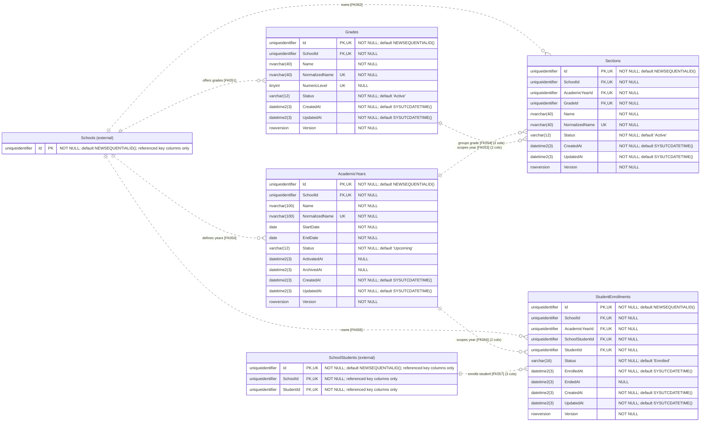

### ORBIT schema — Annual academics — part 2

[Mermaid source](src/schema-academics-2.mmd) · [SVG fallback](svg/schema-academics-2.svg) · [PNG fallback](png/schema-academics-2.png)

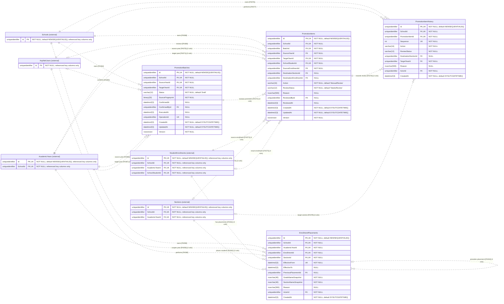

### AcademicYears

school year lifecycle.

Scope: **current required functionality**.

| Column | SQL Server type | PK / FK / UQ | Nullable | Default / generation |
|---|---|---|---|---|
| Id | uniqueidentifier | PK UQ | No | NEWSEQUENTIALID() |
| SchoolId | uniqueidentifier | FK UQ | No | — |
| Name | nvarchar(100) | — | No | — |
| NormalizedName | nvarchar(100) | UQ | No | — |
| StartDate | date | — | No | — |
| EndDate | date | — | No | — |
| Status | varchar(12) COLLATE Latin1_General_100_BIN2 | — | No | 'Upcoming' |
| ActivatedAt | datetime2(3) | — | Yes | — |
| ArchivedAt | datetime2(3) | — | Yes | — |
| CreatedAt | datetime2(3) | — | No | SYSUTCDATETIME() |
| UpdatedAt | datetime2(3) | — | No | SYSUTCDATETIME() |
| Version | rowversion | — | No | — |

**Primary key**

- PK_AcademicYears: NONCLUSTERED (Id)

**Unique constraints**

- UQ_AcademicYears_1: NONCLUSTERED (SchoolId, NormalizedName)
- UQ_AcademicYears_2: CLUSTERED (SchoolId, Id)

**Points to — ordered foreign keys**

- FK050 / FK_AcademicYears_Schools_1: (SchoolId) → Schools (Id); DELETE NO ACTION, UPDATE NO ACTION.

**Referenced by**

- FK053: Sections (SchoolId, AcademicYearId) → (SchoolId, Id).
- FK056: StudentEnrollments (SchoolId, AcademicYearId) → (SchoolId, Id).
- FK059: EnrollmentPlacements (SchoolId, AcademicYearId) → (SchoolId, Id).
- FK066: PromotionBatches (SchoolId, SourceYearId) → (SchoolId, Id).
- FK067: PromotionBatches (SchoolId, TargetYearId) → (SchoolId, Id).
- FK070: PromotionItems (SchoolId, SourceYearId) → (SchoolId, Id).
- FK071: PromotionItems (SchoolId, TargetYearId) → (SchoolId, Id).
- FK081: TeachingAssignments (SchoolId, AcademicYearId) → (SchoolId, Id).
- FK086: TeachingAssignmentHistory (SchoolId, AcademicYearId) → (SchoolId, Id).
- FK091: WeeklySubjectRequirements (SchoolId, AcademicYearId) → (SchoolId, Id).
- FK096: TeacherUnavailableSlots (SchoolId, AcademicYearId) → (SchoolId, Id).
- FK100: Timetables (SchoolId, AcademicYearId) → (SchoolId, Id).
- FK105: TimetableRevisions (SchoolId, AcademicYearId) → (SchoolId, Id).
- FK110: TimetableCells (SchoolId, AcademicYearId) → (SchoolId, Id).
- FK115: PublishedTimetableOccupancy (SchoolId, AcademicYearId) → (SchoolId, Id).
- FK119: TimetableChangeRequests (SchoolId, AcademicYearId) → (SchoolId, Id).
- FK125: Channels (SchoolId, AcademicYearId) → (SchoolId, Id).
- FK131: ChannelSections (SchoolId, AcademicYearId) → (SchoolId, Id).
- FK147: PostSections (SchoolId, AcademicYearId) → (SchoolId, Id).
- FK157: SubmissionVersions (SchoolId, AcademicYearId) → (SchoolId, Id).
- FK168: ContentCorrectionRequests (SchoolId, AcademicYearId) → (SchoolId, Id).
- FK174: CorrectionResponses (SchoolId, AcademicYearId) → (SchoolId, Id).
- FK182: PostModerationActions (SchoolId, AcademicYearId) → (SchoolId, Id).
- FK221: SchoolEvents (SchoolId, AcademicYearId) → (SchoolId, Id).
- FK224: SchoolEventSections (SchoolId, AcademicYearId) → (SchoolId, Id).

**CHECK constraints**

- CK_AcademicYears_Status_Values: `[Status] IN ('Upcoming', 'Active', 'Archived')`
- CK_AcademicYears_Name_Nonblank: `LEN(LTRIM(RTRIM([Name]))) > 0`
- CK_AcademicYears_NormalizedName_Nonblank: `LEN(LTRIM(RTRIM([NormalizedName]))) > 0`
- CK_AcademicYears_Status_Nonblank: `LEN(LTRIM(RTRIM([Status]))) > 0`
- CK_AcademicYears_Dates: `[EndDate] > [StartDate]`

**Clustering strategy**

`UQ_AcademicYears_2` (SchoolId, Id): Tenant-first stable roster/catalog range; the school plus sequential domain ID bounds width to 32 bytes. Global ID PK and other business uniqueness remain NONCLUSTERED.

**Indexes**

- IX_AcademicYears_1: NONCLUSTERED (SchoolId ASC, StartDate ASC, EndDate ASC).
- UX_AcademicYears_2: UNIQUE NONCLUSTERED (SchoolId ASC) WHERE [Status] = 'Active'.

### Grades

school-level grade registry.

Scope: **current required functionality**.

| Column | SQL Server type | PK / FK / UQ | Nullable | Default / generation |
|---|---|---|---|---|
| Id | uniqueidentifier | PK UQ | No | NEWSEQUENTIALID() |
| SchoolId | uniqueidentifier | FK UQ | No | — |
| Name | nvarchar(40) | — | No | — |
| NormalizedName | nvarchar(40) | UQ | No | — |
| NumericLevel | tinyint | UQ | Yes | — |
| Status | varchar(12) COLLATE Latin1_General_100_BIN2 | — | No | 'Active' |
| CreatedAt | datetime2(3) | — | No | SYSUTCDATETIME() |
| UpdatedAt | datetime2(3) | — | No | SYSUTCDATETIME() |
| Version | rowversion | — | No | — |

**Primary key**

- PK_Grades: NONCLUSTERED (Id)

**Unique constraints**

- UQ_Grades_1: NONCLUSTERED (SchoolId, NormalizedName)
- UQ_Grades_2: CLUSTERED (SchoolId, Id)

**Points to — ordered foreign keys**

- FK051 / FK_Grades_Schools_1: (SchoolId) → Schools (Id); DELETE NO ACTION, UPDATE NO ACTION.

**Referenced by**

- FK054: Sections (SchoolId, GradeId) → (SchoolId, Id).
- FK093: WeeklySubjectRequirements (SchoolId, GradeId) → (SchoolId, Id).

**CHECK constraints**

- CK_Grades_Status_Values: `[Status] IN ('Active', 'Archived')`
- CK_Grades_Name_Nonblank: `LEN(LTRIM(RTRIM([Name]))) > 0`
- CK_Grades_NormalizedName_Nonblank: `LEN(LTRIM(RTRIM([NormalizedName]))) > 0`
- CK_Grades_Status_Nonblank: `LEN(LTRIM(RTRIM([Status]))) > 0`
- CK_Grades_NumericLevel: `[NumericLevel] BETWEEN 1 AND 12`

**Clustering strategy**

`UQ_Grades_2` (SchoolId, Id): Tenant-first stable roster/catalog range; the school plus sequential domain ID bounds width to 32 bytes. Global ID PK and other business uniqueness remain NONCLUSTERED.

**Indexes**

- UX_Grades_1: UNIQUE NONCLUSTERED (SchoolId ASC, NumericLevel ASC) WHERE [NumericLevel] IS NOT NULL.

### Sections

class group in one year.

Scope: **current required functionality**.

| Column | SQL Server type | PK / FK / UQ | Nullable | Default / generation |
|---|---|---|---|---|
| Id | uniqueidentifier | PK UQ | No | NEWSEQUENTIALID() |
| SchoolId | uniqueidentifier | FK UQ | No | — |
| AcademicYearId | uniqueidentifier | FK UQ | No | — |
| GradeId | uniqueidentifier | FK UQ | No | — |
| Name | nvarchar(40) | — | No | — |
| NormalizedName | nvarchar(40) | UQ | No | — |
| Status | varchar(12) COLLATE Latin1_General_100_BIN2 | — | No | 'Active' |
| CreatedAt | datetime2(3) | — | No | SYSUTCDATETIME() |
| UpdatedAt | datetime2(3) | — | No | SYSUTCDATETIME() |
| Version | rowversion | — | No | — |

**Primary key**

- PK_Sections: NONCLUSTERED (Id)

**Unique constraints**

- UQ_Sections_1: NONCLUSTERED (SchoolId, AcademicYearId, GradeId, NormalizedName)
- UQ_Sections_2: NONCLUSTERED (SchoolId, AcademicYearId, Id, GradeId)
- UQ_Sections_3: NONCLUSTERED (SchoolId, Id)
- UQ_Sections_4: CLUSTERED (SchoolId, AcademicYearId, Id)

**Points to — ordered foreign keys**

- FK052 / FK_Sections_Schools_1: (SchoolId) → Schools (Id); DELETE NO ACTION, UPDATE NO ACTION.
- FK053 / FK_Sections_AcademicYears_2: (SchoolId, AcademicYearId) → AcademicYears (SchoolId, Id); DELETE NO ACTION, UPDATE NO ACTION.
- FK054 / FK_Sections_Grades_3: (SchoolId, GradeId) → Grades (SchoolId, Id); DELETE NO ACTION, UPDATE NO ACTION.

**Referenced by**

- FK062: EnrollmentPlacements (SchoolId, AcademicYearId, SectionId) → (SchoolId, AcademicYearId, Id).
- FK074: PromotionItems (SchoolId, TargetYearId, DestinationSectionId) → (SchoolId, AcademicYearId, Id).
- FK079: PromotionItemHistory (SchoolId, TargetYearId, DestinationSectionId) → (SchoolId, AcademicYearId, Id).
- FK082: TeachingAssignments (SchoolId, AcademicYearId, SectionId) → (SchoolId, AcademicYearId, Id).
- FK101: Timetables (SchoolId, AcademicYearId, SectionId) → (SchoolId, AcademicYearId, Id).
- FK116: PublishedTimetableOccupancy (SchoolId, AcademicYearId, SectionId) → (SchoolId, AcademicYearId, Id).
- FK133: ChannelSections (SchoolId, AcademicYearId, SectionId) → (SchoolId, AcademicYearId, Id).
- FK226: SchoolEventSections (SchoolId, AcademicYearId, SectionId) → (SchoolId, AcademicYearId, Id).

**CHECK constraints**

- CK_Sections_Status_Values: `[Status] IN ('Active', 'Archived')`
- CK_Sections_Name_Nonblank: `LEN(LTRIM(RTRIM([Name]))) > 0`
- CK_Sections_NormalizedName_Nonblank: `LEN(LTRIM(RTRIM([NormalizedName]))) > 0`
- CK_Sections_Status_Nonblank: `LEN(LTRIM(RTRIM([Status]))) > 0`

**Clustering strategy**

`UQ_Sections_4` (SchoolId, AcademicYearId, Id): Group annual records by school/year while preserving stable IDs. The 48-byte scoped key is a deliberate locality-versus-locator-width tradeoff; teacher/student-specific indexes remain available.

**Indexes**

- IX_Sections_1: NONCLUSTERED (SchoolId ASC, GradeId ASC).

### StudentEnrollments

one annual registration.

Scope: **current required functionality**.

| Column | SQL Server type | PK / FK / UQ | Nullable | Default / generation |
|---|---|---|---|---|
| Id | uniqueidentifier | PK UQ | No | NEWSEQUENTIALID() |
| SchoolId | uniqueidentifier | FK UQ | No | — |
| AcademicYearId | uniqueidentifier | FK UQ | No | — |
| SchoolStudentId | uniqueidentifier | FK UQ | No | — |
| StudentId | uniqueidentifier | FK UQ | No | — |
| Status | varchar(16) COLLATE Latin1_General_100_BIN2 | — | No | 'Enrolled' |
| EnrolledAt | datetime2(3) | — | No | SYSUTCDATETIME() |
| EndedAt | datetime2(3) | — | Yes | — |
| CreatedAt | datetime2(3) | — | No | SYSUTCDATETIME() |
| UpdatedAt | datetime2(3) | — | No | SYSUTCDATETIME() |
| Version | rowversion | — | No | — |

**Primary key**

- PK_StudentEnrollments: NONCLUSTERED (Id)

**Unique constraints**

- UQ_StudentEnrollments_1: NONCLUSTERED (SchoolId, AcademicYearId, SchoolStudentId)
- UQ_StudentEnrollments_2: NONCLUSTERED (SchoolId, AcademicYearId, StudentId)
- UQ_StudentEnrollments_3: NONCLUSTERED (SchoolId, AcademicYearId, Id, SchoolStudentId)
- UQ_StudentEnrollments_4: NONCLUSTERED (SchoolId, Id)
- UQ_StudentEnrollments_5: CLUSTERED (SchoolId, AcademicYearId, Id)

**Points to — ordered foreign keys**

- FK055 / FK_StudentEnrollments_Schools_1: (SchoolId) → Schools (Id); DELETE NO ACTION, UPDATE NO ACTION.
- FK056 / FK_StudentEnrollments_AcademicYears_2: (SchoolId, AcademicYearId) → AcademicYears (SchoolId, Id); DELETE NO ACTION, UPDATE NO ACTION.
- FK057 / FK_StudentEnrollments_SchoolStudents_3: (SchoolId, SchoolStudentId, StudentId) → SchoolStudents (SchoolId, Id, StudentId); DELETE NO ACTION, UPDATE NO ACTION.

**Referenced by**

- FK061: EnrollmentPlacements (SchoolId, AcademicYearId, EnrollmentId) → (SchoolId, AcademicYearId, Id).
- FK073: PromotionItems (SchoolId, SourceYearId, SourceEnrollmentId, SchoolStudentId) → (SchoolId, AcademicYearId, Id, SchoolStudentId).
- FK075: PromotionItems (SchoolId, TargetYearId, DestinationEnrollmentId, SchoolStudentId) → (SchoolId, AcademicYearId, Id, SchoolStudentId).

**CHECK constraints**

- CK_StudentEnrollments_Status_Values: `[Status] IN ('Enrolled', 'Withdrawn', 'TransferredOut', 'Completed')`
- CK_StudentEnrollments_Status_Nonblank: `LEN(LTRIM(RTRIM([Status]))) > 0`
- CK_StudentEnrollments_EndedAt: `[EndedAt] IS NULL OR ([EnrolledAt] IS NOT NULL AND [EndedAt] >= [EnrolledAt])`

**Clustering strategy**

`UQ_StudentEnrollments_5` (SchoolId, AcademicYearId, Id): Group annual records by school/year while preserving stable IDs. The 48-byte scoped key is a deliberate locality-versus-locator-width tradeoff; teacher/student-specific indexes remain available.

**Indexes**

- IX_StudentEnrollments_1: NONCLUSTERED (StudentId ASC, AcademicYearId ASC).
- IX_StudentEnrollments_2: NONCLUSTERED (SchoolId ASC, AcademicYearId ASC, Status ASC).
- IX_StudentEnrollments_3: NONCLUSTERED (SchoolId ASC, SchoolStudentId ASC, StudentId ASC).

### EnrollmentPlacements

section placement history.

Scope: **current required functionality**.

| Column | SQL Server type | PK / FK / UQ | Nullable | Default / generation |
|---|---|---|---|---|
| Id | uniqueidentifier | PK UQ | No | NEWSEQUENTIALID() |
| SchoolId | uniqueidentifier | FK UQ | No | — |
| AcademicYearId | uniqueidentifier | FK UQ | No | — |
| EnrollmentId | uniqueidentifier | FK UQ | No | — |
| SectionId | uniqueidentifier | FK UQ | No | — |
| EffectiveFrom | datetime2(3) | UQ | No | — |
| EffectiveTo | datetime2(3) | — | Yes | — |
| PreviousPlacementId | uniqueidentifier | FK | Yes | — |
| GradeNameSnapshot | nvarchar(40) | — | No | — |
| SectionNameSnapshot | nvarchar(40) | — | No | — |
| Reason | nvarchar(500) | — | Yes | — |
| ActorId | uniqueidentifier | FK | No | — |
| CreatedAt | datetime2(3) | — | No | SYSUTCDATETIME() |

**Primary key**

- PK_EnrollmentPlacements: NONCLUSTERED (Id)

**Unique constraints**

- UQ_EnrollmentPlacements_1: NONCLUSTERED (SchoolId, AcademicYearId, EnrollmentId, Id)
- UQ_EnrollmentPlacements_2: NONCLUSTERED (SchoolId, Id)
- UQ_EnrollmentPlacements_3: NONCLUSTERED (SchoolId, AcademicYearId, Id)
- UQ_EnrollmentPlacements_4: NONCLUSTERED (SchoolId, AcademicYearId, Id, SectionId)

**Points to — ordered foreign keys**

- FK058 / FK_EnrollmentPlacements_Schools_1: (SchoolId) → Schools (Id); DELETE NO ACTION, UPDATE NO ACTION.
- FK059 / FK_EnrollmentPlacements_AcademicYears_2: (SchoolId, AcademicYearId) → AcademicYears (SchoolId, Id); DELETE NO ACTION, UPDATE NO ACTION.
- FK060 / FK_EnrollmentPlacements_AspNetUsers_3: (ActorId) → AspNetUsers (Id); DELETE NO ACTION, UPDATE NO ACTION.
- FK061 / FK_EnrollmentPlacements_StudentEnrollments_4: (SchoolId, AcademicYearId, EnrollmentId) → StudentEnrollments (SchoolId, AcademicYearId, Id); DELETE NO ACTION, UPDATE NO ACTION.
- FK062 / FK_EnrollmentPlacements_Sections_5: (SchoolId, AcademicYearId, SectionId) → Sections (SchoolId, AcademicYearId, Id); DELETE NO ACTION, UPDATE NO ACTION.
- FK063 / FK_EnrollmentPlacements_EnrollmentPlacements_6: (SchoolId, AcademicYearId, EnrollmentId, PreviousPlacementId) → EnrollmentPlacements (SchoolId, AcademicYearId, EnrollmentId, Id); DELETE NO ACTION, UPDATE NO ACTION.

**Referenced by**

- FK063: EnrollmentPlacements (SchoolId, AcademicYearId, EnrollmentId, PreviousPlacementId) → (SchoolId, AcademicYearId, EnrollmentId, Id).
- FK160: SubmissionVersions (SchoolId, AcademicYearId, EnrollmentId, PlacementId) → (SchoolId, AcademicYearId, EnrollmentId, Id).
- FK161: SubmissionVersions (SchoolId, AcademicYearId, PlacementId, SectionId) → (SchoolId, AcademicYearId, Id, SectionId).

**CHECK constraints**

- CK_EnrollmentPlacements_GradeNameSnapshot_Nonblank: `LEN(LTRIM(RTRIM([GradeNameSnapshot]))) > 0`
- CK_EnrollmentPlacements_SectionNameSnapshot_Nonblank: `LEN(LTRIM(RTRIM([SectionNameSnapshot]))) > 0`
- CK_EnrollmentPlacements_Reason_Nonblank: `[Reason] IS NULL OR LEN(LTRIM(RTRIM([Reason]))) > 0`
- CK_EnrollmentPlacements_EffectiveTo: `[EffectiveTo] IS NULL OR ([EffectiveFrom] IS NOT NULL AND [EffectiveTo] > [EffectiveFrom])`
- CK_EnrollmentPlacements_Previous: `[PreviousPlacementId] IS NULL OR ([PreviousPlacementId] <> [Id] AND [Reason] IS NOT NULL)`

**Clustering strategy**

`CX_EnrollmentPlacements_Access` (EnrollmentId, EffectiveFrom, Id): Immutable parent/time/Id range supports chronological history. Id breaks time ties and already guarantees uniqueness; this unique clustered superkey adds no new business restriction. Existing filtered and FK indexes are preserved.

**Indexes**

- IX_EnrollmentPlacements_1: NONCLUSTERED (SchoolId ASC, AcademicYearId ASC, SectionId ASC, EffectiveFrom ASC, EffectiveTo ASC).
- UX_EnrollmentPlacements_2: UNIQUE NONCLUSTERED (SchoolId ASC, AcademicYearId ASC, EnrollmentId ASC) WHERE [EffectiveTo] IS NULL.
- IX_EnrollmentPlacements_3: NONCLUSTERED (ActorId ASC).
- IX_EnrollmentPlacements_4: NONCLUSTERED (SchoolId ASC, AcademicYearId ASC, EnrollmentId ASC, PreviousPlacementId ASC).
- CX_EnrollmentPlacements_Access: UNIQUE CLUSTERED (EnrollmentId ASC, EffectiveFrom ASC, Id ASC).

### PromotionBatches

saved preview, confirmation and execution.

Scope: **current required functionality**.

| Column | SQL Server type | PK / FK / UQ | Nullable | Default / generation |
|---|---|---|---|---|
| Id | uniqueidentifier | PK UQ | No | NEWSEQUENTIALID() |
| SchoolId | uniqueidentifier | FK UQ | No | — |
| SourceYearId | uniqueidentifier | FK UQ | No | — |
| TargetYearId | uniqueidentifier | FK UQ | No | — |
| Status | varchar(12) COLLATE Latin1_General_100_BIN2 | — | No | 'Draft' |
| SourceFingerprint | binary(32) | — | No | — |
| ConfirmedAt | datetime2(3) | — | Yes | — |
| ConfirmedById | uniqueidentifier | FK | Yes | — |
| ExecutedAt | datetime2(3) | — | Yes | — |
| OperationId | uniqueidentifier | UQ | Yes | — |
| CreatedAt | datetime2(3) | — | No | SYSUTCDATETIME() |
| UpdatedAt | datetime2(3) | — | No | SYSUTCDATETIME() |
| Version | rowversion | — | No | — |

**Primary key**

- PK_PromotionBatches: CLUSTERED (Id)

**Unique constraints**

- UQ_PromotionBatches_1: NONCLUSTERED (SchoolId, Id, SourceYearId, TargetYearId)
- UQ_PromotionBatches_2: NONCLUSTERED (SchoolId, Id)

**Points to — ordered foreign keys**

- FK064 / FK_PromotionBatches_Schools_1: (SchoolId) → Schools (Id); DELETE NO ACTION, UPDATE NO ACTION.
- FK065 / FK_PromotionBatches_AspNetUsers_2: (ConfirmedById) → AspNetUsers (Id); DELETE NO ACTION, UPDATE NO ACTION.
- FK066 / FK_PromotionBatches_AcademicYears_3: (SchoolId, SourceYearId) → AcademicYears (SchoolId, Id); DELETE NO ACTION, UPDATE NO ACTION.
- FK067 / FK_PromotionBatches_AcademicYears_4: (SchoolId, TargetYearId) → AcademicYears (SchoolId, Id); DELETE NO ACTION, UPDATE NO ACTION.

**Referenced by**

- FK072: PromotionItems (SchoolId, BatchId, SourceYearId, TargetYearId) → (SchoolId, Id, SourceYearId, TargetYearId).

**CHECK constraints**

- CK_PromotionBatches_Status_Values: `[Status] IN ('Draft', 'Confirmed', 'Executed', 'Cancelled')`
- CK_PromotionBatches_Status_Nonblank: `LEN(LTRIM(RTRIM([Status]))) > 0`
- CK_PromotionBatches_DistinctYears: `[SourceYearId] <> [TargetYearId]`
- CK_PromotionBatches_Lifecycle: `([Status] IN ('Draft','Cancelled') AND [ExecutedAt] IS NULL) OR ([Status] = 'Confirmed' AND [ConfirmedAt] IS NOT NULL AND [ConfirmedById] IS NOT NULL AND [ExecutedAt] IS NULL) OR ([Status] = 'Executed' AND [ConfirmedAt] IS NOT NULL AND [ConfirmedById] IS NOT NULL AND [ExecutedAt] IS NOT NULL AND [OperationId] IS NOT NULL)`
- CK_PromotionBatches_ConfirmedAt_ConfirmedById: `([ConfirmedAt] IS NULL AND [ConfirmedById] IS NULL) OR ([ConfirmedAt] IS NOT NULL AND [ConfirmedById] IS NOT NULL)`

**Clustering strategy**

`PK_PromotionBatches` (Id): Stable, narrow Guid point lookup; NEWSEQUENTIALID supports append-biased inserts. Wider names, mutable status/time fields and existing seek/filter paths stay nonclustered.

**Indexes**

- IX_PromotionBatches_1: NONCLUSTERED (SchoolId ASC, SourceYearId ASC, TargetYearId ASC, Status ASC).
- UX_PromotionBatches_2: UNIQUE NONCLUSTERED (SchoolId ASC, OperationId ASC) WHERE [OperationId] IS NOT NULL.
- IX_PromotionBatches_3: NONCLUSTERED (ConfirmedById ASC).
- IX_PromotionBatches_4: NONCLUSTERED (SchoolId ASC, TargetYearId ASC).

### PromotionItems

reviewed decision for each source enrollment.

Scope: **current required functionality**.

| Column | SQL Server type | PK / FK / UQ | Nullable | Default / generation |
|---|---|---|---|---|
| Id | uniqueidentifier | PK UQ | No | NEWSEQUENTIALID() |
| SchoolId | uniqueidentifier | FK UQ | No | — |
| BatchId | uniqueidentifier | FK UQ | No | — |
| SourceYearId | uniqueidentifier | FK | No | — |
| TargetYearId | uniqueidentifier | FK UQ | No | — |
| SchoolStudentId | uniqueidentifier | FK UQ | No | — |
| SourceEnrollmentId | uniqueidentifier | FK | No | — |
| DestinationSectionId | uniqueidentifier | FK | Yes | — |
| DestinationEnrollmentId | uniqueidentifier | FK | Yes | — |
| Action | varchar(16) COLLATE Latin1_General_100_BIN2 | — | No | 'ManualReview' |
| ReviewStatus | varchar(12) COLLATE Latin1_General_100_BIN2 | — | No | 'NeedsReview' |
| Reason | nvarchar(500) | — | Yes | — |
| ReviewedById | uniqueidentifier | FK | Yes | — |
| ReviewedAt | datetime2(3) | — | Yes | — |
| CreatedAt | datetime2(3) | — | No | SYSUTCDATETIME() |
| UpdatedAt | datetime2(3) | — | No | SYSUTCDATETIME() |
| Version | rowversion | — | No | — |

**Primary key**

- PK_PromotionItems: NONCLUSTERED (Id)

**Unique constraints**

- UQ_PromotionItems_1: CLUSTERED (SchoolId, BatchId, SchoolStudentId)
- UQ_PromotionItems_2: NONCLUSTERED (SchoolId, Id, TargetYearId)
- UQ_PromotionItems_3: NONCLUSTERED (SchoolId, Id)

**Points to — ordered foreign keys**

- FK068 / FK_PromotionItems_Schools_1: (SchoolId) → Schools (Id); DELETE NO ACTION, UPDATE NO ACTION.
- FK069 / FK_PromotionItems_AspNetUsers_2: (ReviewedById) → AspNetUsers (Id); DELETE NO ACTION, UPDATE NO ACTION.
- FK070 / FK_PromotionItems_AcademicYears_3: (SchoolId, SourceYearId) → AcademicYears (SchoolId, Id); DELETE NO ACTION, UPDATE NO ACTION.
- FK071 / FK_PromotionItems_AcademicYears_4: (SchoolId, TargetYearId) → AcademicYears (SchoolId, Id); DELETE NO ACTION, UPDATE NO ACTION.
- FK072 / FK_PromotionItems_PromotionBatches_5: (SchoolId, BatchId, SourceYearId, TargetYearId) → PromotionBatches (SchoolId, Id, SourceYearId, TargetYearId); DELETE NO ACTION, UPDATE NO ACTION.
- FK073 / FK_PromotionItems_StudentEnrollments_6: (SchoolId, SourceYearId, SourceEnrollmentId, SchoolStudentId) → StudentEnrollments (SchoolId, AcademicYearId, Id, SchoolStudentId); DELETE NO ACTION, UPDATE NO ACTION.
- FK074 / FK_PromotionItems_Sections_7: (SchoolId, TargetYearId, DestinationSectionId) → Sections (SchoolId, AcademicYearId, Id); DELETE NO ACTION, UPDATE NO ACTION.
- FK075 / FK_PromotionItems_StudentEnrollments_8: (SchoolId, TargetYearId, DestinationEnrollmentId, SchoolStudentId) → StudentEnrollments (SchoolId, AcademicYearId, Id, SchoolStudentId); DELETE NO ACTION, UPDATE NO ACTION.

**Referenced by**

- FK078: PromotionItemHistory (SchoolId, PromotionItemId, TargetYearId) → (SchoolId, Id, TargetYearId).

**CHECK constraints**

- CK_PromotionItems_Action_Values: `[Action] IN ('ManualReview', 'Promote', 'Repeat', 'Change', 'Exclude', 'GraduationReview')`
- CK_PromotionItems_ReviewStatus_Values: `[ReviewStatus] IN ('NeedsReview', 'Unresolved', 'Reviewed')`
- CK_PromotionItems_Action_Nonblank: `LEN(LTRIM(RTRIM([Action]))) > 0`
- CK_PromotionItems_ReviewStatus_Nonblank: `LEN(LTRIM(RTRIM([ReviewStatus]))) > 0`
- CK_PromotionItems_Reason_Nonblank: `[Reason] IS NULL OR LEN(LTRIM(RTRIM([Reason]))) > 0`
- CK_PromotionItems_Destination: `([Action] IN ('Promote','Repeat','Change') AND [DestinationSectionId] IS NOT NULL) OR ([Action] NOT IN ('Promote','Repeat','Change') AND [DestinationSectionId] IS NULL)`
- CK_PromotionItems_DestinationEnrollment: `[Action] IN ('Promote','Repeat','Change') OR [DestinationEnrollmentId] IS NULL`
- CK_PromotionItems_Review: `[ReviewStatus] <> 'Reviewed' OR ([ReviewedById] IS NOT NULL AND [ReviewedAt] IS NOT NULL)`
- CK_PromotionItems_ReviewedAt_ReviewedById: `([ReviewedAt] IS NULL AND [ReviewedById] IS NULL) OR ([ReviewedAt] IS NOT NULL AND [ReviewedById] IS NOT NULL)`

**Clustering strategy**

`UQ_PromotionItems_1` (SchoolId, BatchId, SchoolStudentId): Promotion preview/confirmation loads one batch of student decisions; immutable parent/student keys group that work without clustering on mutable review state.

**Indexes**

- IX_PromotionItems_1: NONCLUSTERED (ReviewedById ASC).
- IX_PromotionItems_2: NONCLUSTERED (SchoolId ASC, SourceYearId ASC).
- IX_PromotionItems_3: NONCLUSTERED (SchoolId ASC, TargetYearId ASC).
- IX_PromotionItems_4: NONCLUSTERED (SchoolId ASC, BatchId ASC, SourceYearId ASC, TargetYearId ASC).
- IX_PromotionItems_5: NONCLUSTERED (SchoolId ASC, SourceYearId ASC, SourceEnrollmentId ASC, SchoolStudentId ASC).
- IX_PromotionItems_6: NONCLUSTERED (SchoolId ASC, TargetYearId ASC, DestinationSectionId ASC).
- IX_PromotionItems_7: NONCLUSTERED (SchoolId ASC, TargetYearId ASC, DestinationEnrollmentId ASC, SchoolStudentId ASC).

### PromotionItemHistory

immutable review revisions.

Scope: **current required functionality**.

| Column | SQL Server type | PK / FK / UQ | Nullable | Default / generation |
|---|---|---|---|---|
| Id | uniqueidentifier | PK UQ | No | NEWSEQUENTIALID() |
| SchoolId | uniqueidentifier | FK UQ | No | — |
| PromotionItemId | uniqueidentifier | FK UQ | No | — |
| Sequence | int | UQ | No | — |
| Action | varchar(16) COLLATE Latin1_General_100_BIN2 | — | No | — |
| ReviewStatus | varchar(12) COLLATE Latin1_General_100_BIN2 | — | No | — |
| DestinationSectionId | uniqueidentifier | FK | Yes | — |
| TargetYearId | uniqueidentifier | FK | No | — |
| Reason | nvarchar(500) | — | Yes | — |
| ActorId | uniqueidentifier | FK | No | — |
| CreatedAt | datetime2(3) | — | No | SYSUTCDATETIME() |

**Primary key**

- PK_PromotionItemHistory: NONCLUSTERED (Id)

**Unique constraints**

- UQ_PromotionItemHistory_1: CLUSTERED (SchoolId, PromotionItemId, Sequence)
- UQ_PromotionItemHistory_2: NONCLUSTERED (SchoolId, Id)

**Points to — ordered foreign keys**

- FK076 / FK_PromotionItemHistory_Schools_1: (SchoolId) → Schools (Id); DELETE NO ACTION, UPDATE NO ACTION.
- FK077 / FK_PromotionItemHistory_AspNetUsers_2: (ActorId) → AspNetUsers (Id); DELETE NO ACTION, UPDATE NO ACTION.
- FK078 / FK_PromotionItemHistory_PromotionItems_3: (SchoolId, PromotionItemId, TargetYearId) → PromotionItems (SchoolId, Id, TargetYearId); DELETE NO ACTION, UPDATE NO ACTION.
- FK079 / FK_PromotionItemHistory_Sections_4: (SchoolId, TargetYearId, DestinationSectionId) → Sections (SchoolId, AcademicYearId, Id); DELETE NO ACTION, UPDATE NO ACTION.

**Referenced by**

None.

**CHECK constraints**

- CK_PromotionItemHistory_Action_Values: `[Action] IN ('ManualReview', 'Promote', 'Repeat', 'Change', 'Exclude', 'GraduationReview')`
- CK_PromotionItemHistory_ReviewStatus_Values: `[ReviewStatus] IN ('NeedsReview', 'Unresolved', 'Reviewed')`
- CK_PromotionItemHistory_Action_Nonblank: `LEN(LTRIM(RTRIM([Action]))) > 0`
- CK_PromotionItemHistory_ReviewStatus_Nonblank: `LEN(LTRIM(RTRIM([ReviewStatus]))) > 0`
- CK_PromotionItemHistory_Reason_Nonblank: `[Reason] IS NULL OR LEN(LTRIM(RTRIM([Reason]))) > 0`
- CK_PromotionItemHistory_Destination: `([Action] IN ('Promote','Repeat','Change') AND [DestinationSectionId] IS NOT NULL) OR ([Action] NOT IN ('Promote','Repeat','Change') AND [DestinationSectionId] IS NULL)`
- CK_PromotionItemHistory_Sequence: `[Sequence] > 0`

**Clustering strategy**

`UQ_PromotionItemHistory_1` (SchoolId, PromotionItemId, Sequence): Append/read decision history per promotion item in sequence order; retain global ID and target-year candidate keys.

**Indexes**

- IX_PromotionItemHistory_1: NONCLUSTERED (ActorId ASC).
- IX_PromotionItemHistory_2: NONCLUSTERED (SchoolId ASC, PromotionItemId ASC, TargetYearId ASC).
- IX_PromotionItemHistory_3: NONCLUSTERED (SchoolId ASC, TargetYearId ASC, DestinationSectionId ASC).

## Teaching & timetables

### ORBIT schema — Teaching & timetables — part 1

[Mermaid source](src/schema-teaching-1.mmd) · [SVG fallback](svg/schema-teaching-1.svg) · [PNG fallback](png/schema-teaching-1.png)

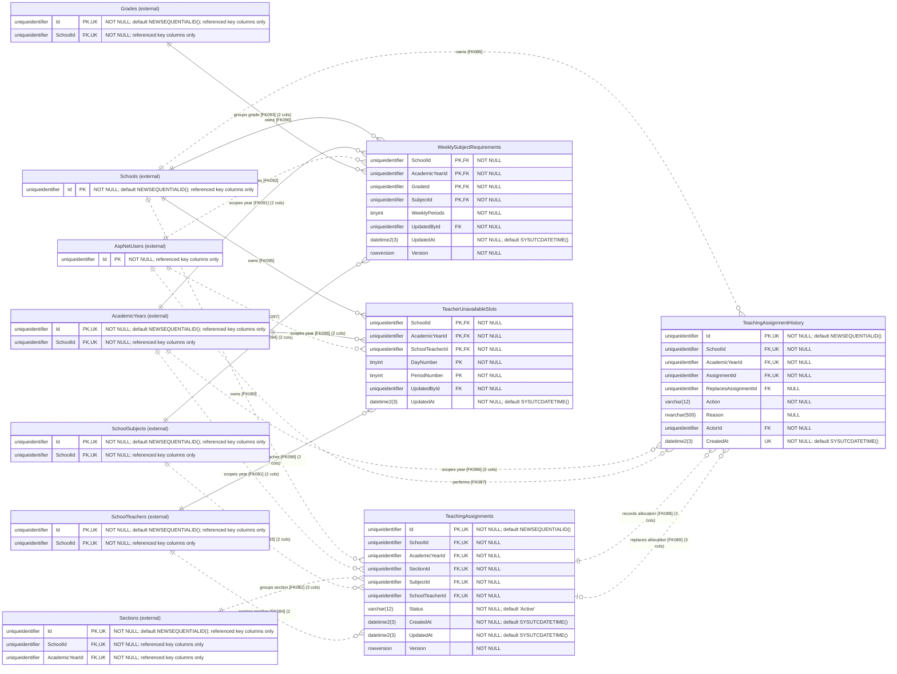

### ORBIT schema — Teaching & timetables — part 2

[Mermaid source](src/schema-teaching-2.mmd) · [SVG fallback](svg/schema-teaching-2.svg) · [PNG fallback](png/schema-teaching-2.png)

```mermaid
erDiagram
  direction LR
  accTitle: ORBIT schema — Teaching & timetables — part 2
  accDescr: White background. External entities are marked external. Business relationship labels and stable FK IDs map to ordered source and referenced columns in the accompanying Markdown.
  Timetables["Timetables"] {
    uniqueidentifier Id PK, FK, UK "NOT NULL; default NEWSEQUENTIALID()"
    uniqueidentifier SchoolId FK, UK "NOT NULL"
    uniqueidentifier AcademicYearId FK, UK "NOT NULL"
    uniqueidentifier SectionId FK, UK "NOT NULL"
    uniqueidentifier CurrentDraftRevisionId FK "NULL"
    uniqueidentifier PublishedRevisionId FK "NULL"
    datetime2(3) CreatedAt "NOT NULL; default SYSUTCDATETIME()"
    datetime2(3) UpdatedAt "NOT NULL; default SYSUTCDATETIME()"
    rowversion Version "NOT NULL"
  }
  TimetableRevisions["TimetableRevisions"] {
    uniqueidentifier Id PK, UK "NOT NULL; default NEWSEQUENTIALID()"
    uniqueidentifier SchoolId FK, UK "NOT NULL"
    uniqueidentifier AcademicYearId FK, UK "NOT NULL"
    uniqueidentifier TimetableId FK, UK "NOT NULL"
    uniqueidentifier SectionId FK, UK "NOT NULL"
    int RevisionNumber UK "NOT NULL"
    int PublishedNumber UK "NULL"
    uniqueidentifier SavedById FK "NOT NULL"
    datetime2(3) CreatedAt "NOT NULL; default SYSUTCDATETIME()"
    datetime2(3) PublishedAt "NULL"
    uniqueidentifier PublishedById FK "NULL"
    varchar(24) Action "NOT NULL"
  }
  TimetableCells["TimetableCells"] {
    uniqueidentifier Id PK, UK "NOT NULL; default NEWSEQUENTIALID()"
    uniqueidentifier SchoolId FK, UK "NOT NULL"
    uniqueidentifier AcademicYearId FK, UK "NOT NULL"
    uniqueidentifier RevisionId FK, UK "NOT NULL"
    uniqueidentifier SectionId FK, UK "NOT NULL"
    tinyint DayNumber UK "NOT NULL"
    tinyint PeriodNumber UK "NOT NULL"
    uniqueidentifier AssignmentId FK "NOT NULL"
    uniqueidentifier SubjectId FK "NOT NULL"
    uniqueidentifier SchoolTeacherId FK, UK "NOT NULL"
    uniqueidentifier ChannelId FK "NULL"
    nvarchar(160) TeacherNameSnapshot "NOT NULL"
    nvarchar(160) SubjectNameSnapshot "NOT NULL"
  }
  PublishedTimetableOccupancy["PublishedTimetableOccupancy"] {
    uniqueidentifier SchoolId PK, FK, UK "NOT NULL"
    uniqueidentifier AcademicYearId PK, FK, UK "NOT NULL"
    uniqueidentifier SectionId PK, FK "NOT NULL"
    tinyint DayNumber PK, FK, UK "NOT NULL"
    tinyint PeriodNumber PK, FK, UK "NOT NULL"
    uniqueidentifier CellId FK "NOT NULL"
    uniqueidentifier SchoolTeacherId FK, UK "NOT NULL"
  }
  Schools["Schools (external)"] {
    uniqueidentifier Id PK "NOT NULL; default NEWSEQUENTIALID(); referenced key columns only"
  }
  AcademicYears["AcademicYears (external)"] {
    uniqueidentifier Id PK, UK "NOT NULL; default NEWSEQUENTIALID(); referenced key columns only"
    uniqueidentifier SchoolId FK, UK "NOT NULL; referenced key columns only"
  }
  Sections["Sections (external)"] {
    uniqueidentifier Id PK, UK "NOT NULL; default NEWSEQUENTIALID(); referenced key columns only"
    uniqueidentifier SchoolId FK, UK "NOT NULL; referenced key columns only"
    uniqueidentifier AcademicYearId FK, UK "NOT NULL; referenced key columns only"
  }
  AspNetUsers["AspNetUsers (external)"] {
    uniqueidentifier Id PK "NOT NULL; referenced key columns only"
  }
  TeachingAssignments["TeachingAssignments (external)"] {
    uniqueidentifier Id PK, UK "NOT NULL; default NEWSEQUENTIALID(); referenced key columns only"
    uniqueidentifier SchoolId FK, UK "NOT NULL; referenced key columns only"
    uniqueidentifier AcademicYearId FK, UK "NOT NULL; referenced key columns only"
    uniqueidentifier SectionId FK, UK "NOT NULL; referenced key columns only"
    uniqueidentifier SubjectId FK, UK "NOT NULL; referenced key columns only"
    uniqueidentifier SchoolTeacherId FK, UK "NOT NULL; referenced key columns only"
  }
  ChannelSections["ChannelSections (external)"] {
    uniqueidentifier SchoolId PK, FK, UK "NOT NULL; referenced key columns only"
    uniqueidentifier AcademicYearId PK, FK, UK "NOT NULL; referenced key columns only"
    uniqueidentifier ChannelId PK, FK, UK "NOT NULL; referenced key columns only"
    uniqueidentifier SectionId PK, FK, UK "NOT NULL; referenced key columns only"
    uniqueidentifier SubjectId FK, UK "NOT NULL; referenced key columns only"
  }
  Schools ||..o{ Timetables : "owns [FK099]"
  AcademicYears ||..o{ Timetables : "scopes year [FK100] (2 cols)"
  Sections ||..o| Timetables : "groups section [FK101] (3 cols)"
  TimetableRevisions |o..o| Timetables : "current draft [FK102] (5 cols)"
  TimetableRevisions |o..o| Timetables : "published version [FK103] (5 cols)"
  Schools ||..o{ TimetableRevisions : "owns [FK104]"
  AcademicYears ||..o{ TimetableRevisions : "scopes year [FK105] (2 cols)"
  AspNetUsers ||..o{ TimetableRevisions : "saves revision [FK106]"
  AspNetUsers |o..o{ TimetableRevisions : "publishes [FK107]"
  Timetables ||..o{ TimetableRevisions : "has revisions [FK108] (4 cols)"
  Schools ||..o{ TimetableCells : "owns [FK109]"
  AcademicYears ||..o{ TimetableCells : "scopes year [FK110] (2 cols)"
  TimetableRevisions ||..o{ TimetableCells : "contains cells [FK111] (4 cols)"
  TeachingAssignments ||..o{ TimetableCells : "schedules lesson [FK112] (6 cols)"
  ChannelSections |o..o{ TimetableCells : "targets section [FK113] (5 cols)"
  Schools ||--o{ PublishedTimetableOccupancy : "owns [FK114]"
  AcademicYears ||--o{ PublishedTimetableOccupancy : "scopes year [FK115] (2 cols)"
  Sections ||--o{ PublishedTimetableOccupancy : "groups section [FK116] (3 cols)"
  TimetableCells ||..o| PublishedTimetableOccupancy : "reserves slot [FK117] (7 cols)"
```

### ORBIT schema — Teaching & timetables — part 3

[Mermaid source](src/schema-teaching-3.mmd) · [SVG fallback](svg/schema-teaching-3.svg) · [PNG fallback](png/schema-teaching-3.png)

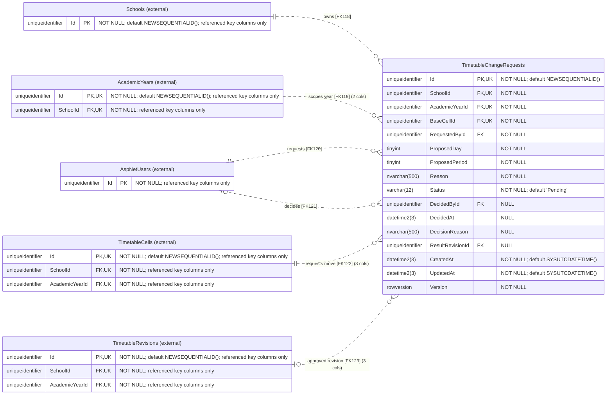

### TeachingAssignments

primary-only annual section/subject/teacher allocation.

Scope: **current required functionality**.

| Column | SQL Server type | PK / FK / UQ | Nullable | Default / generation |
|---|---|---|---|---|
| Id | uniqueidentifier | PK UQ | No | NEWSEQUENTIALID() |
| SchoolId | uniqueidentifier | FK UQ | No | — |
| AcademicYearId | uniqueidentifier | FK UQ | No | — |
| SectionId | uniqueidentifier | FK UQ | No | — |
| SubjectId | uniqueidentifier | FK UQ | No | — |
| SchoolTeacherId | uniqueidentifier | FK UQ | No | — |
| Status | varchar(12) COLLATE Latin1_General_100_BIN2 | — | No | 'Active' |
| CreatedAt | datetime2(3) | — | No | SYSUTCDATETIME() |
| UpdatedAt | datetime2(3) | — | No | SYSUTCDATETIME() |
| Version | rowversion | — | No | — |

**Primary key**

- PK_TeachingAssignments: NONCLUSTERED (Id)

**Unique constraints**

- UQ_TeachingAssignments_1: NONCLUSTERED (SchoolId, AcademicYearId, Id, SectionId, SubjectId, SchoolTeacherId)
- UQ_TeachingAssignments_2: NONCLUSTERED (SchoolId, Id)
- UQ_TeachingAssignments_3: CLUSTERED (SchoolId, AcademicYearId, Id)

**Points to — ordered foreign keys**

- FK080 / FK_TeachingAssignments_Schools_1: (SchoolId) → Schools (Id); DELETE NO ACTION, UPDATE NO ACTION.
- FK081 / FK_TeachingAssignments_AcademicYears_2: (SchoolId, AcademicYearId) → AcademicYears (SchoolId, Id); DELETE NO ACTION, UPDATE NO ACTION.
- FK082 / FK_TeachingAssignments_Sections_3: (SchoolId, AcademicYearId, SectionId) → Sections (SchoolId, AcademicYearId, Id); DELETE NO ACTION, UPDATE NO ACTION.
- FK083 / FK_TeachingAssignments_SchoolSubjects_4: (SchoolId, SubjectId) → SchoolSubjects (SchoolId, Id); DELETE NO ACTION, UPDATE NO ACTION.
- FK084 / FK_TeachingAssignments_SchoolTeachers_5: (SchoolId, SchoolTeacherId) → SchoolTeachers (SchoolId, Id); DELETE NO ACTION, UPDATE NO ACTION.

**Referenced by**

- FK088: TeachingAssignmentHistory (SchoolId, AcademicYearId, AssignmentId) → (SchoolId, AcademicYearId, Id).
- FK089: TeachingAssignmentHistory (SchoolId, AcademicYearId, ReplacesAssignmentId) → (SchoolId, AcademicYearId, Id).
- FK112: TimetableCells (SchoolId, AcademicYearId, AssignmentId, SectionId, SubjectId, SchoolTeacherId) → (SchoolId, AcademicYearId, Id, SectionId, SubjectId, SchoolTeacherId).

**CHECK constraints**

- CK_TeachingAssignments_Status_Values: `[Status] IN ('Active', 'Retired')`
- CK_TeachingAssignments_Status_Nonblank: `LEN(LTRIM(RTRIM([Status]))) > 0`

**Clustering strategy**

`UQ_TeachingAssignments_3` (SchoolId, AcademicYearId, Id): Group annual records by school/year while preserving stable IDs. The 48-byte scoped key is a deliberate locality-versus-locator-width tradeoff; teacher/student-specific indexes remain available.

**Indexes**

- IX_TeachingAssignments_1: NONCLUSTERED (SchoolId ASC, AcademicYearId ASC, SchoolTeacherId ASC, Status ASC).
- UX_TeachingAssignments_2: UNIQUE NONCLUSTERED (SchoolId ASC, AcademicYearId ASC, SectionId ASC, SubjectId ASC) WHERE [Status] = 'Active'.
- IX_TeachingAssignments_3: NONCLUSTERED (SchoolId ASC, AcademicYearId ASC, SectionId ASC).
- IX_TeachingAssignments_4: NONCLUSTERED (SchoolId ASC, SubjectId ASC).
- IX_TeachingAssignments_5: NONCLUSTERED (SchoolId ASC, SchoolTeacherId ASC).

### TeachingAssignmentHistory

allocation lifecycle/reason.

Scope: **current required functionality**.

| Column | SQL Server type | PK / FK / UQ | Nullable | Default / generation |
|---|---|---|---|---|
| Id | uniqueidentifier | PK UQ | No | NEWSEQUENTIALID() |
| SchoolId | uniqueidentifier | FK UQ | No | — |
| AcademicYearId | uniqueidentifier | FK UQ | No | — |
| AssignmentId | uniqueidentifier | FK UQ | No | — |
| ReplacesAssignmentId | uniqueidentifier | FK | Yes | — |
| Action | varchar(12) COLLATE Latin1_General_100_BIN2 | — | No | — |
| Reason | nvarchar(500) | — | Yes | — |
| ActorId | uniqueidentifier | FK | No | — |
| CreatedAt | datetime2(3) | UQ | No | SYSUTCDATETIME() |

**Primary key**

- PK_TeachingAssignmentHistory: NONCLUSTERED (Id)

**Unique constraints**

- UQ_TeachingAssignmentHistory_1: NONCLUSTERED (SchoolId, Id)
- UQ_TeachingAssignmentHistory_2: NONCLUSTERED (SchoolId, AcademicYearId, Id)

**Points to — ordered foreign keys**

- FK085 / FK_TeachingAssignmentHistory_Schools_1: (SchoolId) → Schools (Id); DELETE NO ACTION, UPDATE NO ACTION.
- FK086 / FK_TeachingAssignmentHistory_AcademicYears_2: (SchoolId, AcademicYearId) → AcademicYears (SchoolId, Id); DELETE NO ACTION, UPDATE NO ACTION.
- FK087 / FK_TeachingAssignmentHistory_AspNetUsers_3: (ActorId) → AspNetUsers (Id); DELETE NO ACTION, UPDATE NO ACTION.
- FK088 / FK_TeachingAssignmentHistory_TeachingAssignments_4: (SchoolId, AcademicYearId, AssignmentId) → TeachingAssignments (SchoolId, AcademicYearId, Id); DELETE NO ACTION, UPDATE NO ACTION.
- FK089 / FK_TeachingAssignmentHistory_TeachingAssignments_5: (SchoolId, AcademicYearId, ReplacesAssignmentId) → TeachingAssignments (SchoolId, AcademicYearId, Id); DELETE NO ACTION, UPDATE NO ACTION.

**Referenced by**

None.

**CHECK constraints**

- CK_TeachingAssignmentHistory_Action_Values: `[Action] IN ('Created', 'Retired')`
- CK_TeachingAssignmentHistory_Action_Nonblank: `LEN(LTRIM(RTRIM([Action]))) > 0`
- CK_TeachingAssignmentHistory_Reason_Nonblank: `[Reason] IS NULL OR LEN(LTRIM(RTRIM([Reason]))) > 0`
- CK_TeachingAssignmentHistory_Reason: `([Action] <> 'Retired' AND [ReplacesAssignmentId] IS NULL) OR [Reason] IS NOT NULL`

**Clustering strategy**

`CX_TeachingAssignmentHistory_Access` (AssignmentId, CreatedAt, Id): Immutable parent/time/Id range supports chronological history. Id breaks time ties and already guarantees uniqueness; this unique clustered superkey adds no new business restriction. Existing filtered and FK indexes are preserved.

**Indexes**

- IX_TeachingAssignmentHistory_1: NONCLUSTERED (SchoolId ASC, AcademicYearId ASC, AssignmentId ASC, CreatedAt ASC).
- IX_TeachingAssignmentHistory_2: NONCLUSTERED (ActorId ASC).
- IX_TeachingAssignmentHistory_3: NONCLUSTERED (SchoolId ASC, AcademicYearId ASC, ReplacesAssignmentId ASC).
- CX_TeachingAssignmentHistory_Access: UNIQUE CLUSTERED (AssignmentId ASC, CreatedAt ASC, Id ASC).

### WeeklySubjectRequirements

year/grade curriculum counts.

Scope: **current required functionality**.

| Column | SQL Server type | PK / FK / UQ | Nullable | Default / generation |
|---|---|---|---|---|
| SchoolId | uniqueidentifier | PK FK | No | — |
| AcademicYearId | uniqueidentifier | PK FK | No | — |
| GradeId | uniqueidentifier | PK FK | No | — |
| SubjectId | uniqueidentifier | PK FK | No | — |
| WeeklyPeriods | tinyint | — | No | — |
| UpdatedById | uniqueidentifier | FK | No | — |
| UpdatedAt | datetime2(3) | — | No | SYSUTCDATETIME() |
| Version | rowversion | — | No | — |

**Primary key**

- PK_WeeklySubjectRequirements: CLUSTERED (SchoolId, AcademicYearId, GradeId, SubjectId)

**Unique constraints**

None beyond the primary key.

**Points to — ordered foreign keys**

- FK090 / FK_WeeklySubjectRequirements_Schools_1: (SchoolId) → Schools (Id); DELETE NO ACTION, UPDATE NO ACTION.
- FK091 / FK_WeeklySubjectRequirements_AcademicYears_2: (SchoolId, AcademicYearId) → AcademicYears (SchoolId, Id); DELETE NO ACTION, UPDATE NO ACTION.
- FK092 / FK_WeeklySubjectRequirements_AspNetUsers_3: (UpdatedById) → AspNetUsers (Id); DELETE NO ACTION, UPDATE NO ACTION.
- FK093 / FK_WeeklySubjectRequirements_Grades_4: (SchoolId, GradeId) → Grades (SchoolId, Id); DELETE NO ACTION, UPDATE NO ACTION.
- FK094 / FK_WeeklySubjectRequirements_SchoolSubjects_5: (SchoolId, SubjectId) → SchoolSubjects (SchoolId, Id); DELETE NO ACTION, UPDATE NO ACTION.

**Referenced by**

None.

**CHECK constraints**

- CK_WeeklySubjectRequirements_WeeklyPeriods: `[WeeklyPeriods] BETWEEN 0 AND 35`

**Clustering strategy**

`PK_WeeklySubjectRequirements` (SchoolId, AcademicYearId, GradeId, SubjectId): Parent-first junction key keeps related membership/lookup rows together; the existing composite uniqueness is unchanged.

**Indexes**

- IX_WeeklySubjectRequirements_1: NONCLUSTERED (UpdatedById ASC).
- IX_WeeklySubjectRequirements_2: NONCLUSTERED (SchoolId ASC, GradeId ASC).
- IX_WeeklySubjectRequirements_3: NONCLUSTERED (SchoolId ASC, SubjectId ASC).

### TeacherUnavailableSlots

annual numbered availability.

Scope: **current required functionality**.

| Column | SQL Server type | PK / FK / UQ | Nullable | Default / generation |
|---|---|---|---|---|
| SchoolId | uniqueidentifier | PK FK | No | — |
| AcademicYearId | uniqueidentifier | PK FK | No | — |
| SchoolTeacherId | uniqueidentifier | PK FK | No | — |
| DayNumber | tinyint | PK | No | — |
| PeriodNumber | tinyint | PK | No | — |
| UpdatedById | uniqueidentifier | FK | No | — |
| UpdatedAt | datetime2(3) | — | No | SYSUTCDATETIME() |

**Primary key**

- PK_TeacherUnavailableSlots: CLUSTERED (SchoolId, AcademicYearId, SchoolTeacherId, DayNumber, PeriodNumber)

**Unique constraints**

None beyond the primary key.

**Points to — ordered foreign keys**

- FK095 / FK_TeacherUnavailableSlots_Schools_1: (SchoolId) → Schools (Id); DELETE NO ACTION, UPDATE NO ACTION.
- FK096 / FK_TeacherUnavailableSlots_AcademicYears_2: (SchoolId, AcademicYearId) → AcademicYears (SchoolId, Id); DELETE NO ACTION, UPDATE NO ACTION.
- FK097 / FK_TeacherUnavailableSlots_AspNetUsers_3: (UpdatedById) → AspNetUsers (Id); DELETE NO ACTION, UPDATE NO ACTION.
- FK098 / FK_TeacherUnavailableSlots_SchoolTeachers_4: (SchoolId, SchoolTeacherId) → SchoolTeachers (SchoolId, Id); DELETE NO ACTION, UPDATE NO ACTION.

**Referenced by**

None.

**CHECK constraints**

- CK_TeacherUnavailableSlots_DayNumber: `[DayNumber] BETWEEN 0 AND 4`
- CK_TeacherUnavailableSlots_PeriodNumber: `[PeriodNumber] BETWEEN 1 AND 7`

**Clustering strategy**

`PK_TeacherUnavailableSlots` (SchoolId, AcademicYearId, SchoolTeacherId, DayNumber, PeriodNumber): Parent-first junction key keeps related membership/lookup rows together; the existing composite uniqueness is unchanged.

**Indexes**

- IX_TeacherUnavailableSlots_1: NONCLUSTERED (UpdatedById ASC).
- IX_TeacherUnavailableSlots_2: NONCLUSTERED (SchoolId ASC, SchoolTeacherId ASC).

### Timetables

one section timetable aggregate/year.

Scope: **current required functionality**.

| Column | SQL Server type | PK / FK / UQ | Nullable | Default / generation |
|---|---|---|---|---|
| Id | uniqueidentifier | PK FK UQ | No | NEWSEQUENTIALID() |
| SchoolId | uniqueidentifier | FK UQ | No | — |
| AcademicYearId | uniqueidentifier | FK UQ | No | — |
| SectionId | uniqueidentifier | FK UQ | No | — |
| CurrentDraftRevisionId | uniqueidentifier | FK | Yes | — |
| PublishedRevisionId | uniqueidentifier | FK | Yes | — |
| CreatedAt | datetime2(3) | — | No | SYSUTCDATETIME() |
| UpdatedAt | datetime2(3) | — | No | SYSUTCDATETIME() |
| Version | rowversion | — | No | — |

**Primary key**

- PK_Timetables: NONCLUSTERED (Id)

**Unique constraints**

- UQ_Timetables_1: CLUSTERED (SchoolId, AcademicYearId, SectionId)
- UQ_Timetables_2: NONCLUSTERED (SchoolId, AcademicYearId, Id, SectionId)
- UQ_Timetables_3: NONCLUSTERED (SchoolId, Id)
- UQ_Timetables_4: NONCLUSTERED (SchoolId, AcademicYearId, Id)

**Points to — ordered foreign keys**

- FK099 / FK_Timetables_Schools_1: (SchoolId) → Schools (Id); DELETE NO ACTION, UPDATE NO ACTION.
- FK100 / FK_Timetables_AcademicYears_2: (SchoolId, AcademicYearId) → AcademicYears (SchoolId, Id); DELETE NO ACTION, UPDATE NO ACTION.
- FK101 / FK_Timetables_Sections_3: (SchoolId, AcademicYearId, SectionId) → Sections (SchoolId, AcademicYearId, Id); DELETE NO ACTION, UPDATE NO ACTION.
- FK102 / FK_Timetables_TimetableRevisions_4: (SchoolId, AcademicYearId, Id, SectionId, CurrentDraftRevisionId) → TimetableRevisions (SchoolId, AcademicYearId, TimetableId, SectionId, Id); DELETE NO ACTION, UPDATE NO ACTION.
- FK103 / FK_Timetables_TimetableRevisions_5: (SchoolId, AcademicYearId, Id, SectionId, PublishedRevisionId) → TimetableRevisions (SchoolId, AcademicYearId, TimetableId, SectionId, Id); DELETE NO ACTION, UPDATE NO ACTION.

**Referenced by**

- FK108: TimetableRevisions (SchoolId, AcademicYearId, TimetableId, SectionId) → (SchoolId, AcademicYearId, Id, SectionId).

**CHECK constraints**

None.

**Clustering strategy**

`UQ_Timetables_1` (SchoolId, AcademicYearId, SectionId): One annual timetable per section is the dominant lookup. Draft/published pointers change without moving the clustering key.

**Indexes**

- IX_Timetables_1: NONCLUSTERED (SchoolId ASC, AcademicYearId ASC, Id ASC, SectionId ASC, CurrentDraftRevisionId ASC).
- IX_Timetables_2: NONCLUSTERED (SchoolId ASC, AcademicYearId ASC, Id ASC, SectionId ASC, PublishedRevisionId ASC).

### TimetableRevisions

immutable full draft/published snapshot.

Scope: **current required functionality**.

| Column | SQL Server type | PK / FK / UQ | Nullable | Default / generation |
|---|---|---|---|---|
| Id | uniqueidentifier | PK UQ | No | NEWSEQUENTIALID() |
| SchoolId | uniqueidentifier | FK UQ | No | — |
| AcademicYearId | uniqueidentifier | FK UQ | No | — |
| TimetableId | uniqueidentifier | FK UQ | No | — |
| SectionId | uniqueidentifier | FK UQ | No | — |
| RevisionNumber | int | UQ | No | — |
| PublishedNumber | int | UQ | Yes | — |
| SavedById | uniqueidentifier | FK | No | — |
| CreatedAt | datetime2(3) | — | No | SYSUTCDATETIME() |
| PublishedAt | datetime2(3) | — | Yes | — |
| PublishedById | uniqueidentifier | FK | Yes | — |
| Action | varchar(24) COLLATE Latin1_General_100_BIN2 | — | No | — |

**Primary key**

- PK_TimetableRevisions: NONCLUSTERED (Id)

**Unique constraints**

- UQ_TimetableRevisions_1: CLUSTERED (SchoolId, AcademicYearId, TimetableId, RevisionNumber)
- UQ_TimetableRevisions_2: NONCLUSTERED (SchoolId, AcademicYearId, TimetableId, SectionId, Id)
- UQ_TimetableRevisions_3: NONCLUSTERED (SchoolId, AcademicYearId, Id, SectionId)
- UQ_TimetableRevisions_4: NONCLUSTERED (SchoolId, Id)
- UQ_TimetableRevisions_5: NONCLUSTERED (SchoolId, AcademicYearId, Id)

**Points to — ordered foreign keys**

- FK104 / FK_TimetableRevisions_Schools_1: (SchoolId) → Schools (Id); DELETE NO ACTION, UPDATE NO ACTION.
- FK105 / FK_TimetableRevisions_AcademicYears_2: (SchoolId, AcademicYearId) → AcademicYears (SchoolId, Id); DELETE NO ACTION, UPDATE NO ACTION.
- FK106 / FK_TimetableRevisions_AspNetUsers_3: (SavedById) → AspNetUsers (Id); DELETE NO ACTION, UPDATE NO ACTION.
- FK107 / FK_TimetableRevisions_AspNetUsers_4: (PublishedById) → AspNetUsers (Id); DELETE NO ACTION, UPDATE NO ACTION.
- FK108 / FK_TimetableRevisions_Timetables_5: (SchoolId, AcademicYearId, TimetableId, SectionId) → Timetables (SchoolId, AcademicYearId, Id, SectionId); DELETE NO ACTION, UPDATE NO ACTION.

**Referenced by**

- FK102: Timetables (SchoolId, AcademicYearId, Id, SectionId, CurrentDraftRevisionId) → (SchoolId, AcademicYearId, TimetableId, SectionId, Id).
- FK103: Timetables (SchoolId, AcademicYearId, Id, SectionId, PublishedRevisionId) → (SchoolId, AcademicYearId, TimetableId, SectionId, Id).
- FK111: TimetableCells (SchoolId, AcademicYearId, RevisionId, SectionId) → (SchoolId, AcademicYearId, Id, SectionId).
- FK123: TimetableChangeRequests (SchoolId, AcademicYearId, ResultRevisionId) → (SchoolId, AcademicYearId, Id).

**CHECK constraints**

- CK_TimetableRevisions_Action_Values: `[Action] IN ('Blank', 'Edit', 'Remove', 'Copy', 'Assistant', 'TeacherRequest', 'Save')`
- CK_TimetableRevisions_Action_Nonblank: `LEN(LTRIM(RTRIM([Action]))) > 0`
- CK_TimetableRevisions_RevisionNumber: `[RevisionNumber] > 0`
- CK_TimetableRevisions_PublishedMetadata: `([PublishedNumber] IS NULL AND [PublishedAt] IS NULL AND [PublishedById] IS NULL) OR ([PublishedNumber] IS NOT NULL AND [PublishedNumber] > 0 AND [PublishedAt] IS NOT NULL AND [PublishedById] IS NOT NULL)`

**Clustering strategy**

`UQ_TimetableRevisions_1` (SchoolId, AcademicYearId, TimetableId, RevisionNumber): Version history is read/appended per timetable, ordered by immutable revision number. Publication metadata is not the clustering key.

**Indexes**

- UX_TimetableRevisions_1: UNIQUE NONCLUSTERED (SchoolId ASC, AcademicYearId ASC, TimetableId ASC, PublishedNumber ASC) WHERE [PublishedNumber] IS NOT NULL.
- IX_TimetableRevisions_2: NONCLUSTERED (SavedById ASC).
- IX_TimetableRevisions_3: NONCLUSTERED (PublishedById ASC).

### TimetableCells

occupied slots only.

Scope: **current required functionality**.

| Column | SQL Server type | PK / FK / UQ | Nullable | Default / generation |
|---|---|---|---|---|
| Id | uniqueidentifier | PK UQ | No | NEWSEQUENTIALID() |
| SchoolId | uniqueidentifier | FK UQ | No | — |
| AcademicYearId | uniqueidentifier | FK UQ | No | — |
| RevisionId | uniqueidentifier | FK UQ | No | — |
| SectionId | uniqueidentifier | FK UQ | No | — |
| DayNumber | tinyint | UQ | No | — |
| PeriodNumber | tinyint | UQ | No | — |
| AssignmentId | uniqueidentifier | FK | No | — |
| SubjectId | uniqueidentifier | FK | No | — |
| SchoolTeacherId | uniqueidentifier | FK UQ | No | — |
| ChannelId | uniqueidentifier | FK | Yes | — |
| TeacherNameSnapshot | nvarchar(160) | — | No | — |
| SubjectNameSnapshot | nvarchar(160) | — | No | — |

**Primary key**

- PK_TimetableCells: NONCLUSTERED (Id)

**Unique constraints**

- UQ_TimetableCells_1: CLUSTERED (SchoolId, AcademicYearId, RevisionId, DayNumber, PeriodNumber)
- UQ_TimetableCells_2: NONCLUSTERED (SchoolId, AcademicYearId, Id, SectionId, SchoolTeacherId, DayNumber, PeriodNumber)
- UQ_TimetableCells_3: NONCLUSTERED (SchoolId, Id)
- UQ_TimetableCells_4: NONCLUSTERED (SchoolId, AcademicYearId, Id)

**Points to — ordered foreign keys**

- FK109 / FK_TimetableCells_Schools_1: (SchoolId) → Schools (Id); DELETE NO ACTION, UPDATE NO ACTION.
- FK110 / FK_TimetableCells_AcademicYears_2: (SchoolId, AcademicYearId) → AcademicYears (SchoolId, Id); DELETE NO ACTION, UPDATE NO ACTION.
- FK111 / FK_TimetableCells_TimetableRevisions_3: (SchoolId, AcademicYearId, RevisionId, SectionId) → TimetableRevisions (SchoolId, AcademicYearId, Id, SectionId); DELETE NO ACTION, UPDATE NO ACTION.
- FK112 / FK_TimetableCells_TeachingAssignments_4: (SchoolId, AcademicYearId, AssignmentId, SectionId, SubjectId, SchoolTeacherId) → TeachingAssignments (SchoolId, AcademicYearId, Id, SectionId, SubjectId, SchoolTeacherId); DELETE NO ACTION, UPDATE NO ACTION.
- FK113 / FK_TimetableCells_ChannelSections_5: (SchoolId, AcademicYearId, ChannelId, SectionId, SubjectId) → ChannelSections (SchoolId, AcademicYearId, ChannelId, SectionId, SubjectId); DELETE NO ACTION, UPDATE NO ACTION.

**Referenced by**

- FK117: PublishedTimetableOccupancy (SchoolId, AcademicYearId, CellId, SectionId, SchoolTeacherId, DayNumber, PeriodNumber) → (SchoolId, AcademicYearId, Id, SectionId, SchoolTeacherId, DayNumber, PeriodNumber).
- FK122: TimetableChangeRequests (SchoolId, AcademicYearId, BaseCellId) → (SchoolId, AcademicYearId, Id).

**CHECK constraints**

- CK_TimetableCells_TeacherNameSnapshot_Nonblank: `LEN(LTRIM(RTRIM([TeacherNameSnapshot]))) > 0`
- CK_TimetableCells_SubjectNameSnapshot_Nonblank: `LEN(LTRIM(RTRIM([SubjectNameSnapshot]))) > 0`
- CK_TimetableCells_DayNumber: `[DayNumber] BETWEEN 0 AND 4`
- CK_TimetableCells_PeriodNumber: `[PeriodNumber] BETWEEN 1 AND 7`

**Clustering strategy**

`UQ_TimetableCells_1` (SchoolId, AcademicYearId, RevisionId, DayNumber, PeriodNumber): Fetch a complete immutable revision/grid in slot order; preserve global cell IDs and wider FK candidate keys separately.

**Indexes**

- IX_TimetableCells_1: NONCLUSTERED (SchoolId ASC, AcademicYearId ASC, SchoolTeacherId ASC, DayNumber ASC, PeriodNumber ASC).
- IX_TimetableCells_2: NONCLUSTERED (SchoolId ASC, AcademicYearId ASC, RevisionId ASC, SectionId ASC).
- IX_TimetableCells_3: NONCLUSTERED (SchoolId ASC, AcademicYearId ASC, AssignmentId ASC, SectionId ASC, SubjectId ASC, SchoolTeacherId ASC).
- IX_TimetableCells_4: NONCLUSTERED (SchoolId ASC, AcademicYearId ASC, ChannelId ASC, SectionId ASC, SubjectId ASC).

### PublishedTimetableOccupancy

current publication uniqueness projection.

Scope: **current required functionality**.

| Column | SQL Server type | PK / FK / UQ | Nullable | Default / generation |
|---|---|---|---|---|
| SchoolId | uniqueidentifier | PK FK UQ | No | — |
| AcademicYearId | uniqueidentifier | PK FK UQ | No | — |
| SectionId | uniqueidentifier | PK FK | No | — |
| DayNumber | tinyint | PK FK UQ | No | — |
| PeriodNumber | tinyint | PK FK UQ | No | — |
| CellId | uniqueidentifier | FK | No | — |
| SchoolTeacherId | uniqueidentifier | FK UQ | No | — |

**Primary key**

- PK_PublishedTimetableOccupancy: CLUSTERED (SchoolId, AcademicYearId, SectionId, DayNumber, PeriodNumber)

**Unique constraints**

- UQ_PublishedTimetableOccupancy_1: NONCLUSTERED (SchoolId, AcademicYearId, SchoolTeacherId, DayNumber, PeriodNumber)

**Points to — ordered foreign keys**

- FK114 / FK_PublishedTimetableOccupancy_Schools_1: (SchoolId) → Schools (Id); DELETE NO ACTION, UPDATE NO ACTION.
- FK115 / FK_PublishedTimetableOccupancy_AcademicYears_2: (SchoolId, AcademicYearId) → AcademicYears (SchoolId, Id); DELETE NO ACTION, UPDATE NO ACTION.
- FK116 / FK_PublishedTimetableOccupancy_Sections_3: (SchoolId, AcademicYearId, SectionId) → Sections (SchoolId, AcademicYearId, Id); DELETE NO ACTION, UPDATE NO ACTION.
- FK117 / FK_PublishedTimetableOccupancy_TimetableCells_4: (SchoolId, AcademicYearId, CellId, SectionId, SchoolTeacherId, DayNumber, PeriodNumber) → TimetableCells (SchoolId, AcademicYearId, Id, SectionId, SchoolTeacherId, DayNumber, PeriodNumber); DELETE NO ACTION, UPDATE NO ACTION.

**Referenced by**

None.

**CHECK constraints**

- CK_PublishedTimetableOccupancy_DayNumber: `[DayNumber] BETWEEN 0 AND 4`
- CK_PublishedTimetableOccupancy_PeriodNumber: `[PeriodNumber] BETWEEN 1 AND 7`

**Clustering strategy**

`PK_PublishedTimetableOccupancy` (SchoolId, AcademicYearId, SectionId, DayNumber, PeriodNumber): Parent-first junction key keeps related membership/lookup rows together; the existing composite uniqueness is unchanged.

**Indexes**

- IX_PublishedTimetableOccupancy_1: NONCLUSTERED (SchoolId ASC, AcademicYearId ASC, CellId ASC, SectionId ASC, SchoolTeacherId ASC, DayNumber ASC, PeriodNumber ASC).

### TimetableChangeRequests

teacher proposal tied to published cell.

Scope: **current required functionality**.

| Column | SQL Server type | PK / FK / UQ | Nullable | Default / generation |
|---|---|---|---|---|
| Id | uniqueidentifier | PK UQ | No | NEWSEQUENTIALID() |
| SchoolId | uniqueidentifier | FK UQ | No | — |
| AcademicYearId | uniqueidentifier | FK UQ | No | — |
| BaseCellId | uniqueidentifier | FK UQ | No | — |
| RequestedById | uniqueidentifier | FK | No | — |
| ProposedDay | tinyint | — | No | — |
| ProposedPeriod | tinyint | — | No | — |
| Reason | nvarchar(500) | — | No | — |
| Status | varchar(12) COLLATE Latin1_General_100_BIN2 | — | No | 'Pending' |
| DecidedById | uniqueidentifier | FK | Yes | — |
| DecidedAt | datetime2(3) | — | Yes | — |
| DecisionReason | nvarchar(500) | — | Yes | — |
| ResultRevisionId | uniqueidentifier | FK | Yes | — |
| CreatedAt | datetime2(3) | — | No | SYSUTCDATETIME() |
| UpdatedAt | datetime2(3) | — | No | SYSUTCDATETIME() |
| Version | rowversion | — | No | — |

**Primary key**

- PK_TimetableChangeRequests: CLUSTERED (Id)

**Unique constraints**

- UQ_TimetableChangeRequests_1: NONCLUSTERED (SchoolId, Id)
- UQ_TimetableChangeRequests_2: NONCLUSTERED (SchoolId, AcademicYearId, Id)

**Points to — ordered foreign keys**

- FK118 / FK_TimetableChangeRequests_Schools_1: (SchoolId) → Schools (Id); DELETE NO ACTION, UPDATE NO ACTION.
- FK119 / FK_TimetableChangeRequests_AcademicYears_2: (SchoolId, AcademicYearId) → AcademicYears (SchoolId, Id); DELETE NO ACTION, UPDATE NO ACTION.
- FK120 / FK_TimetableChangeRequests_AspNetUsers_3: (RequestedById) → AspNetUsers (Id); DELETE NO ACTION, UPDATE NO ACTION.
- FK121 / FK_TimetableChangeRequests_AspNetUsers_4: (DecidedById) → AspNetUsers (Id); DELETE NO ACTION, UPDATE NO ACTION.
- FK122 / FK_TimetableChangeRequests_TimetableCells_5: (SchoolId, AcademicYearId, BaseCellId) → TimetableCells (SchoolId, AcademicYearId, Id); DELETE NO ACTION, UPDATE NO ACTION.
- FK123 / FK_TimetableChangeRequests_TimetableRevisions_6: (SchoolId, AcademicYearId, ResultRevisionId) → TimetableRevisions (SchoolId, AcademicYearId, Id); DELETE NO ACTION, UPDATE NO ACTION.

**Referenced by**

None.

**CHECK constraints**

- CK_TimetableChangeRequests_Status_Values: `[Status] IN ('Pending', 'Approved', 'Rejected', 'Cancelled')`
- CK_TimetableChangeRequests_Reason_Nonblank: `LEN(LTRIM(RTRIM([Reason]))) > 0`
- CK_TimetableChangeRequests_Status_Nonblank: `LEN(LTRIM(RTRIM([Status]))) > 0`
- CK_TimetableChangeRequests_DecisionReason_Nonblank: `[DecisionReason] IS NULL OR LEN(LTRIM(RTRIM([DecisionReason]))) > 0`
- CK_TimetableChangeRequests_DecisionMetadata: `([Status] IN ('Pending') AND [DecidedById] IS NULL AND [DecidedAt] IS NULL) OR ([Status] NOT IN ('Pending') AND [DecidedById] IS NOT NULL AND [DecidedAt] IS NOT NULL)`
- CK_TimetableChangeRequests_ProposedDay: `[ProposedDay] BETWEEN 0 AND 4`
- CK_TimetableChangeRequests_ProposedPeriod: `[ProposedPeriod] BETWEEN 1 AND 7`
- CK_TimetableChangeRequests_DecisionResult: `([Status] <> 'Rejected' OR [DecisionReason] IS NOT NULL) AND ([Status] <> 'Approved' OR [ResultRevisionId] IS NOT NULL)`

**Clustering strategy**

`PK_TimetableChangeRequests` (Id): Stable, narrow Guid point lookup; NEWSEQUENTIALID supports append-biased inserts. Wider names, mutable status/time fields and existing seek/filter paths stay nonclustered.

**Indexes**

- IX_TimetableChangeRequests_1: NONCLUSTERED (SchoolId ASC, AcademicYearId ASC, Status ASC, CreatedAt ASC).
- UX_TimetableChangeRequests_2: UNIQUE NONCLUSTERED (SchoolId ASC, AcademicYearId ASC, BaseCellId ASC) WHERE [Status] = 'Pending'.
- IX_TimetableChangeRequests_3: NONCLUSTERED (RequestedById ASC).
- IX_TimetableChangeRequests_4: NONCLUSTERED (DecidedById ASC).
- IX_TimetableChangeRequests_5: NONCLUSTERED (SchoolId ASC, AcademicYearId ASC, BaseCellId ASC).
- IX_TimetableChangeRequests_6: NONCLUSTERED (SchoolId ASC, AcademicYearId ASC, ResultRevisionId ASC).

## Channels & learning

### ORBIT schema — Channels & learning — part 1

[Mermaid source](src/schema-content-1.mmd) · [SVG fallback](svg/schema-content-1.svg) · [PNG fallback](png/schema-content-1.png)

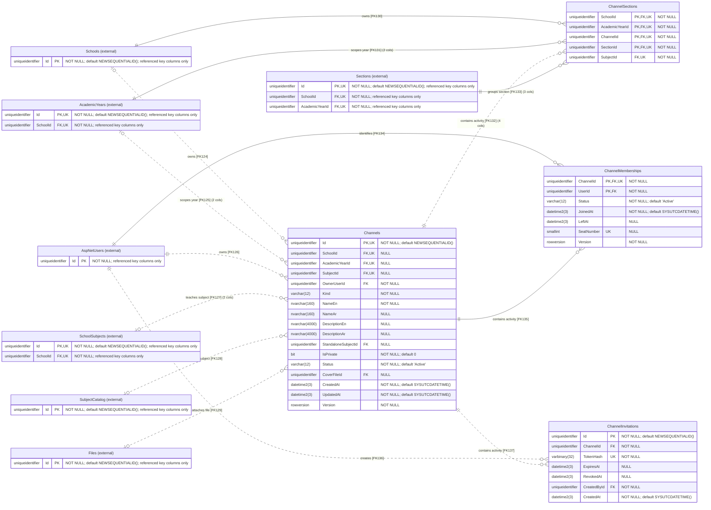

### ORBIT schema — Channels & learning — part 2

[Mermaid source](src/schema-content-2.mmd) · [SVG fallback](svg/schema-content-2.svg) · [PNG fallback](png/schema-content-2.png)

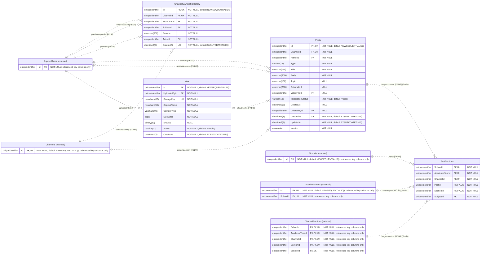

### ORBIT schema — Channels & learning — part 3

[Mermaid source](src/schema-content-3.mmd) · [SVG fallback](svg/schema-content-3.svg) · [PNG fallback](png/schema-content-3.png)

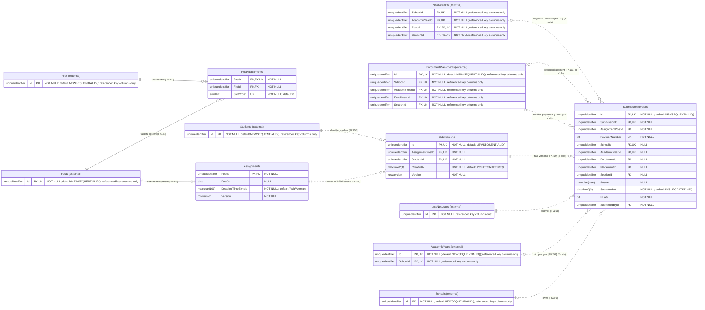

### ORBIT schema — Channels & learning — part 4

[Mermaid source](src/schema-content-4.mmd) · [SVG fallback](svg/schema-content-4.svg) · [PNG fallback](png/schema-content-4.png)

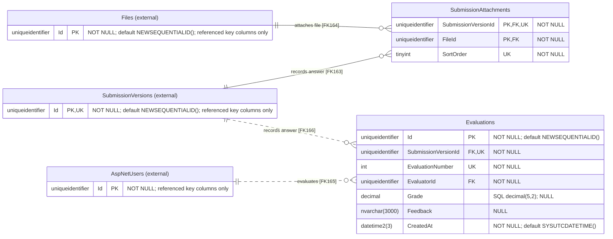

### Channels

independent teacher channel or managed school channel.

Scope: **current required functionality**.

| Column | SQL Server type | PK / FK / UQ | Nullable | Default / generation |
|---|---|---|---|---|
| Id | uniqueidentifier | PK UQ | No | NEWSEQUENTIALID() |
| SchoolId | uniqueidentifier | FK UQ | Yes | — |
| AcademicYearId | uniqueidentifier | FK UQ | Yes | — |
| SubjectId | uniqueidentifier | FK UQ | Yes | — |
| OwnerUserId | uniqueidentifier | FK | No | — |
| Kind | varchar(12) COLLATE Latin1_General_100_BIN2 | — | No | — |
| NameEn | nvarchar(160) | — | No | — |
| NameAr | nvarchar(160) | — | Yes | — |
| DescriptionEn | nvarchar(4000) | — | Yes | — |
| DescriptionAr | nvarchar(4000) | — | Yes | — |
| StandaloneSubjectId | uniqueidentifier | FK | Yes | — |
| IsPrivate | bit | — | No | 0 |
| Status | varchar(12) COLLATE Latin1_General_100_BIN2 | — | No | 'Active' |
| CoverFileId | uniqueidentifier | FK | Yes | — |
| CreatedAt | datetime2(3) | — | No | SYSUTCDATETIME() |
| UpdatedAt | datetime2(3) | — | No | SYSUTCDATETIME() |
| Version | rowversion | — | No | — |

**Primary key**

- PK_Channels: CLUSTERED (Id)

**Unique constraints**

- UQ_Channels_1: NONCLUSTERED (SchoolId, AcademicYearId, Id, SubjectId)
- UQ_Channels_2: NONCLUSTERED (SchoolId, AcademicYearId, Id)
- UQ_Channels_3: NONCLUSTERED (SchoolId, Id)

**Points to — ordered foreign keys**

- FK124 / FK_Channels_Schools_1: (SchoolId) → Schools (Id); DELETE NO ACTION, UPDATE NO ACTION.
- FK125 / FK_Channels_AcademicYears_2: (SchoolId, AcademicYearId) → AcademicYears (SchoolId, Id); DELETE NO ACTION, UPDATE NO ACTION.
- FK126 / FK_Channels_AspNetUsers_3: (OwnerUserId) → AspNetUsers (Id); DELETE NO ACTION, UPDATE NO ACTION.
- FK127 / FK_Channels_SchoolSubjects_4: (SchoolId, SubjectId) → SchoolSubjects (SchoolId, Id); DELETE NO ACTION, UPDATE NO ACTION.
- FK128 / FK_Channels_SubjectCatalog_5: (StandaloneSubjectId) → SubjectCatalog (Id); DELETE NO ACTION, UPDATE NO ACTION.
- FK129 / FK_Channels_Files_6: (CoverFileId) → Files (Id); DELETE NO ACTION, UPDATE NO ACTION.

**Referenced by**

- FK132: ChannelSections (SchoolId, AcademicYearId, ChannelId, SubjectId) → (SchoolId, AcademicYearId, Id, SubjectId).
- FK135: ChannelMemberships (ChannelId) → (Id).
- FK137: ChannelInvitations (ChannelId) → (Id).
- FK141: ChannelOwnershipHistory (ChannelId) → (Id).
- FK144: Posts (ChannelId) → (Id).
- FK171: ContentCorrectionRequests (SchoolId, AcademicYearId, ChannelId) → (SchoolId, AcademicYearId, Id).
- FK228: LearningMeetings (ChannelId) → (Id).
- FK231: MeetingGroups (ChannelId) → (Id).

**CHECK constraints**

- CK_Channels_Status_Values: `[Status] IN ('Active', 'Archived')`
- CK_Channels_Kind_Values: `[Kind] IN ('Independent', 'School')`
- CK_Channels_Kind_Nonblank: `LEN(LTRIM(RTRIM([Kind]))) > 0`
- CK_Channels_NameEn_Nonblank: `LEN(LTRIM(RTRIM([NameEn]))) > 0`
- CK_Channels_NameAr_Nonblank: `[NameAr] IS NULL OR LEN(LTRIM(RTRIM([NameAr]))) > 0`
- CK_Channels_DescriptionEn_Nonblank: `[DescriptionEn] IS NULL OR LEN(LTRIM(RTRIM([DescriptionEn]))) > 0`
- CK_Channels_DescriptionAr_Nonblank: `[DescriptionAr] IS NULL OR LEN(LTRIM(RTRIM([DescriptionAr]))) > 0`
- CK_Channels_Status_Nonblank: `LEN(LTRIM(RTRIM([Status]))) > 0`
- CK_Channels_Scope: `([Kind] = 'School' AND [SchoolId] IS NOT NULL AND [AcademicYearId] IS NOT NULL AND [SubjectId] IS NOT NULL AND [IsPrivate] = 1 AND [StandaloneSubjectId] IS NULL) OR ([Kind] = 'Independent' AND [SchoolId] IS NULL AND [AcademicYearId] IS NULL AND [SubjectId] IS NULL)`

**Clustering strategy**

`PK_Channels` (Id): Stable, narrow Guid point lookup; NEWSEQUENTIALID supports append-biased inserts. Wider names, mutable status/time fields and existing seek/filter paths stay nonclustered.

**Indexes**

- IX_Channels_1: NONCLUSTERED (OwnerUserId ASC, Status ASC).
- IX_Channels_2: NONCLUSTERED (SchoolId ASC, AcademicYearId ASC, Status ASC).
- IX_Channels_3: NONCLUSTERED (SchoolId ASC, SubjectId ASC).
- IX_Channels_4: NONCLUSTERED (StandaloneSubjectId ASC).
- IX_Channels_5: NONCLUSTERED (CoverFileId ASC).

### ChannelSections

managed channel N:M annual sections.

Scope: **current required functionality**.

| Column | SQL Server type | PK / FK / UQ | Nullable | Default / generation |
|---|---|---|---|---|
| SchoolId | uniqueidentifier | PK FK UQ | No | — |
| AcademicYearId | uniqueidentifier | PK FK UQ | No | — |
| ChannelId | uniqueidentifier | PK FK UQ | No | — |
| SectionId | uniqueidentifier | PK FK UQ | No | — |
| SubjectId | uniqueidentifier | FK UQ | No | — |

**Primary key**

- PK_ChannelSections: CLUSTERED (SchoolId, AcademicYearId, ChannelId, SectionId)

**Unique constraints**

- UQ_ChannelSections_1: NONCLUSTERED (SchoolId, AcademicYearId, ChannelId, SectionId, SubjectId)

**Points to — ordered foreign keys**

- FK130 / FK_ChannelSections_Schools_1: (SchoolId) → Schools (Id); DELETE NO ACTION, UPDATE NO ACTION.
- FK131 / FK_ChannelSections_AcademicYears_2: (SchoolId, AcademicYearId) → AcademicYears (SchoolId, Id); DELETE NO ACTION, UPDATE NO ACTION.
- FK132 / FK_ChannelSections_Channels_3: (SchoolId, AcademicYearId, ChannelId, SubjectId) → Channels (SchoolId, AcademicYearId, Id, SubjectId); DELETE NO ACTION, UPDATE NO ACTION.
- FK133 / FK_ChannelSections_Sections_4: (SchoolId, AcademicYearId, SectionId) → Sections (SchoolId, AcademicYearId, Id); DELETE NO ACTION, UPDATE NO ACTION.

**Referenced by**

- FK113: TimetableCells (SchoolId, AcademicYearId, ChannelId, SectionId, SubjectId) → (SchoolId, AcademicYearId, ChannelId, SectionId, SubjectId).
- FK149: PostSections (SchoolId, AcademicYearId, ChannelId, SectionId, SubjectId) → (SchoolId, AcademicYearId, ChannelId, SectionId, SubjectId).

**CHECK constraints**

None.

**Clustering strategy**

`PK_ChannelSections` (SchoolId, AcademicYearId, ChannelId, SectionId): Parent-first junction key keeps related membership/lookup rows together; the existing composite uniqueness is unchanged.

**Indexes**

- IX_ChannelSections_1: NONCLUSTERED (SchoolId ASC, AcademicYearId ASC, ChannelId ASC, SubjectId ASC).
- IX_ChannelSections_2: NONCLUSTERED (SchoolId ASC, AcademicYearId ASC, SectionId ASC).

### ChannelMemberships

explicit membership for independent channels only.

Scope: **current required functionality**.

| Column | SQL Server type | PK / FK / UQ | Nullable | Default / generation |
|---|---|---|---|---|
| ChannelId | uniqueidentifier | PK FK UQ | No | — |
| UserId | uniqueidentifier | PK FK | No | — |
| Status | varchar(12) COLLATE Latin1_General_100_BIN2 | — | No | 'Active' |
| JoinedAt | datetime2(3) | — | No | SYSUTCDATETIME() |
| LeftAt | datetime2(3) | — | Yes | — |
| SeatNumber | smallint | UQ | Yes | — |
| Version | rowversion | — | No | — |

**Primary key**

- PK_ChannelMemberships: CLUSTERED (ChannelId, UserId)

**Unique constraints**

None beyond the primary key.

**Points to — ordered foreign keys**

- FK134 / FK_ChannelMemberships_AspNetUsers_1: (UserId) → AspNetUsers (Id); DELETE NO ACTION, UPDATE NO ACTION.
- FK135 / FK_ChannelMemberships_Channels_2: (ChannelId) → Channels (Id); DELETE NO ACTION, UPDATE NO ACTION.

**Referenced by**

None.

**CHECK constraints**

- CK_ChannelMemberships_Status_Values: `[Status] IN ('Active', 'Left', 'Removed')`
- CK_ChannelMemberships_Status_Nonblank: `LEN(LTRIM(RTRIM([Status]))) > 0`
- CK_ChannelMemberships_LeftAt: `[LeftAt] IS NULL OR ([JoinedAt] IS NOT NULL AND [LeftAt] >= [JoinedAt])`
- CK_ChannelMemberships_SeatNumber: `[SeatNumber] IS NULL OR [SeatNumber] >= 0`

**Clustering strategy**

`PK_ChannelMemberships` (ChannelId, UserId): Parent-first junction key keeps related membership/lookup rows together; the existing composite uniqueness is unchanged.

**Indexes**

- IX_ChannelMemberships_1: NONCLUSTERED (UserId ASC, Status ASC, ChannelId ASC).
- UX_ChannelMemberships_2: UNIQUE NONCLUSTERED (ChannelId ASC, SeatNumber ASC) WHERE [SeatNumber] IS NOT NULL AND [Status] = 'Active'.

### ChannelInvitations

private independent-channel join code.

Scope: **current required functionality**.

| Column | SQL Server type | PK / FK / UQ | Nullable | Default / generation |
|---|---|---|---|---|
| Id | uniqueidentifier | PK | No | NEWSEQUENTIALID() |
| ChannelId | uniqueidentifier | FK | No | — |
| TokenHash | varbinary(32) | UQ | No | — |
| ExpiresAt | datetime2(3) | — | Yes | — |
| RevokedAt | datetime2(3) | — | Yes | — |
| CreatedById | uniqueidentifier | FK | No | — |
| CreatedAt | datetime2(3) | — | No | SYSUTCDATETIME() |

**Primary key**

- PK_ChannelInvitations: CLUSTERED (Id)

**Unique constraints**

- UQ_ChannelInvitations_1: NONCLUSTERED (TokenHash)

**Points to — ordered foreign keys**

- FK136 / FK_ChannelInvitations_AspNetUsers_1: (CreatedById) → AspNetUsers (Id); DELETE NO ACTION, UPDATE NO ACTION.
- FK137 / FK_ChannelInvitations_Channels_2: (ChannelId) → Channels (Id); DELETE NO ACTION, UPDATE NO ACTION.

**Referenced by**

None.

**CHECK constraints**

- CK_ChannelInvitations_ExpiresAt: `[ExpiresAt] IS NULL OR ([CreatedAt] IS NOT NULL AND [ExpiresAt] > [CreatedAt])`

**Clustering strategy**

`PK_ChannelInvitations` (Id): Stable, narrow Guid point lookup; NEWSEQUENTIALID supports append-biased inserts. Wider names, mutable status/time fields and existing seek/filter paths stay nonclustered.

**Indexes**

- IX_ChannelInvitations_1: NONCLUSTERED (ChannelId ASC, RevokedAt ASC, ExpiresAt ASC).
- IX_ChannelInvitations_2: NONCLUSTERED (CreatedById ASC).

### ChannelOwnershipHistory

transfers preserve authorship.

Scope: **current required functionality**.

| Column | SQL Server type | PK / FK / UQ | Nullable | Default / generation |
|---|---|---|---|---|
| Id | uniqueidentifier | PK UQ | No | NEWSEQUENTIALID() |
| ChannelId | uniqueidentifier | FK UQ | No | — |
| FromUserId | uniqueidentifier | FK | No | — |
| ToUserId | uniqueidentifier | FK | No | — |
| Reason | nvarchar(500) | — | No | — |
| ActorId | uniqueidentifier | FK | No | — |
| CreatedAt | datetime2(3) | UQ | No | SYSUTCDATETIME() |

**Primary key**

- PK_ChannelOwnershipHistory: NONCLUSTERED (Id)

**Unique constraints**

None beyond the primary key.

**Points to — ordered foreign keys**

- FK138 / FK_ChannelOwnershipHistory_AspNetUsers_1: (FromUserId) → AspNetUsers (Id); DELETE NO ACTION, UPDATE NO ACTION.
- FK139 / FK_ChannelOwnershipHistory_AspNetUsers_2: (ToUserId) → AspNetUsers (Id); DELETE NO ACTION, UPDATE NO ACTION.
- FK140 / FK_ChannelOwnershipHistory_AspNetUsers_3: (ActorId) → AspNetUsers (Id); DELETE NO ACTION, UPDATE NO ACTION.
- FK141 / FK_ChannelOwnershipHistory_Channels_4: (ChannelId) → Channels (Id); DELETE NO ACTION, UPDATE NO ACTION.

**Referenced by**

None.

**CHECK constraints**

- CK_ChannelOwnershipHistory_Reason_Nonblank: `LEN(LTRIM(RTRIM([Reason]))) > 0`
- CK_ChannelOwnershipHistory_DistinctOwners: `[FromUserId] <> [ToUserId]`

**Clustering strategy**

`CX_ChannelOwnershipHistory_Access` (ChannelId, CreatedAt, Id): Immutable parent/time/Id range supports chronological history. Id breaks time ties and already guarantees uniqueness; this unique clustered superkey adds no new business restriction. Existing filtered and FK indexes are preserved.

**Indexes**

- IX_ChannelOwnershipHistory_1: NONCLUSTERED (ChannelId ASC, CreatedAt ASC).
- IX_ChannelOwnershipHistory_2: NONCLUSTERED (FromUserId ASC).
- IX_ChannelOwnershipHistory_3: NONCLUSTERED (ToUserId ASC).
- IX_ChannelOwnershipHistory_4: NONCLUSTERED (ActorId ASC).
- CX_ChannelOwnershipHistory_Access: UNIQUE CLUSTERED (ChannelId ASC, CreatedAt ASC, Id ASC).

### Posts

shared content aggregate.

Scope: **current required functionality**.

| Column | SQL Server type | PK / FK / UQ | Nullable | Default / generation |
|---|---|---|---|---|
| Id | uniqueidentifier | PK UQ | No | NEWSEQUENTIALID() |
| ChannelId | uniqueidentifier | FK UQ | No | — |
| AuthorId | uniqueidentifier | FK | No | — |
| Type | varchar(12) COLLATE Latin1_General_100_BIN2 | — | No | — |
| Title | nvarchar(160) | — | No | — |
| Body | nvarchar(3000) | — | No | — |
| Topic | nvarchar(160) | — | Yes | — |
| ExternalUrl | nvarchar(2000) | — | Yes | — |
| VideoFileId | uniqueidentifier | FK | Yes | — |
| ModerationStatus | varchar(12) COLLATE Latin1_General_100_BIN2 | — | No | 'Visible' |
| DeletedAt | datetime2(3) | — | Yes | — |
| DeletedById | uniqueidentifier | FK | Yes | — |
| CreatedAt | datetime2(3) | UQ | No | SYSUTCDATETIME() |
| UpdatedAt | datetime2(3) | — | No | SYSUTCDATETIME() |
| Version | rowversion | — | No | — |

**Primary key**

- PK_Posts: NONCLUSTERED (Id)

**Unique constraints**

- UQ_Posts_1: NONCLUSTERED (ChannelId, Id)

**Points to — ordered foreign keys**

- FK142 / FK_Posts_AspNetUsers_1: (AuthorId) → AspNetUsers (Id); DELETE NO ACTION, UPDATE NO ACTION.
- FK143 / FK_Posts_AspNetUsers_2: (DeletedById) → AspNetUsers (Id); DELETE NO ACTION, UPDATE NO ACTION.
- FK144 / FK_Posts_Channels_3: (ChannelId) → Channels (Id); DELETE NO ACTION, UPDATE NO ACTION.
- FK145 / FK_Posts_Files_4: (VideoFileId) → Files (Id); DELETE NO ACTION, UPDATE NO ACTION.

**Referenced by**

- FK148: PostSections (ChannelId, PostId) → (ChannelId, Id).
- FK151: PostAttachments (PostId) → (Id).
- FK153: Assignments (PostId) → (Id).
- FK172: ContentCorrectionRequests (ChannelId, PostId) → (ChannelId, Id).
- FK180: ModerationReports (PostId) → (Id).
- FK184: PostModerationActions (PostId) → (Id).
- FK239: Notifications (PostId) → (Id).

**CHECK constraints**

- CK_Posts_Type_Values: `[Type] IN ('Lesson', 'Video', 'Assignment', 'Announcement', 'Discussion')`
- CK_Posts_ModerationStatus_Values: `[ModerationStatus] IN ('Visible', 'Hidden')`
- CK_Posts_Type_Nonblank: `LEN(LTRIM(RTRIM([Type]))) > 0`
- CK_Posts_Title_Nonblank: `LEN(LTRIM(RTRIM([Title]))) > 0`
- CK_Posts_Body_Nonblank: `LEN(LTRIM(RTRIM([Body]))) > 0`
- CK_Posts_Topic_Nonblank: `[Topic] IS NULL OR LEN(LTRIM(RTRIM([Topic]))) > 0`
- CK_Posts_ExternalUrl_Nonblank: `[ExternalUrl] IS NULL OR LEN(LTRIM(RTRIM([ExternalUrl]))) > 0`
- CK_Posts_ModerationStatus_Nonblank: `LEN(LTRIM(RTRIM([ModerationStatus]))) > 0`
- CK_Posts_DeletedAt_DeletedById: `([DeletedAt] IS NULL AND [DeletedById] IS NULL) OR ([DeletedAt] IS NOT NULL AND [DeletedById] IS NOT NULL)`

**Clustering strategy**

`CX_Posts_Access` (ChannelId, CreatedAt, Id): Immutable parent/time/Id range supports channel feeds. Id breaks time ties and already guarantees uniqueness; this unique clustered superkey adds no new business restriction. Existing filtered and FK indexes are preserved.

**Indexes**

- IX_Posts_1: NONCLUSTERED (ChannelId ASC, CreatedAt DESC) INCLUDE (Type, ModerationStatus, DeletedAt).
- IX_Posts_2: NONCLUSTERED (AuthorId ASC, CreatedAt ASC).
- IX_Posts_3: NONCLUSTERED (DeletedById ASC).
- IX_Posts_4: NONCLUSTERED (VideoFileId ASC).
- CX_Posts_Access: UNIQUE CLUSTERED (ChannelId ASC, CreatedAt ASC, Id ASC).

### PostSections

target subset of school-channel sections.

Scope: **current required functionality**.

| Column | SQL Server type | PK / FK / UQ | Nullable | Default / generation |
|---|---|---|---|---|
| SchoolId | uniqueidentifier | FK UQ | No | — |
| AcademicYearId | uniqueidentifier | FK UQ | No | — |
| ChannelId | uniqueidentifier | FK UQ | No | — |
| PostId | uniqueidentifier | PK FK UQ | No | — |
| SectionId | uniqueidentifier | PK FK UQ | No | — |
| SubjectId | uniqueidentifier | FK | No | — |

**Primary key**

- PK_PostSections: CLUSTERED (PostId, SectionId)

**Unique constraints**

- UQ_PostSections_1: NONCLUSTERED (SchoolId, AcademicYearId, ChannelId, PostId, SectionId)
- UQ_PostSections_2: NONCLUSTERED (SchoolId, AcademicYearId, PostId, SectionId)

**Points to — ordered foreign keys**

- FK146 / FK_PostSections_Schools_1: (SchoolId) → Schools (Id); DELETE NO ACTION, UPDATE NO ACTION.
- FK147 / FK_PostSections_AcademicYears_2: (SchoolId, AcademicYearId) → AcademicYears (SchoolId, Id); DELETE NO ACTION, UPDATE NO ACTION.
- FK148 / FK_PostSections_Posts_3: (ChannelId, PostId) → Posts (ChannelId, Id); DELETE NO ACTION, UPDATE NO ACTION.
- FK149 / FK_PostSections_ChannelSections_4: (SchoolId, AcademicYearId, ChannelId, SectionId, SubjectId) → ChannelSections (SchoolId, AcademicYearId, ChannelId, SectionId, SubjectId); DELETE NO ACTION, UPDATE NO ACTION.

**Referenced by**

- FK162: SubmissionVersions (SchoolId, AcademicYearId, AssignmentPostId, SectionId) → (SchoolId, AcademicYearId, PostId, SectionId).

**CHECK constraints**

None.

**Clustering strategy**

`PK_PostSections` (PostId, SectionId): Parent-first junction key keeps related membership/lookup rows together; the existing composite uniqueness is unchanged.

**Indexes**

- IX_PostSections_1: NONCLUSTERED (ChannelId ASC, PostId ASC).
- IX_PostSections_2: NONCLUSTERED (SchoolId ASC, AcademicYearId ASC, ChannelId ASC, SectionId ASC, SubjectId ASC).

### Files

attachment/blob metadata, not binary localStorage strings.

Scope: **supporting backend infrastructure**.

| Column | SQL Server type | PK / FK / UQ | Nullable | Default / generation |
|---|---|---|---|---|
| Id | uniqueidentifier | PK | No | NEWSEQUENTIALID() |
| UploadedById | uniqueidentifier | FK | No | — |
| StorageKey | nvarchar(450) | UQ | No | — |
| OriginalName | nvarchar(255) | — | No | — |
| ContentType | varchar(100) | — | No | — |
| SizeBytes | bigint | — | No | — |
| Sha256 | binary(32) | — | Yes | — |
| Status | varchar(12) COLLATE Latin1_General_100_BIN2 | — | No | 'Pending' |
| CreatedAt | datetime2(3) | — | No | SYSUTCDATETIME() |

**Primary key**

- PK_Files: CLUSTERED (Id)

**Unique constraints**

- UQ_Files_1: NONCLUSTERED (StorageKey)

**Points to — ordered foreign keys**

- FK150 / FK_Files_AspNetUsers_1: (UploadedById) → AspNetUsers (Id); DELETE NO ACTION, UPDATE NO ACTION.

**Referenced by**

- FK010: UserProfiles (PhotoFileId) → (Id).
- FK014: Teachers (CvFileId) → (Id).
- FK019: TeacherFacets (FileId) → (Id).
- FK020: Schools (LogoFileId) → (Id).
- FK129: Channels (CoverFileId) → (Id).
- FK145: Posts (VideoFileId) → (Id).
- FK152: PostAttachments (FileId) → (Id).
- FK164: SubmissionAttachments (FileId) → (Id).
- FK202: ApplicationFiles (FileId) → (Id).

**CHECK constraints**

- CK_Files_Status_Values: `[Status] IN ('Pending', 'Ready', 'Quarantined', 'Retired')`
- CK_Files_StorageKey_Nonblank: `LEN(LTRIM(RTRIM([StorageKey]))) > 0`
- CK_Files_OriginalName_Nonblank: `LEN(LTRIM(RTRIM([OriginalName]))) > 0`
- CK_Files_ContentType_Nonblank: `LEN(LTRIM(RTRIM([ContentType]))) > 0`
- CK_Files_Status_Nonblank: `LEN(LTRIM(RTRIM([Status]))) > 0`
- CK_Files_SizeBytes: `[SizeBytes] > 0`

**Clustering strategy**

`PK_Files` (Id): Stable, narrow Guid point lookup; NEWSEQUENTIALID supports append-biased inserts. Wider names, mutable status/time fields and existing seek/filter paths stay nonclustered.

**Indexes**

- IX_Files_1: NONCLUSTERED (UploadedById ASC, CreatedAt ASC).

### PostAttachments

ordered content files.

Scope: **current required functionality**.

| Column | SQL Server type | PK / FK / UQ | Nullable | Default / generation |
|---|---|---|---|---|
| PostId | uniqueidentifier | PK FK UQ | No | — |
| FileId | uniqueidentifier | PK FK | No | — |
| SortOrder | smallint | UQ | No | 0 |

**Primary key**

- PK_PostAttachments: NONCLUSTERED (PostId, FileId)

**Unique constraints**

- UQ_PostAttachments_1: CLUSTERED (PostId, SortOrder)

**Points to — ordered foreign keys**

- FK151 / FK_PostAttachments_Posts_1: (PostId) → Posts (Id); DELETE NO ACTION, UPDATE NO ACTION.
- FK152 / FK_PostAttachments_Files_2: (FileId) → Files (Id); DELETE NO ACTION, UPDATE NO ACTION.

**Referenced by**

None.

**CHECK constraints**

- CK_PostAttachments_SortOrder: `[SortOrder] >= 0`

**Clustering strategy**

`UQ_PostAttachments_1` (PostId, SortOrder): Short unique parent/order key retrieves displayed attachments in order; edits are small bounded collections.

**Indexes**

- IX_PostAttachments_1: NONCLUSTERED (FileId ASC).

### Assignments

post subtype and due date semantics.

Scope: **current required functionality**.

| Column | SQL Server type | PK / FK / UQ | Nullable | Default / generation |
|---|---|---|---|---|
| PostId | uniqueidentifier | PK FK | No | — |
| DueOn | date | — | Yes | — |
| DeadlineTimeZoneId | nvarchar(100) | — | No | 'Asia/Amman' |
| Version | rowversion | — | No | — |

**Primary key**

- PK_Assignments: CLUSTERED (PostId)

**Unique constraints**

None beyond the primary key.

**Points to — ordered foreign keys**

- FK153 / FK_Assignments_Posts_1: (PostId) → Posts (Id); DELETE NO ACTION, UPDATE NO ACTION.

**Referenced by**

- FK154: Submissions (AssignmentPostId) → (PostId).

**CHECK constraints**

- CK_Assignments_DeadlineTimeZoneId_Nonblank: `LEN(LTRIM(RTRIM([DeadlineTimeZoneId]))) > 0`

**Clustering strategy**

`PK_Assignments` (PostId): Shared stable Guid key co-locates the subtype lookup path; no extra surrogate column.

**Indexes**

None beyond indexes backing the declared keys.

### Submissions

one student/assignment aggregate.

Scope: **current required functionality**.

| Column | SQL Server type | PK / FK / UQ | Nullable | Default / generation |
|---|---|---|---|---|
| Id | uniqueidentifier | PK UQ | No | NEWSEQUENTIALID() |
| AssignmentPostId | uniqueidentifier | FK UQ | No | — |
| StudentId | uniqueidentifier | FK UQ | No | — |
| CreatedAt | datetime2(3) | — | No | SYSUTCDATETIME() |
| Version | rowversion | — | No | — |

**Primary key**

- PK_Submissions: NONCLUSTERED (Id)

**Unique constraints**

- UQ_Submissions_1: CLUSTERED (AssignmentPostId, StudentId)
- UQ_Submissions_2: NONCLUSTERED (Id, AssignmentPostId)

**Points to — ordered foreign keys**

- FK154 / FK_Submissions_Assignments_1: (AssignmentPostId) → Assignments (PostId); DELETE NO ACTION, UPDATE NO ACTION.
- FK155 / FK_Submissions_Students_2: (StudentId) → Students (Id); DELETE NO ACTION, UPDATE NO ACTION.

**Referenced by**

- FK159: SubmissionVersions (SubmissionId, AssignmentPostId) → (Id, AssignmentPostId).

**CHECK constraints**

None.

**Clustering strategy**

`UQ_Submissions_1` (AssignmentPostId, StudentId): Teacher review reads the assignment’s submission roster; the immutable assignment/student pair groups that path.

**Indexes**

- IX_Submissions_1: NONCLUSTERED (StudentId ASC, CreatedAt ASC).

### SubmissionVersions

immutable submitted answer and placement-at-submit.

Scope: **current required functionality**.

| Column | SQL Server type | PK / FK / UQ | Nullable | Default / generation |
|---|---|---|---|---|
| Id | uniqueidentifier | PK UQ | No | NEWSEQUENTIALID() |
| SubmissionId | uniqueidentifier | FK UQ | No | — |
| AssignmentPostId | uniqueidentifier | FK | No | — |
| RevisionNumber | int | UQ | No | — |
| SchoolId | uniqueidentifier | FK UQ | Yes | — |
| AcademicYearId | uniqueidentifier | FK UQ | Yes | — |
| EnrollmentId | uniqueidentifier | FK | Yes | — |
| PlacementId | uniqueidentifier | FK | Yes | — |
| SectionId | uniqueidentifier | FK | Yes | — |
| Answer | nvarchar(max) | — | Yes | — |
| SubmittedAt | datetime2(3) | — | No | SYSUTCDATETIME() |
| IsLate | bit | — | No | — |
| SubmittedById | uniqueidentifier | FK | No | — |

**Primary key**

- PK_SubmissionVersions: NONCLUSTERED (Id)

**Unique constraints**

- UQ_SubmissionVersions_1: CLUSTERED (SubmissionId, RevisionNumber)
- UQ_SubmissionVersions_2: NONCLUSTERED (SchoolId, Id)
- UQ_SubmissionVersions_3: NONCLUSTERED (SchoolId, AcademicYearId, Id)

**Points to — ordered foreign keys**

- FK156 / FK_SubmissionVersions_Schools_1: (SchoolId) → Schools (Id); DELETE NO ACTION, UPDATE NO ACTION.
- FK157 / FK_SubmissionVersions_AcademicYears_2: (SchoolId, AcademicYearId) → AcademicYears (SchoolId, Id); DELETE NO ACTION, UPDATE NO ACTION.
- FK158 / FK_SubmissionVersions_AspNetUsers_3: (SubmittedById) → AspNetUsers (Id); DELETE NO ACTION, UPDATE NO ACTION.
- FK159 / FK_SubmissionVersions_Submissions_4: (SubmissionId, AssignmentPostId) → Submissions (Id, AssignmentPostId); DELETE NO ACTION, UPDATE NO ACTION.
- FK160 / FK_SubmissionVersions_EnrollmentPlacements_5: (SchoolId, AcademicYearId, EnrollmentId, PlacementId) → EnrollmentPlacements (SchoolId, AcademicYearId, EnrollmentId, Id); DELETE NO ACTION, UPDATE NO ACTION.
- FK161 / FK_SubmissionVersions_EnrollmentPlacements_6: (SchoolId, AcademicYearId, PlacementId, SectionId) → EnrollmentPlacements (SchoolId, AcademicYearId, Id, SectionId); DELETE NO ACTION, UPDATE NO ACTION.
- FK162 / FK_SubmissionVersions_PostSections_7: (SchoolId, AcademicYearId, AssignmentPostId, SectionId) → PostSections (SchoolId, AcademicYearId, PostId, SectionId); DELETE NO ACTION, UPDATE NO ACTION.

**Referenced by**

- FK163: SubmissionAttachments (SubmissionVersionId) → (Id).
- FK166: Evaluations (SubmissionVersionId) → (Id).

**CHECK constraints**

- CK_SubmissionVersions_Answer_Nonblank: `[Answer] IS NULL OR LEN(LTRIM(RTRIM([Answer]))) > 0`
- CK_SubmissionVersions_RevisionNumber: `[RevisionNumber] > 0`
- CK_SubmissionVersions_AnswerLength: `[Answer] IS NULL OR DATALENGTH([Answer]) <= 20000`
- CK_SubmissionVersions_PlacementScope: `([SchoolId] IS NULL AND [AcademicYearId] IS NULL AND [EnrollmentId] IS NULL AND [PlacementId] IS NULL AND [SectionId] IS NULL) OR ([SchoolId] IS NOT NULL AND [AcademicYearId] IS NOT NULL AND [EnrollmentId] IS NOT NULL AND [PlacementId] IS NOT NULL AND [SectionId] IS NOT NULL)`

**Clustering strategy**

`UQ_SubmissionVersions_1` (SubmissionId, RevisionNumber): Narrow 20-byte immutable parent/revision key supports submission history and latest-version lookup.

**Indexes**

- IX_SubmissionVersions_1: NONCLUSTERED (SchoolId ASC, AcademicYearId ASC, SectionId ASC, SubmittedAt ASC).
- IX_SubmissionVersions_2: NONCLUSTERED (SubmittedById ASC).
- IX_SubmissionVersions_3: NONCLUSTERED (SubmissionId ASC, AssignmentPostId ASC).
- IX_SubmissionVersions_4: NONCLUSTERED (SchoolId ASC, AcademicYearId ASC, EnrollmentId ASC, PlacementId ASC).
- IX_SubmissionVersions_5: NONCLUSTERED (SchoolId ASC, AcademicYearId ASC, PlacementId ASC, SectionId ASC).
- IX_SubmissionVersions_6: NONCLUSTERED (SchoolId ASC, AcademicYearId ASC, AssignmentPostId ASC, SectionId ASC).

### SubmissionAttachments

immutable version file list.

Scope: **current required functionality**.

| Column | SQL Server type | PK / FK / UQ | Nullable | Default / generation |
|---|---|---|---|---|
| SubmissionVersionId | uniqueidentifier | PK FK UQ | No | — |
| FileId | uniqueidentifier | PK FK | No | — |
| SortOrder | tinyint | UQ | No | — |

**Primary key**

- PK_SubmissionAttachments: NONCLUSTERED (SubmissionVersionId, FileId)

**Unique constraints**

- UQ_SubmissionAttachments_1: CLUSTERED (SubmissionVersionId, SortOrder)

**Points to — ordered foreign keys**

- FK163 / FK_SubmissionAttachments_SubmissionVersions_1: (SubmissionVersionId) → SubmissionVersions (Id); DELETE NO ACTION, UPDATE NO ACTION.
- FK164 / FK_SubmissionAttachments_Files_2: (FileId) → Files (Id); DELETE NO ACTION, UPDATE NO ACTION.

**Referenced by**

None.

**CHECK constraints**

- CK_SubmissionAttachments_SortOrder: `[SortOrder] BETWEEN 0 AND 2`

**Clustering strategy**

`UQ_SubmissionAttachments_1` (SubmissionVersionId, SortOrder): Narrow immutable version/order key retrieves the at-most-three files for a submitted version.

**Indexes**

- IX_SubmissionAttachments_1: NONCLUSTERED (FileId ASC).

### Evaluations

immutable review attempts tied to submitted version.

Scope: **current required functionality**.

| Column | SQL Server type | PK / FK / UQ | Nullable | Default / generation |
|---|---|---|---|---|
| Id | uniqueidentifier | PK | No | NEWSEQUENTIALID() |
| SubmissionVersionId | uniqueidentifier | FK UQ | No | — |
| EvaluationNumber | int | UQ | No | — |
| EvaluatorId | uniqueidentifier | FK | No | — |
| Grade | decimal(5,2) | — | Yes | — |
| Feedback | nvarchar(3000) | — | Yes | — |
| CreatedAt | datetime2(3) | — | No | SYSUTCDATETIME() |

**Primary key**

- PK_Evaluations: NONCLUSTERED (Id)

**Unique constraints**

- UQ_Evaluations_1: CLUSTERED (SubmissionVersionId, EvaluationNumber)

**Points to — ordered foreign keys**

- FK165 / FK_Evaluations_AspNetUsers_1: (EvaluatorId) → AspNetUsers (Id); DELETE NO ACTION, UPDATE NO ACTION.
- FK166 / FK_Evaluations_SubmissionVersions_2: (SubmissionVersionId) → SubmissionVersions (Id); DELETE NO ACTION, UPDATE NO ACTION.

**Referenced by**

None.

**CHECK constraints**

- CK_Evaluations_Feedback_Nonblank: `[Feedback] IS NULL OR LEN(LTRIM(RTRIM([Feedback]))) > 0`
- CK_Evaluations_EvaluationNumber: `[EvaluationNumber] > 0`
- CK_Evaluations_Grade: `[Grade] BETWEEN 0 AND 100`
- CK_Evaluations_Content: `[Grade] IS NOT NULL OR ([Feedback] IS NOT NULL AND LEN(LTRIM(RTRIM([Feedback]))) > 0)`

**Clustering strategy**

`UQ_Evaluations_1` (SubmissionVersionId, EvaluationNumber): Narrow immutable parent/sequence key groups evaluation history for a specific submitted answer.

**Indexes**

- IX_Evaluations_1: NONCLUSTERED (EvaluatorId ASC, CreatedAt ASC).

## Monitoring & moderation

### ORBIT schema — Monitoring & moderation — part 1

[Mermaid source](src/schema-moderation-1.mmd) · [SVG fallback](svg/schema-moderation-1.svg) · [PNG fallback](png/schema-moderation-1.png)

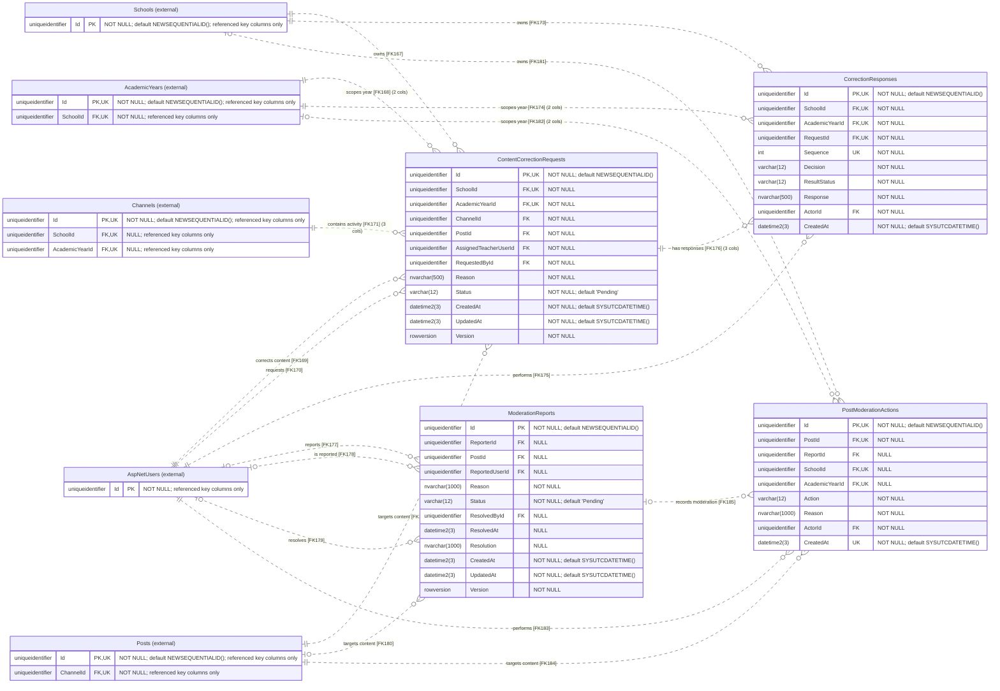

### ContentCorrectionRequests

school asks teacher to correct content.

Scope: **current required functionality**.

| Column | SQL Server type | PK / FK / UQ | Nullable | Default / generation |
|---|---|---|---|---|
| Id | uniqueidentifier | PK UQ | No | NEWSEQUENTIALID() |
| SchoolId | uniqueidentifier | FK UQ | No | — |
| AcademicYearId | uniqueidentifier | FK UQ | No | — |
| ChannelId | uniqueidentifier | FK | No | — |
| PostId | uniqueidentifier | FK | No | — |
| AssignedTeacherUserId | uniqueidentifier | FK | No | — |
| RequestedById | uniqueidentifier | FK | No | — |
| Reason | nvarchar(500) | — | No | — |
| Status | varchar(12) COLLATE Latin1_General_100_BIN2 | — | No | 'Pending' |
| CreatedAt | datetime2(3) | — | No | SYSUTCDATETIME() |
| UpdatedAt | datetime2(3) | — | No | SYSUTCDATETIME() |
| Version | rowversion | — | No | — |

**Primary key**

- PK_ContentCorrectionRequests: CLUSTERED (Id)

**Unique constraints**

- UQ_ContentCorrectionRequests_1: NONCLUSTERED (SchoolId, Id)
- UQ_ContentCorrectionRequests_2: NONCLUSTERED (SchoolId, AcademicYearId, Id)

**Points to — ordered foreign keys**

- FK167 / FK_ContentCorrectionRequests_Schools_1: (SchoolId) → Schools (Id); DELETE NO ACTION, UPDATE NO ACTION.
- FK168 / FK_ContentCorrectionRequests_AcademicYears_2: (SchoolId, AcademicYearId) → AcademicYears (SchoolId, Id); DELETE NO ACTION, UPDATE NO ACTION.
- FK169 / FK_ContentCorrectionRequests_AspNetUsers_3: (AssignedTeacherUserId) → AspNetUsers (Id); DELETE NO ACTION, UPDATE NO ACTION.
- FK170 / FK_ContentCorrectionRequests_AspNetUsers_4: (RequestedById) → AspNetUsers (Id); DELETE NO ACTION, UPDATE NO ACTION.
- FK171 / FK_ContentCorrectionRequests_Channels_5: (SchoolId, AcademicYearId, ChannelId) → Channels (SchoolId, AcademicYearId, Id); DELETE NO ACTION, UPDATE NO ACTION.
- FK172 / FK_ContentCorrectionRequests_Posts_6: (ChannelId, PostId) → Posts (ChannelId, Id); DELETE NO ACTION, UPDATE NO ACTION.

**Referenced by**

- FK176: CorrectionResponses (SchoolId, AcademicYearId, RequestId) → (SchoolId, AcademicYearId, Id).

**CHECK constraints**

- CK_ContentCorrectionRequests_Status_Values: `[Status] IN ('Pending', 'Responded', 'Closed', 'Reopened')`
- CK_ContentCorrectionRequests_Reason_Nonblank: `LEN(LTRIM(RTRIM([Reason]))) > 0`
- CK_ContentCorrectionRequests_Status_Nonblank: `LEN(LTRIM(RTRIM([Status]))) > 0`

**Clustering strategy**

`PK_ContentCorrectionRequests` (Id): Stable, narrow Guid point lookup; NEWSEQUENTIALID supports append-biased inserts. Wider names, mutable status/time fields and existing seek/filter paths stay nonclustered.

**Indexes**

- IX_ContentCorrectionRequests_1: NONCLUSTERED (SchoolId ASC, AcademicYearId ASC, Status ASC, CreatedAt ASC).
- IX_ContentCorrectionRequests_2: NONCLUSTERED (AssignedTeacherUserId ASC, Status ASC).
- IX_ContentCorrectionRequests_3: NONCLUSTERED (RequestedById ASC).
- IX_ContentCorrectionRequests_4: NONCLUSTERED (SchoolId ASC, AcademicYearId ASC, ChannelId ASC).
- IX_ContentCorrectionRequests_5: NONCLUSTERED (ChannelId ASC, PostId ASC).

### CorrectionResponses

append-only discussion/status decisions.

Scope: **current required functionality**.

| Column | SQL Server type | PK / FK / UQ | Nullable | Default / generation |
|---|---|---|---|---|
| Id | uniqueidentifier | PK UQ | No | NEWSEQUENTIALID() |
| SchoolId | uniqueidentifier | FK UQ | No | — |
| AcademicYearId | uniqueidentifier | FK UQ | No | — |
| RequestId | uniqueidentifier | FK UQ | No | — |
| Sequence | int | UQ | No | — |
| Decision | varchar(12) COLLATE Latin1_General_100_BIN2 | — | No | — |
| ResultStatus | varchar(12) COLLATE Latin1_General_100_BIN2 | — | No | — |
| Response | nvarchar(500) | — | No | — |
| ActorId | uniqueidentifier | FK | No | — |
| CreatedAt | datetime2(3) | — | No | SYSUTCDATETIME() |

**Primary key**

- PK_CorrectionResponses: NONCLUSTERED (Id)

**Unique constraints**

- UQ_CorrectionResponses_1: CLUSTERED (SchoolId, AcademicYearId, RequestId, Sequence)
- UQ_CorrectionResponses_2: NONCLUSTERED (SchoolId, Id)
- UQ_CorrectionResponses_3: NONCLUSTERED (SchoolId, AcademicYearId, Id)

**Points to — ordered foreign keys**

- FK173 / FK_CorrectionResponses_Schools_1: (SchoolId) → Schools (Id); DELETE NO ACTION, UPDATE NO ACTION.
- FK174 / FK_CorrectionResponses_AcademicYears_2: (SchoolId, AcademicYearId) → AcademicYears (SchoolId, Id); DELETE NO ACTION, UPDATE NO ACTION.
- FK175 / FK_CorrectionResponses_AspNetUsers_3: (ActorId) → AspNetUsers (Id); DELETE NO ACTION, UPDATE NO ACTION.
- FK176 / FK_CorrectionResponses_ContentCorrectionRequests_4: (SchoolId, AcademicYearId, RequestId) → ContentCorrectionRequests (SchoolId, AcademicYearId, Id); DELETE NO ACTION, UPDATE NO ACTION.

**Referenced by**

None.

**CHECK constraints**

- CK_CorrectionResponses_Decision_Values: `[Decision] IN ('Corrected', 'Explained', 'Closed', 'Reopened')`
- CK_CorrectionResponses_ResultStatus_Values: `[ResultStatus] IN ('Responded', 'Closed', 'Reopened')`
- CK_CorrectionResponses_Decision_Nonblank: `LEN(LTRIM(RTRIM([Decision]))) > 0`
- CK_CorrectionResponses_ResultStatus_Nonblank: `LEN(LTRIM(RTRIM([ResultStatus]))) > 0`
- CK_CorrectionResponses_Response_Nonblank: `LEN(LTRIM(RTRIM([Response]))) > 0`
- CK_CorrectionResponses_Sequence: `[Sequence] > 0`
- CK_CorrectionResponses_DecisionStatus: `([Decision] IN ('Corrected','Explained') AND [ResultStatus] = 'Responded') OR ([Decision] = 'Closed' AND [ResultStatus] = 'Closed') OR ([Decision] = 'Reopened' AND [ResultStatus] = 'Reopened')`

**Clustering strategy**

`UQ_CorrectionResponses_1` (SchoolId, AcademicYearId, RequestId, Sequence): Read and append school-scoped correction discussion in request sequence order; no clustering on mutable parent status.

**Indexes**

- IX_CorrectionResponses_1: NONCLUSTERED (ActorId ASC).

### ModerationReports

admin report review entity (intake proposed).

Scope: **current required functionality**.

| Column | SQL Server type | PK / FK / UQ | Nullable | Default / generation |
|---|---|---|---|---|
| Id | uniqueidentifier | PK | No | NEWSEQUENTIALID() |
| ReporterId | uniqueidentifier | FK | Yes | — |
| PostId | uniqueidentifier | FK | Yes | — |
| ReportedUserId | uniqueidentifier | FK | Yes | — |
| Reason | nvarchar(1000) | — | No | — |
| Status | varchar(12) COLLATE Latin1_General_100_BIN2 | — | No | 'Pending' |
| ResolvedById | uniqueidentifier | FK | Yes | — |
| ResolvedAt | datetime2(3) | — | Yes | — |
| Resolution | nvarchar(1000) | — | Yes | — |
| CreatedAt | datetime2(3) | — | No | SYSUTCDATETIME() |
| UpdatedAt | datetime2(3) | — | No | SYSUTCDATETIME() |
| Version | rowversion | — | No | — |

**Primary key**

- PK_ModerationReports: CLUSTERED (Id)

**Unique constraints**

None beyond the primary key.

**Points to — ordered foreign keys**

- FK177 / FK_ModerationReports_AspNetUsers_1: (ReporterId) → AspNetUsers (Id); DELETE NO ACTION, UPDATE NO ACTION.
- FK178 / FK_ModerationReports_AspNetUsers_2: (ReportedUserId) → AspNetUsers (Id); DELETE NO ACTION, UPDATE NO ACTION.
- FK179 / FK_ModerationReports_AspNetUsers_3: (ResolvedById) → AspNetUsers (Id); DELETE NO ACTION, UPDATE NO ACTION.
- FK180 / FK_ModerationReports_Posts_4: (PostId) → Posts (Id); DELETE NO ACTION, UPDATE NO ACTION.

**Referenced by**

- FK185: PostModerationActions (ReportId) → (Id).

**CHECK constraints**

- CK_ModerationReports_Status_Values: `[Status] IN ('Pending', 'Resolved', 'Dismissed')`
- CK_ModerationReports_Reason_Nonblank: `LEN(LTRIM(RTRIM([Reason]))) > 0`
- CK_ModerationReports_Status_Nonblank: `LEN(LTRIM(RTRIM([Status]))) > 0`
- CK_ModerationReports_Resolution_Nonblank: `[Resolution] IS NULL OR LEN(LTRIM(RTRIM([Resolution]))) > 0`
- CK_ModerationReports_Target: `([PostId] IS NOT NULL AND [ReportedUserId] IS NULL) OR ([PostId] IS NULL AND [ReportedUserId] IS NOT NULL)`
- CK_ModerationReports_Resolution: `([Status] = 'Pending' AND [ResolvedById] IS NULL AND [ResolvedAt] IS NULL) OR ([Status] <> 'Pending' AND [ResolvedById] IS NOT NULL AND [ResolvedAt] IS NOT NULL)`

**Clustering strategy**

`PK_ModerationReports` (Id): Stable, narrow Guid point lookup; NEWSEQUENTIALID supports append-biased inserts. Wider names, mutable status/time fields and existing seek/filter paths stay nonclustered.

**Indexes**

- IX_ModerationReports_1: NONCLUSTERED (Status ASC, CreatedAt ASC).
- IX_ModerationReports_2: NONCLUSTERED (PostId ASC, Status ASC).
- IX_ModerationReports_3: NONCLUSTERED (ReporterId ASC).
- IX_ModerationReports_4: NONCLUSTERED (ReportedUserId ASC).
- IX_ModerationReports_5: NONCLUSTERED (ResolvedById ASC).

### PostModerationActions

hide/restore/delete history.

Scope: **current required functionality**.

| Column | SQL Server type | PK / FK / UQ | Nullable | Default / generation |
|---|---|---|---|---|
| Id | uniqueidentifier | PK UQ | No | NEWSEQUENTIALID() |
| PostId | uniqueidentifier | FK UQ | No | — |
| ReportId | uniqueidentifier | FK | Yes | — |
| SchoolId | uniqueidentifier | FK UQ | Yes | — |
| AcademicYearId | uniqueidentifier | FK UQ | Yes | — |
| Action | varchar(12) COLLATE Latin1_General_100_BIN2 | — | No | — |
| Reason | nvarchar(1000) | — | No | — |
| ActorId | uniqueidentifier | FK | No | — |
| CreatedAt | datetime2(3) | UQ | No | SYSUTCDATETIME() |

**Primary key**

- PK_PostModerationActions: NONCLUSTERED (Id)

**Unique constraints**

- UQ_PostModerationActions_1: NONCLUSTERED (SchoolId, Id)
- UQ_PostModerationActions_2: NONCLUSTERED (SchoolId, AcademicYearId, Id)

**Points to — ordered foreign keys**

- FK181 / FK_PostModerationActions_Schools_1: (SchoolId) → Schools (Id); DELETE NO ACTION, UPDATE NO ACTION.
- FK182 / FK_PostModerationActions_AcademicYears_2: (SchoolId, AcademicYearId) → AcademicYears (SchoolId, Id); DELETE NO ACTION, UPDATE NO ACTION.
- FK183 / FK_PostModerationActions_AspNetUsers_3: (ActorId) → AspNetUsers (Id); DELETE NO ACTION, UPDATE NO ACTION.
- FK184 / FK_PostModerationActions_Posts_4: (PostId) → Posts (Id); DELETE NO ACTION, UPDATE NO ACTION.
- FK185 / FK_PostModerationActions_ModerationReports_5: (ReportId) → ModerationReports (Id); DELETE NO ACTION, UPDATE NO ACTION.

**Referenced by**

None.

**CHECK constraints**

- CK_PostModerationActions_Action_Values: `[Action] IN ('Hide', 'Restore', 'SoftDelete')`
- CK_PostModerationActions_Action_Nonblank: `LEN(LTRIM(RTRIM([Action]))) > 0`
- CK_PostModerationActions_Reason_Nonblank: `LEN(LTRIM(RTRIM([Reason]))) > 0`
- CK_PostModerationActions_SchoolId_AcademicYearId: `([SchoolId] IS NULL AND [AcademicYearId] IS NULL) OR ([SchoolId] IS NOT NULL AND [AcademicYearId] IS NOT NULL)`

**Clustering strategy**

`CX_PostModerationActions_Access` (PostId, CreatedAt, Id): Immutable parent/time/Id range supports chronological history. Id breaks time ties and already guarantees uniqueness; this unique clustered superkey adds no new business restriction. Existing filtered and FK indexes are preserved.

**Indexes**

- IX_PostModerationActions_1: NONCLUSTERED (PostId ASC, CreatedAt ASC).
- IX_PostModerationActions_2: NONCLUSTERED (ActorId ASC).
- IX_PostModerationActions_3: NONCLUSTERED (ReportId ASC).
- CX_PostModerationActions_Access: UNIQUE CLUSTERED (PostId ASC, CreatedAt ASC, Id ASC).

## Recruitment

### ORBIT schema — Recruitment — part 1

[Mermaid source](src/schema-recruitment-1.mmd) · [SVG fallback](svg/schema-recruitment-1.svg) · [PNG fallback](png/schema-recruitment-1.png)

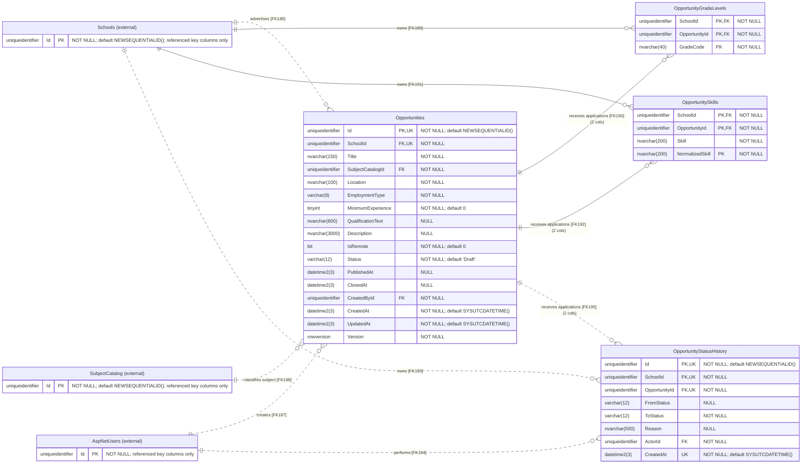

### ORBIT schema — Recruitment — part 2

[Mermaid source](src/schema-recruitment-2.mmd) · [SVG fallback](svg/schema-recruitment-2.svg) · [PNG fallback](png/schema-recruitment-2.png)

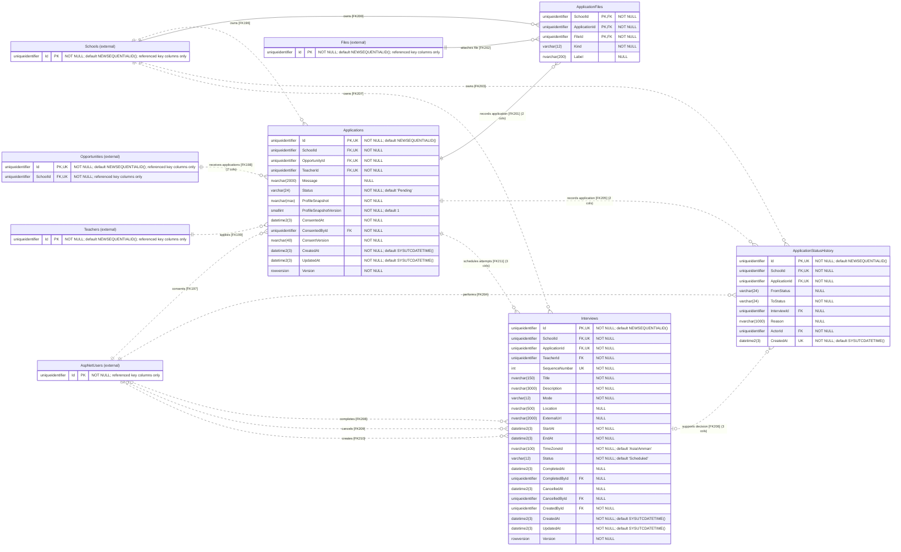

### ORBIT schema — Recruitment — part 3

[Mermaid source](src/schema-recruitment-3.mmd) · [SVG fallback](svg/schema-recruitment-3.svg) · [PNG fallback](png/schema-recruitment-3.png)

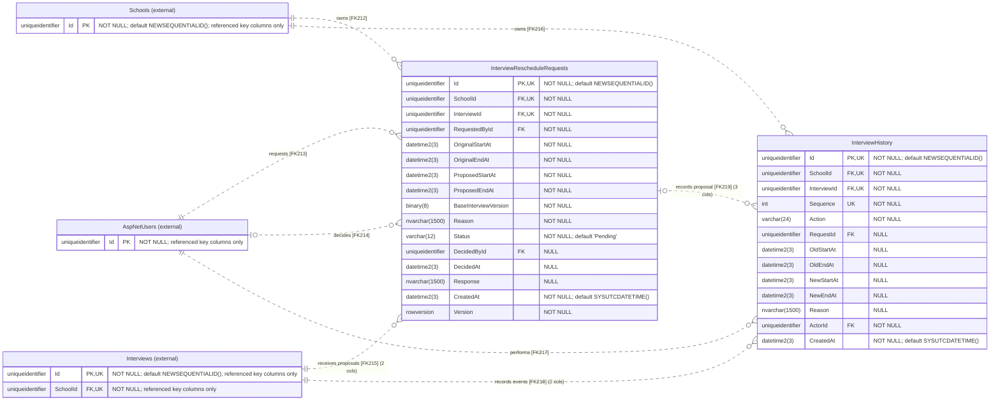

### Opportunities

school recruitment vacancy.

Scope: **current required functionality**.

| Column | SQL Server type | PK / FK / UQ | Nullable | Default / generation |
|---|---|---|---|---|
| Id | uniqueidentifier | PK UQ | No | NEWSEQUENTIALID() |
| SchoolId | uniqueidentifier | FK UQ | No | — |
| Title | nvarchar(150) | — | No | — |
| SubjectCatalogId | uniqueidentifier | FK | No | — |
| Location | nvarchar(100) | — | No | — |
| EmploymentType | varchar(8) COLLATE Latin1_General_100_BIN2 | — | No | — |
| MinimumExperience | tinyint | — | No | 0 |
| QualificationText | nvarchar(800) | — | Yes | — |
| Description | nvarchar(3000) | — | Yes | — |
| IsRemote | bit | — | No | 0 |
| Status | varchar(12) COLLATE Latin1_General_100_BIN2 | — | No | 'Draft' |
| PublishedAt | datetime2(3) | — | Yes | — |
| ClosedAt | datetime2(3) | — | Yes | — |
| CreatedById | uniqueidentifier | FK | No | — |
| CreatedAt | datetime2(3) | — | No | SYSUTCDATETIME() |
| UpdatedAt | datetime2(3) | — | No | SYSUTCDATETIME() |
| Version | rowversion | — | No | — |

**Primary key**

- PK_Opportunities: CLUSTERED (Id)

**Unique constraints**

- UQ_Opportunities_1: NONCLUSTERED (SchoolId, Id)

**Points to — ordered foreign keys**

- FK186 / FK_Opportunities_Schools_1: (SchoolId) → Schools (Id); DELETE NO ACTION, UPDATE NO ACTION.
- FK187 / FK_Opportunities_AspNetUsers_2: (CreatedById) → AspNetUsers (Id); DELETE NO ACTION, UPDATE NO ACTION.
- FK188 / FK_Opportunities_SubjectCatalog_3: (SubjectCatalogId) → SubjectCatalog (Id); DELETE NO ACTION, UPDATE NO ACTION.

**Referenced by**

- FK190: OpportunityGradeLevels (SchoolId, OpportunityId) → (SchoolId, Id).
- FK192: OpportunitySkills (SchoolId, OpportunityId) → (SchoolId, Id).
- FK195: OpportunityStatusHistory (SchoolId, OpportunityId) → (SchoolId, Id).
- FK198: Applications (SchoolId, OpportunityId) → (SchoolId, Id).

**CHECK constraints**

- CK_Opportunities_EmploymentType_Values: `[EmploymentType] IN ('FullTime', 'PartTime')`
- CK_Opportunities_Status_Values: `[Status] IN ('Draft', 'Published', 'Closed')`
- CK_Opportunities_Title_Nonblank: `LEN(LTRIM(RTRIM([Title]))) > 0`
- CK_Opportunities_Location_Nonblank: `LEN(LTRIM(RTRIM([Location]))) > 0`
- CK_Opportunities_EmploymentType_Nonblank: `LEN(LTRIM(RTRIM([EmploymentType]))) > 0`
- CK_Opportunities_QualificationText_Nonblank: `[QualificationText] IS NULL OR LEN(LTRIM(RTRIM([QualificationText]))) > 0`
- CK_Opportunities_Description_Nonblank: `[Description] IS NULL OR LEN(LTRIM(RTRIM([Description]))) > 0`
- CK_Opportunities_Status_Nonblank: `LEN(LTRIM(RTRIM([Status]))) > 0`
- CK_Opportunities_MinimumExperience: `[MinimumExperience] BETWEEN 0 AND 60`

**Clustering strategy**

`PK_Opportunities` (Id): Stable, narrow Guid point lookup; NEWSEQUENTIALID supports append-biased inserts. Wider names, mutable status/time fields and existing seek/filter paths stay nonclustered.

**Indexes**

- IX_Opportunities_1: NONCLUSTERED (Status ASC, PublishedAt DESC) INCLUDE (SubjectCatalogId, EmploymentType, Location).
- IX_Opportunities_2: NONCLUSTERED (SchoolId ASC, Status ASC, CreatedAt ASC).
- IX_Opportunities_3: NONCLUSTERED (CreatedById ASC).
- IX_Opportunities_4: NONCLUSTERED (SubjectCatalogId ASC).

### OpportunityGradeLevels

requested grades.

Scope: **current required functionality**.

| Column | SQL Server type | PK / FK / UQ | Nullable | Default / generation |
|---|---|---|---|---|
| SchoolId | uniqueidentifier | PK FK | No | — |
| OpportunityId | uniqueidentifier | PK FK | No | — |
| GradeCode | nvarchar(40) | PK | No | — |

**Primary key**

- PK_OpportunityGradeLevels: CLUSTERED (SchoolId, OpportunityId, GradeCode)

**Unique constraints**

None beyond the primary key.

**Points to — ordered foreign keys**

- FK189 / FK_OpportunityGradeLevels_Schools_1: (SchoolId) → Schools (Id); DELETE NO ACTION, UPDATE NO ACTION.
- FK190 / FK_OpportunityGradeLevels_Opportunities_2: (SchoolId, OpportunityId) → Opportunities (SchoolId, Id); DELETE NO ACTION, UPDATE NO ACTION.

**Referenced by**

None.

**CHECK constraints**

- CK_OpportunityGradeLevels_GradeCode_Nonblank: `LEN(LTRIM(RTRIM([GradeCode]))) > 0`

**Clustering strategy**

`PK_OpportunityGradeLevels` (SchoolId, OpportunityId, GradeCode): Parent-first junction key keeps related membership/lookup rows together; the existing composite uniqueness is unchanged.

**Indexes**

None beyond indexes backing the declared keys.

### OpportunitySkills

normalized required skills.

Scope: **current required functionality**.

| Column | SQL Server type | PK / FK / UQ | Nullable | Default / generation |
|---|---|---|---|---|
| SchoolId | uniqueidentifier | PK FK | No | — |
| OpportunityId | uniqueidentifier | PK FK | No | — |
| Skill | nvarchar(200) | — | No | — |
| NormalizedSkill | nvarchar(200) | PK | No | — |

**Primary key**

- PK_OpportunitySkills: NONCLUSTERED (SchoolId, OpportunityId, NormalizedSkill)

**Unique constraints**

None beyond the primary key.

**Points to — ordered foreign keys**

- FK191 / FK_OpportunitySkills_Schools_1: (SchoolId) → Schools (Id); DELETE NO ACTION, UPDATE NO ACTION.
- FK192 / FK_OpportunitySkills_Opportunities_2: (SchoolId, OpportunityId) → Opportunities (SchoolId, Id); DELETE NO ACTION, UPDATE NO ACTION.

**Referenced by**

None.

**CHECK constraints**

- CK_OpportunitySkills_Skill_Nonblank: `LEN(LTRIM(RTRIM([Skill]))) > 0`
- CK_OpportunitySkills_NormalizedSkill_Nonblank: `LEN(LTRIM(RTRIM([NormalizedSkill]))) > 0`

**Clustering strategy**

`CX_OpportunitySkills_Access` (OpportunityId): Group required skills by vacancy on a 16-byte key instead of propagating the up-to-432-byte school/opportunity/normalized-skill PK. Keep that exact business uniqueness NONCLUSTERED; SQL Server supplies a nonunique-cluster uniquifier.

**Indexes**

- CX_OpportunitySkills_Access: CLUSTERED (OpportunityId ASC).

### OpportunityStatusHistory

immutable publication/closing events.

Scope: **current required functionality**.

| Column | SQL Server type | PK / FK / UQ | Nullable | Default / generation |
|---|---|---|---|---|
| Id | uniqueidentifier | PK UQ | No | NEWSEQUENTIALID() |
| SchoolId | uniqueidentifier | FK UQ | No | — |
| OpportunityId | uniqueidentifier | FK UQ | No | — |
| FromStatus | varchar(12) COLLATE Latin1_General_100_BIN2 | — | Yes | — |
| ToStatus | varchar(12) COLLATE Latin1_General_100_BIN2 | — | No | — |
| Reason | nvarchar(500) | — | Yes | — |
| ActorId | uniqueidentifier | FK | No | — |
| CreatedAt | datetime2(3) | UQ | No | SYSUTCDATETIME() |

**Primary key**

- PK_OpportunityStatusHistory: NONCLUSTERED (Id)

**Unique constraints**

- UQ_OpportunityStatusHistory_1: NONCLUSTERED (SchoolId, Id)

**Points to — ordered foreign keys**

- FK193 / FK_OpportunityStatusHistory_Schools_1: (SchoolId) → Schools (Id); DELETE NO ACTION, UPDATE NO ACTION.
- FK194 / FK_OpportunityStatusHistory_AspNetUsers_2: (ActorId) → AspNetUsers (Id); DELETE NO ACTION, UPDATE NO ACTION.
- FK195 / FK_OpportunityStatusHistory_Opportunities_3: (SchoolId, OpportunityId) → Opportunities (SchoolId, Id); DELETE NO ACTION, UPDATE NO ACTION.

**Referenced by**

None.

**CHECK constraints**

- CK_OpportunityStatusHistory_FromStatus_Values: `[FromStatus] IN ('Draft', 'Published', 'Closed')`
- CK_OpportunityStatusHistory_ToStatus_Values: `[ToStatus] IN ('Draft', 'Published', 'Closed')`
- CK_OpportunityStatusHistory_FromStatus_Nonblank: `[FromStatus] IS NULL OR LEN(LTRIM(RTRIM([FromStatus]))) > 0`
- CK_OpportunityStatusHistory_ToStatus_Nonblank: `LEN(LTRIM(RTRIM([ToStatus]))) > 0`
- CK_OpportunityStatusHistory_Reason_Nonblank: `[Reason] IS NULL OR LEN(LTRIM(RTRIM([Reason]))) > 0`

**Clustering strategy**

`CX_OpportunityStatusHistory_Access` (OpportunityId, CreatedAt, Id): Immutable parent/time/Id range supports chronological history. Id breaks time ties and already guarantees uniqueness; this unique clustered superkey adds no new business restriction. Existing filtered and FK indexes are preserved.

**Indexes**

- IX_OpportunityStatusHistory_1: NONCLUSTERED (SchoolId ASC, OpportunityId ASC, CreatedAt ASC).
- IX_OpportunityStatusHistory_2: NONCLUSTERED (ActorId ASC).
- CX_OpportunityStatusHistory_Access: UNIQUE CLUSTERED (OpportunityId ASC, CreatedAt ASC, Id ASC).

### Applications

teacher application + frozen consented disclosure.

Scope: **current required functionality**.

| Column | SQL Server type | PK / FK / UQ | Nullable | Default / generation |
|---|---|---|---|---|
| Id | uniqueidentifier | PK UQ | No | NEWSEQUENTIALID() |
| SchoolId | uniqueidentifier | FK UQ | No | — |
| OpportunityId | uniqueidentifier | FK UQ | No | — |
| TeacherId | uniqueidentifier | FK UQ | No | — |
| Message | nvarchar(2000) | — | Yes | — |
| Status | varchar(24) COLLATE Latin1_General_100_BIN2 | — | No | 'Pending' |
| ProfileSnapshot | nvarchar(max) | — | No | — |
| ProfileSnapshotVersion | smallint | — | No | 1 |
| ConsentedAt | datetime2(3) | — | No | — |
| ConsentedById | uniqueidentifier | FK | No | — |
| ConsentVersion | nvarchar(40) | — | No | — |
| CreatedAt | datetime2(3) | — | No | SYSUTCDATETIME() |
| UpdatedAt | datetime2(3) | — | No | SYSUTCDATETIME() |
| Version | rowversion | — | No | — |

**Primary key**

- PK_Applications: NONCLUSTERED (Id)

**Unique constraints**

- UQ_Applications_1: CLUSTERED (SchoolId, OpportunityId, TeacherId)
- UQ_Applications_2: NONCLUSTERED (SchoolId, Id, TeacherId)
- UQ_Applications_3: NONCLUSTERED (SchoolId, Id)

**Points to — ordered foreign keys**

- FK196 / FK_Applications_Schools_1: (SchoolId) → Schools (Id); DELETE NO ACTION, UPDATE NO ACTION.
- FK197 / FK_Applications_AspNetUsers_2: (ConsentedById) → AspNetUsers (Id); DELETE NO ACTION, UPDATE NO ACTION.
- FK198 / FK_Applications_Opportunities_3: (SchoolId, OpportunityId) → Opportunities (SchoolId, Id); DELETE NO ACTION, UPDATE NO ACTION.
- FK199 / FK_Applications_Teachers_4: (TeacherId) → Teachers (Id); DELETE NO ACTION, UPDATE NO ACTION.

**Referenced by**

- FK201: ApplicationFiles (SchoolId, ApplicationId) → (SchoolId, Id).
- FK205: ApplicationStatusHistory (SchoolId, ApplicationId) → (SchoolId, Id).
- FK211: Interviews (SchoolId, ApplicationId, TeacherId) → (SchoolId, Id, TeacherId).
- FK241: Notifications (SchoolId, ApplicationId) → (SchoolId, Id).

**CHECK constraints**

- CK_Applications_Status_Values: `[Status] IN ('Pending', 'Review', 'Shortlisted', 'InterviewScheduled', 'Accepted', 'Rejected', 'Withdrawn')`
- CK_Applications_Message_Nonblank: `[Message] IS NULL OR LEN(LTRIM(RTRIM([Message]))) > 0`
- CK_Applications_Status_Nonblank: `LEN(LTRIM(RTRIM([Status]))) > 0`
- CK_Applications_ProfileSnapshot_Nonblank: `LEN(LTRIM(RTRIM([ProfileSnapshot]))) > 0`
- CK_Applications_ProfileSnapshot_Json: `ISJSON([ProfileSnapshot]) = 1`
- CK_Applications_ConsentVersion_Nonblank: `LEN(LTRIM(RTRIM([ConsentVersion]))) > 0`
- CK_Applications_SnapshotVersion: `[ProfileSnapshotVersion] > 0`

**Clustering strategy**

`UQ_Applications_1` (SchoolId, OpportunityId, TeacherId): School recruitment normally reviews an opportunity’s applicants; group stable opportunity/teacher pairs, retaining teacher-history indexes.

**Indexes**

- IX_Applications_1: NONCLUSTERED (SchoolId ASC, OpportunityId ASC, Status ASC, CreatedAt ASC).
- IX_Applications_2: NONCLUSTERED (TeacherId ASC, CreatedAt DESC).
- IX_Applications_3: NONCLUSTERED (ConsentedById ASC).

### ApplicationFiles

retained disclosed CV/certificate/work sample files.

Scope: **current required functionality**.

| Column | SQL Server type | PK / FK / UQ | Nullable | Default / generation |
|---|---|---|---|---|
| SchoolId | uniqueidentifier | PK FK | No | — |
| ApplicationId | uniqueidentifier | PK FK | No | — |
| FileId | uniqueidentifier | PK FK | No | — |
| Kind | varchar(12) COLLATE Latin1_General_100_BIN2 | — | No | — |
| Label | nvarchar(200) | — | Yes | — |

**Primary key**

- PK_ApplicationFiles: CLUSTERED (SchoolId, ApplicationId, FileId)

**Unique constraints**

None beyond the primary key.

**Points to — ordered foreign keys**

- FK200 / FK_ApplicationFiles_Schools_1: (SchoolId) → Schools (Id); DELETE NO ACTION, UPDATE NO ACTION.
- FK201 / FK_ApplicationFiles_Applications_2: (SchoolId, ApplicationId) → Applications (SchoolId, Id); DELETE NO ACTION, UPDATE NO ACTION.
- FK202 / FK_ApplicationFiles_Files_3: (FileId) → Files (Id); DELETE NO ACTION, UPDATE NO ACTION.

**Referenced by**

None.

**CHECK constraints**

- CK_ApplicationFiles_Kind_Values: `[Kind] IN ('CV', 'Certificate', 'WorkSample')`
- CK_ApplicationFiles_Kind_Nonblank: `LEN(LTRIM(RTRIM([Kind]))) > 0`
- CK_ApplicationFiles_Label_Nonblank: `[Label] IS NULL OR LEN(LTRIM(RTRIM([Label]))) > 0`

**Clustering strategy**

`PK_ApplicationFiles` (SchoolId, ApplicationId, FileId): Parent-first junction key keeps related membership/lookup rows together; the existing composite uniqueness is unchanged.

**Indexes**

- IX_ApplicationFiles_1: NONCLUSTERED (FileId ASC).

### ApplicationStatusHistory

decisions/withdrawals/interview lifecycle.

Scope: **current required functionality**.

| Column | SQL Server type | PK / FK / UQ | Nullable | Default / generation |
|---|---|---|---|---|
| Id | uniqueidentifier | PK UQ | No | NEWSEQUENTIALID() |
| SchoolId | uniqueidentifier | FK UQ | No | — |
| ApplicationId | uniqueidentifier | FK UQ | No | — |
| FromStatus | varchar(24) COLLATE Latin1_General_100_BIN2 | — | Yes | — |
| ToStatus | varchar(24) COLLATE Latin1_General_100_BIN2 | — | No | — |
| InterviewId | uniqueidentifier | FK | Yes | — |
| Reason | nvarchar(1000) | — | Yes | — |
| ActorId | uniqueidentifier | FK | No | — |
| CreatedAt | datetime2(3) | UQ | No | SYSUTCDATETIME() |

**Primary key**

- PK_ApplicationStatusHistory: NONCLUSTERED (Id)

**Unique constraints**

- UQ_ApplicationStatusHistory_1: NONCLUSTERED (SchoolId, Id)

**Points to — ordered foreign keys**

- FK203 / FK_ApplicationStatusHistory_Schools_1: (SchoolId) → Schools (Id); DELETE NO ACTION, UPDATE NO ACTION.
- FK204 / FK_ApplicationStatusHistory_AspNetUsers_2: (ActorId) → AspNetUsers (Id); DELETE NO ACTION, UPDATE NO ACTION.
- FK205 / FK_ApplicationStatusHistory_Applications_3: (SchoolId, ApplicationId) → Applications (SchoolId, Id); DELETE NO ACTION, UPDATE NO ACTION.
- FK206 / FK_ApplicationStatusHistory_Interviews_4: (SchoolId, ApplicationId, InterviewId) → Interviews (SchoolId, ApplicationId, Id); DELETE NO ACTION, UPDATE NO ACTION.

**Referenced by**

None.

**CHECK constraints**

- CK_ApplicationStatusHistory_FromStatus_Values: `[FromStatus] IN ('Pending', 'Review', 'Shortlisted', 'InterviewScheduled', 'Accepted', 'Rejected', 'Withdrawn')`
- CK_ApplicationStatusHistory_ToStatus_Values: `[ToStatus] IN ('Pending', 'Review', 'Shortlisted', 'InterviewScheduled', 'Accepted', 'Rejected', 'Withdrawn')`
- CK_ApplicationStatusHistory_FromStatus_Nonblank: `[FromStatus] IS NULL OR LEN(LTRIM(RTRIM([FromStatus]))) > 0`
- CK_ApplicationStatusHistory_ToStatus_Nonblank: `LEN(LTRIM(RTRIM([ToStatus]))) > 0`
- CK_ApplicationStatusHistory_Reason_Nonblank: `[Reason] IS NULL OR LEN(LTRIM(RTRIM([Reason]))) > 0`
- CK_ApplicationStatusHistory_FinalInterview: `[ToStatus] NOT IN ('Accepted','Rejected') OR [InterviewId] IS NOT NULL`

**Clustering strategy**

`CX_ApplicationStatusHistory_Access` (ApplicationId, CreatedAt, Id): Immutable parent/time/Id range supports chronological history. Id breaks time ties and already guarantees uniqueness; this unique clustered superkey adds no new business restriction. Existing filtered and FK indexes are preserved.

**Indexes**

- IX_ApplicationStatusHistory_1: NONCLUSTERED (SchoolId ASC, ApplicationId ASC, CreatedAt ASC).
- IX_ApplicationStatusHistory_2: NONCLUSTERED (ActorId ASC).
- IX_ApplicationStatusHistory_3: NONCLUSTERED (SchoolId ASC, ApplicationId ASC, InterviewId ASC).
- CX_ApplicationStatusHistory_Access: UNIQUE CLUSTERED (ApplicationId ASC, CreatedAt ASC, Id ASC).

### Interviews

sequential recruitment appointments, separate from educational meetings.

Scope: **current required functionality**.

| Column | SQL Server type | PK / FK / UQ | Nullable | Default / generation |
|---|---|---|---|---|
| Id | uniqueidentifier | PK UQ | No | NEWSEQUENTIALID() |
| SchoolId | uniqueidentifier | FK UQ | No | — |
| ApplicationId | uniqueidentifier | FK UQ | No | — |
| TeacherId | uniqueidentifier | FK | No | — |
| SequenceNumber | int | UQ | No | — |
| Title | nvarchar(150) | — | No | — |
| Description | nvarchar(3000) | — | No | — |
| Mode | varchar(12) COLLATE Latin1_General_100_BIN2 | — | No | — |
| Location | nvarchar(500) | — | Yes | — |
| ExternalUrl | nvarchar(2000) | — | Yes | — |
| StartAt | datetime2(3) | — | No | — |
| EndAt | datetime2(3) | — | No | — |
| TimeZoneId | nvarchar(100) | — | No | 'Asia/Amman' |
| Status | varchar(12) COLLATE Latin1_General_100_BIN2 | — | No | 'Scheduled' |
| CompletedAt | datetime2(3) | — | Yes | — |
| CompletedById | uniqueidentifier | FK | Yes | — |
| CancelledAt | datetime2(3) | — | Yes | — |
| CancelledById | uniqueidentifier | FK | Yes | — |
| CreatedById | uniqueidentifier | FK | No | — |
| CreatedAt | datetime2(3) | — | No | SYSUTCDATETIME() |
| UpdatedAt | datetime2(3) | — | No | SYSUTCDATETIME() |
| Version | rowversion | — | No | — |

**Primary key**

- PK_Interviews: NONCLUSTERED (Id)

**Unique constraints**

- UQ_Interviews_1: CLUSTERED (SchoolId, ApplicationId, SequenceNumber)
- UQ_Interviews_2: NONCLUSTERED (SchoolId, ApplicationId, Id)
- UQ_Interviews_3: NONCLUSTERED (SchoolId, Id)

**Points to — ordered foreign keys**

- FK207 / FK_Interviews_Schools_1: (SchoolId) → Schools (Id); DELETE NO ACTION, UPDATE NO ACTION.
- FK208 / FK_Interviews_AspNetUsers_2: (CompletedById) → AspNetUsers (Id); DELETE NO ACTION, UPDATE NO ACTION.
- FK209 / FK_Interviews_AspNetUsers_3: (CancelledById) → AspNetUsers (Id); DELETE NO ACTION, UPDATE NO ACTION.
- FK210 / FK_Interviews_AspNetUsers_4: (CreatedById) → AspNetUsers (Id); DELETE NO ACTION, UPDATE NO ACTION.
- FK211 / FK_Interviews_Applications_5: (SchoolId, ApplicationId, TeacherId) → Applications (SchoolId, Id, TeacherId); DELETE NO ACTION, UPDATE NO ACTION.

**Referenced by**

- FK206: ApplicationStatusHistory (SchoolId, ApplicationId, InterviewId) → (SchoolId, ApplicationId, Id).
- FK215: InterviewRescheduleRequests (SchoolId, InterviewId) → (SchoolId, Id).
- FK218: InterviewHistory (SchoolId, InterviewId) → (SchoolId, Id).
- FK242: Notifications (SchoolId, InterviewId) → (SchoolId, Id).

**CHECK constraints**

- CK_Interviews_Mode_Values: `[Mode] IN ('Online', 'InPerson')`
- CK_Interviews_Status_Values: `[Status] IN ('Scheduled', 'Completed', 'Cancelled')`
- CK_Interviews_Title_Nonblank: `LEN(LTRIM(RTRIM([Title]))) > 0`
- CK_Interviews_Description_Nonblank: `LEN(LTRIM(RTRIM([Description]))) > 0`
- CK_Interviews_Mode_Nonblank: `LEN(LTRIM(RTRIM([Mode]))) > 0`
- CK_Interviews_Location_Nonblank: `[Location] IS NULL OR LEN(LTRIM(RTRIM([Location]))) > 0`
- CK_Interviews_ExternalUrl_Nonblank: `[ExternalUrl] IS NULL OR LEN(LTRIM(RTRIM([ExternalUrl]))) > 0`
- CK_Interviews_TimeZoneId_Nonblank: `LEN(LTRIM(RTRIM([TimeZoneId]))) > 0`
- CK_Interviews_Status_Nonblank: `LEN(LTRIM(RTRIM([Status]))) > 0`
- CK_Interviews_SequenceNumber: `[SequenceNumber] > 0`
- CK_Interviews_Duration: `[EndAt] >= DATEADD(MINUTE, 15, [StartAt]) AND [EndAt] <= DATEADD(MINUTE, 180, [StartAt])`
- CK_Interviews_Venue: `([Mode] = 'Online' AND [ExternalUrl] IS NOT NULL AND [Location] IS NULL) OR ([Mode] = 'InPerson' AND [Location] IS NOT NULL AND [ExternalUrl] IS NULL)`
- CK_Interviews_Lifecycle: `([Status] = 'Scheduled' AND [CompletedAt] IS NULL AND [CompletedById] IS NULL AND [CancelledAt] IS NULL AND [CancelledById] IS NULL) OR ([Status] = 'Completed' AND [CompletedAt] IS NOT NULL AND [CompletedById] IS NOT NULL AND [CancelledAt] IS NULL AND [CancelledById] IS NULL) OR ([Status] = 'Cancelled' AND [CancelledAt] IS NOT NULL AND [CancelledById] IS NOT NULL AND [CompletedAt] IS NULL AND [CompletedById] IS NULL)`

**Clustering strategy**

`UQ_Interviews_1` (SchoolId, ApplicationId, SequenceNumber): Sequential interview attempts are read/allocated per application; cancelled attempts retain their position.

**Indexes**

- IX_Interviews_1: NONCLUSTERED (SchoolId ASC, Status ASC, StartAt ASC, EndAt ASC).
- IX_Interviews_2: NONCLUSTERED (TeacherId ASC, Status ASC, StartAt ASC, EndAt ASC).
- UX_Interviews_3: UNIQUE NONCLUSTERED (SchoolId ASC, ApplicationId ASC) WHERE [Status] = 'Scheduled'.
- IX_Interviews_4: NONCLUSTERED (CompletedById ASC).
- IX_Interviews_5: NONCLUSTERED (CancelledById ASC).
- IX_Interviews_6: NONCLUSTERED (CreatedById ASC).
- IX_Interviews_7: NONCLUSTERED (SchoolId ASC, ApplicationId ASC, TeacherId ASC).

### InterviewRescheduleRequests

proposal independent of confirmed slot.

Scope: **current required functionality**.

| Column | SQL Server type | PK / FK / UQ | Nullable | Default / generation |
|---|---|---|---|---|
| Id | uniqueidentifier | PK UQ | No | NEWSEQUENTIALID() |
| SchoolId | uniqueidentifier | FK UQ | No | — |
| InterviewId | uniqueidentifier | FK UQ | No | — |
| RequestedById | uniqueidentifier | FK | No | — |
| OriginalStartAt | datetime2(3) | — | No | — |
| OriginalEndAt | datetime2(3) | — | No | — |
| ProposedStartAt | datetime2(3) | — | No | — |
| ProposedEndAt | datetime2(3) | — | No | — |
| BaseInterviewVersion | binary(8) | — | No | — |
| Reason | nvarchar(1500) | — | No | — |
| Status | varchar(12) COLLATE Latin1_General_100_BIN2 | — | No | 'Pending' |
| DecidedById | uniqueidentifier | FK | Yes | — |
| DecidedAt | datetime2(3) | — | Yes | — |
| Response | nvarchar(1500) | — | Yes | — |
| CreatedAt | datetime2(3) | — | No | SYSUTCDATETIME() |
| Version | rowversion | — | No | — |

**Primary key**

- PK_InterviewRescheduleRequests: CLUSTERED (Id)

**Unique constraints**

- UQ_InterviewRescheduleRequests_1: NONCLUSTERED (SchoolId, InterviewId, Id)
- UQ_InterviewRescheduleRequests_2: NONCLUSTERED (SchoolId, Id)

**Points to — ordered foreign keys**

- FK212 / FK_InterviewRescheduleRequests_Schools_1: (SchoolId) → Schools (Id); DELETE NO ACTION, UPDATE NO ACTION.
- FK213 / FK_InterviewRescheduleRequests_AspNetUsers_2: (RequestedById) → AspNetUsers (Id); DELETE NO ACTION, UPDATE NO ACTION.
- FK214 / FK_InterviewRescheduleRequests_AspNetUsers_3: (DecidedById) → AspNetUsers (Id); DELETE NO ACTION, UPDATE NO ACTION.
- FK215 / FK_InterviewRescheduleRequests_Interviews_4: (SchoolId, InterviewId) → Interviews (SchoolId, Id); DELETE NO ACTION, UPDATE NO ACTION.

**Referenced by**

- FK219: InterviewHistory (SchoolId, InterviewId, RequestId) → (SchoolId, InterviewId, Id).

**CHECK constraints**

- CK_InterviewRescheduleRequests_Status_Values: `[Status] IN ('Pending', 'Approved', 'Rejected', 'Cancelled', 'Expired')`
- CK_InterviewRescheduleRequests_Reason_Nonblank: `LEN(LTRIM(RTRIM([Reason]))) > 0`
- CK_InterviewRescheduleRequests_Status_Nonblank: `LEN(LTRIM(RTRIM([Status]))) > 0`
- CK_InterviewRescheduleRequests_Response_Nonblank: `[Response] IS NULL OR LEN(LTRIM(RTRIM([Response]))) > 0`
- CK_InterviewRescheduleRequests_Duration: `[ProposedEndAt] >= DATEADD(MINUTE, 15, [ProposedStartAt]) AND [ProposedEndAt] <= DATEADD(MINUTE, 180, [ProposedStartAt])`
- CK_InterviewRescheduleRequests_OriginalSlot: `[OriginalEndAt] > [OriginalStartAt]`
- CK_InterviewRescheduleRequests_DecisionMetadata: `([Status] IN ('Pending') AND [DecidedById] IS NULL AND [DecidedAt] IS NULL) OR ([Status] NOT IN ('Pending') AND [DecidedById] IS NOT NULL AND [DecidedAt] IS NOT NULL)`

**Clustering strategy**

`PK_InterviewRescheduleRequests` (Id): Stable sequential Guid cluster avoids moving rows when event/meeting/proposed/retry times or status change; existing time/status indexes serve range and pending-work queries.

**Indexes**

- IX_InterviewRescheduleRequests_1: NONCLUSTERED (SchoolId ASC, Status ASC, CreatedAt ASC).
- UX_InterviewRescheduleRequests_2: UNIQUE NONCLUSTERED (SchoolId ASC, InterviewId ASC) WHERE [Status] = 'Pending'.
- IX_InterviewRescheduleRequests_3: NONCLUSTERED (RequestedById ASC).
- IX_InterviewRescheduleRequests_4: NONCLUSTERED (DecidedById ASC).

### InterviewHistory

immutable appointment/action/request history.

Scope: **current required functionality**.

| Column | SQL Server type | PK / FK / UQ | Nullable | Default / generation |
|---|---|---|---|---|
| Id | uniqueidentifier | PK UQ | No | NEWSEQUENTIALID() |
| SchoolId | uniqueidentifier | FK UQ | No | — |
| InterviewId | uniqueidentifier | FK UQ | No | — |
| Sequence | int | UQ | No | — |
| Action | varchar(24) COLLATE Latin1_General_100_BIN2 | — | No | — |
| RequestId | uniqueidentifier | FK | Yes | — |
| OldStartAt | datetime2(3) | — | Yes | — |
| OldEndAt | datetime2(3) | — | Yes | — |
| NewStartAt | datetime2(3) | — | Yes | — |
| NewEndAt | datetime2(3) | — | Yes | — |
| Reason | nvarchar(1500) | — | Yes | — |
| ActorId | uniqueidentifier | FK | No | — |
| CreatedAt | datetime2(3) | — | No | SYSUTCDATETIME() |

**Primary key**

- PK_InterviewHistory: NONCLUSTERED (Id)

**Unique constraints**

- UQ_InterviewHistory_1: CLUSTERED (SchoolId, InterviewId, Sequence)
- UQ_InterviewHistory_2: NONCLUSTERED (SchoolId, Id)

**Points to — ordered foreign keys**

- FK216 / FK_InterviewHistory_Schools_1: (SchoolId) → Schools (Id); DELETE NO ACTION, UPDATE NO ACTION.
- FK217 / FK_InterviewHistory_AspNetUsers_2: (ActorId) → AspNetUsers (Id); DELETE NO ACTION, UPDATE NO ACTION.
- FK218 / FK_InterviewHistory_Interviews_3: (SchoolId, InterviewId) → Interviews (SchoolId, Id); DELETE NO ACTION, UPDATE NO ACTION.
- FK219 / FK_InterviewHistory_InterviewRescheduleRequests_4: (SchoolId, InterviewId, RequestId) → InterviewRescheduleRequests (SchoolId, InterviewId, Id); DELETE NO ACTION, UPDATE NO ACTION.

**Referenced by**

None.

**CHECK constraints**

- CK_InterviewHistory_Action_Values: `[Action] IN ('Scheduled', 'SchoolRescheduled', 'RequestSubmitted', 'RequestApproved', 'RequestRejected', 'RequestExpired', 'RequestCancelled', 'Completed', 'Cancelled')`
- CK_InterviewHistory_Action_Nonblank: `LEN(LTRIM(RTRIM([Action]))) > 0`
- CK_InterviewHistory_Reason_Nonblank: `[Reason] IS NULL OR LEN(LTRIM(RTRIM([Reason]))) > 0`
- CK_InterviewHistory_Sequence: `[Sequence] > 0`
- CK_InterviewHistory_OldStartAt_OldEndAt: `([OldStartAt] IS NULL AND [OldEndAt] IS NULL) OR ([OldStartAt] IS NOT NULL AND [OldEndAt] IS NOT NULL)`
- CK_InterviewHistory_OldEndAt: `[OldEndAt] IS NULL OR ([OldStartAt] IS NOT NULL AND [OldEndAt] > [OldStartAt])`
- CK_InterviewHistory_NewStartAt_NewEndAt: `([NewStartAt] IS NULL AND [NewEndAt] IS NULL) OR ([NewStartAt] IS NOT NULL AND [NewEndAt] IS NOT NULL)`
- CK_InterviewHistory_NewEndAt: `[NewEndAt] IS NULL OR ([NewStartAt] IS NOT NULL AND [NewEndAt] > [NewStartAt])`

**Clustering strategy**

`UQ_InterviewHistory_1` (SchoolId, InterviewId, Sequence): Append/read appointment and request history per interview in stable sequence order.

**Indexes**

- IX_InterviewHistory_1: NONCLUSTERED (SchoolId ASC, InterviewId ASC, CreatedAt ASC).
- IX_InterviewHistory_2: NONCLUSTERED (ActorId ASC).
- IX_InterviewHistory_3: NONCLUSTERED (SchoolId ASC, InterviewId ASC, RequestId ASC).

## Events & delivery

### ORBIT schema — Events & delivery — part 1

[Mermaid source](src/schema-events-1.mmd) · [SVG fallback](svg/schema-events-1.svg) · [PNG fallback](png/schema-events-1.png)

```mermaid
erDiagram
  direction LR
  accTitle: ORBIT schema — Events & delivery — part 1
  accDescr: White background. External entities are marked external. Business relationship labels and stable FK IDs map to ordered source and referenced columns in the accompanying Markdown.
  SchoolEvents["SchoolEvents"] {
    uniqueidentifier Id PK, UK "NOT NULL; default NEWSEQUENTIALID()"
    uniqueidentifier SchoolId FK, UK "NOT NULL"
    uniqueidentifier AcademicYearId FK, UK "NULL"
    varchar(16) Type "NOT NULL"
    nvarchar(160) Title "NOT NULL"
    nvarchar(4000) Description "NOT NULL"
    datetime2(3) OccursAt "NOT NULL"
    nvarchar(100) TimeZoneId "NOT NULL; default 'Asia/Amman'"
    nvarchar(160) Location "NULL"
    varchar(12) Audience "NOT NULL"
    varchar(12) Status "NOT NULL; default 'Published'"
    uniqueidentifier CreatedById FK "NOT NULL"
    datetime2(3) CreatedAt "NOT NULL; default SYSUTCDATETIME()"
    datetime2(3) UpdatedAt "NOT NULL; default SYSUTCDATETIME()"
    rowversion Version "NOT NULL"
  }
  SchoolEventSections["SchoolEventSections"] {
    uniqueidentifier SchoolId PK, FK "NOT NULL"
    uniqueidentifier AcademicYearId PK, FK "NOT NULL"
    uniqueidentifier EventId PK, FK "NOT NULL"
    uniqueidentifier SectionId PK, FK "NOT NULL"
  }
  LearningMeetings["LearningMeetings"] {
    uniqueidentifier Id PK "NOT NULL; default NEWSEQUENTIALID()"
    uniqueidentifier ChannelId FK "NOT NULL"
    uniqueidentifier OrganizerId FK "NOT NULL"
    uniqueidentifier GroupId FK "NULL"
    nvarchar(150) Title "NOT NULL"
    nvarchar(100) Subject "NOT NULL"
    nvarchar(3000) Description "NOT NULL"
    varchar(16) Type "NOT NULL"
    varchar(12) Audience "NOT NULL"
    datetime2(3) StartAt "NOT NULL"
    datetime2(3) EndAt "NOT NULL"
    nvarchar(100) TimeZoneId "NOT NULL; default 'Asia/Amman'"
    nvarchar(100) RoomKey UK "NOT NULL"
    varchar(12) Status "NOT NULL; default 'Scheduled'"
    datetime2(3) CreatedAt "NOT NULL; default SYSUTCDATETIME()"
    datetime2(3) UpdatedAt "NOT NULL; default SYSUTCDATETIME()"
    rowversion Version "NOT NULL"
  }
  MeetingGroups["MeetingGroups"] {
    uniqueidentifier Id PK, UK "NOT NULL; default NEWSEQUENTIALID()"
    uniqueidentifier ChannelId FK, UK "NOT NULL"
    uniqueidentifier OwnerUserId FK "NOT NULL"
    nvarchar(100) Name "NOT NULL"
    datetime2(3) CreatedAt "NOT NULL; default SYSUTCDATETIME()"
    datetime2(3) UpdatedAt "NOT NULL; default SYSUTCDATETIME()"
    rowversion Version "NOT NULL"
  }
  Schools["Schools (external)"] {
    uniqueidentifier Id PK "NOT NULL; default NEWSEQUENTIALID(); referenced key columns only"
  }
  AcademicYears["AcademicYears (external)"] {
    uniqueidentifier Id PK, UK "NOT NULL; default NEWSEQUENTIALID(); referenced key columns only"
    uniqueidentifier SchoolId FK, UK "NOT NULL; referenced key columns only"
  }
  AspNetUsers["AspNetUsers (external)"] {
    uniqueidentifier Id PK "NOT NULL; referenced key columns only"
  }
  Sections["Sections (external)"] {
    uniqueidentifier Id PK, UK "NOT NULL; default NEWSEQUENTIALID(); referenced key columns only"
    uniqueidentifier SchoolId FK, UK "NOT NULL; referenced key columns only"
    uniqueidentifier AcademicYearId FK, UK "NOT NULL; referenced key columns only"
  }
  Channels["Channels (external)"] {
    uniqueidentifier Id PK, UK "NOT NULL; default NEWSEQUENTIALID(); referenced key columns only"
  }
  Schools ||..o{ SchoolEvents : "hosts [FK220]"
  AcademicYears |o..o{ SchoolEvents : "scopes year [FK221] (2 cols)"
  AspNetUsers ||..o{ SchoolEvents : "creates [FK222]"
  Schools ||--o{ SchoolEventSections : "owns [FK223]"
  AcademicYears ||--o{ SchoolEventSections : "scopes year [FK224] (2 cols)"
  SchoolEvents ||--o{ SchoolEventSections : "targets audience [FK225] (3 cols)"
  Sections ||--o{ SchoolEventSections : "groups section [FK226] (3 cols)"
  AspNetUsers ||..o{ LearningMeetings : "organizes [FK227]"
  Channels ||..o{ LearningMeetings : "contains activity [FK228]"
  MeetingGroups |o..o{ LearningMeetings : "selects audience [FK229] (2 cols)"
  AspNetUsers ||..o{ MeetingGroups : "owns [FK230]"
  Channels ||..o{ MeetingGroups : "contains activity [FK231]"
```

### ORBIT schema — Events & delivery — part 2

[Mermaid source](src/schema-events-2.mmd) · [SVG fallback](svg/schema-events-2.svg) · [PNG fallback](png/schema-events-2.png)

```mermaid
erDiagram
  direction LR
  accTitle: ORBIT schema — Events & delivery — part 2
  accDescr: White background. External entities are marked external. Business relationship labels and stable FK IDs map to ordered source and referenced columns in the accompanying Markdown.
  MeetingGroupMembers["MeetingGroupMembers"] {
    uniqueidentifier GroupId PK, FK "NOT NULL"
    uniqueidentifier UserId PK, FK "NOT NULL"
  }
  MeetingRecipients["MeetingRecipients"] {
    uniqueidentifier MeetingId PK, FK "NOT NULL"
    uniqueidentifier UserId PK, FK "NOT NULL"
    datetime2(3) CapturedAt "NOT NULL; default SYSUTCDATETIME()"
  }
  MeetingResources["MeetingResources"] {
    uniqueidentifier MeetingId PK, FK "NOT NULL"
    tinyint SortOrder PK "NOT NULL"
    nvarchar(150) Name "NOT NULL"
    nvarchar(2000) Url "NOT NULL"
  }
  Notifications["Notifications"] {
    uniqueidentifier Id PK, UK "NOT NULL; default NEWSEQUENTIALID()"
    uniqueidentifier RecipientId FK, UK "NOT NULL"
    uniqueidentifier SchoolId FK, UK "NULL"
    nvarchar(200) EventKey UK "NOT NULL"
    varchar(40) Type "NOT NULL"
    nvarchar(2000) TextEn "NOT NULL"
    nvarchar(2000) TextAr "NULL"
    nvarchar(500) Route "NOT NULL"
    uniqueidentifier PostId FK "NULL"
    uniqueidentifier ApplicationId FK "NULL"
    uniqueidentifier InterviewId FK "NULL"
    uniqueidentifier LearningMeetingId FK "NULL"
    uniqueidentifier SchoolEventId FK "NULL"
    datetime2(3) ReadAt "NULL"
    datetime2(3) CreatedAt UK "NOT NULL; default SYSUTCDATETIME()"
  }
  AspNetUsers["AspNetUsers (external)"] {
    uniqueidentifier Id PK "NOT NULL; referenced key columns only"
  }
  MeetingGroups["MeetingGroups (external)"] {
    uniqueidentifier Id PK, UK "NOT NULL; default NEWSEQUENTIALID(); referenced key columns only"
  }
  LearningMeetings["LearningMeetings (external)"] {
    uniqueidentifier Id PK "NOT NULL; default NEWSEQUENTIALID(); referenced key columns only"
  }
  Schools["Schools (external)"] {
    uniqueidentifier Id PK "NOT NULL; default NEWSEQUENTIALID(); referenced key columns only"
  }
  Posts["Posts (external)"] {
    uniqueidentifier Id PK, UK "NOT NULL; default NEWSEQUENTIALID(); referenced key columns only"
  }
  Applications["Applications (external)"] {
    uniqueidentifier Id PK, UK "NOT NULL; default NEWSEQUENTIALID(); referenced key columns only"
    uniqueidentifier SchoolId FK, UK "NOT NULL; referenced key columns only"
  }
  Interviews["Interviews (external)"] {
    uniqueidentifier Id PK, UK "NOT NULL; default NEWSEQUENTIALID(); referenced key columns only"
    uniqueidentifier SchoolId FK, UK "NOT NULL; referenced key columns only"
  }
  SchoolEvents["SchoolEvents (external)"] {
    uniqueidentifier Id PK, UK "NOT NULL; default NEWSEQUENTIALID(); referenced key columns only"
    uniqueidentifier SchoolId FK, UK "NOT NULL; referenced key columns only"
  }
  AspNetUsers ||--o{ MeetingGroupMembers : "identifies [FK232]"
  MeetingGroups ||--o{ MeetingGroupMembers : "selects audience [FK233]"
  AspNetUsers ||--o{ MeetingRecipients : "identifies [FK234]"
  LearningMeetings ||--o{ MeetingRecipients : "invites audience [FK235]"
  LearningMeetings ||--o{ MeetingResources : "invites audience [FK236]"
  Schools |o..o{ Notifications : "owns [FK237]"
  AspNetUsers ||..o{ Notifications : "receives [FK238]"
  Posts |o..o{ Notifications : "targets content [FK239]"
  LearningMeetings |o..o{ Notifications : "invites audience [FK240]"
  Applications |o..o{ Notifications : "records application [FK241] (2 cols)"
  Interviews |o..o{ Notifications : "receives proposals [FK242] (2 cols)"
  SchoolEvents |o..o{ Notifications : "targets audience [FK243] (2 cols)"
```

### ORBIT schema — Events & delivery — part 3

[Mermaid source](src/schema-events-3.mmd) · [SVG fallback](svg/schema-events-3.svg) · [PNG fallback](png/schema-events-3.png)

```mermaid
erDiagram
  direction LR
  accTitle: ORBIT schema — Events & delivery — part 3
  accDescr: White background. External entities are marked external. Business relationship labels and stable FK IDs map to ordered source and referenced columns in the accompanying Markdown.
  AuditEvents["AuditEvents"] {
    uniqueidentifier Id PK, UK "NOT NULL; default NEWSEQUENTIALID()"
    uniqueidentifier SchoolId FK, UK "NULL"
    uniqueidentifier ActorId FK "NULL"
    varchar(100) Action "NOT NULL"
    varchar(80) EntityType "NOT NULL"
    nvarchar(160) EntityId "NOT NULL"
    uniqueidentifier CorrelationId "NOT NULL"
    nvarchar(max) DetailJson "NULL"
    datetime2(3) CreatedAt UK "NOT NULL; default SYSUTCDATETIME()"
  }
  OperationReceipts["OperationReceipts"] {
    uniqueidentifier Id PK "NOT NULL; default NEWSEQUENTIALID()"
    nvarchar(100) ScopeKey UK "NOT NULL"
    uniqueidentifier ActorId FK, UK "NOT NULL"
    uniqueidentifier ClientOperationId UK "NOT NULL"
    varchar(80) Command "NOT NULL"
    binary(32) RequestHash "NOT NULL"
    nvarchar(max) ResultJson "NOT NULL"
    datetime2(3) CreatedAt "NOT NULL; default SYSUTCDATETIME()"
  }
  OutboxMessages["OutboxMessages"] {
    uniqueidentifier Id PK "NOT NULL; default NEWSEQUENTIALID()"
    nvarchar(200) EventKey UK "NOT NULL"
    varchar(100) Type "NOT NULL"
    nvarchar(max) PayloadJson "NOT NULL"
    datetime2(3) OccurredAt "NOT NULL; default SYSUTCDATETIME()"
    datetime2(3) AvailableAt "NOT NULL; default SYSUTCDATETIME()"
    datetime2(3) ProcessedAt "NULL"
    int Attempts "NOT NULL; default 0"
    nvarchar(1000) LastError "NULL"
    rowversion Version "NOT NULL"
  }
  Schools["Schools (external)"] {
    uniqueidentifier Id PK "NOT NULL; default NEWSEQUENTIALID(); referenced key columns only"
  }
  AspNetUsers["AspNetUsers (external)"] {
    uniqueidentifier Id PK "NOT NULL; referenced key columns only"
  }
  Schools |o..o{ AuditEvents : "owns [FK244]"
  AspNetUsers |o..o{ AuditEvents : "performs [FK245]"
  AspNetUsers ||..o{ OperationReceipts : "performs [FK246]"
```

### SchoolEvents

school event/announcement.

Scope: **current required functionality**.

| Column | SQL Server type | PK / FK / UQ | Nullable | Default / generation |
|---|---|---|---|---|
| Id | uniqueidentifier | PK UQ | No | NEWSEQUENTIALID() |
| SchoolId | uniqueidentifier | FK UQ | No | — |
| AcademicYearId | uniqueidentifier | FK UQ | Yes | — |
| Type | varchar(16) COLLATE Latin1_General_100_BIN2 | — | No | — |
| Title | nvarchar(160) | — | No | — |
| Description | nvarchar(4000) | — | No | — |
| OccursAt | datetime2(3) | — | No | — |
| TimeZoneId | nvarchar(100) | — | No | 'Asia/Amman' |
| Location | nvarchar(160) | — | Yes | — |
| Audience | varchar(12) COLLATE Latin1_General_100_BIN2 | — | No | — |
| Status | varchar(12) COLLATE Latin1_General_100_BIN2 | — | No | 'Published' |
| CreatedById | uniqueidentifier | FK | No | — |
| CreatedAt | datetime2(3) | — | No | SYSUTCDATETIME() |
| UpdatedAt | datetime2(3) | — | No | SYSUTCDATETIME() |
| Version | rowversion | — | No | — |

**Primary key**

- PK_SchoolEvents: CLUSTERED (Id)

**Unique constraints**

- UQ_SchoolEvents_1: NONCLUSTERED (SchoolId, AcademicYearId, Id)
- UQ_SchoolEvents_2: NONCLUSTERED (SchoolId, Id)

**Points to — ordered foreign keys**

- FK220 / FK_SchoolEvents_Schools_1: (SchoolId) → Schools (Id); DELETE NO ACTION, UPDATE NO ACTION.
- FK221 / FK_SchoolEvents_AcademicYears_2: (SchoolId, AcademicYearId) → AcademicYears (SchoolId, Id); DELETE NO ACTION, UPDATE NO ACTION.
- FK222 / FK_SchoolEvents_AspNetUsers_3: (CreatedById) → AspNetUsers (Id); DELETE NO ACTION, UPDATE NO ACTION.

**Referenced by**

- FK225: SchoolEventSections (SchoolId, AcademicYearId, EventId) → (SchoolId, AcademicYearId, Id).
- FK243: Notifications (SchoolId, SchoolEventId) → (SchoolId, Id).

**CHECK constraints**

- CK_SchoolEvents_Type_Values: `[Type] IN ('Event', 'Announcement')`
- CK_SchoolEvents_Audience_Values: `[Audience] IN ('School', 'Teachers', 'Students', 'Sections')`
- CK_SchoolEvents_Status_Values: `[Status] IN ('Published', 'Cancelled', 'Archived')`
- CK_SchoolEvents_Type_Nonblank: `LEN(LTRIM(RTRIM([Type]))) > 0`
- CK_SchoolEvents_Title_Nonblank: `LEN(LTRIM(RTRIM([Title]))) > 0`
- CK_SchoolEvents_Description_Nonblank: `LEN(LTRIM(RTRIM([Description]))) > 0`
- CK_SchoolEvents_TimeZoneId_Nonblank: `LEN(LTRIM(RTRIM([TimeZoneId]))) > 0`
- CK_SchoolEvents_Location_Nonblank: `[Location] IS NULL OR LEN(LTRIM(RTRIM([Location]))) > 0`
- CK_SchoolEvents_Audience_Nonblank: `LEN(LTRIM(RTRIM([Audience]))) > 0`
- CK_SchoolEvents_Status_Nonblank: `LEN(LTRIM(RTRIM([Status]))) > 0`
- CK_SchoolEvents_TargetYear: `[Audience] <> 'Sections' OR [AcademicYearId] IS NOT NULL`

**Clustering strategy**

`PK_SchoolEvents` (Id): Stable sequential Guid cluster avoids moving rows when event/meeting/proposed/retry times or status change; existing time/status indexes serve range and pending-work queries.

**Indexes**

- IX_SchoolEvents_1: NONCLUSTERED (SchoolId ASC, OccursAt ASC, Status ASC).
- IX_SchoolEvents_2: NONCLUSTERED (CreatedById ASC).

### SchoolEventSections

section-targeted audience.

Scope: **current required functionality**.

| Column | SQL Server type | PK / FK / UQ | Nullable | Default / generation |
|---|---|---|---|---|
| SchoolId | uniqueidentifier | PK FK | No | — |
| AcademicYearId | uniqueidentifier | PK FK | No | — |
| EventId | uniqueidentifier | PK FK | No | — |
| SectionId | uniqueidentifier | PK FK | No | — |

**Primary key**

- PK_SchoolEventSections: CLUSTERED (SchoolId, AcademicYearId, EventId, SectionId)

**Unique constraints**

None beyond the primary key.

**Points to — ordered foreign keys**

- FK223 / FK_SchoolEventSections_Schools_1: (SchoolId) → Schools (Id); DELETE NO ACTION, UPDATE NO ACTION.
- FK224 / FK_SchoolEventSections_AcademicYears_2: (SchoolId, AcademicYearId) → AcademicYears (SchoolId, Id); DELETE NO ACTION, UPDATE NO ACTION.
- FK225 / FK_SchoolEventSections_SchoolEvents_3: (SchoolId, AcademicYearId, EventId) → SchoolEvents (SchoolId, AcademicYearId, Id); DELETE NO ACTION, UPDATE NO ACTION.
- FK226 / FK_SchoolEventSections_Sections_4: (SchoolId, AcademicYearId, SectionId) → Sections (SchoolId, AcademicYearId, Id); DELETE NO ACTION, UPDATE NO ACTION.

**Referenced by**

None.

**CHECK constraints**

None.

**Clustering strategy**

`PK_SchoolEventSections` (SchoolId, AcademicYearId, EventId, SectionId): Parent-first junction key keeps related membership/lookup rows together; the existing composite uniqueness is unchanged.

**Indexes**

- IX_SchoolEventSections_1: NONCLUSTERED (SchoolId ASC, AcademicYearId ASC, SectionId ASC).

### LearningMeetings

educational channel meetings.

Scope: **current required functionality**.

| Column | SQL Server type | PK / FK / UQ | Nullable | Default / generation |
|---|---|---|---|---|
| Id | uniqueidentifier | PK | No | NEWSEQUENTIALID() |
| ChannelId | uniqueidentifier | FK | No | — |
| OrganizerId | uniqueidentifier | FK | No | — |
| GroupId | uniqueidentifier | FK | Yes | — |
| Title | nvarchar(150) | — | No | — |
| Subject | nvarchar(100) | — | No | — |
| Description | nvarchar(3000) | — | No | — |
| Type | varchar(16) COLLATE Latin1_General_100_BIN2 | — | No | — |
| Audience | varchar(12) COLLATE Latin1_General_100_BIN2 | — | No | — |
| StartAt | datetime2(3) | — | No | — |
| EndAt | datetime2(3) | — | No | — |
| TimeZoneId | nvarchar(100) | — | No | 'Asia/Amman' |
| RoomKey | nvarchar(100) | UQ | No | — |
| Status | varchar(12) COLLATE Latin1_General_100_BIN2 | — | No | 'Scheduled' |
| CreatedAt | datetime2(3) | — | No | SYSUTCDATETIME() |
| UpdatedAt | datetime2(3) | — | No | SYSUTCDATETIME() |
| Version | rowversion | — | No | — |

**Primary key**

- PK_LearningMeetings: CLUSTERED (Id)

**Unique constraints**

- UQ_LearningMeetings_1: NONCLUSTERED (RoomKey)

**Points to — ordered foreign keys**

- FK227 / FK_LearningMeetings_AspNetUsers_1: (OrganizerId) → AspNetUsers (Id); DELETE NO ACTION, UPDATE NO ACTION.
- FK228 / FK_LearningMeetings_Channels_2: (ChannelId) → Channels (Id); DELETE NO ACTION, UPDATE NO ACTION.
- FK229 / FK_LearningMeetings_MeetingGroups_3: (ChannelId, GroupId) → MeetingGroups (ChannelId, Id); DELETE NO ACTION, UPDATE NO ACTION.

**Referenced by**

- FK235: MeetingRecipients (MeetingId) → (Id).
- FK236: MeetingResources (MeetingId) → (Id).
- FK240: Notifications (LearningMeetingId) → (Id).

**CHECK constraints**

- CK_LearningMeetings_Type_Values: `[Type] IN ('Lesson', 'Revision', 'Consultation', 'Other')`
- CK_LearningMeetings_Audience_Values: `[Audience] IN ('Channel', 'Individual', 'Group')`
- CK_LearningMeetings_Status_Values: `[Status] IN ('Scheduled', 'Cancelled')`
- CK_LearningMeetings_Title_Nonblank: `LEN(LTRIM(RTRIM([Title]))) > 0`
- CK_LearningMeetings_Subject_Nonblank: `LEN(LTRIM(RTRIM([Subject]))) > 0`
- CK_LearningMeetings_Description_Nonblank: `LEN(LTRIM(RTRIM([Description]))) > 0`
- CK_LearningMeetings_Type_Nonblank: `LEN(LTRIM(RTRIM([Type]))) > 0`
- CK_LearningMeetings_Audience_Nonblank: `LEN(LTRIM(RTRIM([Audience]))) > 0`
- CK_LearningMeetings_TimeZoneId_Nonblank: `LEN(LTRIM(RTRIM([TimeZoneId]))) > 0`
- CK_LearningMeetings_RoomKey_Nonblank: `LEN(LTRIM(RTRIM([RoomKey]))) > 0`
- CK_LearningMeetings_Status_Nonblank: `LEN(LTRIM(RTRIM([Status]))) > 0`
- CK_LearningMeetings_GroupAudience: `([Audience] = 'Group' AND [GroupId] IS NOT NULL) OR ([Audience] <> 'Group' AND [GroupId] IS NULL)`
- CK_LearningMeetings_Duration: `[EndAt] >= DATEADD(MINUTE, 0, [StartAt]) AND [EndAt] <= DATEADD(MINUTE, 1440, [StartAt]) AND [EndAt] > [StartAt]`

**Clustering strategy**

`PK_LearningMeetings` (Id): Stable sequential Guid cluster avoids moving rows when event/meeting/proposed/retry times or status change; existing time/status indexes serve range and pending-work queries.

**Indexes**

- IX_LearningMeetings_1: NONCLUSTERED (ChannelId ASC, StartAt ASC).
- IX_LearningMeetings_2: NONCLUSTERED (OrganizerId ASC, StartAt ASC).
- IX_LearningMeetings_3: NONCLUSTERED (ChannelId ASC, GroupId ASC).

### MeetingGroups

reusable teacher-owned audience in one channel.

Scope: **current required functionality**.

| Column | SQL Server type | PK / FK / UQ | Nullable | Default / generation |
|---|---|---|---|---|
| Id | uniqueidentifier | PK UQ | No | NEWSEQUENTIALID() |
| ChannelId | uniqueidentifier | FK UQ | No | — |
| OwnerUserId | uniqueidentifier | FK | No | — |
| Name | nvarchar(100) | — | No | — |
| CreatedAt | datetime2(3) | — | No | SYSUTCDATETIME() |
| UpdatedAt | datetime2(3) | — | No | SYSUTCDATETIME() |
| Version | rowversion | — | No | — |

**Primary key**

- PK_MeetingGroups: CLUSTERED (Id)

**Unique constraints**

- UQ_MeetingGroups_1: NONCLUSTERED (ChannelId, Id)

**Points to — ordered foreign keys**

- FK230 / FK_MeetingGroups_AspNetUsers_1: (OwnerUserId) → AspNetUsers (Id); DELETE NO ACTION, UPDATE NO ACTION.
- FK231 / FK_MeetingGroups_Channels_2: (ChannelId) → Channels (Id); DELETE NO ACTION, UPDATE NO ACTION.

**Referenced by**

- FK229: LearningMeetings (ChannelId, GroupId) → (ChannelId, Id).
- FK233: MeetingGroupMembers (GroupId) → (Id).

**CHECK constraints**

- CK_MeetingGroups_Name_Nonblank: `LEN(LTRIM(RTRIM([Name]))) > 0`

**Clustering strategy**

`PK_MeetingGroups` (Id): Stable, narrow Guid point lookup; NEWSEQUENTIALID supports append-biased inserts. Wider names, mutable status/time fields and existing seek/filter paths stay nonclustered.

**Indexes**

- IX_MeetingGroups_1: NONCLUSTERED (OwnerUserId ASC, ChannelId ASC).

### MeetingGroupMembers

saved group membership.

Scope: **current required functionality**.

| Column | SQL Server type | PK / FK / UQ | Nullable | Default / generation |
|---|---|---|---|---|
| GroupId | uniqueidentifier | PK FK | No | — |
| UserId | uniqueidentifier | PK FK | No | — |

**Primary key**

- PK_MeetingGroupMembers: CLUSTERED (GroupId, UserId)

**Unique constraints**

None beyond the primary key.

**Points to — ordered foreign keys**

- FK232 / FK_MeetingGroupMembers_AspNetUsers_1: (UserId) → AspNetUsers (Id); DELETE NO ACTION, UPDATE NO ACTION.
- FK233 / FK_MeetingGroupMembers_MeetingGroups_2: (GroupId) → MeetingGroups (Id); DELETE NO ACTION, UPDATE NO ACTION.

**Referenced by**

None.

**CHECK constraints**

None.

**Clustering strategy**

`PK_MeetingGroupMembers` (GroupId, UserId): Parent-first junction key keeps related membership/lookup rows together; the existing composite uniqueness is unchanged.

**Indexes**

- IX_MeetingGroupMembers_1: NONCLUSTERED (UserId ASC, GroupId ASC).

### MeetingRecipients

captured allowed recipients.

Scope: **current required functionality**.

| Column | SQL Server type | PK / FK / UQ | Nullable | Default / generation |
|---|---|---|---|---|
| MeetingId | uniqueidentifier | PK FK | No | — |
| UserId | uniqueidentifier | PK FK | No | — |
| CapturedAt | datetime2(3) | — | No | SYSUTCDATETIME() |

**Primary key**

- PK_MeetingRecipients: CLUSTERED (MeetingId, UserId)

**Unique constraints**

None beyond the primary key.

**Points to — ordered foreign keys**

- FK234 / FK_MeetingRecipients_AspNetUsers_1: (UserId) → AspNetUsers (Id); DELETE NO ACTION, UPDATE NO ACTION.
- FK235 / FK_MeetingRecipients_LearningMeetings_2: (MeetingId) → LearningMeetings (Id); DELETE NO ACTION, UPDATE NO ACTION.

**Referenced by**

None.

**CHECK constraints**

None.

**Clustering strategy**

`PK_MeetingRecipients` (MeetingId, UserId): Parent-first junction key keeps related membership/lookup rows together; the existing composite uniqueness is unchanged.

**Indexes**

- IX_MeetingRecipients_1: NONCLUSTERED (UserId ASC, MeetingId ASC).

### MeetingResources

named resource URLs.

Scope: **current required functionality**.

| Column | SQL Server type | PK / FK / UQ | Nullable | Default / generation |
|---|---|---|---|---|
| MeetingId | uniqueidentifier | PK FK | No | — |
| SortOrder | tinyint | PK | No | — |
| Name | nvarchar(150) | — | No | — |
| Url | nvarchar(2000) | — | No | — |

**Primary key**

- PK_MeetingResources: CLUSTERED (MeetingId, SortOrder)

**Unique constraints**

None beyond the primary key.

**Points to — ordered foreign keys**

- FK236 / FK_MeetingResources_LearningMeetings_1: (MeetingId) → LearningMeetings (Id); DELETE NO ACTION, UPDATE NO ACTION.

**Referenced by**

None.

**CHECK constraints**

- CK_MeetingResources_Name_Nonblank: `LEN(LTRIM(RTRIM([Name]))) > 0`
- CK_MeetingResources_Url_Nonblank: `LEN(LTRIM(RTRIM([Url]))) > 0`
- CK_MeetingResources_SortOrder: `[SortOrder] BETWEEN 0 AND 4`

**Clustering strategy**

`PK_MeetingResources` (MeetingId, SortOrder): Parent-first junction key keeps related membership/lookup rows together; the existing composite uniqueness is unchanged.

**Indexes**

None beyond indexes backing the declared keys.

### Notifications

recipient delivery/read state, consolidated from all stores.

Scope: **current required functionality**.

| Column | SQL Server type | PK / FK / UQ | Nullable | Default / generation |
|---|---|---|---|---|
| Id | uniqueidentifier | PK UQ | No | NEWSEQUENTIALID() |
| RecipientId | uniqueidentifier | FK UQ | No | — |
| SchoolId | uniqueidentifier | FK UQ | Yes | — |
| EventKey | nvarchar(200) | UQ | No | — |
| Type | varchar(40) | — | No | — |
| TextEn | nvarchar(2000) | — | No | — |
| TextAr | nvarchar(2000) | — | Yes | — |
| Route | nvarchar(500) | — | No | — |
| PostId | uniqueidentifier | FK | Yes | — |
| ApplicationId | uniqueidentifier | FK | Yes | — |
| InterviewId | uniqueidentifier | FK | Yes | — |
| LearningMeetingId | uniqueidentifier | FK | Yes | — |
| SchoolEventId | uniqueidentifier | FK | Yes | — |
| ReadAt | datetime2(3) | — | Yes | — |
| CreatedAt | datetime2(3) | UQ | No | SYSUTCDATETIME() |

**Primary key**

- PK_Notifications: NONCLUSTERED (Id)

**Unique constraints**

- UQ_Notifications_1: NONCLUSTERED (RecipientId, EventKey)
- UQ_Notifications_2: NONCLUSTERED (SchoolId, Id)

**Points to — ordered foreign keys**

- FK237 / FK_Notifications_Schools_1: (SchoolId) → Schools (Id); DELETE NO ACTION, UPDATE NO ACTION.
- FK238 / FK_Notifications_AspNetUsers_2: (RecipientId) → AspNetUsers (Id); DELETE NO ACTION, UPDATE NO ACTION.
- FK239 / FK_Notifications_Posts_3: (PostId) → Posts (Id); DELETE NO ACTION, UPDATE NO ACTION.
- FK240 / FK_Notifications_LearningMeetings_4: (LearningMeetingId) → LearningMeetings (Id); DELETE NO ACTION, UPDATE NO ACTION.
- FK241 / FK_Notifications_Applications_5: (SchoolId, ApplicationId) → Applications (SchoolId, Id); DELETE NO ACTION, UPDATE NO ACTION.
- FK242 / FK_Notifications_Interviews_6: (SchoolId, InterviewId) → Interviews (SchoolId, Id); DELETE NO ACTION, UPDATE NO ACTION.
- FK243 / FK_Notifications_SchoolEvents_7: (SchoolId, SchoolEventId) → SchoolEvents (SchoolId, Id); DELETE NO ACTION, UPDATE NO ACTION.

**Referenced by**

None.

**CHECK constraints**

- CK_Notifications_EventKey_Nonblank: `LEN(LTRIM(RTRIM([EventKey]))) > 0`
- CK_Notifications_Type_Nonblank: `LEN(LTRIM(RTRIM([Type]))) > 0`
- CK_Notifications_TextEn_Nonblank: `LEN(LTRIM(RTRIM([TextEn]))) > 0`
- CK_Notifications_TextAr_Nonblank: `[TextAr] IS NULL OR LEN(LTRIM(RTRIM([TextAr]))) > 0`
- CK_Notifications_Route_Nonblank: `LEN(LTRIM(RTRIM([Route]))) > 0`
- CK_Notifications_Resource: `CASE WHEN [PostId] IS NULL THEN 0 ELSE 1 END + CASE WHEN [ApplicationId] IS NULL THEN 0 ELSE 1 END + CASE WHEN [InterviewId] IS NULL THEN 0 ELSE 1 END + CASE WHEN [LearningMeetingId] IS NULL THEN 0 ELSE 1 END + CASE WHEN [SchoolEventId] IS NULL THEN 0 ELSE 1 END <= 1`
- CK_Notifications_SchoolResource: `([ApplicationId] IS NULL AND [InterviewId] IS NULL AND [SchoolEventId] IS NULL) OR [SchoolId] IS NOT NULL`

**Clustering strategy**

`CX_Notifications_Access` (RecipientId, CreatedAt, Id): Immutable parent/time/Id range supports recipient inbox chronology. Id breaks time ties and already guarantees uniqueness; this unique clustered superkey adds no new business restriction. Existing filtered and FK indexes are preserved.

**Indexes**

- IX_Notifications_1: NONCLUSTERED (RecipientId ASC, ReadAt ASC, CreatedAt DESC).
- IX_Notifications_2: NONCLUSTERED (PostId ASC).
- IX_Notifications_3: NONCLUSTERED (LearningMeetingId ASC).
- IX_Notifications_4: NONCLUSTERED (SchoolId ASC, ApplicationId ASC).
- IX_Notifications_5: NONCLUSTERED (SchoolId ASC, InterviewId ASC).
- IX_Notifications_6: NONCLUSTERED (SchoolId ASC, SchoolEventId ASC).
- CX_Notifications_Access: UNIQUE CLUSTERED (RecipientId ASC, CreatedAt ASC, Id ASC).

### AuditEvents

append-only operational/security trace.

Scope: **supporting backend infrastructure**.

| Column | SQL Server type | PK / FK / UQ | Nullable | Default / generation |
|---|---|---|---|---|
| Id | uniqueidentifier | PK UQ | No | NEWSEQUENTIALID() |
| SchoolId | uniqueidentifier | FK UQ | Yes | — |
| ActorId | uniqueidentifier | FK | Yes | — |
| Action | varchar(100) | — | No | — |
| EntityType | varchar(80) | — | No | — |
| EntityId | nvarchar(160) | — | No | — |
| CorrelationId | uniqueidentifier | — | No | — |
| DetailJson | nvarchar(max) | — | Yes | — |
| CreatedAt | datetime2(3) | UQ | No | SYSUTCDATETIME() |

**Primary key**

- PK_AuditEvents: NONCLUSTERED (Id)

**Unique constraints**

- UQ_AuditEvents_1: NONCLUSTERED (SchoolId, Id)

**Points to — ordered foreign keys**

- FK244 / FK_AuditEvents_Schools_1: (SchoolId) → Schools (Id); DELETE NO ACTION, UPDATE NO ACTION.
- FK245 / FK_AuditEvents_AspNetUsers_2: (ActorId) → AspNetUsers (Id); DELETE NO ACTION, UPDATE NO ACTION.

**Referenced by**

None.

**CHECK constraints**

- CK_AuditEvents_Action_Nonblank: `LEN(LTRIM(RTRIM([Action]))) > 0`
- CK_AuditEvents_EntityType_Nonblank: `LEN(LTRIM(RTRIM([EntityType]))) > 0`
- CK_AuditEvents_EntityId_Nonblank: `LEN(LTRIM(RTRIM([EntityId]))) > 0`
- CK_AuditEvents_DetailJson_Nonblank: `[DetailJson] IS NULL OR LEN(LTRIM(RTRIM([DetailJson]))) > 0`
- CK_AuditEvents_DetailJson_Json: `[DetailJson] IS NULL OR ISJSON([DetailJson]) = 1`

**Clustering strategy**

`CX_AuditEvents_Access` (CreatedAt, Id): Compact time/Id append-oriented chronology supports audit ranges/retention; Id breaks clock ties. School/entity-specific nonclustered indexes remain.

**Indexes**

- IX_AuditEvents_1: NONCLUSTERED (SchoolId ASC, CreatedAt DESC).
- IX_AuditEvents_2: NONCLUSTERED (EntityType ASC, EntityId ASC, CreatedAt ASC).
- IX_AuditEvents_3: NONCLUSTERED (CorrelationId ASC).
- IX_AuditEvents_4: NONCLUSTERED (ActorId ASC).
- CX_AuditEvents_Access: UNIQUE CLUSTERED (CreatedAt ASC, Id ASC).

### OperationReceipts

new server idempotency for provisioning/promotion and other multi-write commands.

Scope: **supporting backend infrastructure**.

| Column | SQL Server type | PK / FK / UQ | Nullable | Default / generation |
|---|---|---|---|---|
| Id | uniqueidentifier | PK | No | NEWSEQUENTIALID() |
| ScopeKey | nvarchar(100) | UQ | No | — |
| ActorId | uniqueidentifier | FK UQ | No | — |
| ClientOperationId | uniqueidentifier | UQ | No | — |
| Command | varchar(80) | — | No | — |
| RequestHash | binary(32) | — | No | — |
| ResultJson | nvarchar(max) | — | No | — |
| CreatedAt | datetime2(3) | — | No | SYSUTCDATETIME() |

**Primary key**

- PK_OperationReceipts: CLUSTERED (Id)

**Unique constraints**

- UQ_OperationReceipts_1: NONCLUSTERED (ScopeKey, ActorId, ClientOperationId)

**Points to — ordered foreign keys**

- FK246 / FK_OperationReceipts_AspNetUsers_1: (ActorId) → AspNetUsers (Id); DELETE NO ACTION, UPDATE NO ACTION.

**Referenced by**

None.

**CHECK constraints**

- CK_OperationReceipts_ScopeKey_Nonblank: `LEN(LTRIM(RTRIM([ScopeKey]))) > 0`
- CK_OperationReceipts_Command_Nonblank: `LEN(LTRIM(RTRIM([Command]))) > 0`
- CK_OperationReceipts_ResultJson_Nonblank: `LEN(LTRIM(RTRIM([ResultJson]))) > 0`
- CK_OperationReceipts_ResultJson_Json: `ISJSON([ResultJson]) = 1`

**Clustering strategy**

`PK_OperationReceipts` (Id): Stable, narrow Guid point lookup; NEWSEQUENTIALID supports append-biased inserts. Wider names, mutable status/time fields and existing seek/filter paths stay nonclustered.

**Indexes**

- IX_OperationReceipts_1: NONCLUSTERED (CreatedAt ASC).
- IX_OperationReceipts_2: NONCLUSTERED (ActorId ASC).

### OutboxMessages

new reliable post-commit notification/event delivery.

Scope: **supporting backend infrastructure**.

| Column | SQL Server type | PK / FK / UQ | Nullable | Default / generation |
|---|---|---|---|---|
| Id | uniqueidentifier | PK | No | NEWSEQUENTIALID() |
| EventKey | nvarchar(200) | UQ | No | — |
| Type | varchar(100) | — | No | — |
| PayloadJson | nvarchar(max) | — | No | — |
| OccurredAt | datetime2(3) | — | No | SYSUTCDATETIME() |
| AvailableAt | datetime2(3) | — | No | SYSUTCDATETIME() |
| ProcessedAt | datetime2(3) | — | Yes | — |
| Attempts | int | — | No | 0 |
| LastError | nvarchar(1000) | — | Yes | — |
| Version | rowversion | — | No | — |

**Primary key**

- PK_OutboxMessages: CLUSTERED (Id)

**Unique constraints**

- UQ_OutboxMessages_1: NONCLUSTERED (EventKey)

**Points to — ordered foreign keys**

None.

**Referenced by**

None.

**CHECK constraints**

- CK_OutboxMessages_EventKey_Nonblank: `LEN(LTRIM(RTRIM([EventKey]))) > 0`
- CK_OutboxMessages_Type_Nonblank: `LEN(LTRIM(RTRIM([Type]))) > 0`
- CK_OutboxMessages_PayloadJson_Nonblank: `LEN(LTRIM(RTRIM([PayloadJson]))) > 0`
- CK_OutboxMessages_PayloadJson_Json: `ISJSON([PayloadJson]) = 1`
- CK_OutboxMessages_LastError_Nonblank: `[LastError] IS NULL OR LEN(LTRIM(RTRIM([LastError]))) > 0`
- CK_OutboxMessages_Attempts: `[Attempts] >= 0`

**Clustering strategy**

`PK_OutboxMessages` (Id): Stable sequential Guid cluster avoids moving rows when event/meeting/proposed/retry times or status change; existing time/status indexes serve range and pending-work queries.

**Indexes**

- IX_OutboxMessages_1: NONCLUSTERED (AvailableAt ASC, Id ASC) WHERE [ProcessedAt] IS NULL.

## Database-enforced versus application rules

### Database: Typed, ordered references

Primary, unique and foreign keys enforce stored identity and school/year scope. A composite FK is one relationship, with ordered column pairs.

### Database: Restrictive deletion

Every foreign key uses ON DELETE NO ACTION and ON UPDATE NO ACTION; archive/retire/cancel instead of cascading away history.

### Database: Uniqueness and current state

Filtered unique indexes enforce maximum Active, pending, open or scheduled rows. They do not enforce minimum counts or valid transitions.

### Database: Row-local checks and defaults

Enumerated codes, null coherence, ranges, date order and JSON validity are explicit CHECK constraints. Defaults apply on insert; UpdatedAt is not automatically maintained.

### Application / transaction: School registration/approval

Create organization, applicant membership and review; approval changes school/review status with audit/notifications. At least one active manager, last-admin/self-protection and manager permissions are service rules. Browser subscription membership alone cannot prove school ownership.

### Application / transaction: Year activation

Serialize on school; verify Upcoming, require confirmation, no live-date overlap; archive previous Active first, activate requested year, record audit/outbox. Unique filtered index permits <=1, not exactly one. No auto-enrollment/promotion; activation does not erase historical access. Archived business records are read-only under normal commands.

### Application / transaction: Student provisioning

Lock normalized email/identity command and selected school/year; verify writable year, section and name ambiguity. Create Identity user through UserManager, Students/SchoolStudents, school membership, verified school-provisioning link history, enrollment and first placement, audit and operation receipt in one shared DB transaction. Set MustChangePassword before account becomes usable; only password-change/logout/recovery routes allowed until change. If any step fails, none persist. Temporary credential exists only in immediate response; retry receipt must not reproduce it. Use reset/activation delivery on ambiguous response loss.

### Application / transaction: Existing-account linking/correction

School requests a specific roster target; authenticated account owner proves ownership and consents, school approves; consume single-use proof and validate expiry. Lock person/user/roster, ensure roles and no competing mapping; merge reviewed duplicate person records only via explicit correction. Preserve former account linkage and actor/reason; never silently repoint historical submissions or grant access based on matching email/name. Newly school-issued account is distinct from linking someone else's existing identity.

### Application / transaction: Enrollment/placement/transfer

Writable year, verified identity, eligible membership; serialize by canonical StudentId across schools, examine relevant year date intervals and enforce existing cross-school non-overlap policy. Year date edits also revalidate these intervals under compatible locks. Close old placement before inserting new one, preserve predecessor/reason, and check no interval overlaps. DB ensures at most one open; service ensures exactly one when enrollment is Enrolled. An open placement in an archived/completed year is ended at its actual historical boundary, not silently carried forward.

### Application / transaction: Teaching assignment/replacement

Verify school teacher, subject, section, year; explicit confirmation/reason. Retire/create rather than rewrite referenced teaching identity. Revalidate dependent channel ownership, draft assignments and current publication plans; published historical snapshots still resolve retired assignment. Assignment eligibility grants no unrelated school permissions.

### Application / transaction: Timetable save/copy/assistant/publish

Serialize school/year timetable commands, validate the final candidate set against other current drafts AND retained current publications, teacher unavailability and subject requirements. Empty slots valid; configured subject totals must match before publication, not all 35 cells. Publish inserts immutable revision/cells, replaces current occupancy and pointer in one transaction; multi-section publication removes affected old occupancy before adding final candidates. Preserve previous publication during draft edits. Legacy timed commitments block until manually resolved. Historical publication rows never participate as live occupancy.

### Application / transaction: Timetable change request

Requester must be verified assigned teacher of base published cell. Proposal does not alter publication. Approval verifies same published revision, assignment/identity and no unrelated unsaved draft changes; rechecks conflicts and publishes a new revision atomically. Rejection requires reason. Pending changes remain proposals.

### Application / transaction: Managed channel/post targeting

Check teacher's approved account link and current assignments for every target section/subject/year; no cross-year channel reuse. Independent membership rows cannot grant school-channel access. Channel transfer validates replacement teacher for all sections and preserves old authorship. Managed post target >=1; retain targets with historical submissions. Archived content read policy differs from write eligibility.

### Application / transaction: Submit/evaluate/upload

Check current account, effective annual placement, post target, visibility, membership and immutable assignment subtype. Recheck after upload; validate MIME, limits and ready/scanned metadata. Answer or <=3 attachments required. Allocate new submission revision under lock; record IsLate using DueOn/time zone and retain previous version/evaluations. Evaluator must be authorized owner/teacher; evaluation ties to a specific version and cannot review an unseen concurrent resubmission. Orphan upload cleanup only after reference checks.

### Application / transaction: Monitoring/corrections/moderation

Compute verified year-specific metadata; unresolved joins produce unknown/review-required, not fabricated zeros. Teacher Corrected/Explained => Responded; school closes/reopens only Responded; history, status and notification commit together. Archived requests read-only. Hide/restore/deletion audit and post status are atomic. School action must match channel scope.

### Application / transaction: Apply

Lock opportunity while verifying Published, active applicant and consent; snapshot disclosed profile/files and record Pending/history/outbox atomically. Concurrent opportunity close must serialize with apply; FK/CHECK cannot enforce parent Published. Closing leaves applications intact. Matching remains advisory, recalculated from canonical profile, not a stored eligibility decision.

### Application / transaction: Schedule/interview/final decision

Serialize application; require nonfinal/nonwithdrawn status and no Scheduled predecessor (even if elapsed); allocate next sequence and check school/teacher interval conflicts with locks keyed to both participants (teacher lock must span schools). Past end time never auto-completes. Complete only after EndAt, preserve completion actor/time, expire pending request and return application to Review. Accepted/Rejected requires at least one manually Completed interview for the application and no Scheduled interview. After manual completion the school explicitly chooses another interview or final decision. Cancellation provides no completion evidence; retain the cancelled record/sequence and allow a replacement using a fresh increasing number. If an earlier interview was manually completed, its evidence remains valid; cancellation alone cannot qualify a previously uncompleted application. First interview needs no predecessor; later scheduling requires the preceding attempt Completed or Cancelled (replacement). Pending rescheduling never bypasses these guards. Final history references a manually completed interview; status/history/outbox commit together. FK/CHECK cannot prove that interview status, sequence eligibility or actor authority.

### Application / transaction: Reschedule

Teacher must be applicant, interview still Scheduled and future; reason/proposed future slot required, duration retained. Pending does not modify confirmed StartAt/EndAt. Approval locks participants/interview/request, rechecks BaseInterviewVersion and original slot, overlap, future validity, then updates appointment/status/history/outbox. Reject preserves slot. Direct school rescheduling increments version and records old/new times; old pending requests become explicitly stale/expired or require rejection, never silently approved.

### Application / transaction: Notifications/history/idempotency

Domain write + typed history + audit + outbox/receipt in same transaction. Delivery worker deduplicates recipient/EventKey; read-state update restricted to recipient. Status transition ordering, append-only access permissions and state continuity are service/DB-permission rules, not ordinary CHECKs. Same idempotency key with changed payload is an error.

### Application / transaction: Derived standard grade progression

For numeric grades 1–11 derive NumericLevel + 1 automatically. Grade 12 opens non-executing GraduationReview. No administrator progression mapping/order configuration. Missing target grade/section blocks execution. Custom grades require per-student ManualReview; never infer ordering from text or creation date.

## Stored status and type codes

| Table.column | Stored code | Display meaning |
|---|---|---|
| AspNetUsers.AccountStatus | Active | Active |
| AspNetUsers.AccountStatus | Suspended | Suspended |
| AspNetUsers.AccountStatus | Deleted | Deleted |
| TeacherFacets.Kind | Skill | Skill |
| TeacherFacets.Kind | Method | Method |
| TeacherFacets.Kind | Certificate | Certificate |
| TeacherFacets.Kind | WorkSample | Work Sample |
| Schools.Type | Private | Private |
| Schools.Type | Public | Public |
| Schools.Type | International | International |
| Schools.Status | Pending | Pending |
| Schools.Status | Approved | Approved |
| Schools.Status | Rejected | Rejected |
| Schools.Status | Suspended | Suspended |
| Schools.Status | Archived | Archived |
| SchoolSubjects.Status | Active | Active |
| SchoolSubjects.Status | Archived | Archived |
| SchoolTeachers.Status | Active | Active |
| SchoolTeachers.Status | Inactive | Inactive |
| Grades.Status | Active | Active |
| Grades.Status | Archived | Archived |
| Sections.Status | Active | Active |
| Sections.Status | Archived | Archived |
| Channels.Status | Active | Active |
| Channels.Status | Archived | Archived |
| SchoolRegistrationReviews.Status | Pending | Pending |
| SchoolRegistrationReviews.Status | Approved | Approved |
| SchoolRegistrationReviews.Status | Rejected | Rejected |
| SchoolMemberships.MembershipRole | Manager | Manager |
| SchoolMemberships.MembershipRole | Teacher | Teacher |
| SchoolMemberships.MembershipRole | Student | Student |
| SchoolMemberships.Status | Pending | Pending |
| SchoolMemberships.Status | Active | Active |
| SchoolMemberships.Status | Removed | Removed |
| MembershipPermissions.PermissionCode | Publish | Publish |
| MembershipPermissions.PermissionCode | Classes | Classes |
| MembershipPermissions.PermissionCode | Labs | Labs |
| MembershipPermissions.PermissionCode | Reports | Reports |
| MembershipPermissions.PermissionCode | Planning | Planning |
| SchoolStudents.Status | Enrolled | Enrolled |
| SchoolStudents.Status | Inactive | Inactive |
| SchoolStudents.Status | TransferredOut | Transferred Out |
| AccountLinkRequests.Status | Pending | Pending |
| AccountLinkRequests.Status | Approved | Approved |
| AccountLinkRequests.Status | Declined | Declined |
| AccountLinkRequests.Status | Cancelled | Cancelled |
| AccountLinkRequests.Status | Expired | Expired |
| AccountLinkHistory.LinkSource | SchoolProvisioned | School Provisioned |
| AccountLinkHistory.LinkSource | OwnerApproved | Owner Approved |
| AccountLinkHistory.LinkSource | Correction | Correction |
| AcademicYears.Status | Upcoming | Planned, not yet active |
| AcademicYears.Status | Active | Current active school year |
| AcademicYears.Status | Archived | Historical year, normally read-only |
| StudentEnrollments.Status | Enrolled | Enrolled |
| StudentEnrollments.Status | Withdrawn | Withdrawn |
| StudentEnrollments.Status | TransferredOut | Transferred Out |
| StudentEnrollments.Status | Completed | Annual registration completed; not graduation |
| PromotionBatches.Status | Draft | Draft |
| PromotionBatches.Status | Confirmed | Confirmed |
| PromotionBatches.Status | Executed | Executed |
| PromotionBatches.Status | Cancelled | Cancelled |
| PromotionItems.Action | ManualReview | Manual Review |
| PromotionItems.Action | Promote | Promote |
| PromotionItems.Action | Repeat | Repeat |
| PromotionItems.Action | Change | Change |
| PromotionItems.Action | Exclude | Exclude |
| PromotionItems.Action | GraduationReview | Review only; never executes graduation |
| PromotionItems.ReviewStatus | NeedsReview | Needs Review |
| PromotionItems.ReviewStatus | Unresolved | Unresolved |
| PromotionItems.ReviewStatus | Reviewed | Reviewed |
| PromotionItemHistory.Action | ManualReview | Manual Review |
| PromotionItemHistory.Action | Promote | Promote |
| PromotionItemHistory.Action | Repeat | Repeat |
| PromotionItemHistory.Action | Change | Change |
| PromotionItemHistory.Action | Exclude | Exclude |
| PromotionItemHistory.Action | GraduationReview | Review only; never executes graduation |
| PromotionItemHistory.ReviewStatus | NeedsReview | Needs Review |
| PromotionItemHistory.ReviewStatus | Unresolved | Unresolved |
| PromotionItemHistory.ReviewStatus | Reviewed | Reviewed |
| TeachingAssignments.Status | Active | Active |
| TeachingAssignments.Status | Retired | Retired |
| TeachingAssignmentHistory.Action | Created | Created |
| TeachingAssignmentHistory.Action | Retired | Retired |
| TimetableRevisions.Action | Blank | Blank |
| TimetableRevisions.Action | Edit | Edit |
| TimetableRevisions.Action | Remove | Remove |
| TimetableRevisions.Action | Copy | Copy |
| TimetableRevisions.Action | Assistant | Assistant |
| TimetableRevisions.Action | TeacherRequest | Teacher Request |
| TimetableRevisions.Action | Save | Save |
| TimetableChangeRequests.Status | Pending | Pending |
| TimetableChangeRequests.Status | Approved | Approved |
| TimetableChangeRequests.Status | Rejected | Rejected |
| TimetableChangeRequests.Status | Cancelled | Cancelled |
| Channels.Kind | Independent | Independent |
| Channels.Kind | School | School |
| ChannelMemberships.Status | Active | Active |
| ChannelMemberships.Status | Left | Left |
| ChannelMemberships.Status | Removed | Removed |
| Posts.Type | Lesson | Lesson |
| Posts.Type | Video | Video |
| Posts.Type | Assignment | Assignment |
| Posts.Type | Announcement | Announcement |
| Posts.Type | Discussion | Discussion |
| Posts.ModerationStatus | Visible | Visible |
| Posts.ModerationStatus | Hidden | Hidden |
| Files.Status | Pending | Pending |
| Files.Status | Ready | Ready |
| Files.Status | Quarantined | Quarantined |
| Files.Status | Retired | Retired |
| ContentCorrectionRequests.Status | Pending | Pending |
| ContentCorrectionRequests.Status | Responded | Responded |
| ContentCorrectionRequests.Status | Closed | Closed |
| ContentCorrectionRequests.Status | Reopened | Reopened |
| CorrectionResponses.Decision | Corrected | Corrected |
| CorrectionResponses.Decision | Explained | Explained |
| CorrectionResponses.Decision | Closed | Closed |
| CorrectionResponses.Decision | Reopened | Reopened |
| CorrectionResponses.ResultStatus | Responded | Responded |
| CorrectionResponses.ResultStatus | Closed | Closed |
| CorrectionResponses.ResultStatus | Reopened | Reopened |
| ModerationReports.Status | Pending | Pending |
| ModerationReports.Status | Resolved | Resolved |
| ModerationReports.Status | Dismissed | Dismissed |
| PostModerationActions.Action | Hide | Hide |
| PostModerationActions.Action | Restore | Restore |
| PostModerationActions.Action | SoftDelete | Soft Delete |
| Opportunities.EmploymentType | FullTime | Full Time |
| Opportunities.EmploymentType | PartTime | Part Time |
| Opportunities.Status | Draft | Draft |
| Opportunities.Status | Published | Published |
| Opportunities.Status | Closed | Closed |
| OpportunityStatusHistory.FromStatus | Draft | Draft |
| OpportunityStatusHistory.FromStatus | Published | Published |
| OpportunityStatusHistory.FromStatus | Closed | Closed |
| OpportunityStatusHistory.ToStatus | Draft | Draft |
| OpportunityStatusHistory.ToStatus | Published | Published |
| OpportunityStatusHistory.ToStatus | Closed | Closed |
| Applications.Status | Pending | Pending |
| Applications.Status | Review | Review |
| Applications.Status | Shortlisted | Shortlisted |
| Applications.Status | InterviewScheduled | Interview Scheduled |
| Applications.Status | Accepted | Accepted |
| Applications.Status | Rejected | Rejected |
| Applications.Status | Withdrawn | Withdrawn |
| ApplicationStatusHistory.FromStatus | Pending | Pending |
| ApplicationStatusHistory.FromStatus | Review | Review |
| ApplicationStatusHistory.FromStatus | Shortlisted | Shortlisted |
| ApplicationStatusHistory.FromStatus | InterviewScheduled | Interview Scheduled |
| ApplicationStatusHistory.FromStatus | Accepted | Accepted |
| ApplicationStatusHistory.FromStatus | Rejected | Rejected |
| ApplicationStatusHistory.FromStatus | Withdrawn | Withdrawn |
| ApplicationStatusHistory.ToStatus | Pending | Pending |
| ApplicationStatusHistory.ToStatus | Review | Review |
| ApplicationStatusHistory.ToStatus | Shortlisted | Shortlisted |
| ApplicationStatusHistory.ToStatus | InterviewScheduled | Interview Scheduled |
| ApplicationStatusHistory.ToStatus | Accepted | Accepted |
| ApplicationStatusHistory.ToStatus | Rejected | Rejected |
| ApplicationStatusHistory.ToStatus | Withdrawn | Withdrawn |
| ApplicationFiles.Kind | CV | CV |
| ApplicationFiles.Kind | Certificate | Certificate |
| ApplicationFiles.Kind | WorkSample | Work Sample |
| Interviews.Mode | Online | Online |
| Interviews.Mode | InPerson | In Person |
| Interviews.Status | Scheduled | Scheduled |
| Interviews.Status | Completed | Manually completed by the school after the appointment ends |
| Interviews.Status | Cancelled | Cancelled attempt; not completion evidence |
| InterviewRescheduleRequests.Status | Pending | Pending |
| InterviewRescheduleRequests.Status | Approved | Approved |
| InterviewRescheduleRequests.Status | Rejected | Rejected |
| InterviewRescheduleRequests.Status | Cancelled | Cancelled |
| InterviewRescheduleRequests.Status | Expired | Expired |
| InterviewHistory.Action | Scheduled | Scheduled |
| InterviewHistory.Action | SchoolRescheduled | School Rescheduled |
| InterviewHistory.Action | RequestSubmitted | Request Submitted |
| InterviewHistory.Action | RequestApproved | Request Approved |
| InterviewHistory.Action | RequestRejected | Request Rejected |
| InterviewHistory.Action | RequestExpired | Request Expired |
| InterviewHistory.Action | RequestCancelled | Request Cancelled |
| InterviewHistory.Action | Completed | Completed |
| InterviewHistory.Action | Cancelled | Cancelled |
| SchoolEvents.Type | Event | Event |
| SchoolEvents.Type | Announcement | Announcement |
| SchoolEvents.Audience | School | School |
| SchoolEvents.Audience | Teachers | Teachers |
| SchoolEvents.Audience | Students | Students |
| SchoolEvents.Audience | Sections | Sections |
| SchoolEvents.Status | Published | Published |
| SchoolEvents.Status | Cancelled | Cancelled |
| SchoolEvents.Status | Archived | Archived |
| LearningMeetings.Type | Lesson | Lesson |
| LearningMeetings.Type | Revision | Revision |
| LearningMeetings.Type | Consultation | Consultation |
| LearningMeetings.Type | Other | Other |
| LearningMeetings.Audience | Channel | Channel |
| LearningMeetings.Audience | Individual | Individual |
| LearningMeetings.Audience | Group | Group |
| LearningMeetings.Status | Scheduled | Scheduled |
| LearningMeetings.Status | Cancelled | Cancelled |

## Provisional decisions — recommendations, not approval

### One active school per teacher

Retain one active school per teacher, matching the prototype.

PartTime does not permit multiple active school memberships. The SQL includes the recommended unique filtered index, explicitly marked provisional. Approval of multiple schools requires revising it and cross-school timetable conflict rules.

### Historical timetable access

Read-only historical schedules for verified former members; revoke access for an account wrongly linked and corrected.

Requires person/enrollment/assignment history rather than old email or current membership alone. Student prototype currently limits access to Active years.

### Legacy Contract opportunities

Quarantine Contract/unknown values for reviewed FullTime/PartTime classification before import.

No automatic mapping, enum extension or conversion is approved.

### Retention and anonymization

Keep restrictive deletes and historical references during design.

This is not approval for indefinite production retention. Agree periods, access and anonymization before handling production records.

## Deferred scope

- Existing subscriptions: plans, trials/expiry, entitlements, personal-versus-school selection, quotas and usage accounting.
- Existing lesson-planner/studio project documents; generated lessons/questions, practice/quiz attempts and personal learning progress.
- Existing achievements, personal saved/liked content, themes, language, mood and other UI state.
- Unspecified graduation confirmation/revocation and graduated roster state; RSVP and attendance; supporting/co-teacher assignments.
- Reserved private-channel approval requests and unspecified report intake beyond existing report review.
- Legacy timed/weekend timetables require migration exception review, not parallel operational tables.

## Validation limit

SQL Server execution/compilation has not been performed. Rendered diagram checks are described in the root README.
